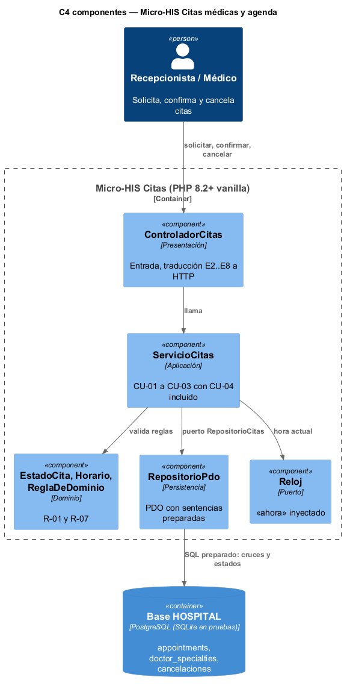
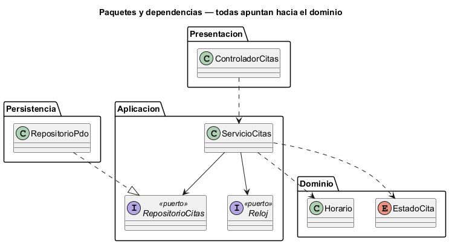

# Semana 3 — Vista arquitectónica del Micro-HIS Citas médicas y agenda

| | |
|---|---|
| **Tarea Odoo** | 2460 — Semana 3: Diseño arquitectónico, vistas y patrones |
| **Flujo** | «Solicitud, validación de disponibilidad y confirmación o cancelación de cita» (semanas [1](../semana-01/semana-01-uml-citas.md) y [2](../semana-02/semana-02-dip-requerimientos-diseno.md)) |
| **Código** | [`micro-his-citas/`](../micro-his-citas/): PHP 8.2+ vanilla, sin framework |
| **Estudiante** | Josué David Morales Ramírez |

## 1. Decisiones arquitectónicas

| Decisión | Por qué |
|---|---|
| Cuatro capas: Presentación, Aplicación, Dominio y Persistencia | Lo pide el enunciado; cada capa tiene una sola razón para cambiar. |
| Dominio sin dependencias: `EstadoCita` (R-07) y `Horario` (R-01) | Las reglas de la agenda se prueban sin base ni HTTP. |
| Puertos `RepositorioCitas` y `Reloj` en Aplicación | Continúa el DIP de la semana 2: la base y la hora se inyectan. |
| Detección de cruces en SQL preparado, con intervalos `[inicio, fin)` | Igual que la exclusión `gist` del esquema real; en PostgreSQL ella es la última barrera. |
| `UPDATE … WHERE status = ?` y cancelación con su motivo en la misma transacción | Concurrencia optimista (E7) y trazabilidad de R-10. |

## 2. Vista C4 de componentes y regla de dependencias

 

| Componente | Capa | Responsabilidad | Depende de |
|---|---|---|---|
| `ControladorCitas` | Presentación | Recibir la petición y traducir E2–E8 a HTTP | `ServicioCitas` |
| `ServicioCitas` | Aplicación | CU-01 a CU-03, con la validación de disponibilidad | Dominio y los puertos |
| `EstadoCita`, `Horario` | Dominio | Transiciones y horario válido | Nada |
| `RepositorioPdo` | Persistencia | Cruces, altas y cambios de estado con PDO | Puerto `RepositorioCitas` |

## 3. Pruebas y evidencia

`php docs/modulos/citas-medicas/micro-his-citas/pruebas/pruebas.php` → [`evidencia/salida-pruebas.txt`](evidencia/salida-pruebas.txt) (17/17, exit 0).

| Tipo pedido | Cómo se prueba | Resultado |
|---|---|---|
| Camino feliz | Base SQLite de prueba: solicitar → confirmar → cancelar con motivo → el horario liberado se reutiliza | 5/5 |
| Regla de dominio | Pasado (E2), especialidad no vigente (E3), médico ocupado (E4), paciente ocupado (E5), cancelar dos veces (E7) | 5/5 |
| Error de persistencia | Doble con la base caída y `PDOException` real (tabla borrada): 503 sin detalles técnicos | 2/2 |
| Dependencias y SQL | Ninguna capa apunta hacia afuera; ninguna consulta concatena variables | 5/5 |

En una prueba de mutación se quitó «no agendar en el pasado» en una copia del dominio, y las pruebas fallaron (exit 1).

**Limitaciones:** el horario de atención del médico sigue fuera del alcance (supuesto de la semana 1); SQLite reemplaza a PostgreSQL en las pruebas. **Siguiente:** MVC con Repository (semana 4).

**Bibliografía:** Brown, S. (2018). *The C4 model*. https://c4model.com · Martin, R. C. (2018). *Clean Architecture*. Prentice Hall.
