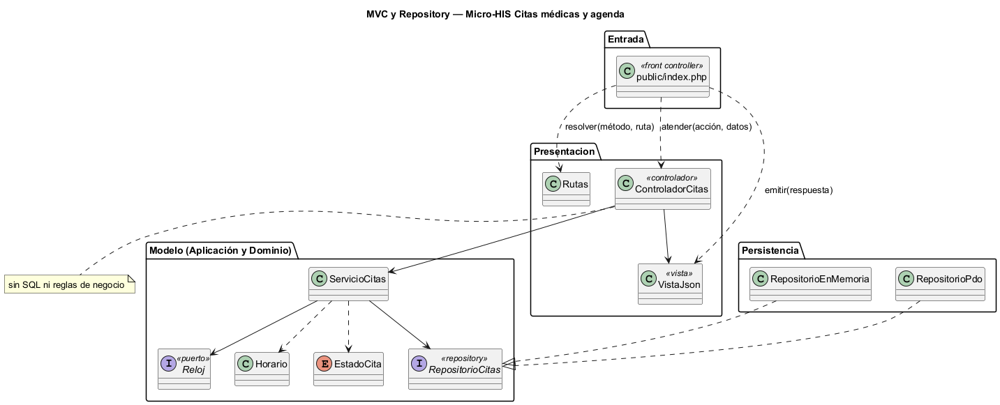
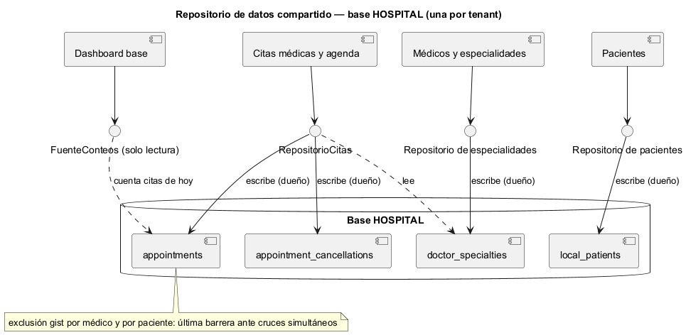

# Semana 4 — MVC, Repository y repositorio de datos compartido en el Micro-HIS Citas médicas y agenda

| | |
|---|---|
| **Tarea Odoo** | 2461 — Semana 4: Arquitectura en capas y patrón repositorio |
| **Flujo** | «Solicitud, validación de disponibilidad y confirmación o cancelación de cita» (mismo Micro-HIS de la [Semana 3](../semana-03/semana-03-arquitectura-micro-his.md)) |
| **Código** | [`micro-his-citas/`](../micro-his-citas/): PHP 8.2+ vanilla, sin framework |
| **Estudiante** | Josué David Morales Ramírez |

## 1. Entrada organizada con MVC

| Pieza | Archivo | Responsabilidad |
|---|---|---|
| Front controller | `public/index.php` | Único punto de entrada HTTP: resuelve la ruta, inyecta el reloj del sistema y emite la respuesta. |
| Rutas | `Presentacion/Rutas.php` | `POST /citas`, `POST /citas/{id}/confirmacion` y `POST /citas/{id}/cancelacion` → acción e id. |
| Controlador | `Presentacion/ControladorCitas.php` | Elige el caso de uso y entrega el resultado a la vista. **Sin SQL ni reglas de negocio** (lo comprueba una prueba). |
| Vista | `Presentacion/VistaJson.php` | Única dueña de los códigos HTTP y de los textos al usuario (E2–E8); antes esa tabla estaba en el controlador. |
| Modelo | `Aplicacion/ServicioCitas.php` + `Dominio/Cita.php` | Casos de uso y reglas R-01 a R-10; sin cambios respecto a la Semana 3. |

## 2. Interfaz Repository en el límite y sus adaptadores

`RepositorioCitas` vive en **Aplicación**, junto al puerto `Reloj`: el caso de uso define qué necesita (especialidad vigente, cruces, alta y cambio de estado con concurrencia optimista) y la persistencia lo cumple. El modelo no depende de PDO (DIP de la semana 2).

| Adaptador | Para qué | Cómo cumple el contrato |
|---|---|---|
| `RepositorioPdo` | Producción (PostgreSQL) y pruebas (SQLite) | Cruces con `starts_at < fin AND ends_at > inicio`, `UPDATE … WHERE status = ?` y cancelación con motivo en una transacción. |
| `RepositorioEnMemoria` | Pruebas y demos sin base | La misma comparación de intervalos semiabiertos `[inicio, fin)`, el médico informado antes que el paciente y la misma concurrencia optimista. |

Las pruebas corren **el mismo guion** contra los dos adaptadores (9 + 9), incluida la regla de contrato: `[2000,3000)` y `[3000,4000)` no se cruzan, y cambiar desde un estado viejo devuelve `false`.

## 3. Capas, responsabilidades y objetos reutilizables

| Capa | Objetos | Responsabilidad | Reutilizable en |
|---|---|---|---|
| Dominio | `Horario`, `EstadoCita`, `ReglaDeDominio` | Horario futuro y semiabierto (R-01) y transiciones de la cita (R-07) | Cualquier agenda del HIS (laboratorio, quirófano) que reserve intervalos |
| Aplicación | `ServicioCitas`, puertos `RepositorioCitas` y `Reloj`, `ErrorPersistencia` | CU-01 a CU-04 | Cualquier entrada (HTTP, consola o recordatorios programados) |
| Persistencia | `RepositorioPdo`, `RepositorioEnMemoria` | Guardar y consultar citas | `RepositorioEnMemoria` como doble para el dashboard base, que cuenta las citas del día |
| Presentación | `Rutas`, `ControladorCitas`, `VistaJson` | Entrada y salida HTTP | El mismo patrón de los demás Micro-HIS |

## 4. Cómo lo integraría un repositorio de datos compartido

En el estilo de **repositorio de datos compartido**, los módulos se coordinan a través de un almacén común en lugar de llamarse entre sí. Para Citas, ese almacén es la base HOSPITAL del tenant, cuyo esquema controlan las migraciones de `database/migrations/hospital/`.

| Decisión | Regla propuesta |
|---|---|
| Dueño de cada dato | Citas es el único que escribe `appointments` y las cancelaciones; Médicos y especialidades escribe `doctor_specialties`; Pacientes escribe `local_patients`. Citas solo lee esas dos. |
| Acceso | Cada módulo entra por su propia interfaz Repository; el dashboard base solo cuenta citas con su puerto de lectura. |
| Concurrencia | La consulta de cruces es la primera barrera; en PostgreSQL la exclusión `gist` de `appointments` es la última ante dos solicitudes simultáneas. |
| Esquema | Un cambio en `appointments.status` exige revisar a los lectores (dashboard base y expediente). |
| Aislamiento | Una base por hospital: nunca se mezclan agendas de tenants distintos. |

**Ventajas:** un solo dato de verdad sobre la agenda y módulos que no se conocen entre sí. **Riesgos:** acoplamiento al esquema y contención en horas pico; se mitigan con un solo dueño por tabla, la exclusión `gist` y transacciones cortas. Como el modelo solo conoce `RepositorioCitas`, pasar después a una API o a eventos no toca los casos de uso.

## 5. Evidencia

`php docs/modulos/citas-medicas/micro-his-citas/pruebas/pruebas.php` → [`evidencia/salida-pruebas.txt`](evidencia/salida-pruebas.txt) (28/28, exit 0). Prueba HTTP real con `php -S` y `curl` → [`evidencia/salida-http.txt`](evidencia/salida-http.txt). En una prueba de mutación se trató el fin de la cita como incluido en una copia de `RepositorioEnMemoria`, y la prueba de contrato falló (exit 1). **Limitaciones:** sin autenticación ni RBAC en la entrada; no hay consulta de agenda (`GET`); el horario de atención del médico sigue fuera del alcance. **Bibliografía:** Pressman, R. S. y Maxim, B. R. (2020). *Ingeniería del software* (9.ª ed.), cap. de diseño arquitectónico. McGraw-Hill · Fowler, M. (2002). *Patterns of Enterprise Application Architecture* (Repository, Front Controller). Addison-Wesley.
