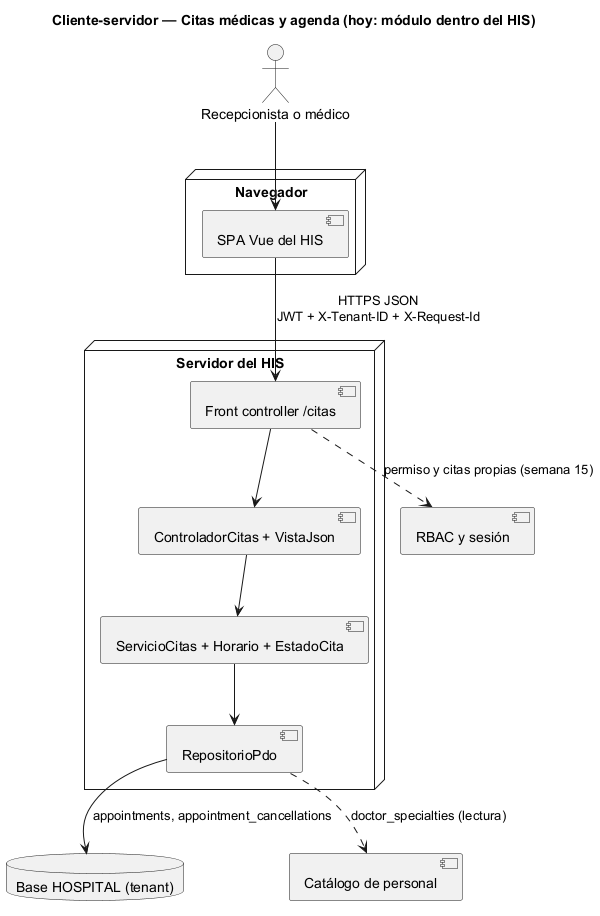
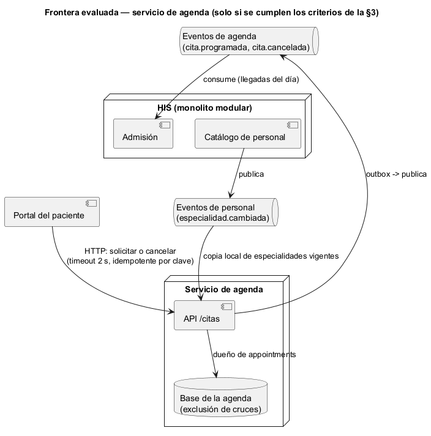

# Semana 5 — Cliente-servidor, contrato API y frontera de microservicio de Citas médicas y agenda

| | |
|---|---|
| **Tarea Odoo** | 2462 — Semana 5: Cliente-servidor, API REST, microservicios e integración |
| **Flujo** | «Solicitud, validación de disponibilidad y confirmación o cancelación de cita» (mismo Micro-HIS de las [semanas 3](../semana-03/semana-03-arquitectura-micro-his.md) y [4](../semana-04/semana-04-mvc-repository.md)) |
| **Contrato** | [api/openapi.yaml](api/openapi.yaml) (OpenAPI 3.1, validado con Redocly) |
| **Estudiante** | Josué David Morales Ramírez |

## 1. Diseño cliente-servidor

El cliente es la SPA del HIS en el navegador y el servidor es el Micro-HIS detrás de su front controller. Hablan solo por HTTPS con JSON. El cliente manda la intención (solicitar, confirmar o cancelar) y muestra el código y el mensaje que decide la vista. La disponibilidad la valida siempre el servidor: el cliente nunca decide si un horario está libre.

## 2. Contrato API

| Método | Ruta | Caso de uso | Éxito | Errores documentados |
|---|---|---|---|---|
| POST | `/citas` | CU-01 solicitar, con CU-04 | 201 `{id}` | 409 E4 médico ocupado o E5 paciente ocupado, 422 E2 datos o E3 especialidad, 503 E8 |
| POST | `/citas/{id}/confirmacion` | CU-02 confirmar | 200 | 404 NF, 422 E7 estado, 503 E8 |
| POST | `/citas/{id}/cancelacion` | CU-03 cancelar con motivo | 200 | 404 NF, 422 E2 sin motivo o E7 estado, 503 E8 |

Cada error responde `{"error", "mensaje"}` sin detalles técnicos. Las rutas son las que ya implementa la semana 4. Confirmar y cancelar son `POST` sobre un subrecurso, porque crean un hecho (la confirmación, la cancelación con su motivo), no editan la cita. **E6** («otra persona tomó el horario», 409) sigue pendiente: es el hallazgo H-02 de la semana 13, y el contrato lo declara así. **Prueba de contrato:** [verificar-contrato.php](evidencia/verificar-contrato.php) hace pasar 10 escenarios por las rutas y el controlador reales. Comprueba que cada respuesta esté documentada y que las 3 operaciones coincidan con las acciones del controlador ([salida](evidencia/salida-contrato.txt)).

## 3. Frontera de microservicio: evaluación con criterios medibles

La frontera candidata es un **servicio de agenda**, dueño de `appointments`. Es el módulo con más motivos para separarse algún día: la disponibilidad la consultaría también un portal del paciente, y la concurrencia se resuelve mejor con una base que tenga su propia exclusión de cruces. Pero dividir solo tiene sentido si un criterio medible lo pide:

| Criterio para extraerlo | Umbral | Valor hoy | ¿Lo pide? |
|---|---|---|---|
| Despliegue independiente: cambios de la agenda frenados por otros módulos | Más de 1 por mes | 0: ninguno de los 9 PR del módulo integrados en `develop` esperó un cambio de otro módulo | No |
| Clientes externos al HIS (portal del paciente, otra institución) | Al menos 1 en producción | 0: el portal no existe todavía | No |
| Contención por horarios: 409 E4 o E5 sobre el total de solicitudes | Más del 5 % sostenido | Sin datos de producción | No |
| Equipo propio que lo mantenga | Al menos 1 equipo aparte | 1 estudiante, el mismo de los otros módulos | No |

**Decisión:** la agenda sigue como **módulo del monolito**, con su frontera ya marcada por la interfaz Repository de la semana 4. El primer criterio que se cumpla, probablemente el portal del paciente, dispara la migración de la §5.

## 4. Si se extrae: propiedad, comunicación, seguridad, resiliencia, observabilidad y consistencia

| Aspecto | Decisión |
|---|---|
| Propiedad de datos | La agenda es la única que escribe `appointments` y sus cancelaciones. Las especialidades vigentes siguen siendo del catálogo de personal; la agenda guarda una copia de solo lectura. |
| Comunicación | Síncrona (HTTP) para solicitar, confirmar y cancelar, que necesitan respuesta. Asíncrona para avisar (`cita.programada`, `cita.cancelada`) y para recibir `especialidad.cambiada`. |
| Seguridad | JWT y `X-Tenant-ID` en cada petición (RNF-01); el médico solo cancela sus citas (R-09); la agenda filtra siempre por hospital. |
| Resiliencia | Timeout de 2 s en el cliente; reintento de `POST /citas` solo con una clave de idempotencia, para no crear dos citas; si la agenda cae, 503 E8 y nadie agenda a ciegas. |
| Observabilidad | `X-Request-Id` de punta a punta, log con el código de error y métricas de 409 E4, E5 y E6, que miden la contención por horarios (el criterio de la §3). |
| Consistencia | La exclusión de cruces en la base de la agenda es la barrera final (RNF-04), traducida a 409 E6. Hay outbox para los eventos, y la copia de especialidades es eventual: una especialidad vencida hace segundos podría aceptarse, y la agenda vuelve a validarla al confirmar. |

## 5. Migración razonada (si un criterio de la §3 se cumple)

1. **Contrato primero:** congelar `openapi.yaml` y su prueba de contrato en el CI. Ya está hecho en esta entrega.
2. **Cerrar E6 antes de mover nada:** con la barrera de la base y su 409, una carrera se ve igual dentro y fuera del monolito.
3. **Copia de especialidades:** el catálogo de personal publica `especialidad.cambiada`, y la agenda deja de leer `doctor_specialties`.
4. **Extracción (*strangler fig*):** se mueve el módulo a su servicio con su base y el monolito redirige `/citas`. La salida se mide con la prueba de contrato en verde y la tasa de 409 sin cambios.
5. **Reversa:** si el p95 de `POST /citas` sube más de 300 ms o aparece una cita doble, se vuelve al módulo en proceso.

## 6. Plan de issue, rama, worktree y PR

| Paso | Valor |
|---|---|
| Issue | «Semana 5: Citas — contrato API y frontera de microservicio»; criterios de aceptación: lint sin errores, prueba de contrato en verde, decisión con criterios medibles. |
| Rama | `semana-5-citas-medicas`, desde `origin/develop` actualizado. |
| Worktree | `git worktree add ../wt-citas-s5 -b semana-5-citas-medicas origin/develop`. Aísla la tarea sin cambiar de rama en la copia principal. Para esta entrega se usó una rama normal, porque había una sola tarea activa. |
| PR | Hacia `develop`, 1 commit, máximo 400 líneas, con la plantilla del repositorio, la salida del lint y de la prueba de contrato, y la revisión pedida al revisor asignado. |

**Evidencia:** [salida del lint](evidencia/salida-lint-openapi.txt) (`npx @redocly/cli@1.34.3 lint`, sin errores ni avisos) y [salida de la prueba de contrato](evidencia/salida-contrato.txt) (12 de 12). **Bibliografía:** Newman, S. (2021). *Building Microservices* (2.ª ed.). O'Reilly · Fowler, M. (2004). *StranglerFigApplication*. martinfowler.com · OpenAPI Initiative (2021). *OpenAPI Specification 3.1.0*.
