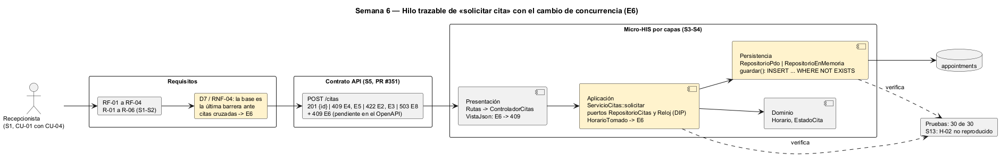

# Semana 6 — Defensa de la arquitectura de Citas médicas y agenda

| | |
|---|---|
| **Tarea Odoo** | 2463 — Semana 6: Primera evaluación parcial |
| **Flujo** | «Solicitud, validación de disponibilidad y confirmación o cancelación de cita» |
| **Presentación** | [semana-06-diapositivas.md](semana-06-diapositivas.md) (8 diapositivas) |
| **Estudiante** | Josué David Morales Ramírez |

## 1. Hilo trazable

Un solo hilo conecta las semanas 1 a 5. La recepcionista pide CU-01, que incluye CU-04 (validar disponibilidad). RF-01 a RF-04 y R-01 a R-06 fijan las reglas, `POST /citas` expone la operación, y cada capa del Micro-HIS cumple una parte. En amarillo está lo que añade el cambio práctico (§3).

## 2. Matriz decisión → evidencia

| # | Decisión | Por qué | RF/RNF | Evidencia verificable |
|---|---|---|---|---|
| D-01 | Dos actores (recepcionista y médico); el paciente no es actor porque no hay portal | El sistema lo usa quien agenda | RF-01, RF-05 | [Casos de uso S1](../semana-01/semana-01-uml-citas.md) |
| D-02 | **DIP**: el servicio depende de los puertos `RepositorioCitas` y `Reloj` | La política no cambia con la base ni con la hora real | RNF-02, RNF-03 | [Antes/después S2](../semana-02/semana-02-dip-requerimientos-diseno.md); «ahora» fijo en las pruebas |
| D-03 | Cuatro capas; el dominio (`Horario`, `EstadoCita`) no tiene dependencias | Las reglas se prueban sin base ni HTTP | RNF-03 | [S3](../semana-03/semana-03-arquitectura-micro-his.md); 4 pruebas «dependencias: …» |
| D-04 | MVC: el controlador solo elige el caso de uso; `VistaJson` es dueña de los HTTP | Errores con un código fijo | RF-02, RF-03 | [S4](../semana-04/semana-04-mvc-repository.md); prueba «el controlador no tiene SQL…» |
| D-05 | Repository con adaptadores PDO e InMemory y el mismo guion | Probar sin base y cambiar de motor | RNF-02 | 10 pruebas por adaptador en [salida-pruebas.txt](evidencia/salida-pruebas.txt) |
| D-06 | Confirmar y cancelar con `UPDATE … WHERE status = ?` → E7 | Dos personas no cambian la misma cita a la vez | RF-05 | Prueba «cambiar desde un estado viejo devuelve false» |
| D-07 | Contrato OpenAPI con prueba de contrato | El documento y el código no se separan | RF-01 a RF-05 | S5, PR #351 (abierto): lint sin avisos, contrato 12 de 12 |
| D-08 | Cambio práctico: la barrera de cruces va dentro del `INSERT` → `HorarioTomado` → 409 E6 | Cierra D7 de la S1 y el hallazgo H-02 de la S13 | RNF-04 | §3; prueba «cambio S6» por adaptador |

## 3. Registro del cambio práctico defendido

**Solicitud:** «Dos recepcionistas piden el mismo horario del mismo médico al mismo tiempo; solo una puede quedarse con él, y la otra debe recibir un aviso claro.» Es el paso D7 de la actividad de la S1 («¿la base aceptó la cita?», E6) y el hallazgo H-02 de la revisión técnica de la S13. Hasta ahora no estaban implementados: se consultaban los cruces y después se insertaba, sin barrera en medio.

| Capa | Qué cambió | Qué no cambió |
|---|---|---|
| Aplicación | Nueva excepción `HorarioTomado` en el puerto; `solicitar` la traduce a `ReglaDeDominio('E6')`. | La firma de `guardar` y el orden E2, E3, E4 y E5. |
| Persistencia | PDO: `INSERT … SELECT … WHERE NOT EXISTS` con la misma condición de cruce, en una sola sentencia; si no inserta, lanza `HorarioTomado`. InMemory aplica la misma barrera. | `cruce()`, que sigue dando E4 y E5 con el motivo exacto. |
| Presentación | `VistaJson` traduce E6 → 409. | Rutas y controlador: el contrato no suma operaciones. |
| Dominio | Nada. | `Horario` y `EstadoCita`. |

| Escenario: una segunda solicitud intercalada entre la consulta y el `INSERT` | [Antes](evidencia/salida-concurrencia-antes.txt) | [Después](evidencia/salida-concurrencia-despues.txt) |
|---|---|---|
| La solicitud que empezó primero (p1) | 201 | **409 E6** |
| La segunda, intercalada (p2) | 201 | 201 |
| Citas activas de m1 en [5000, 6000) | **2** (se viola R-02) | 1 |

El mismo resultado se ve con PDO y con InMemory. Las pruebas pasan de 28 a 30, y el script de la S13 ahora da **H-02 «no reproducido»**.

**Riesgo defendido:** el `INSERT … WHERE NOT EXISTS` es atómico en SQLite, que serializa las escrituras. En el PostgreSQL real la barrera definitiva es la exclusión `gist` (`appointments_doctor_active_period_exclusion`, RNF-04); su violación debe traducirse a `HorarioTomado` en el adaptador de producción.

## 4. Evidencia y bibliografía

[probar-concurrencia.php](evidencia/probar-concurrencia.php) se corrió antes y después del cambio. [salida-pruebas.txt](evidencia/salida-pruebas.txt) muestra las 30 pruebas en verde. El diagrama se generó con PlantUML local (`-charset UTF-8`).

**Bibliografía:** Martin, R. C. (2017). *Clean Architecture*. Prentice Hall · Kleppmann, M. (2017). *Designing Data-Intensive Applications*, cap. 7 (write skew y condiciones de carrera). O'Reilly.
