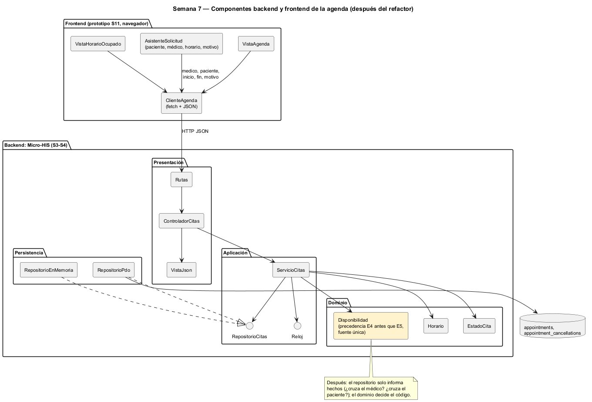

# Semana 7 — Componentes y refactorización de Citas médicas y agenda

| | |
|---|---|
| **Tarea Odoo** | 2464 — Semana 7: Diseño de componentes y refactorización |
| **Flujo** | «Solicitud, validación de disponibilidad y confirmación o cancelación de cita» |
| **Base** | Micro-HIS de las semanas 3 y 4, contrato de la [semana 5](../semana-05/semana-05-cliente-servidor.md) y prototipo de la [semana 11](../semana-11/semana-11-prototipo.md) |
| **Estudiante** | Josué David Morales Ramírez |

## 1. Componentes backend y frontend

| Componente | Lado | Responsabilidad única | Depende de |
|---|---|---|---|
| `VistaAgenda` | Frontend | Mostrar las citas del día; el médico solo ve las suyas (R-09) | `ClienteAgenda` |
| `AsistenteSolicitud` | Frontend | Pasos paciente → médico → horario → motivo (R-06) | `ClienteAgenda` |
| `VistaHorarioOcupado` | Frontend | Explicar el 409 y ofrecer los siguientes horarios, conservando el motivo | `ClienteAgenda` |
| `ClienteAgenda` | Frontend | Hablar HTTP y JSON con el contrato de la S5 | Contrato API |
| `Rutas`, `ControladorCitas`, `VistaJson` | Backend: Presentación | Ruta → acción → caso de uso → respuesta HTTP | `ServicioCitas` |
| `ServicioCitas` | Backend: Aplicación | Orden de CU-01 (con CU-04), CU-02 y CU-03 | Puertos `RepositorioCitas` y `Reloj`, dominio |
| `Horario`, `EstadoCita`, `ReglaDeDominio` | Backend: Dominio | R-01 (horario futuro), R-07 (transiciones) y los códigos | Nada |
| `RepositorioPdo`, `RepositorioEnMemoria` | Backend: Persistencia | Implementar el puerto | `RepositorioCitas` |

## 2. Contratos de entrada y salida

| Contrato | Entrada | Salida | Errores |
|---|---|---|---|
| HTTP `POST /citas` | `{medico, paciente, especialidad, inicio, fin, motivo}` | 201 `{id}` | 409 E4 o E5, 422 E2 o E3, 503 E8 |
| HTTP `POST /citas/{id}/confirmacion` | — | 200 | 404 NF, 422 E7, 503 E8 |
| HTTP `POST /citas/{id}/cancelacion` | `{motivo}` | 200 | 404 NF, 422 E2 o E7, 503 E8 |
| `ControladorCitas::atender` | acción, datos | `['status', 'id'?, 'error'?, 'mensaje'?]` | Nunca lanza: traduce a la vista |
| `ServicioCitas::solicitar` | médico, paciente, especialidad, inicio, fin, motivo | id de la cita | `ReglaDeDominio` E2 a E5 |
| `RepositorioCitas::cruce` | médico, paciente, inicio, fin | `'medico'`, `'paciente'` o `null` | `ErrorPersistencia` |
| `RepositorioCitas::cambiarEstado` | id, de, a, motivo | `bool` (false = E7) | `ErrorPersistencia` |
| `Horario::validar` · `EstadoCita::validarCambioA` | inicio, fin, ahora · destino | `Horario` · `void` | E2 · E7 |

## 3. El punto con mayor acoplamiento

[medir-acoplamiento.php](evidencia/medir-acoplamiento.php) cuenta, para cada tipo propio, cuántos usa (Ce) y cuántos lo usan (Ca) ([salida](evidencia/salida-acoplamiento.txt)). El máximo es **`ServicioCitas`, con Ce 5 y Ca 1**: usa el repositorio, el reloj, `ReglaDeDominio`, `Horario` y `EstadoCita`. Dentro de él, el acoplamiento que cruza capas es la **disponibilidad** (CU-04):

| Lugar | Qué decide | Problema |
|---|---|---|
| `RepositorioPdo::cruce` | `ORDER BY del_medico DESC`: si cruzan médico y paciente, informa primero al médico | Una regla de negocio (qué conflicto se informa) escrita en SQL |
| `RepositorioEnMemoria::cruce` | Lo mismo con un `if`, y el comentario «el médico se informa primero, como en PDO» | La misma regla copiada en el otro adaptador |
| `ServicioCitas::solicitar` | Traduce los textos `'medico'` y `'paciente'` a E4 y E5 | Protocolo de texto: los tres lugares deben escribir igual las mismas cadenas |

Si mañana se decide informar los dos cruces, o informar primero al paciente, hay que cambiar 3 archivos de 2 capas y mantener los dos adaptadores idénticos a mano.

## 4. Refactor concreto: antes y después

| | Antes | Después |
|---|---|---|
| Persistencia | `cruce(): ?string` con la precedencia en `ORDER BY` y en un `if` | `cruces(): array{medico: bool, paciente: bool}`: solo hechos, sin orden ni códigos |
| Dominio | — | `Disponibilidad::verificar(array $cruces): void`, que lanza E4 si cruza el médico y si no E5: la precedencia vive una vez |
| Aplicación | `if ($cruce === 'medico') … if ($cruce === 'paciente') …` | `Disponibilidad::verificar($this->repo->cruces(…))` |
| Archivos a tocar si cambia la precedencia | 3 (2 adaptadores y el servicio) | 1 (`Disponibilidad`) |
| Cadenas mágicas entre capas | `'medico'`, `'paciente'` | Ninguna: claves de un arreglo tipado |

**Justificación:**
- Aplica SRP y DIP: la persistencia responde «qué hay en la base», y el dominio decide «qué le digo al usuario».
- Los adaptadores se vuelven más simples y más parecidos entre sí, que es lo que necesita el contrato del Repository.
- No amplía el módulo: los errores, las rutas y el contrato son los mismos.
- La red de seguridad ya existe: las pruebas «médico ocupado = 409 E4» y «paciente ocupado = 409 E5» corren con los dos adaptadores.
- La barrera de concurrencia de la semana 6 (E6, PR #435) no cambia: sigue en el `INSERT`.
- Es un refactor conceptual, como pide el enunciado: no cambia el código de esta entrega.

## 5. Evidencia y bibliografía

[salida-acoplamiento.txt](evidencia/salida-acoplamiento.txt) se midió sobre `develop` en `402fd68`. El diagrama se generó con PlantUML local (`-charset UTF-8`).

**Bibliografía:** Martin, R. C. (2017). *Clean Architecture*, caps. 13 y 14. Prentice Hall · Fowler, M. (2018). *Refactoring* (2.ª ed.), «Replace Primitive with Object». Addison-Wesley.
