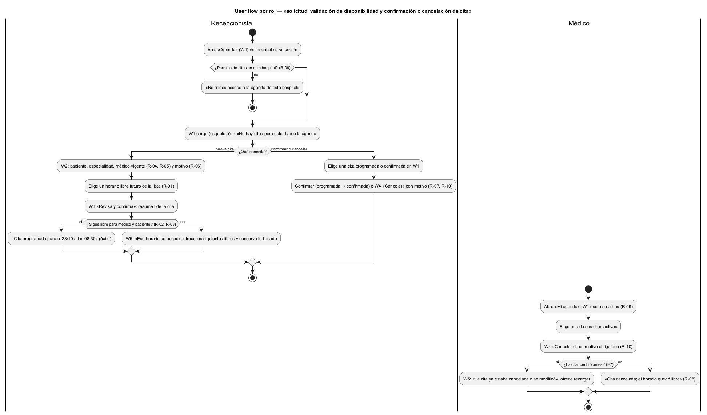

# Semana 8 — Flujo UX de «solicitud, validación de disponibilidad y confirmación o cancelación de cita»

| | |
|---|---|
| **Tarea Odoo** | 2465 — Semana 8: Diseño de experiencia de usuario |
| **Módulo** | Citas médicas y agenda |
| **Base** | Actores y reglas R-01 a R-10 de la [Semana 1](../semana-01/semana-01-uml-citas.md); códigos de error E2–E8 del Micro-HIS ([Semana 3](../semana-03/semana-03-arquitectura-micro-his.md)) |
| **Estudiante** | Josué David Morales Ramírez |

## 1. Roles autorizados y lo que ve cada uno

| Rol | Puede | No ve |
|---|---|---|
| Recepcionista | Solicitar, confirmar y cancelar citas en nombre del paciente | — |
| Médico | Ver «Mi agenda» y cancelar sus propias citas (R-09) | Las citas de otros médicos y los botones «Nueva cita» y «Confirmar» |
| Sin permiso de citas en el hospital (R-09) | Nada | La pantalla: ve «No tienes acceso a la agenda de este hospital» |

El paciente no usa el sistema: la recepcionista actúa por él (semana 1).

## 2. User flow por rol

Inicio: W1. Decisión: nueva cita, confirmar o cancelar. Confirmación: W3 antes de agendar y W4 antes de cancelar. Salida: mensaje de éxito o un error que se puede recuperar (W5).

## 3. Wireframes anotados

| W | Pantalla | Estados | Mensajes | Validaciones | Reglas de interacción |
|---|---|---|---|---|---|
| [W1](diagramas/semana-08-wf1-agenda.png) | Agenda del día | Carga: filas de esqueleto. Vacío: «No hay citas para este día». Resumen: tabla por hora con estado | Estado de cada cita en palabras (Programada, Confirmada, Cancelada) | Día y médico como filtros | Solo se ofrecen las acciones válidas para el estado (R-07): una cancelada no tiene botones |
| [W2](diagramas/semana-08-wf2-nueva-cita.png) | Nueva cita | Formulario → buscando horarios (indicador) → lista de horarios libres o «No hay horarios libres esta semana» | «El médico no tiene esa especialidad vigente» (E3); «El motivo es obligatorio» (E2) | Médicos con especialidad vigente (R-04, R-05); solo horarios futuros (R-01) que ya excluyen cruces (R-02, R-03); motivo obligatorio (R-06) | Elegir especialidad filtra los médicos; elegir médico carga sus horarios; nada se guarda hasta W3 |
| [W3](diagramas/semana-08-wf3-confirmar-solicitud.png) | Revisa y confirma | Resumen → confirmando (botón deshabilitado) → «Cita programada para el 28/10 a las 08:30» | El resumen avisa que se vuelve a validar la disponibilidad | Nueva validación de cruces al confirmar | «Volver y editar» regresa a W2 con todo lo llenado |
| [W4](diagramas/semana-08-wf4-cancelar-cita.png) | Cancelar cita (confirmación) | Cita elegida → cancelando → «Cita cancelada; el horario quedó libre» | «El motivo de cancelación es obligatorio» (E2) | Motivo obligatorio (R-10); el médico solo sobre sus citas (R-09) | El botón por defecto es «No cancelar», para evitar cancelaciones por error |
| [W5](diagramas/semana-08-wf5-error-recuperable.png) | Errores recuperables | Horario tomado (E4/E5), cita ya cambiada (E7) o servicio no disponible (E8) | «Ese horario se ocupó mientras confirmabas»; «La agenda no está disponible» | — | Propone los siguientes horarios libres y conserva todo lo llenado; «Reintentar» reenvía; ningún mensaje muestra detalles técnicos |

## 4. Ayuda contextual

Cada formulario tiene «[?] Ayuda» y textos cortos junto al campo: por qué solo aparecen ciertos médicos, por qué no se ofrecen horarios pasados u ocupados, por qué se vuelve a validar al confirmar y para qué se guarda el motivo. La ayuda nunca tapa el formulario.

## 5. Protección de datos

- La agenda muestra código y nombre corto del paciente, nunca diagnósticos, notas clínicas ni datos de contacto.
- El médico solo ve sus propias citas; la recepción ve las del hospital de la sesión (`X-Tenant-ID`) y no hay selector para otro hospital.
- El buscador de pacientes pide al menos 3 letras y muestra pocos resultados, para no listar el padrón completo.
- El motivo de cancelación queda en la auditoría con usuario y fecha (R-10), pero la agenda no muestra quién canceló.
- No existe «Eliminar cita»: cancelar libera el horario y conserva la cita (R-08).

## 6. Trazabilidad y evidencia

| Regla | Dónde se aplica |
|---|---|
| R-01, R-02, R-03 | W2 (horarios libres futuros) y W3 (nueva validación al confirmar) |
| R-04, R-05, R-06 | W2: médicos vigentes y motivo obligatorio |
| R-07, R-08 | W1: acciones según estado; W4: cancelar sin borrar |
| R-09, R-10 | Inicio del user flow, «Mi agenda» del médico y motivo en W4 |

Fuentes editables en [`diagramas/`](diagramas/) (`.puml` con PlantUML Salt para los wireframes); los PNG se generaron con PlantUML local. Las pantallas siguen las rutas y errores del front controller propuesto en la semana 4 (PR #195, aún no integrado); si ese PR cambia, se ajustan los textos de los mensajes. La consulta de horarios libres de W2 es un supuesto de diseño: el Micro-HIS aún no la expone.

**Bibliografía:** Nielsen, J. (1994). *10 Usability Heuristics for User Interface Design*. Nielsen Norman Group · W3C (2023). *Web Content Accessibility Guidelines (WCAG) 2.2*.
