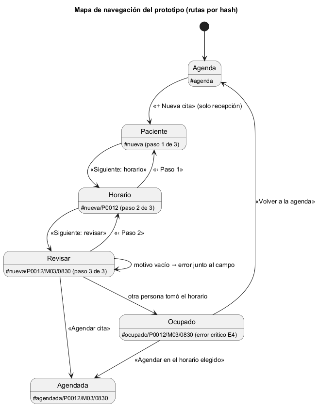

# Semana 11 — Prototipo navegable de Citas médicas y agenda

| | |
|---|---|
| **Tarea Odoo** | 2468 — Semana 11: Mejores prácticas para diseño móvil/web |
| **Módulo** | Citas médicas y agenda |
| **Base** | Flujo de la semana 8 (PR #203), backlog de la semana 9 (PR #209) y diseño móvil de la semana 10 (PR #226) |
| **Estudiante** | Josué David Morales Ramírez |

## 1. Prototipo y mapa de navegación

**Archivo:** [prototipo/index.html](prototipo/index.html). Se abre sin servidor; es HTML, CSS y JavaScript sin dependencias, con datos ficticios en memoria y sin conexión a la API. Flujo principal: «solicitud, validación de disponibilidad y confirmación de cita» en 3 pasos (semana 10). Cada paso lleva su estado en la ruta (`#nueva/P0012/M03/0830`), así que se puede recargar y «atrás» funciona. El **panel del prototipo**, al pie, cambia el rol y simula el error crítico.

## 2. Camino feliz y error crítico

| Paso | Escritorio (1280 px) | Móvil (360 px) | Qué se ve |
|---|---|---|---|
| 1. Agenda del día | [captura](capturas/escritorio/01-agenda.png) | [captura](capturas/movil/01-agenda.png) | Hora, paciente, médico y estado de cada cita |
| 2. Horario (el paso 1 elige al paciente) | [captura](capturas/escritorio/02-horario.png) | [captura](capturas/movil/02-horario.png) | Solo horarios libres; «3 horarios libres con Dra. Ruiz» se anuncia |
| 3. Revisar | [captura](capturas/escritorio/03-revisar.png) | [captura](capturas/movil/03-revisar.png) | Motivo y resumen; al confirmar se vuelve a revisar el horario |
| 4. **Camino feliz** | [captura](capturas/escritorio/04-cita-agendada.png) | [captura](capturas/movil/04-cita-agendada.png) | «Cita programada para el Mié 28/10 a las 08:30», y la cita aparece en la agenda |
| 5. **Error crítico** | [captura](capturas/escritorio/05-error-horario-ocupado.png) | [captura](capturas/movil/05-error-horario-ocupado.png) | Otra persona tomó el horario (concurrencia, E4): la cita no se agenda, el motivo se conserva y se ofrecen los siguientes horarios libres |

Es el error crítico porque toca la agenda médica, la disponibilidad y la confirmación: si se agendara, la Dra. Ruiz tendría dos citas cruzadas (R-02). La cancelación no entra en este recorrido; se diseñó en las semanas 8 y 10. Las capturas 4 y 5 salen de escribir el motivo y pulsar «Agendar cita», igual que un usuario.

## 3. Consistencia de roles, estados y accesibilidad

- **Roles:** solo recepción solicita citas. La médica ve solo sus citas y, si abre `#nueva`, vuelve a la agenda (R-09); se probó cambiando el rol en el panel.
- **Estados:** Programada, Confirmada y Cancelada, como en las semanas 8 a 10. Una cita nueva nace programada (R-07).
- **Accesibilidad:** `lang="es"` y un título por pantalla; foco en el `<h1>` y «Saltar al contenido»; anillo de foco de 2 px en `#2563eb` y objetivos de 44 px; horarios en un grupo con leyenda; el motivo vacío da «Error:» junto al campo, con `aria-invalid`, y el foco vuelve al campo. Nada en la interfaz dice «Cancelar» (semana 9, B-02).

## 4. Evidencia y validación

[capturar.mjs](evidencia/capturar.mjs) (el mismo script de la semana 11 de Catálogo) fija el ancho exacto con el protocolo DevTools de Edge, recorre las rutas, toma las capturas y mide el scroll horizontal. Su [salida](evidencia/salida-medicion.txt) da 15 de 15 mediciones sin scroll a 320, 360 y 430 px (WCAG 1.4.10), un título distinto por pantalla y el foco en `H1`. Controles: un bloque inyectado de 600 px marca «SÍ»; con el motivo vacío, el foco queda en el `TEXTAREA`; con el rol de médica, `#nueva` vuelve a la agenda.

**Bibliografía:** W3C (2023). *WCAG 2.2* · Chrome DevTools Protocol: `Emulation.setDeviceMetricsOverride`.
