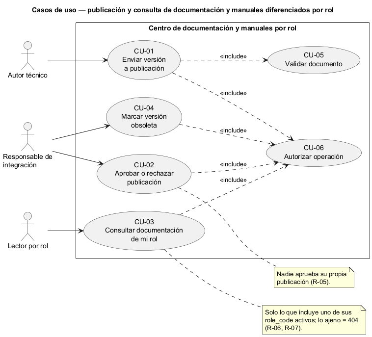
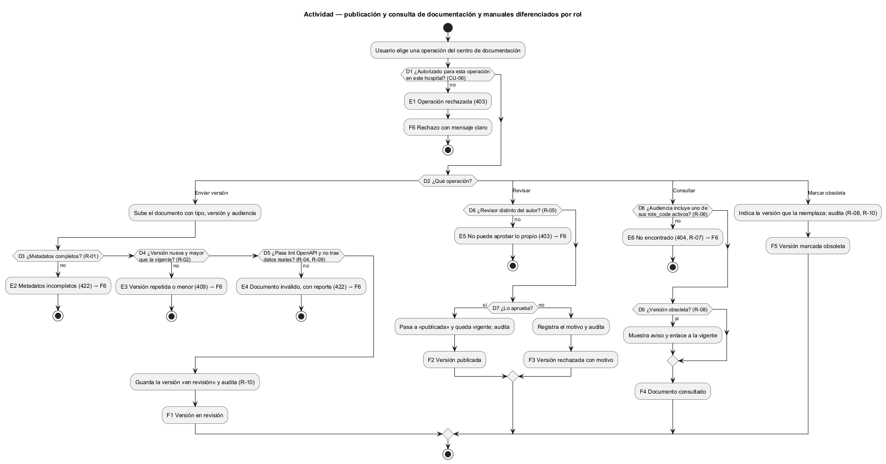
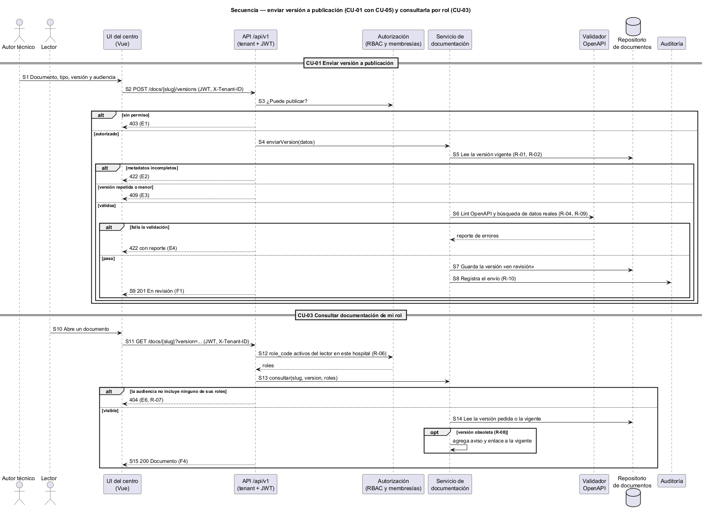

# Semana 1 — Modelado UML del centro de documentación y manuales por rol

| | |
|---|---|
| **Curso** | Análisis de Sistemas II — Proyecto Final 2026 |
| **Proyecto** | Sistema Hospitalario Integrado (HIS) |
| **Módulo** | Contratos API: OpenAPI/Postman y documentación técnica (adaptación: centro de documentación y manuales por rol) |
| **Tarea Odoo** | 2473 — Semana 1: Conceptos generales, orientación a objetos y UML |
| **Proceso modelado** | «Publicación y consulta de documentación y manuales diferenciados por rol» |
| **Estudiante** | Josué David Morales Ramírez (carné 1890-23-10545) |
| **Fecha** | Octubre 2026 |

## 1. Introducción

Cada módulo del HIS ya escribe su contrato (por ejemplo `docs/modulos/pacientes/micro-his-pacientes/api/openapi.yaml`), pero no hay un lugar único para publicarlo, versionarlo y entregarlo **a quien le corresponde**. Un médico necesita el manual de uso, no el contrato técnico; un integrador necesita la versión vigente y saber cuál quedó obsoleta. Las tres vistas UML comparten identificadores (CU, R, D, E, F, S) para trazarlas entre sí (§9).

## 2. Narrativa de alcance

| | |
|---|---|
| **Objetivo** | Publicar documentos versionados (OpenAPI, colección Postman o manual) con una audiencia por rol, revisados antes de publicarse, y que cada usuario consulte solo los suyos. |
| **Dentro del alcance** | Enviar una versión a publicación; validarla; aprobarla o rechazarla; consultar la documentación de mi rol; marcar una versión como obsoleta. |
| **Fuera del alcance** | Escribir el contenido de los contratos (lo hace cada módulo); ejecutar las colecciones Postman; generar documentación automática desde el código; traducciones. |
| **Supuestos** | El esquema no tiene tablas para documentos, así que el almacenamiento se define en la Semana 4. Los roles de audiencia son los `role_code` de `hospital_memberships` (base CENTRAL), que hoy son texto libre sin catálogo. Los endpoints son una propuesta; el contrato se formaliza en la Semana 5. |

## 3. Actores

| Actor | Tipo | Objetivo en el proceso |
|---|---|---|
| Autor técnico | Primario | Enviar una nueva versión de un contrato o manual de su módulo. |
| Responsable de integración | Primario | Revisar y aprobar o rechazar publicaciones, y marcar versiones obsoletas. |
| Lector por rol (personal clínico, administrador, integrador) | Primario | Consultar la documentación vigente que corresponde a sus roles. |

El validador de OpenAPI, la autorización (RBAC) y la auditoría son servicios internos: aparecen en la actividad y la secuencia, no como actores.

## 4. Reglas de negocio

| ID | Regla | Origen |
|---|---|---|
| R-01 | Todo documento tiene tipo (OpenAPI, Postman o manual), versión semántica y al menos un rol de audiencia. | Decisión de diseño |
| R-02 | La pareja documento-versión es única, y una versión nueva debe ser mayor que la vigente. | Decisión de diseño (versionado semántico) |
| R-03 | Una versión publicada no se edita: un cambio genera otra versión. | Decisión de diseño |
| R-04 | Un OpenAPI debe pasar la validación (lint) antes de ir a revisión. | Práctica del repo: `semana-05/evidencia/salida-lint-openapi.txt` en pacientes y rbac |
| R-05 | Nadie aprueba su propia publicación. | Separación de funciones |
| R-06 | Un lector solo ve documentos cuya audiencia incluye uno de sus `role_code` activos y vigentes en el hospital. | `hospital_memberships` (`status`, `valid_from`, `valid_to`) |
| R-07 | Un documento fuera de la audiencia responde 404, no 403, para no revelar que existe. | Decisión de diseño |
| R-08 | Las versiones no se borran: se marcan obsoletas, con enlace a la que las reemplaza. | Decisión de diseño |
| R-09 | Los ejemplos usan datos ficticios: nada de pacientes reales ni credenciales. | `README.md` (regla de datos ficticios) |
| R-10 | Enviar, aprobar, rechazar y marcar obsoleta quedan en la auditoría. | Módulo de auditoría |

## 5. Diagrama de casos de uso

Fuente editable: [diagramas/semana-01-casos-de-uso.puml](diagramas/semana-01-casos-de-uso.puml)

## 6. Especificación de casos de uso

| CU | Nombre | Actor | Flujo principal | Alternativas y excepciones | Reglas |
|---|---|---|---|---|---|
| CU-01 | Enviar versión a publicación | Autor técnico | Sube el documento con tipo, versión y audiencia; si es válido, queda «en revisión». | Metadatos incompletos (E2); versión repetida o menor (E3); no pasa la validación (E4). | R-01–R-04, R-09, R-10 |
| CU-02 | Aprobar o rechazar publicación | Responsable de integración | Revisa y aprueba (pasa a «publicada» y vigente) o rechaza con motivo. | Es su propia publicación (E5). | R-05, R-10 |
| CU-03 | Consultar documentación de mi rol | Lector por rol | Lista y abre los documentos de sus roles, en su versión vigente o en una anterior. | Fuera de su audiencia (E6); versión obsoleta: se muestra con aviso. | R-06–R-08 |
| CU-04 | Marcar versión obsoleta | Responsable de integración | Indica la versión que la reemplaza; la obsoleta sigue consultable con aviso. | — | R-08, R-10 |
| CU-05 | Validar documento (incluido) | — | Revisa metadatos, versión, lint de OpenAPI y ausencia de datos reales. | E2, E3, E4. | R-01, R-02, R-04, R-09 |
| CU-06 | Autorizar operación (incluido) | — | Verifica sesión, hospital y permiso según la operación. | E1. | R-06 |

**Relaciones:** CU-01 *incluye* CU-05. CU-01 a CU-04 *incluyen* CU-06.

## 7. Diagrama de actividad

Fuente editable: [diagramas/semana-01-actividad.puml](diagramas/semana-01-actividad.puml)

| Decisión | Pregunta | Si falla |
|---|---|---|
| D1 | ¿Autorizado para esta operación en este hospital? | E1 Operación rechazada (403) |
| D2 | ¿Qué operación: enviar, revisar, consultar o marcar obsoleta? | — |
| D3 | ¿Tipo, versión y audiencia completos? | E2 Metadatos incompletos (422) |
| D4 | ¿Versión nueva y mayor que la vigente? | E3 Versión repetida o menor (409) |
| D5 | ¿Pasa la validación (lint OpenAPI, sin datos reales)? | E4 Documento inválido, con reporte (422) |
| D6 | ¿El revisor es distinto del autor? | E5 No puede aprobar lo propio (403) |
| D7 | ¿Lo aprueba? | No → F3 rechazada con motivo |
| D8 | ¿Su audiencia incluye uno de los roles del lector? | E6 No encontrado (404) |
| D9 | ¿La versión pedida está obsoleta? | Sí → se muestra con aviso y enlace a la vigente |

**Resultados:** F1 versión en revisión · F2 versión publicada y vigente · F3 versión rechazada con motivo · F4 documento consultado · F5 versión marcada obsoleta · F6 operación rechazada con mensaje claro.

## 8. Diagrama de secuencia

Fuente editable: [diagramas/semana-01-secuencia.puml](diagramas/semana-01-secuencia.puml)

Participantes: Autor técnico, Lector, UI del centro de documentación (Vue), API `/api/v1`, Autorización (RBAC y membresías), Servicio de documentación, Validador OpenAPI, Repositorio de documentos y Auditoría.

| Paso | Mensaje | Validación o respuesta |
|---|---|---|
| S1–S3 | Documento y metadatos → `POST /docs/{slug}/versions`; RBAC: ¿puede publicar? | No → 403 |
| S4–S5 | Servicio valida metadatos y compara con la versión vigente | Incompletos → 422; repetida o menor → 409 |
| S6 | Validador: lint OpenAPI y búsqueda de datos reales | Falla → 422 con reporte |
| S7–S9 | Guarda la versión «en revisión», audita → 201 | — |
| S10–S12 | Lector abre un documento → `GET /docs/{slug}`; RBAC devuelve sus `role_code` activos | — |
| S13 | Servicio cruza audiencia y roles | Sin coincidencia → 404 |
| S14–S15 | Lee la versión pedida (con aviso si está obsoleta) → 200 | — |

## 9. Matriz de trazabilidad

| CU | Reglas | Actividad | Secuencia |
|---|---|---|---|
| CU-01 | R-01–R-04, R-09, R-10 | D1–D5, E1–E4, F1 | S1–S9 |
| CU-02 | R-05, R-10 | D1, D6, D7, E5, F2, F3 | (mismo patrón que S1–S3) |
| CU-03 | R-06–R-08 | D1, D8, D9, E6, F4 | S10–S15 |
| CU-04 | R-08, R-10 | D1, F5 | (mismo patrón que S1–S3) |
| CU-05 | R-01, R-02, R-04, R-09 | D3–D5, E2–E4 | S4–S6 |
| CU-06 | R-06 | D1, E1, F6 | S3, S12 |

## 10. Conclusión

El centro no escribe contratos: los recibe, los valida y decide quién los ve. Las tres decisiones clave son la revisión por otra persona (R-05), las versiones inmutables y nunca borradas (R-03, R-08) y la audiencia por `role_code` con 404 para lo ajeno (R-06, R-07). Falta definir dónde se guardan los documentos y un catálogo formal de roles.

## 11. Bibliografía

- Object Management Group. (2017). *Unified Modeling Language (UML) Version 2.5.1*. https://www.omg.org/spec/UML/2.5.1
- OpenAPI Initiative. (2021). *OpenAPI Specification v3.1.0*. https://spec.openapis.org/oas/v3.1.0
- Esquema CENTRAL del repositorio: `database/migrations/central/2026_08_11_000100_create_identity_and_memberships.php`.
