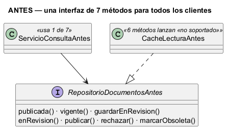
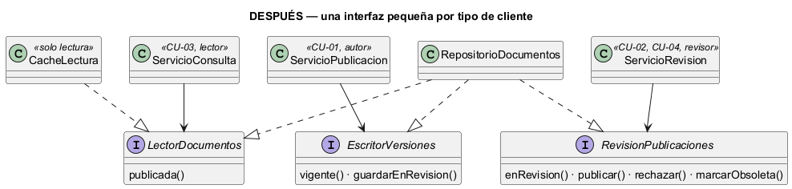

# Semana 2 — RF/RNF, criterios de aceptación e ISP en el centro de documentación por rol

| | |
|---|---|
| **Módulo** | Contratos API: OpenAPI/Postman y documentación técnica (adaptación: centro de documentación y manuales por rol) |
| **Tarea Odoo** | 2474 — Semana 2: Proceso y modelo de diseño; principios SOLID |
| **Flujo** | «Publicación y consulta de documentación y manuales diferenciados por rol» (modelado en la [Semana 1](../semana-01/semana-01-uml-documentacion-rol.md)) |
| **Principio aplicado** | ISP — principio de segregación de interfaces |
| **Estudiante** | Josué David Morales Ramírez |

## 1. Requerimientos funcionales

| ID | Requerimiento | Trazado a |
|---|---|---|
| RF-01 | Enviar una versión con tipo, versión semántica `x.y.z` y al menos un rol de audiencia; queda «en revisión». | CU-01, R-01 |
| RF-02 | Rechazar una versión igual o menor que la vigente. | CU-05, R-02 |
| RF-03 | Aprobar o rechazar una versión en revisión; el autor no puede aprobar la suya. | CU-02, R-05 |
| RF-04 | Consultar la versión vigente o una anterior, solo si la audiencia incluye uno de los roles del lector. | CU-03, R-06 |
| RF-05 | Responder 404 a un documento fuera de la audiencia o inexistente. | CU-03, R-07 |
| RF-06 | Marcar una versión como obsoleta sin borrarla; al consultarla se muestra un aviso. | CU-04, R-08 |

## 2. Requerimientos no funcionales

| ID | Requerimiento | Cómo se verifica |
|---|---|---|
| RNF-01 | Seguridad: la audiencia se cruza con los `role_code` activos del lector en el hospital. | Prueba de API en la Semana 15 |
| RNF-02 | Rendimiento: la consulta puede pasar por una caché de solo lectura sin tocar la lógica. | `verificar.php`: mismos resultados con `CacheLectura` |
| RNF-03 | Mantenibilidad: cada cliente depende solo de los métodos que usa. | `verificar.php`: reflexión (1, 2 y 4 métodos frente a 7) |
| RNF-04 | Confidencialidad: un 404 no revela si el documento existe. | `verificar.php`: CA-06 |
| RNF-05 | Trazabilidad: las versiones nunca se borran. | `verificar.php`: CA-07 |

## 3. Criterios de aceptación

| CA | Dado / Cuando / Entonces | RF | Evidencia |
|---|---|---|---|
| CA-01 | Cuando envío `guia-citas` 1.0.0 (o 1.1.0 sobre una vigente 1.0.0) con audiencia, entonces 201 en revisión. | RF-01 | `verificar.php` |
| CA-02 | Cuando envío una versión sin formato `x.y.z` o sin audiencia, entonces 422 (E2). | RF-01 | `verificar.php` |
| CA-03 | Dada la vigente 1.0.0, cuando envío otra 1.0.0, entonces 409 (E3). | RF-02 | `verificar.php` |
| CA-04 | Dada una versión de «ana», cuando «ana» la aprueba, entonces 403 (E5); cuando la aprueba «luis», entonces 200. | RF-03 | `verificar.php` |
| CA-05 | Dada la 1.1.0 publicada para «medico», cuando un médico consulta, entonces ve la 1.1.0. | RF-04 | `verificar.php` |
| CA-06 | Cuando consulta un rol fuera de la audiencia, o un documento inexistente, entonces 404. | RF-05 | `verificar.php` |
| CA-07 | Dada la 1.0.0 marcada obsoleta, cuando la consulto, entonces la veo con aviso: no se borró. | RF-06 | `verificar.php` |

## 4. ISP: diseño antes y después

**El problema (antes).** En [`ejemplo-isp/antes.php`](ejemplo-isp/antes.php) hay una sola interfaz, `RepositorioDocumentosAntes`, con 7 métodos para todos los clientes. La consulta por rol usa 1, pero depende de los 7: si cambia la firma de `rechazar()`, la consulta también se vuelve a compilar y a probar. Peor aún, una caché de solo lectura está obligada a «implementar» 6 métodos que solo lanzan «no soportado».



**La solución (después).** En [`ejemplo-isp/despues.php`](ejemplo-isp/despues.php), la interfaz se separa según quién la usa:

| Interfaz | Cliente y su responsabilidad | Métodos | Implementada por |
|---|---|---:|---|
| `LectorDocumentos` | `ServicioConsulta`: entregar al lector solo lo de su audiencia | 1 | `RepositorioDocumentos`, `CacheLectura` |
| `EscritorVersiones` | `ServicioPublicacion`: validar metadatos y versión antes de enviar | 2 | `RepositorioDocumentos` |
| `RevisionPublicaciones` | `ServicioRevision`: aprobar, rechazar y marcar obsoletas | 4 | `RepositorioDocumentos` |



**Por qué estas responsabilidades y dependencias.** Las interfaces se cortan por cliente, no por tabla: cada actor de la Semana 1 tiene la suya. Cada servicio recibe por constructor solo su interfaz, y ninguna interfaz depende de otra. El almacén puede seguir siendo una sola clase que implementa las tres, pero ningún cliente lo ve entero. Así la caché implementa solo lo que tiene sentido ofrecer, y un cambio en la revisión no afecta a la consulta.

## 5. Evidencia verificable

```powershell
php docs/modulos/contratos-api/semana-02/ejemplo-isp/verificar.php
```

Salida real: [`evidencia/salida-verificar.txt`](evidencia/salida-verificar.txt). Pasan 22 de 22 controles: los criterios de aceptación; la consulta con el repositorio y con la caché, con resultados idénticos; la reflexión que muestra que cada servicio depende de 1, 2 o 4 métodos frente a 7; y los 6 métodos inútiles de la caché anterior. En una prueba de mutación se quitó R-05 en una copia de `despues.php`, y el script falló en CA-04 (exit 1).

## 6. Conclusión

ISP hizo visible algo que el modelo de la Semana 1 ya decía: hay tres clientes con necesidades distintas. Separar las interfaces por cliente permite agregar una caché de lectura sin código muerto, y protege la consulta (la parte más usada) de los cambios en la publicación y en la revisión.

## 7. Bibliografía

- MVP Cluster. (s. f.). *Diseño de software 2: principios SOLID*. https://mvpcluster.com/diseno-de-software-2/
- Martin, R. C. (2018). *Clean Architecture*. Prentice Hall.
