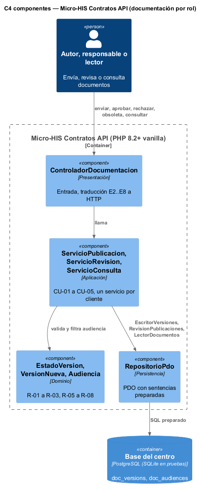
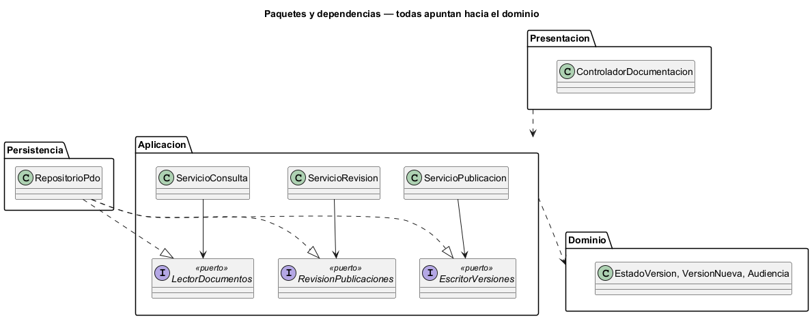

# Semana 3 — Vista arquitectónica del Micro-HIS Contratos API: OpenAPI/Postman y documentación técnica

| | |
|---|---|
| **Tarea Odoo** | 2475 — Semana 3: Diseño arquitectónico, vistas y patrones |
| **Adaptación** | Centro de documentación y manuales por rol |
| **Flujo** | «Publicación y consulta de documentación y manuales diferenciados por rol» (semanas [1](../semana-01/semana-01-uml-documentacion-rol.md) y [2](../semana-02/semana-02-isp-requerimientos-diseno.md)) |
| **Código** | [`micro-his-contratos-api/`](../micro-his-contratos-api/): PHP 8.2+ vanilla, sin framework |
| **Estudiante** | Josué David Morales Ramírez |

## 1. Decisiones arquitectónicas

| Decisión | Por qué |
|---|---|
| Cuatro capas, con un Dominio sin dependencias: `EstadoVersion` (R-03, R-08), `VersionNueva` (R-01, R-02) y `Audiencia` (R-06) | Las reglas del centro se prueban sin base ni HTTP. |
| Tres puertos en Aplicación, uno por cliente (`EscritorVersiones`, `RevisionPublicaciones`, `LectorDocumentos`), y un solo `RepositorioPdo` que los implementa | Continúa el ISP de la semana 2: una clase de persistencia, pero cada servicio ve solo su puerto. |
| La audiencia se filtra antes de elegir la vigente, y lo ajeno responde igual que lo inexistente (E6) | R-06 y R-07: un lector no descubre versiones que no le tocan. |
| `UPDATE … WHERE status = ?`, y versión y audiencia en una transacción | Concurrencia optimista (E7) y nada guardado a medias. |

## 2. Vista C4 de componentes y regla de dependencias

 

Regla de dependencias: Presentación usa los tres servicios; cada servicio usa el Dominio y **un** puerto; `RepositorioPdo` implementa los tres puertos; el Dominio no depende de nada.

## 3. Pruebas y evidencia

`php docs/modulos/contratos-api/micro-his-contratos-api/pruebas/pruebas.php` → [`evidencia/salida-pruebas.txt`](evidencia/salida-pruebas.txt) (14/14, exit 0).

| Tipo pedido | Cómo se prueba | Resultado |
|---|---|---|
| Camino feliz | Base SQLite de prueba: enviar → aprobar → consultar por rol → marcar obsoleta → consultar con aviso | 4/4 |
| Regla de dominio | Sin `x.y.z` o sin audiencia (E2), versión repetida (E3), aprobar lo propio (E5), rechazar sin motivo (E2), rol ajeno igual a inexistente (E6), obsoleta que vuelve (E7) | 6/6 |
| Error de persistencia | Doble de 2 métodos con la base caída, y `PDOException` real (tabla borrada): 503 sin detalles técnicos y sin versión a medias | 2/2 |
| Dependencias y SQL | Ninguna capa apunta hacia afuera y ninguna consulta concatena variables | 2/2 |

En una prueba de mutación se hizo que `Audiencia::permite` devolviera siempre `true` en una copia, y las pruebas fallaron en R-06 y R-07 (exit 1).

**Limitaciones:** el lint de OpenAPI (R-04), la búsqueda de datos reales (R-09) y la auditoría (R-10, del módulo de auditoría) quedan para una semana posterior; los roles llegan en la petición en vez de leerse de `hospital_memberships`; SQLite reemplaza a PostgreSQL en las pruebas. **Siguiente:** MVC con Repository (semana 4).

**Bibliografía:** Brown, S. (2018). *The C4 model*. https://c4model.com · Martin, R. C. (2018). *Clean Architecture*. Prentice Hall.
