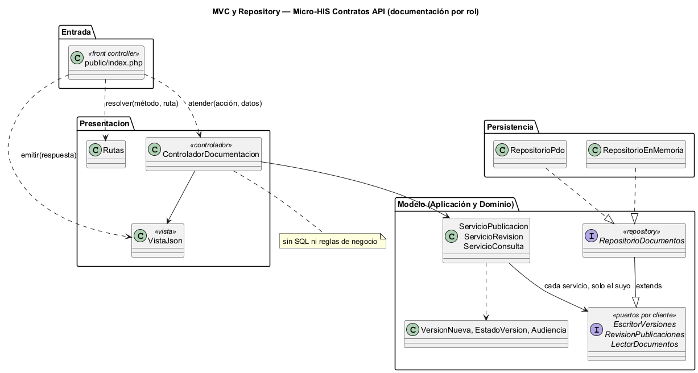
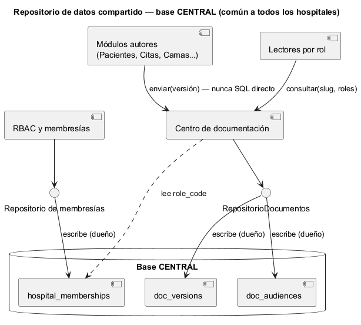

# Semana 4 — MVC, Repository y repositorio de datos compartido en el Micro-HIS Contratos API: OpenAPI/Postman y documentación técnica (centro de documentación por rol)

| | |
|---|---|
| **Tarea Odoo** | 2476 — Semana 4: Arquitectura en capas y patrón repositorio |
| **Flujo** | «Publicación y consulta de documentación y manuales diferenciados por rol» (mismo Micro-HIS de la [Semana 3](../semana-03/semana-03-arquitectura-micro-his.md)) |
| **Código** | [`micro-his-contratos-api/`](../micro-his-contratos-api/): PHP 8.2+ vanilla, sin framework |
| **Estudiante** | Josué David Morales Ramírez |

## 1. Entrada organizada con MVC

| Pieza | Archivo | Responsabilidad |
|---|---|---|
| Front controller | `public/index.php` | Único punto de entrada HTTP: resuelve la ruta, toma usuario y roles de las cabeceras `X-Usuario` y `X-Roles` (en lugar de la sesión) y emite la respuesta. |
| Rutas | `Presentacion/Rutas.php` | `POST /documentos/{slug}/versiones`, `POST /versiones/{id}/aprobacion\|rechazo\|obsolescencia` y `GET /documentos/{slug}[/versiones/{x.y.z}]`. |
| Controlador | `Presentacion/ControladorDocumentacion.php` | Elige el caso de uso y entrega el resultado a la vista. **Sin SQL ni reglas de negocio** (lo comprueba una prueba). |
| Vista | `Presentacion/VistaJson.php` | Única dueña de los códigos HTTP y de los textos al usuario (E2–E8); antes esa tabla estaba en el controlador. |
| Modelo | Los tres servicios de `Aplicacion/` + `Dominio/Documento.php` | Casos de uso y reglas R-01 a R-08; sin cambios respecto a la Semana 3. |

## 2. Interfaz Repository en el límite y sus adaptadores

La interfaz Repository del módulo es `RepositorioDocumentos`, en **Aplicación**: es la unión de los tres puertos por cliente de la semana 2 (`EscritorVersiones`, `RevisionPublicaciones` y `LectorDocumentos`). Los adaptadores implementan la interfaz completa, pero cada servicio sigue recibiendo solo su puerto (ISP), y el modelo no depende de PDO (DIP).

| Adaptador | Para qué | Cómo cumple el contrato |
|---|---|---|
| `RepositorioPdo` | Producción (PostgreSQL) y pruebas (SQLite) | Sentencias preparadas, versión y audiencia en una transacción, índice único parcial y `UPDATE … WHERE status = ?`. |
| `RepositorioEnMemoria` | Pruebas y demos sin base | Las mismas reglas de visibilidad (solo publicadas u obsoletas) y la misma concurrencia optimista. |

## 3. Capas, responsabilidades y objetos reutilizables

| Capa | Objetos | Responsabilidad | Reutilizable en |
|---|---|---|---|
| Dominio | `VersionNueva`, `EstadoVersion`, `Audiencia`, `ReglaDeDominio` | Versión semántica, transiciones y audiencia por rol (R-01 a R-08) | Cualquier módulo que versione artefactos o filtre por `role_code` |
| Aplicación | Tres servicios, tres puertos y `RepositorioDocumentos`, `ErrorPersistencia` | CU-01 a CU-05 | Cualquier entrada (HTTP, consola o CI que publique el OpenAPI de cada módulo) |
| Persistencia | `RepositorioPdo`, `RepositorioEnMemoria` | Versiones y audiencias | `RepositorioEnMemoria` como doble para quien consulte la documentación |

## 4. Cómo lo integraría un repositorio de datos compartido

En el estilo de **repositorio de datos compartido**, los módulos se coordinan a través de un almacén común. La documentación es la misma para todos los hospitales, así que el almacén natural es la base **CENTRAL**, donde ya están las membresías con los `role_code` (`database/migrations/central/`).

| Decisión | Regla propuesta |
|---|---|
| Dueño de cada dato | El centro de documentación es el único que escribe `doc_versions` y `doc_audiences`; RBAC es el dueño de `hospital_memberships` y el centro solo lee los roles. |
| Acceso | Los demás módulos (Pacientes, Citas, Camas…) publican su OpenAPI por el caso de uso `enviar`, nunca con SQL directo; así pasan por la validación y la revisión. |
| Concurrencia | El índice único parcial de (documento, versión) y el `UPDATE … WHERE status = ?` evitan dos publicaciones iguales o dos aprobaciones simultáneas. |
| Esquema | Lo controlan las migraciones de CENTRAL; si cambia `role_code`, se revisa `Audiencia`. |
| Confidencialidad | Lo ajeno responde 404 igual que lo inexistente (R-07), aunque todos compartan la misma base. |

**Ventajas:** un solo lugar para la versión vigente de cada contrato y módulos que no se conocen entre sí. **Riesgos:** acoplamiento al esquema de CENTRAL y un punto único de falla; se mitigan con un solo dueño por tabla y porque la consulta por rol solo lee. La interfaz Repository permite pasar después a un servicio propio del centro sin tocar los casos de uso.

## 5. Evidencia

`php docs/modulos/contratos-api/micro-his-contratos-api/pruebas/pruebas.php` → [`evidencia/salida-pruebas.txt`](evidencia/salida-pruebas.txt) (26/26, exit 0; el mismo guion de 10 pruebas con cada adaptador, incluido el contrato: lo que está en revisión no se consulta y un estado viejo devuelve `false`). Prueba HTTP real con `php -S` y `curl` → [`evidencia/salida-http.txt`](evidencia/salida-http.txt). En una prueba de mutación se dejaron visibles las versiones en revisión en una copia de `RepositorioEnMemoria`, y la prueba de contrato falló (exit 1). **Limitaciones:** las cabeceras `X-Usuario` y `X-Roles` sustituyen a la sesión y a RBAC solo en la demo; siguen pendientes el lint de OpenAPI (R-04) y la auditoría (R-10). **Bibliografía:** Pressman, R. S. y Maxim, B. R. (2020). *Ingeniería del software* (9.ª ed.), cap. de diseño arquitectónico. McGraw-Hill · Fowler, M. (2002). *Patterns of Enterprise Application Architecture* (Repository, Front Controller). Addison-Wesley.
