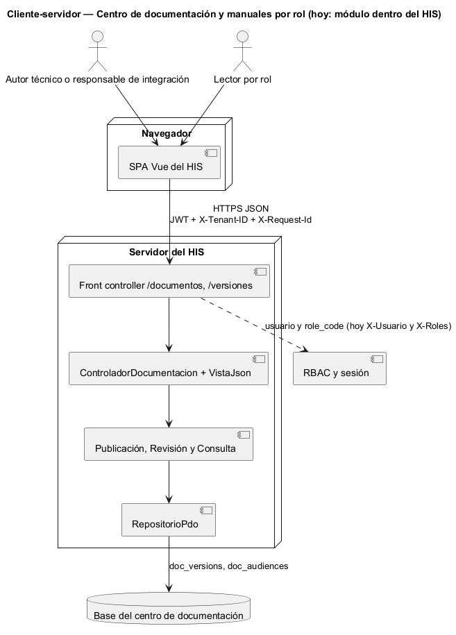
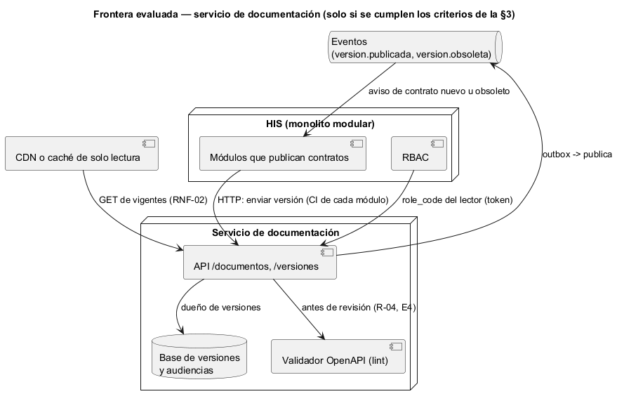

# Semana 5 — Cliente-servidor, contrato API y frontera de microservicio del Centro de documentación y manuales por rol

| | |
|---|---|
| **Tarea Odoo** | 2477 — Semana 5: Cliente-servidor, API REST, microservicios e integración |
| **Flujo** | «Publicación y consulta de documentación y manuales diferenciados por rol» (mismo Micro-HIS de las [semanas 3](../semana-03/semana-03-arquitectura-micro-his.md) y [4](../semana-04/semana-04-mvc-repository.md)) |
| **Contrato** | [api/openapi.yaml](api/openapi.yaml) (OpenAPI 3.1, validado con Redocly) |
| **Estudiante** | Josué David Morales Ramírez |

## 1. Diseño cliente-servidor

El cliente es la SPA del HIS en el navegador y el servidor es el Micro-HIS detrás de su front controller. Hablan solo por HTTPS con JSON. Dos clientes usan el mismo servidor: el autor o el responsable de integración, que envía y revisa versiones, y el lector, que consulta por rol. El servidor decide qué ve cada lector. Al cliente nunca le llega un documento fuera de su audiencia, ni siquiera para ocultarlo en pantalla (R-07).

## 2. Contrato API

| Método | Ruta | Caso de uso | Éxito | Errores documentados |
|---|---|---|---|---|
| POST | `/documentos/{slug}/versiones` | CU-01 enviar | 201 `{id}` | 409 E3 versión repetida o menor, 422 E2 metadatos, 503 E8 |
| POST | `/versiones/{id}/aprobacion` | CU-02 aprobar | 200 | 403 E5 lo propio, 404 NF, 409 E7 estado, 503 E8 |
| POST | `/versiones/{id}/rechazo` | CU-02 rechazar | 200 | 404 NF, 409 E7, 422 E2 sin motivo, 503 E8 |
| POST | `/versiones/{id}/obsolescencia` | CU-04 marcar obsoleta | 200 | 404 NF, 409 E7, 503 E8 |
| GET | `/documentos/{slug}` | CU-03 vigente | 200 | 404 E6 ajeno o inexistente, 503 E8 |
| GET | `/documentos/{slug}/versiones/{version}` | CU-03 versión concreta | 200 con `obsoleta` | 404 E6, 503 E8 |

Cada error responde `{"error", "mensaje"}` sin detalles técnicos. Este módulo es el dueño de los contratos de los demás, así que su propio contrato tiene que ser ejemplar: pasa el lint sin avisos, y el primer lint encontró un error real (una descripción con coma partida en YAML de flujo), que se corrigió. **Prueba de contrato:** [verificar-contrato.php](evidencia/verificar-contrato.php) hace pasar 16 escenarios por las rutas y el controlador reales y comprueba que cada respuesta esté documentada. Comprueba también que las 6 operaciones coincidan con las 5 acciones del controlador, porque consultar sirve a dos rutas ([salida](evidencia/salida-contrato.txt)).

## 3. Frontera de microservicio: evaluación con criterios medibles

La frontera candidata es un **servicio de documentación**, dueño de las versiones y sus audiencias. Tiene un motivo propio para separarse: sus lectores leen mucho y escriben poco, y la consulta podría servirse desde una caché sin tocar la lógica (RNF-02). Pero dividir solo tiene sentido si un criterio medible lo pide:

| Criterio para extraerlo | Umbral | Valor hoy | ¿Lo pide? |
|---|---|---|---|
| Contratos publicados por otros módulos | Más de 30, con publicación desde su CI | 9 archivos `openapi.yaml` en `develop`, en 9 módulos, ninguno enviado por API | No |
| Lectores externos al HIS (integradores, proveedores) | Al menos 1 en producción | 0 | No |
| Despliegue independiente: cambios frenados por otros módulos | Más de 1 por mes | 0: ninguno de los 9 PR del módulo integrados en `develop` esperó un cambio de otro módulo | No |
| Equipo propio que lo mantenga | Al menos 1 equipo aparte | 1 estudiante, el mismo de los otros módulos | No |

**Decisión:** el centro de documentación sigue como **módulo del monolito**, con su frontera ya marcada por los puertos por cliente de la semana 2 y la interfaz Repository de la semana 4. El criterio más cercano es el primero: cuando los módulos publiquen sus contratos desde su CI, el volumen se podrá medir.

## 4. Si se extrae: propiedad, comunicación, seguridad, resiliencia, observabilidad y consistencia

| Aspecto | Decisión |
|---|---|
| Propiedad de datos | El servicio es el único que escribe versiones y audiencias. Cada módulo sigue siendo dueño del **contenido** de su contrato, y el servicio es dueño de su ciclo de vida (revisión, vigencia, obsolescencia). |
| Comunicación | Síncrona (HTTP) para enviar, revisar y consultar. Asíncrona (`version.publicada`, `version.obsoleta`) para avisar a los módulos que consumen un contrato. |
| Seguridad | JWT y `X-Tenant-ID` en cada petición; el usuario y los `role_code` salen del token y no de cabeceras del cliente (corrige H-01). Lo ajeno responde 404 (R-07). |
| Resiliencia | Las consultas de la versión vigente se sirven desde caché (RNF-02); si el servicio cae, los lectores siguen leyendo la última vigente y solo el envío y la revisión responden 503 E8. |
| Observabilidad | `X-Request-Id` de punta a punta y log de cada transición (R-10). Las métricas: tiempo en revisión, rechazos por motivo y consultas 404 por rol (lectores que buscan algo fuera de su audiencia). |
| Consistencia | La vigente es siempre la mayor publicada, y se calcula, no se guarda. Hay un índice único para la pareja documento-versión (R-02, traducido a 409 E3, que hoy llega como 503: H-04), y outbox para los eventos. La caché expira con el evento `version.publicada`. |

## 5. Migración razonada (si un criterio de la §3 se cumple)

1. **Contrato primero:** congelar `openapi.yaml` y su prueba de contrato en el CI. Ya está hecho en esta entrega.
2. **Contenido y lint (R-04):** guardar el contenido de cada versión y pasarlo por el validador antes de la revisión (E4). Es el hallazgo H-02 de la semana 13, que hay que cerrar antes de abrir el envío a otros módulos.
3. **Publicación desde el CI de cada módulo:** cada módulo envía su `openapi.yaml` por la API. Así se mide el primer criterio de la §3.
4. **Extracción (*strangler fig*):** se mueve el módulo a su servicio con su base, se pone la caché delante de los `GET` y el monolito redirige `/documentos` y `/versiones`. La salida se mide con la prueba de contrato en verde.
5. **Reversa:** si una consulta devuelve una versión fuera de la audiencia, o la vigente no coincide con la mayor publicada, se vuelve al módulo en proceso.

## 6. Plan de issue, rama, worktree y PR

| Paso | Valor |
|---|---|
| Issue | «Semana 5: Contratos API — contrato API y frontera de microservicio»; criterios de aceptación: lint sin errores, prueba de contrato en verde, decisión con criterios medibles. |
| Rama | `semana-5-contratos-api`, desde `origin/develop` actualizado. |
| Worktree | `git worktree add ../wt-contratos-s5 -b semana-5-contratos-api origin/develop`. Aísla la tarea sin cambiar de rama en la copia principal. Para esta entrega se usó una rama normal, porque había una sola tarea activa. |
| PR | Hacia `develop`, 1 commit, máximo 400 líneas, con la plantilla del repositorio, la salida del lint y de la prueba de contrato, y la revisión pedida al revisor asignado. |

**Evidencia:** [salida del lint](evidencia/salida-lint-openapi.txt) (`npx @redocly/cli@1.34.3 lint`, sin errores ni avisos) y [salida de la prueba de contrato](evidencia/salida-contrato.txt) (18 de 18). **Bibliografía:** Newman, S. (2021). *Building Microservices* (2.ª ed.). O'Reilly · Fowler, M. (2004). *StranglerFigApplication*. martinfowler.com · OpenAPI Initiative (2021). *OpenAPI Specification 3.1.0*.
