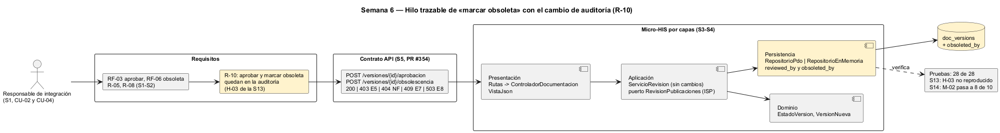

# Semana 6 — Defensa de la arquitectura de Contratos API y documentación por rol

| | |
|---|---|
| **Tarea Odoo** | 2478 — Semana 6: Primera evaluación parcial |
| **Flujo** | «Publicación y consulta de documentación y manuales diferenciados por rol» |
| **Presentación** | [semana-06-diapositivas.md](semana-06-diapositivas.md) (8 diapositivas) |
| **Estudiante** | Josué David Morales Ramírez |

## 1. Hilo trazable

Un solo hilo conecta las semanas 1 a 5. El responsable de integración aprueba (CU-02) y marca obsoleta (CU-04) una versión de un OpenAPI, una colección Postman o un manual. RF-03 y RF-06 con R-05, R-08 y R-10 fijan las reglas, el contrato expone `aprobacion` y `obsolescencia`, y cada capa del Micro-HIS cumple una parte. En amarillo está lo que añade el cambio práctico (§3).

## 2. Matriz decisión → evidencia

| # | Decisión | Por qué | RF/RNF | Evidencia verificable |
|---|---|---|---|---|
| D-01 | Tres actores: autor técnico, responsable de integración y lector por rol | Separar quien escribe, quien aprueba y quien lee (R-05) | RF-01, RF-03, RF-04 | [Casos de uso S1](../semana-01/semana-01-uml-documentacion-rol.md) |
| D-02 | **ISP**: tres puertos por cliente (`EscritorVersiones`, `RevisionPublicaciones`, `LectorDocumentos`) | Cada servicio depende solo de lo que usa | RNF-02, RNF-03 | [Antes/después S2](../semana-02/semana-02-isp-requerimientos-diseno.md); el doble de «base caída» implementa 2 métodos |
| D-03 | Cuatro capas; el dominio (`EstadoVersion`, `VersionNueva`, `Audiencia`) no tiene dependencias | El versionado se prueba sin base | RF-02 | [S3](../semana-03/semana-03-arquitectura-micro-his.md); prueba «dependencias: …» |
| D-04 | MVC: el controlador solo elige el caso de uso; `VistaJson` es dueña de los HTTP | Errores con un código fijo, 404 en lo ajeno | RF-05, RNF-04 | [S4](../semana-04/semana-04-mvc-repository.md); prueba «rol fuera de la audiencia = 404 E6» |
| D-05 | Repository (unión de los tres puertos) con PDO e InMemory y el mismo guion | Probar sin base y cambiar de motor | RNF-03 | 11 pruebas por adaptador en [salida-pruebas.txt](evidencia/salida-pruebas.txt) |
| D-06 | Versión semántica mayor que las no rechazadas; la publicada no se edita | Versionado documental sin ambigüedad | RF-02, RNF-05 | Pruebas «409 E3» y «obsoleta no vuelve a publicarse = 409 E7» |
| D-07 | Contrato OpenAPI de 6 operaciones con prueba de contrato | El documento y el código no se separan | RF-01 a RF-06 | S5, PR #354 (abierto): lint sin avisos, contrato 18 de 18 |
| D-08 | Cambio práctico: quien marca obsoleta va en `obsoleted_by` y no pisa a quien aprobó | Cumple R-10 y cierra H-03 de la S13 | RNF-05 | §3; prueba «cambio S6» por adaptador |

## 3. Registro del cambio práctico defendido

**Solicitud:** «Auditoría necesita saber, para cada versión de un contrato o manual, quién la aprobó y quién la marcó obsoleta. Hoy, al marcarla obsoleta, se pierde quién la aprobó.» Es R-10 de la S1 y el hallazgo H-03 (mayor) de la revisión técnica de la S13: `cambiarEstado` escribía siempre en `reviewed_by`.

| Capa | Qué cambió | Qué no cambió |
|---|---|---|
| Persistencia | `doc_versions.obsoleted_by`. PDO usa dos `UPDATE` fijos: obsoleta → `obsoleted_by`; aprobar o rechazar → `reviewed_by`. InMemory igual. `datosRevision` devuelve también `revisor` y `obsoleta_por`. | La concurrencia optimista (`WHERE status = ?`) y la transacción de la audiencia. |
| Aplicación | Solo el comentario del puerto: documenta las claves nuevas de `datosRevision`. | `ServicioRevision` y la **firma** de los tres puertos (ISP). |
| Dominio y Presentación | Nada. | Transiciones (R-03, R-08), R-05, rutas, controlador y códigos HTTP. |

| Escenario: luis aprueba la 1.0.0 y marta la marca obsoleta | [Antes](evidencia/salida-auditoria-antes.txt) | [Después](evidencia/salida-auditoria-despues.txt) |
|---|---|---|
| Fila en PDO | `reviewed_by = marta` (se perdió luis) | `reviewed_by = luis`, `obsoleted_by = marta` |
| `datosRevision(1)` en PDO e InMemory | Solo autor y estado | autor, estado, `revisor = luis` y `obsoleta_por = marta` |

Las pruebas pasan de 26 a 28. El script de la S13 da **H-03 «no reproducido»**, y la métrica M-02 de la S14 sube de 7 a 8 de 10 reglas con prueba, con lo que pasa a cumplir su umbral.

**Riesgo defendido:** la regla sigue sin enlazar la obsoleta con la versión que la reemplaza (R-08, hallazgo H-05); eso queda para otra entrega. El esquema real del HIS todavía no tiene tablas de documentos (supuesto de la S1), así que `obsoleted_by` es una propuesta para su migración.

## 4. Evidencia y bibliografía

[probar-auditoria.php](evidencia/probar-auditoria.php) se corrió antes y después del cambio. [salida-pruebas.txt](evidencia/salida-pruebas.txt) muestra las 28 pruebas en verde. El diagrama se generó con PlantUML local (`-charset UTF-8`).

**Bibliografía:** Martin, R. C. (2017). *Clean Architecture* (ISP). Prentice Hall · Preston-Werner, T. (s. f.). *Semantic Versioning 2.0.0*. semver.org.
