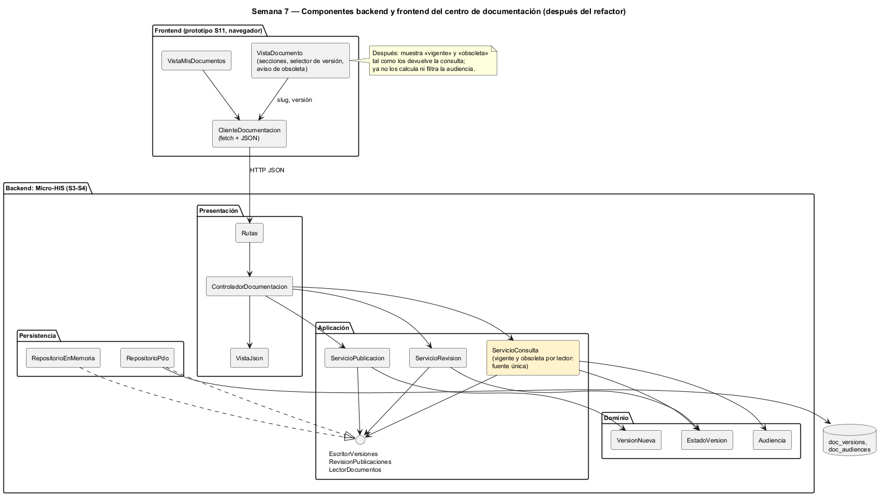

# Semana 7 — Componentes y refactorización de Contratos API y documentación por rol

| | |
|---|---|
| **Tarea Odoo** | 2479 — Semana 7: Diseño de componentes y refactorización |
| **Flujo** | «Publicación y consulta de documentación y manuales diferenciados por rol» |
| **Base** | Micro-HIS de las semanas 3 y 4, contrato de la [semana 5](../semana-05/semana-05-cliente-servidor.md) y prototipo de la [semana 11](../semana-11/semana-11-prototipo.md) |
| **Estudiante** | Josué David Morales Ramírez |

## 1. Componentes backend y frontend

| Componente | Lado | Responsabilidad única | Depende de |
|---|---|---|---|
| `VistaMisDocumentos` | Frontend | Listar los OpenAPI, colecciones Postman y manuales del rol | `ClienteDocumentacion` |
| `VistaDocumento` | Frontend | Secciones, ejemplos y errores; selector de versión y aviso de obsoleta (R-08) | `ClienteDocumentacion` |
| `ClienteDocumentacion` | Frontend | Hablar HTTP y JSON con el contrato de la S5 | Contrato API |
| `Rutas`, `ControladorDocumentacion`, `VistaJson` | Backend: Presentación | Ruta → acción → caso de uso → respuesta HTTP (lo ajeno = 404, R-07) | Los tres servicios |
| `ServicioPublicacion`, `ServicioRevision`, `ServicioConsulta` | Backend: Aplicación | CU-01 enviar, CU-02 y CU-04 revisar, CU-03 consultar | Un puerto cada uno (ISP) |
| `VersionNueva`, `EstadoVersion`, `Audiencia`, `ReglaDeDominio` | Backend: Dominio | Versión semántica (R-01, R-02), estados (R-03, R-08), audiencia (R-06) y códigos | Nada |
| `RepositorioPdo`, `RepositorioEnMemoria` | Backend: Persistencia | Implementar los tres puertos | `RepositorioDocumentos` |

## 2. Contratos de entrada y salida

| Contrato | Entrada | Salida | Errores |
|---|---|---|---|
| HTTP `POST /documentos/{slug}/versiones` | `{tipo, version, audiencia}` | 201 `{id}` | 409 E3, 422 E2, 503 E8 |
| HTTP `POST /versiones/{id}/aprobacion` · `/rechazo` · `/obsolescencia` | `{motivo}` solo en rechazo | 200 | 403 E5, 404 NF, 409 E7, 422 E2, 503 E8 |
| HTTP `GET /documentos/{slug}` · `/versiones/{version}` | roles del lector | 200 `{version, tipo, obsoleta, vigente}` | 404 E6 (ajeno o inexistente), 503 E8 |
| `ControladorDocumentacion::atender` | acción, datos | `['status', …]` | Nunca lanza: traduce a la vista |
| `ServicioConsulta::consultar` | slug, versión o `null`, roles | `{version, tipo, obsoleta, vigente}` | E6 |
| `EscritorVersiones` · `RevisionPublicaciones` · `LectorDocumentos` | versión nueva · id y estados · slug | id · `bool` (E7) · lista consultable | `ErrorPersistencia` |
| `VersionNueva::validar` · `EstadoVersion::validarCambioA` | metadatos y existentes · destino | `VersionNueva` · `void` | E2, E3 · E7 |

## 3. El punto con mayor acoplamiento

[medir-acoplamiento.php](evidencia/medir-acoplamiento.php) da el máximo en **`ControladorDocumentacion`: Ce 6 (I = 1,00)**, porque recibe los tres servicios ([salida](evidencia/salida-acoplamiento.txt)). Es el precio de los puertos por cliente: el controlador concreto, del que nadie depende, absorbe la variedad. Por eso los servicios tienen Ce de 2 a 4, y el dominio está en I ≤ 0,33. Es un acoplamiento sano.

**El acoplamiento caro está entre la UI y la aplicación, en el versionado documental:**

| Lugar | Cómo decide «vigente» y «obsoleta» | Problema |
|---|---|---|
| `ServicioConsulta::consultar` (backend) | Vigente = la mayor **publicada dentro de la audiencia del lector**; obsoleta = estado `obsolete` (R-06, R-08) | Es la fuente legítima |
| `vistas.doc` en [`app.js`](../semana-11/prototipo/app.js) (frontend, S11) | Una sola `vigente` por documento; `obsoleta = v !== d.vigente`, y `visible()` filtra la audiencia en el cliente | Repite R-06 y R-08 con otra regla |

Con los datos de las pruebas del Micro-HIS (la 1.0.0 publicada para enfermería y la 1.1.0 solo para médicos), el backend responde a enfermería que su vigente es la 1.0.0. La UI la marcaría como obsoleta. Además, filtrar la audiencia en el cliente no protege nada: R-07 exige que lo ajeno ni siquiera llegue.

## 4. Refactor concreto: antes y después

| | Antes | Después |
|---|---|---|
| Frontend | `const obsoleta = v !== d.vigente;` y `visible = (id) => DOCUMENTOS[id]?.audiencia.includes(rol)` | `const { version, obsoleta, vigente } = await cliente.documento(slug, v)`: muestra lo que recibe |
| Aplicación | Ya calculaba `obsoleta` y `vigente` por lector, pero la UI no los usaba | `ServicioConsulta` es la única fuente; el listado «mis documentos» también sale de `LectorDocumentos` filtrado por `Audiencia` |
| Dominio | `Audiencia::permite` | Sin cambios: sigue siendo la regla de R-06 |
| Lugares que deciden si una versión es vigente | 2 (servicio y `app.js`), con resultados distintos | 1 (`ServicioConsulta`) |
| Filtro de audiencia | En el cliente y en el servidor | Solo en el servidor (R-06, R-07) |

**Justificación:**
- Separa la UI de una regla de dominio y corrige una contradicción visible para enfermería.
- No amplía el módulo: las respuestas de CU-03 ya traen `obsoleta` y `vigente`, y no se agrega ningún caso de uso ni campo.
- La red ya existe: las pruebas «enfermería la 1.0.0 de su audiencia», «la 1.0.0 obsoleta se consulta con aviso» y «rol fuera de la audiencia = 404 E6» corren con los dos adaptadores, y la prueba de contrato de la S5 fija la forma de la respuesta.
- Es un refactor conceptual, como pide el enunciado: no cambia el código de esta entrega.

## 5. Evidencia y bibliografía

[salida-acoplamiento.txt](evidencia/salida-acoplamiento.txt) se midió sobre `develop` en `402fd68`. El diagrama se generó con PlantUML local (`-charset UTF-8`).

**Bibliografía:** Martin, R. C. (2017). *Clean Architecture*, caps. 10 (ISP), 13 y 14. Prentice Hall · Newman, S. (2015). *Backends for Frontends* (patrón BFF). samnewman.io.
