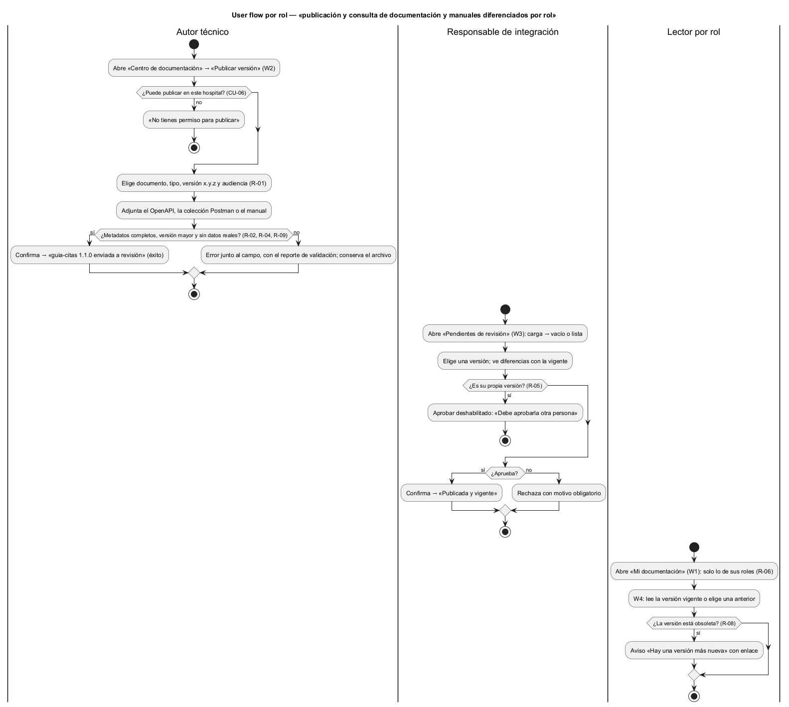

# Semana 8 — Flujo UX de «publicación y consulta de documentación y manuales diferenciados por rol»

| | |
|---|---|
| **Tarea Odoo** | 2480 — Semana 8: Diseño de experiencia de usuario |
| **Módulo** | Contratos API: OpenAPI/Postman y documentación técnica (adaptación: centro de documentación y manuales por rol) |
| **Base** | Actores, CU-01 a CU-06 y reglas R-01 a R-10 de la [Semana 1](../semana-01/semana-01-uml-documentacion-rol.md); códigos de error E2–E8 del Micro-HIS ([Semana 3](../semana-03/semana-03-arquitectura-micro-his.md)) |
| **Estudiante** | Josué David Morales Ramírez |

## 1. Roles autorizados y lo que ve cada uno

| Rol | Puede | No ve |
|---|---|---|
| Autor técnico | Enviar una versión nueva de un OpenAPI, una colección Postman o un manual de su módulo | La bandeja de revisión |
| Responsable de integración | Aprobar o rechazar versiones ajenas y marcar versiones obsoletas | El botón «Aprobar» en sus propias versiones (R-05) |
| Lector por rol (personal clínico, administrador, integrador) | Consultar la versión vigente o una anterior de lo que su rol puede ver | Los documentos fuera de su audiencia: no se listan (R-06, R-07) |

## 2. User flow por rol

Inicio: W1 para el lector, W2 para el autor y W3 para el responsable. Decisión: publicar, aprobar o rechazar, o qué versión leer. Confirmación: «Enviar a revisión» en W2 y «Aprobar y publicar» o «Rechazar» en W3. Salida: mensaje de éxito o un error que se puede recuperar (W5).

## 3. Wireframes anotados

| W | Pantalla | Estados | Mensajes | Validaciones | Reglas de interacción |
|---|---|---|---|---|---|
| [W1](diagramas/semana-08-wf1-mi-documentacion.png) | Mi documentación | Carga: filas de esqueleto. Vacío: «Aún no hay documentos para tus roles». Resumen: tabla con versión vigente | Roles del usuario visibles arriba | Búsqueda por nombre y filtro por tipo | Lo ajeno no se lista ni se insinúa; un enlace directo a algo ajeno responde «Documento no encontrado» (R-07) |
| [W2](diagramas/semana-08-wf2-publicar-version.png) | Publicar versión | Formulario → validando el archivo (indicador) → «guia-citas 1.1.0 enviada a revisión» | «Faltan el tipo, la versión x.y.z o la audiencia» (E2); «La versión debe ser mayor que la 1.0.0» (E3) | Tipo, versión `x.y.z` mayor que la vigente y al menos un rol (R-01, R-02); lint del OpenAPI (R-04); sin datos reales (R-09) | Muestra la versión vigente junto al campo para que el autor elija bien; «Enviar» queda deshabilitado mientras valida |
| [W3](diagramas/semana-08-wf3-revisar-version.png) | Revisar versión | Bandeja: carga, vacío («No hay versiones pendientes») o lista → detalle → «Publicada y vigente» o «Rechazada» | «Nadie aprueba su propia publicación» (E5); «El motivo del rechazo es obligatorio» (E2) | Motivo obligatorio para rechazar; autor distinto del revisor (R-05) | Muestra autor, audiencia, cambios frente a la vigente y el resultado de la validación antes de decidir |
| [W4](diagramas/semana-08-wf4-leer-documento.png) | Leer documento | Vigente o anterior; una obsoleta muestra un aviso | «Estás viendo una versión obsoleta. La vigente es la 1.1.0» | Solo versiones publicadas u obsoletas | El aviso de obsoleta tiene enlace a la vigente (R-08); las versiones publicadas no se editan (R-03) |
| [W5](diagramas/semana-08-wf5-error-recuperable.png) | Errores recuperables | Versión repetida (E3), validación fallida (E4 de la semana 1) o servicio no disponible (E8) | Sugiere una versión válida; reporte con la línea del problema | — | Conserva el archivo y la audiencia; «Usar 1.1.0», «Reemplazar archivo» y «Reintentar» corrigen sin empezar de nuevo |

## 4. Ayuda contextual

Cada pantalla tiene «[?] Ayuda» y textos cortos junto al campo: qué es una versión semántica y por qué debe crecer, quién podrá ver el documento según la audiencia, por qué hace falta otra persona para aprobar y qué hace el validador. En W4 se explica qué significa «obsoleta».

## 5. Protección de datos

- El autor declara que los ejemplos usan datos ficticios, y el validador rechaza lo que parezca un dato real (R-09); el reporte señala la línea sin copiar el dato.
- Un lector solo ve lo de su audiencia, y lo ajeno responde igual que lo inexistente, para no revelar que existe (R-07).
- Los contratos no muestran credenciales ni tokens: los ejemplos de autenticación usan marcadores (`<token>`).
- Enviar, aprobar, rechazar y marcar obsoleta quedan en la auditoría (R-10); las versiones nunca se borran (R-08).

## 6. Trazabilidad y evidencia

| Regla | Dónde se aplica |
|---|---|
| R-01, R-02, R-04, R-09 | W2 y W5: metadatos, versión mayor, validación y datos ficticios |
| R-03, R-05 | W3: revisión por otra persona; W4: publicadas sin edición |
| R-06, R-07, R-08 | W1 y W4: audiencia por rol, 404 para lo ajeno y aviso de obsoleta |
| R-10 | §5: auditoría de cada operación |

Fuentes editables en [`diagramas/`](diagramas/) (`.puml` con PlantUML Salt para los wireframes); los PNG se generaron con PlantUML local. Las rutas y errores siguen el front controller propuesto en la semana 4 (PR #196, aún no integrado); si ese PR cambia, se ajustan los textos de los mensajes. El lint de OpenAPI y la búsqueda de datos reales (R-04, R-09) son un diseño propuesto: el Micro-HIS aún no los implementa.

**Bibliografía:** Nielsen, J. (1994). *10 Usability Heuristics for User Interface Design*. Nielsen Norman Group · W3C (2023). *Web Content Accessibility Guidelines (WCAG) 2.2*.
