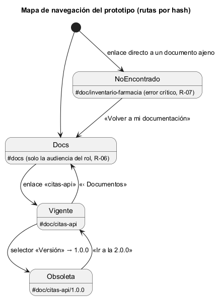

# Semana 11 — Prototipo navegable del centro de documentación por rol (Contratos API)

| | |
|---|---|
| **Tarea Odoo** | 2483 — Semana 11: Mejores prácticas para diseño móvil/web |
| **Módulo** | Contratos API: OpenAPI/Postman y documentación técnica (adaptación: centro de documentación y manuales por rol) |
| **Base** | Flujo de la semana 8 (PR #204), backlog de la semana 9 (PR #210) y diseño móvil de la semana 10 (PR #227) |
| **Estudiante** | Josué David Morales Ramírez |

## 1. Prototipo y mapa de navegación

**Archivo:** [prototipo/index.html](prototipo/index.html). Se abre sin servidor; es HTML, CSS y JavaScript sin dependencias, con datos ficticios en memoria y sin conexión a la API. Flujo principal: la consulta por rol de «publicación y consulta de documentación y manuales diferenciados por rol». El lector ve solo los documentos de su audiencia (R-06), abre un contrato OpenAPI, revisa sus endpoints, errores y ejemplos, y cambia de versión. El **panel del prototipo**, al pie, cambia el rol (médico, integrador o farmacia). El recorrido usa un contrato OpenAPI y dos manuales; las colecciones Postman se muestran como en la semana 10 (lista de peticiones y descarga) y no entran en este recorrido.

## 2. Camino feliz y error crítico

| Paso | Escritorio (1280 px) | Móvil (360 px) | Qué se ve |
|---|---|---|---|
| 1. Mi documentación | [captura](capturas/escritorio/01-mi-documentacion.png) | [captura](capturas/movil/01-mi-documentacion.png) | Solo guia-citas y citas-api para el rol médico; «2 documentos para tus roles» se anuncia |
| 2. **Camino feliz** | [captura](capturas/escritorio/02-citas-api-vigente.png) | [captura](capturas/movil/02-citas-api-vigente.png) | citas-api 2.0.0 vigente, con los endpoints abiertos y los errores y ejemplos plegados (`
`) |
| 3. Versión obsoleta | [captura](capturas/escritorio/03-version-obsoleta.png) | [captura](capturas/movil/03-version-obsoleta.png) | Aviso «Estás viendo una versión obsoleta» con enlace a la vigente (R-08), anunciado en una región viva |
| 4. **Error crítico** | [captura](capturas/escritorio/04-error-documento-ajeno.png) | [captura](capturas/movil/04-error-documento-ajeno.png) | Enlace directo al manual de farmacia con el rol médico: «Documento no encontrado» |

Es el error crítico porque toca los permisos: mostrar un documento ajeno, o siquiera confirmar que existe, filtraría información a otra audiencia. Por eso un documento ajeno responde igual que uno inexistente (R-07). La captura de `#doc/no-existe` es idéntica byte a byte a la de `#doc/inventario-farmacia` (comprobado con `cmp`), y con el rol farmacia el mismo enlace sí abre el manual. En el prototipo, cada versión tiene el mismo contenido: lo que se prueba es el versionado documental (el selector y el aviso), no el diff entre versiones.

## 3. Consistencia de roles, estados y accesibilidad

- **Roles:** médico (guía de citas y citas-api), integrador (citas-api) y farmacia (su manual), con las audiencias de las semanas 8 y 10.
- **Estados:** vigente y obsoleta, como en las semanas 8 a 10. Las rutas de citas-api son las del front controller del PR #195.
- **Accesibilidad:** `lang="es"` y un título por pantalla; foco en el `<h1>` y «Saltar al contenido»; anillo de foco de 2 px en `#2563eb` y objetivos de 44 px; el nombre del documento es un enlace (semana 9, B-06); las secciones plegables usan `
`, que es nativo y accesible con teclado; las rutas y el JSON saltan de línea (`overflow-wrap`) en vez de forzar scroll horizontal.

## 4. Evidencia y validación

[capturar.mjs](evidencia/capturar.mjs), el mismo script de la semana 11 de Catálogo, fija el ancho exacto con el protocolo DevTools de Edge, toma las capturas y mide el scroll horizontal. Su [salida](evidencia/salida-medicion.txt) da 12 de 12 mediciones sin scroll a 320, 360 y 430 px (WCAG 1.4.10), un título distinto por pantalla y el foco en `H1`. Controles: un bloque inyectado de 600 px marca «SÍ», y se hicieron las dos comprobaciones de R-07 descritas en §2.

**Bibliografía:** W3C (2023). *WCAG 2.2* · W3C (2024). *ARIA Authoring Practices Guide: Disclosure* · Chrome DevTools Protocol: `Emulation.setDeviceMetricsOverride`.
