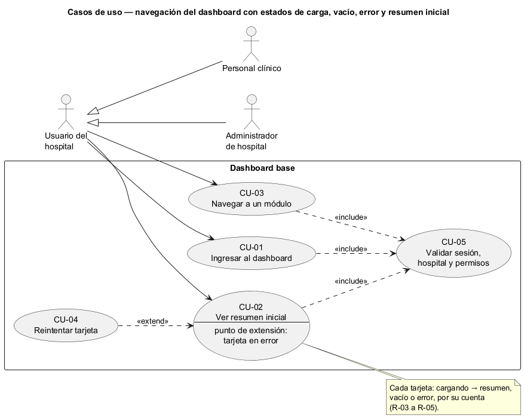
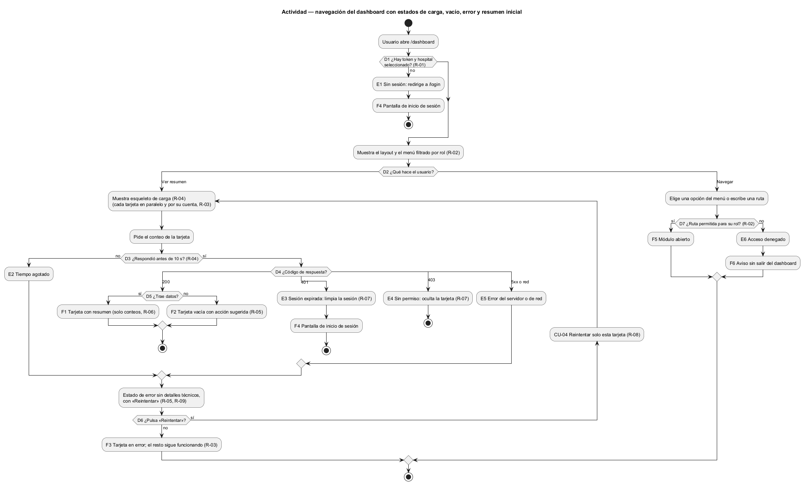
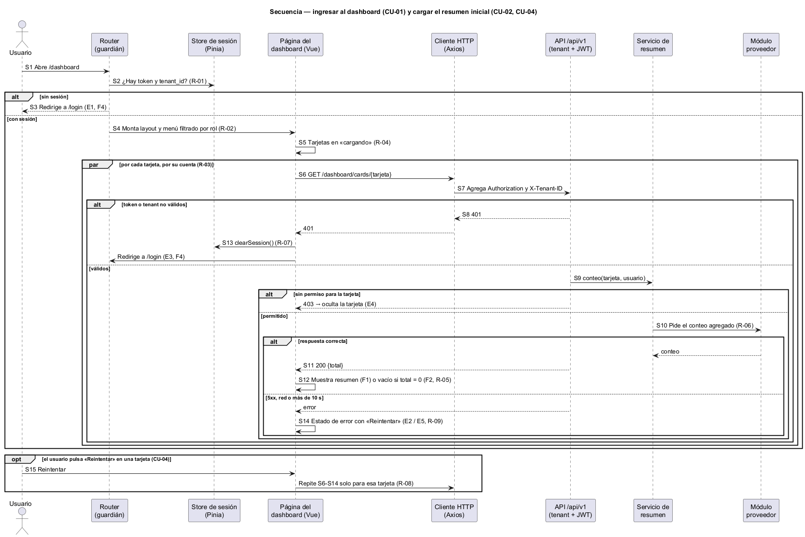

# Semana 1 — Modelado UML de la navegación del Dashboard base

| | |
|---|---|
| **Curso** | Análisis de Sistemas II — Proyecto Final 2026 |
| **Proyecto** | Sistema Hospitalario Integrado (HIS) |
| **Módulo** | Dashboard base UI/UX e implementación transversal |
| **Tarea Odoo** | 2428 — Semana 1: Conceptos generales, orientación a objetos y UML |
| **Proceso modelado** | «Navegación del dashboard con estados de carga, vacío, error y resumen inicial» |
| **Estudiante** | Josué David Morales Ramírez (carné 1890-23-10545) |
| **Fecha** | Octubre 2026 |

## 1. Introducción

El dashboard es lo primero que ve cualquier usuario del HIS y el marco en el que viven las pantallas de los demás módulos. Hoy el frontend solo tiene un encabezado con «Inicio» y «Acceso» (`resources/js/shared/components/AppLayout.vue`) y una página de bienvenida sin datos (`resources/js/pages/HomePage.vue`). Si una tarjeta falla y tumba toda la pantalla, o si «sin datos» se confunde con «error», el usuario deja de confiar en el sistema. Las tres vistas UML comparten identificadores (CU, R, D, E, F, S) para trazarlas entre sí (§9).

## 2. Narrativa de alcance

| | |
|---|---|
| **Objetivo** | Que el usuario entre con una sesión válida, vea un menú con solo lo que su rol permite y un resumen inicial en tarjetas, cada una con estados claros de carga, vacío y error. |
| **Dentro del alcance** | Ingresar al dashboard; ver el resumen inicial; navegar a un módulo desde el menú; reintentar una tarjeta que falló. |
| **Fuera del alcance** | Inicio de sesión y selección de hospital (autenticación); indicadores analíticos y reportes; el contenido de cada módulo; personalizar el dashboard. |
| **Supuestos** | La sesión vive en `localStorage` (`auth_token`, `tenant_id`) y el cliente HTTP ya envía `Authorization` y `X-Tenant-ID` (`resources/js/plugins/axios.js`). El guardián del router ya soporta `requiresAuth`, pero ninguna ruta lo usa todavía (`resources/js/router/guards.js`). Las tarjetas iniciales son pacientes, citas del día y camas disponibles. El límite de espera de 10 s es una propuesta. Los endpoints se formalizan en la Semana 5. |

## 3. Actores

| Actor | Tipo | Objetivo en el proceso |
|---|---|---|
| Usuario del hospital | Primario | Ver de un vistazo el estado de su trabajo y llegar rápido al módulo que necesita. |
| ↳ Personal clínico (médico, enfermería, laboratorio) | Especialización | Igual, con las tarjetas y el menú de su rol. |
| ↳ Administrador de hospital | Especialización | Igual, con las tarjetas y el menú de administración. |

Los módulos que aportan los datos de cada tarjeta, la autorización (RBAC) y el store de sesión son partes internas del HIS: aparecen en la actividad y la secuencia, no como actores.

## 4. Reglas de negocio

| ID | Regla | Origen |
|---|---|---|
| R-01 | Sin token y sin hospital seleccionado no se entra: se redirige a `/login`. | `guards.js` (`requiresAuth`) y `axios.js` |
| R-02 | El menú y las tarjetas muestran solo lo que el rol permite; nunca un acceso que el backend rechazaría. | Módulo RBAC |
| R-03 | Cada tarjeta carga y falla por su cuenta: el error de una no bloquea a las demás. | Decisión de diseño |
| R-04 | Mientras se espera, la tarjeta muestra un esqueleto de carga; más de 10 s se trata como error. | Decisión de diseño |
| R-05 | «Vacío» no es «error»: una respuesta correcta sin datos muestra un mensaje con una acción sugerida; un error muestra un mensaje y «Reintentar». | Decisión de diseño |
| R-06 | Las tarjetas muestran solo conteos: ningún dato que identifique a un paciente. | Minimización de datos clínicos |
| R-07 | Un 401 limpia la sesión y vuelve a `/login`; un 403 oculta la tarjeta. | `stores/auth.js` (`clearSession`) |
| R-08 | Reintentar solo ocurre cuando el usuario lo pide, nunca en un bucle automático. | Decisión de diseño |
| R-09 | Los mensajes de error no muestran detalles técnicos. | Decisión de diseño |

## 5. Diagrama de casos de uso

Fuente editable: [diagramas/semana-01-casos-de-uso.puml](diagramas/semana-01-casos-de-uso.puml)

## 6. Especificación de casos de uso

| CU | Nombre | Actor | Flujo principal | Alternativas y excepciones | Reglas |
|---|---|---|---|---|---|
| CU-01 | Ingresar al dashboard | Usuario del hospital | Abre `/dashboard`; ve el layout y el menú de su rol. | Sin sesión o sin hospital (E1). | R-01, R-02 |
| CU-02 | Ver resumen inicial | Usuario del hospital | Cada tarjeta pasa de «cargando» a «resumen» o a «vacío». | Tiempo agotado (E2); sesión expirada (E3); sin permiso (E4); error del servidor o de red (E5). | R-03–R-07, R-09 |
| CU-03 | Navegar a un módulo | Usuario del hospital | Elige una opción del menú y se abre el módulo. | Escribe a mano una ruta que su rol no permite (E6). | R-02 |
| CU-04 | Reintentar tarjeta (extiende CU-02) | Usuario del hospital | En una tarjeta en error pulsa «Reintentar»; solo esa vuelve a cargar. | — | R-03, R-08 |
| CU-05 | Validar sesión, hospital y permisos (incluido) | — | Comprueba token, `tenant_id` y permisos antes de CU-01 a CU-03. | E1, E3, E4, E6. | R-01, R-02, R-07 |

**Relaciones:** CU-01, CU-02 y CU-03 *incluyen* CU-05. CU-04 *extiende* CU-02 en el punto de extensión «tarjeta en error»: solo ocurre si una tarjeta falló y el usuario lo pide.

## 7. Diagrama de actividad

Fuente editable: [diagramas/semana-01-actividad.puml](diagramas/semana-01-actividad.puml)

| Decisión | Pregunta | Si falla |
|---|---|---|
| D1 | ¿Hay token y hospital seleccionado? | E1 Sin sesión: redirige a `/login` |
| D2 | ¿Qué hace el usuario: ver el resumen o navegar? | — |
| D3 | ¿La tarjeta respondió antes de 10 s? | E2 Tiempo agotado → estado de error |
| D4 | ¿Qué código respondió: 200, 401, 403 o error? | E3 401 sesión expirada; E4 403 sin permiso; E5 5xx o red |
| D5 | ¿La respuesta trae datos? | No → F2 estado vacío |
| D6 | ¿El usuario pulsa «Reintentar»? | No → F3 tarjeta en error |
| D7 | ¿La ruta elegida está permitida para su rol? | E6 Acceso denegado |

**Resultados:** F1 tarjeta con resumen · F2 tarjeta vacía con acción sugerida · F3 tarjeta en error, el resto sigue funcionando · F4 pantalla de inicio de sesión · F5 módulo abierto · F6 aviso de acceso denegado, sin salir del dashboard.

## 8. Diagrama de secuencia

Fuente editable: [diagramas/semana-01-secuencia.puml](diagramas/semana-01-secuencia.puml)

Participantes: Usuario, Router (guardián), Store de sesión (Pinia), Página del dashboard (Vue), Cliente HTTP (Axios), API `/api/v1`, Servicio de resumen y Módulo proveedor.

| Paso | Mensaje | Validación o respuesta |
|---|---|---|
| S1–S2 | Usuario abre `/dashboard`; el router pregunta al store si hay token y hospital | No → S3 redirige a `/login` |
| S4–S5 | Monta el layout con el menú filtrado; tarjetas en «cargando» | — |
| S6–S7 | Por cada tarjeta, en paralelo: `GET /dashboard/cards/{tarjeta}`; Axios agrega `Authorization` y `X-Tenant-ID` | — |
| S8 | API valida tenant y JWT | No válido → 401 |
| S9–S10 | Servicio revisa el permiso y pide un conteo al módulo proveedor | Sin permiso → 403 |
| S11–S12 | 200 con el conteo → resumen o vacío | — |
| S13 | Si fue 401: el store limpia la sesión y el router va a `/login` | — |
| S14 | Si fue 5xx, red o 10 s: estado de error con «Reintentar» | — |
| S15 | Usuario pulsa «Reintentar» → se repiten S6–S14 solo para esa tarjeta | — |

## 9. Matriz de trazabilidad

| CU | Reglas | Actividad | Secuencia |
|---|---|---|---|
| CU-01 | R-01, R-02 | D1, E1, F4 | S1–S5 |
| CU-02 | R-03–R-07, R-09 | D2–D5, E2–E5, F1, F2 | S6–S14 |
| CU-03 | R-02 | D2, D7, E6, F5, F6 | (mismo patrón que S1–S2) |
| CU-04 | R-03, R-08 | D6, F3 | S15 |
| CU-05 | R-01, R-02, R-07 | D1, D4, D7 | S2, S8, S9, S13 |

## 10. Conclusión

El dashboard no es dueño de ningún dato: los pide, los resume y decide cómo mostrarlos. Lo que aporta es la regla transversal de estados (R-03 a R-05, R-08, R-09), que después usarán las pantallas de los demás módulos. Para implementarlo hay que marcar con `requiresAuth` las rutas protegidas y tener un endpoint de conteo por tarjeta.

## 11. Bibliografía

- Object Management Group. (2017). *Unified Modeling Language (UML) Version 2.5.1*. https://www.omg.org/spec/UML/2.5.1
- Nielsen, J. (1994). *10 Usability Heuristics for User Interface Design*. Nielsen Norman Group. https://www.nngroup.com/articles/ten-usability-heuristics/
- Código del repositorio: `resources/js/router/guards.js`, `resources/js/plugins/axios.js`, `resources/js/stores/auth.js`.
