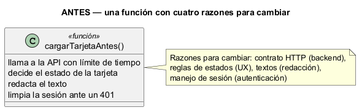
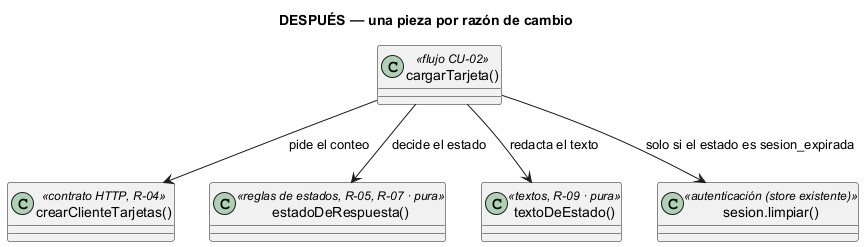

# Semana 2 — RF/RNF, criterios de aceptación y SRP en el Dashboard base

| | |
|---|---|
| **Módulo** | Dashboard base UI/UX e implementación transversal |
| **Tarea Odoo** | 2429 — Semana 2: Proceso y modelo de diseño; principios SOLID |
| **Flujo** | «Navegación del dashboard con estados de carga, vacío, error y resumen inicial» (modelado en la [Semana 1](../semana-01/semana-01-uml-navegacion-dashboard.md)) |
| **Principio aplicado** | SRP — principio de responsabilidad única |
| **Estudiante** | Josué David Morales Ramírez |

## 1. Requerimientos funcionales

| ID | Requerimiento | Trazado a |
|---|---|---|
| RF-01 | Mostrar en cada tarjeta el conteo que devuelve la API («5 citas hoy»). | CU-02, R-06 |
| RF-02 | Mostrar «vacío» con una acción sugerida cuando el conteo es 0. | CU-02, R-05 |
| RF-03 | Mostrar «error» con «Reintentar» ante un 5xx, una falla de red o más de 10 s sin respuesta. | CU-02, CU-04, R-04 |
| RF-04 | Ante un 401, limpiar la sesión y llevar al inicio de sesión. | CU-05, R-07 |
| RF-05 | Ante un 403, ocultar la tarjeta. | CU-05, R-07 |
| RF-06 | Cargar cada tarjeta por su cuenta: el error de una no afecta a las demás. | R-03 |

## 2. Requerimientos no funcionales

| ID | Requerimiento | Cómo se verifica |
|---|---|---|
| RNF-01 | Usabilidad: ningún texto muestra códigos HTTP ni errores técnicos. | `verificar.mjs`: control del texto en cada escenario |
| RNF-02 | Rendimiento percibido: una tarjeta sin respuesta pasa a error a los 10 s, sin congelar la pantalla. | `crearClienteTarjetas(obtener, 10000)`; la prueba usa 30 ms |
| RNF-03 | Mantenibilidad: cambiar una regla de estado o un texto toca una sola función. | §4: una función por razón de cambio |
| RNF-04 | Facilidad de prueba: estados y textos se prueban sin red ni sesión. | `verificar.mjs`: «regla aislada» y «texto aislado» |
| RNF-05 | Privacidad: las tarjetas solo muestran conteos. | `textoDeEstado` solo usa `total` |

## 3. Criterios de aceptación

| CA | Dado / Cuando / Entonces | RF | Evidencia |
|---|---|---|---|
| CA-01 | Cuando la API responde 200 con 5, entonces la tarjeta dice «5 citas hoy». | RF-01 | `verificar.mjs` |
| CA-02 | Cuando responde 200 con 0, entonces la tarjeta queda «vacía» y sugiere agendar. | RF-02 | `verificar.mjs` |
| CA-03 | Cuando responde 500 o falla la red, entonces queda en «error» con un texto amable. | RF-03 | `verificar.mjs` |
| CA-04 | Cuando no responde dentro del límite, entonces queda en «error». | RF-03 | `verificar.mjs` |
| CA-05 | Cuando responde 401, entonces la sesión se limpia y la tarjeta pide volver a entrar. | RF-04 | `verificar.mjs` |
| CA-06 | Cuando responde 403, entonces la tarjeta se oculta. | RF-05 | `verificar.mjs` |
| CA-07 | Las reglas de estado y los textos se comprueban solos, sin API ni sesión. | RF-02, RF-03 | `verificar.mjs` |
| CA-08 | Dadas tres tarjetas, cuando una falla, entonces las otras dos muestran su resumen. | RF-06 | Prueba de UI en la Semana 15 |

## 4. SRP: diseño antes y después

**El problema (antes).** En [`ejemplo-srp/antes.mjs`](ejemplo-srp/antes.mjs), `cargarTarjetaAntes()` llama a la API con límite de tiempo, decide el estado, redacta el texto y limpia la sesión. Cambia por cuatro razones que piden personas distintas: el contrato HTTP (backend), las reglas de estados (UX), los textos (redacción) y la sesión (autenticación).



**La solución (después).** En [`ejemplo-srp/despues.mjs`](ejemplo-srp/despues.mjs) hay una función por razón de cambio:

| Pieza | Única responsabilidad | Quién pide el cambio | Depende de |
|---|---|---|---|
| `crearClienteTarjetas()` | Llamar a la API y cortar a los 10 s | Backend (contrato) | La función `obtener` que se le inyecta |
| `estadoDeRespuesta()` | Decidir resumen, vacío, error, oculta o sesión expirada | UX | Nada (pura) |
| `textoDeEstado()` | Redactar el texto sin detalles técnicos | Redacción | Nada (pura) |
| `cargarTarjeta()` | Ordenar el flujo de una tarjeta (CU-02) | Analista del proceso | Las tres anteriores y `sesion` |
| `sesion.limpiar()` | Cerrar la sesión | Autenticación | Ya existe: `clearSession()` en `resources/js/stores/auth.js` |



**Por qué estas dependencias.** `cargarTarjeta()` recibe el cliente y la sesión como parámetros, así que la prueba usa una API simulada y una sesión falsa. Las reglas y los textos son funciones puras: dan siempre la misma salida para la misma entrada y no tocan la red. En la implementación Vue, el componente de tarjeta solo llamará a `cargarTarjeta()` y mostrará el resultado.

## 5. Evidencia verificable

```powershell
node docs/modulos/dashboard-base/semana-02/ejemplo-srp/verificar.mjs
```

Salida real: [`evidencia/salida-verificar.txt`](evidencia/salida-verificar.txt). Pasan 18 de 18 controles: los 7 escenarios dan el mismo estado y texto antes y después, ningún texto muestra detalles técnicos, la sesión se limpia ante un 401, y las reglas y los textos se prueban solos. En una prueba de mutación se trató «0 citas» como error en una copia de `despues.mjs`, y el script falló en CA-02 y CA-07 (exit 1).

## 6. Conclusión

El refactor no cambió lo que ve el usuario (la paridad lo demuestra), pero dejó la regla transversal del dashboard («vacío no es error») en una función pura de 5 líneas que cualquier módulo puede reutilizar y probar.

## 7. Bibliografía

- MVP Cluster. (s. f.). *Diseño de software 2: principios SOLID*. https://mvpcluster.com/diseno-de-software-2/
- Martin, R. C. (2018). *Clean Architecture*. Prentice Hall.
