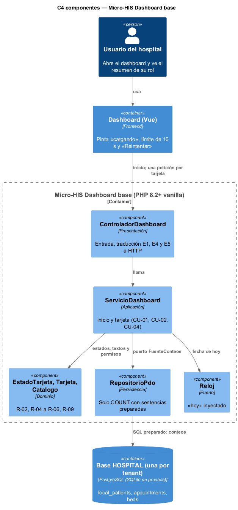
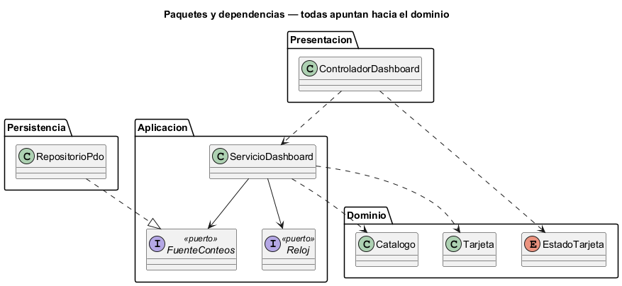

# Semana 3 — Vista arquitectónica del Micro-HIS Dashboard base UI/UX e implementación transversal

| | |
|---|---|
| **Tarea Odoo** | 2430 — Semana 3: Diseño arquitectónico, vistas y patrones |
| **Flujo** | «Navegación del dashboard con estados de carga, vacío, error y resumen inicial» (semanas [1](../semana-01/semana-01-uml-navegacion-dashboard.md) y [2](../semana-02/semana-02-srp-requerimientos-diseno.md)) |
| **Código** | [`micro-his-dashboard-base/`](../micro-his-dashboard-base/): PHP 8.2+ vanilla, sin framework |
| **Estudiante** | Josué David Morales Ramírez |

## 1. Decisiones arquitectónicas

| Decisión | Por qué |
|---|---|
| Cuatro capas: Presentación, Aplicación, Dominio y Persistencia | Lo pide el enunciado; cada capa tiene una sola razón para cambiar (SRP de la semana 2). |
| Dominio sin dependencias: `EstadoTarjeta` (R-04, R-05), `Tarjeta` (R-06, R-09) y `Catalogo` (R-02) | Los estados, los textos y el filtro por rol se prueban sin base ni HTTP. |
| Dos casos de uso: `inicio` (menú y esqueleto «cargando») y `tarjeta` (una sola tarjeta) | Así cada tarjeta carga y falla por su cuenta (R-03), y reintentar es volver a pedir solo esa (R-08). |
| El error de base de una tarjeta se vuelve su estado «error» (503 E5), no un fallo de la página | R-03: las demás tarjetas siguen mostrando su resumen. |
| Puertos `FuenteConteos` y `Reloj` en Aplicación; el adaptador PDO solo hace `COUNT` preparado | R-06: ningún dato que identifique a un paciente sale de la base. |

## 2. Vista C4 de componentes y regla de dependencias

 

| Componente | Capa | Responsabilidad | Depende de |
|---|---|---|---|
| `ControladorDashboard` | Presentación | Recibir la petición y traducir E1, E4 y E5 a HTTP | `ServicioDashboard` |
| `ServicioDashboard` | Aplicación | CU-01, CU-02 y CU-04, con CU-05 incluido | Dominio y los puertos |
| `EstadoTarjeta`, `Tarjeta`, `Catalogo` | Dominio | Estados, textos y filtro por permisos | Nada |
| `RepositorioPdo` | Persistencia | Conteos con PDO sobre la base del hospital (tenant) | Puerto `FuenteConteos` |

## 3. Pruebas y evidencia

`php docs/modulos/dashboard-base/micro-his-dashboard-base/pruebas/pruebas.php` → [`evidencia/salida-pruebas.txt`](evidencia/salida-pruebas.txt) (15/15, exit 0).

| Tipo pedido | Cómo se prueba | Resultado |
|---|---|---|
| Camino feliz | Base SQLite de prueba: inicio con menú y tarjetas «cargando», luego el resumen de pacientes y de citas de hoy | 4/4 |
| Regla de dominio | Vacío no es error (R-05), menú y tarjetas por rol (R-02), 403 sin permiso, 401 sin hospital (R-01), solo conteos (R-06) | 5/5 |
| Error de persistencia | Doble que falla solo en camas, y `PDOException` real (tabla borrada): esa tarjeta queda en «error» con texto amable, las demás siguen y el reintento la recupera | 4/4 |
| Dependencias y SQL | Ninguna capa apunta hacia afuera; ninguna consulta concatena variables | 2/2 |

En una prueba de mutación se hizo que `EstadoTarjeta::deConteo` devolviera siempre «resumen» en una copia, y las pruebas fallaron en R-05 (exit 1).

**Limitaciones:** el estado «cargando» lo pinta el cliente mientras espera; el límite de 10 s (R-04) y la limpieza de sesión ante un 401 (R-07) viven en el frontend (semana 2). Los permisos llegan en la petición en vez de leerse de RBAC; SQLite reemplaza a PostgreSQL en las pruebas. **Siguiente:** MVC con Repository (semana 4).

**Bibliografía:** Brown, S. (2018). *The C4 model*. https://c4model.com · Martin, R. C. (2018). *Clean Architecture*. Prentice Hall.
