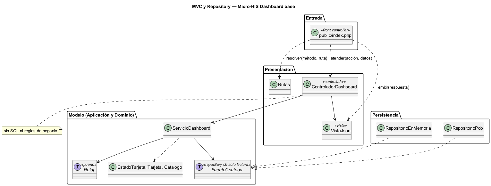
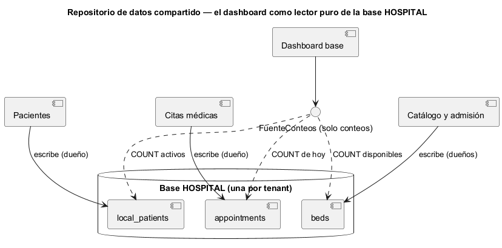

# Semana 4 — MVC, Repository y repositorio de datos compartido en el Micro-HIS Dashboard base UI/UX e implementación transversal

| | |
|---|---|
| **Tarea Odoo** | 2431 — Semana 4: Arquitectura en capas y patrón repositorio |
| **Flujo** | «Navegación del dashboard con estados de carga, vacío, error y resumen inicial» (mismo Micro-HIS de la [Semana 3](../semana-03/semana-03-arquitectura-micro-his.md)) |
| **Código** | [`micro-his-dashboard-base/`](../micro-his-dashboard-base/): PHP 8.2+ vanilla, sin framework |
| **Estudiante** | Josué David Morales Ramírez |

## 1. Entrada organizada con MVC

| Pieza | Archivo | Responsabilidad |
|---|---|---|
| Front controller | `public/index.php` | Único punto de entrada HTTP: resuelve la ruta, toma hospital y permisos de `X-Tenant-ID` y `X-Permisos` (en lugar de la sesión), inyecta el reloj y emite la respuesta. |
| Rutas | `Presentacion/Rutas.php` | `GET /dashboard` (menú y esqueleto) y `GET /dashboard/tarjetas/{id}` (una tarjeta). |
| Controlador | `Presentacion/ControladorDashboard.php` | Elige el caso de uso y entrega el resultado a la vista. **Sin SQL ni reglas de negocio** (lo comprueba una prueba). |
| Vista | `Presentacion/VistaJson.php` | Única dueña de los códigos HTTP: 401 E1, 403 E4 y 503 E5 para una tarjeta en «error». Antes esa decisión estaba en el controlador. |
| Modelo | `Aplicacion/ServicioDashboard.php` + `Dominio/Dashboard.php` | Casos de uso y reglas R-01 a R-09. El único cambio es el singular de los textos (ver §5). |

## 2. Interfaz Repository en el límite y sus adaptadores

La interfaz Repository del módulo es `FuenteConteos`, en **Aplicación**: un repository de **solo lectura** que entrega un conteo por tarjeta y día. El caso de uso no sabe de tablas ni de SQL (DIP), y nadie puede escribir por ella.

| Adaptador | Para qué | Cómo cumple el contrato |
|---|---|---|
| `RepositorioPdo` | Producción (PostgreSQL de cada tenant) y pruebas (SQLite) | Solo `COUNT` con sentencias preparadas sobre `local_patients`, `appointments` y `beds`. |
| `RepositorioEnMemoria` | Pruebas y demos sin base | Cuenta listas en memoria con las mismas reglas: pacientes activos, citas del día programadas o confirmadas y camas disponibles. |

Las pruebas corren **el mismo guion** contra los dos adaptadores, sembrados con los mismos datos (9 + 9), incluido el contrato de conteos 2, 2 y 0.

## 3. Capas, responsabilidades y objetos reutilizables

| Capa | Objetos | Responsabilidad | Reutilizable en |
|---|---|---|---|
| Dominio | `EstadoTarjeta`, `Tarjeta`, `Catalogo`, `ReglaDeDominio` | Estados de carga, vacío, error y resumen; textos; menú y tarjetas por permiso | Es transversal: cualquier tablero del HIS (por ejemplo, el de ocupación) usa los mismos cuatro estados |
| Aplicación | `ServicioDashboard`, puertos `FuenteConteos` y `Reloj`, `ErrorPersistencia` | CU-01, CU-02 y CU-04, con CU-05 incluido | Cualquier entrada que pida el resumen |
| Persistencia | `RepositorioPdo`, `RepositorioEnMemoria` | Conteos | `RepositorioEnMemoria` como doble para la UI Vue |
| Presentación | `Rutas`, `ControladorDashboard`, `VistaJson` | Entrada y salida HTTP | El mismo patrón de los demás Micro-HIS |

## 4. Cómo lo integraría un repositorio de datos compartido

En el estilo de **repositorio de datos compartido**, los módulos se coordinan a través de un almacén común. El dashboard es el caso más claro de **lector puro**: no es dueño de ningún dato y solo cuenta en la base HOSPITAL del tenant lo que escriben Pacientes, Citas y Catálogo.

| Decisión | Regla propuesta |
|---|---|
| Dueño de cada dato | Pacientes escribe `local_patients`, Citas escribe `appointments` y Catálogo y Admisión escriben `beds`. El dashboard no escribe nada. |
| Acceso | Solo por `FuenteConteos`, que únicamente expone conteos: el dashboard no puede leer ni un nombre de paciente (R-06). |
| Acoplamiento | Cada conteo depende de un estado de otro módulo (`active`, `scheduled/confirmed`, `available`). Si un dueño cambia sus estados, solo cambia el adaptador. A futuro, cada dueño podría publicar una vista SQL de conteo. |
| Fallas | Cada tarjeta lee su tabla por separado: si una tabla no responde, solo esa tarjeta queda en «error» (R-03). |
| Aislamiento | Una base por hospital, elegida por `X-Tenant-ID`: nunca se suman datos de dos tenants. |

**Ventajas:** el dashboard no llama a tres módulos ni copia sus datos, y siempre muestra el estado real. **Riesgos:** depende del esquema de tres dueños y suma carga de lectura; se mitigan con conteos indexados, un solo adaptador como punto de cambio y la tolerancia a fallas por tarjeta.

## 5. Evidencia

`php docs/modulos/dashboard-base/micro-his-dashboard-base/pruebas/pruebas.php` → [`evidencia/salida-pruebas.txt`](evidencia/salida-pruebas.txt) (27/27, exit 0). Prueba HTTP real con `php -S` y `curl` → [`evidencia/salida-http.txt`](evidencia/salida-http.txt). Esa prueba encontró un defecto real: con una sola cita la tarjeta decía «1 citas hoy». `Tarjeta` ahora guarda singular y plural, y una prueba nueva lo cubre. En una prueba de mutación se contaron las citas canceladas en una copia de `RepositorioEnMemoria`, y las pruebas fallaron (exit 1). **Limitaciones:** las cabeceras sustituyen a la sesión y a RBAC solo en la demo; el límite de 10 s y «Reintentar» siguen en el frontend. **Bibliografía:** Pressman, R. S. y Maxim, B. R. (2020). *Ingeniería del software* (9.ª ed.), cap. de diseño arquitectónico. McGraw-Hill · Fowler, M. (2002). *Patterns of Enterprise Application Architecture* (Repository, Front Controller). Addison-Wesley.
