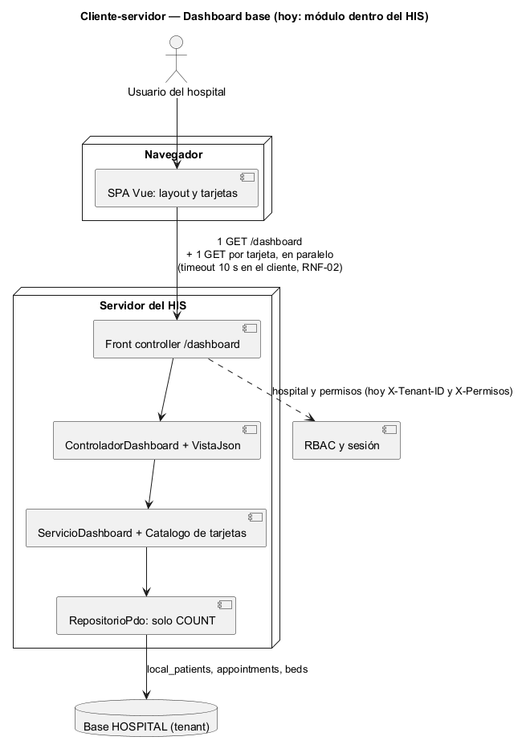
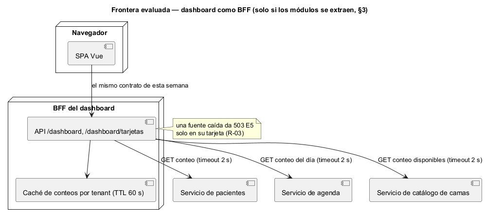

# Semana 5 — Cliente-servidor, contrato API y frontera de microservicio del Dashboard base

| | |
|---|---|
| **Tarea Odoo** | 2432 — Semana 5: Cliente-servidor, API REST, microservicios e integración |
| **Flujo** | «Navegación del dashboard con estados de carga, vacío, error y resumen inicial» (mismo Micro-HIS de las [semanas 3](../semana-03/semana-03-arquitectura-micro-his.md) y [4](../semana-04/semana-04-mvc-repository.md)) |
| **Contrato** | [api/openapi.yaml](api/openapi.yaml) (OpenAPI 3.1, validado con Redocly) |
| **Estudiante** | Josué David Morales Ramírez |

## 1. Diseño cliente-servidor

El cliente es la SPA del HIS y el servidor es el Micro-HIS detrás de su front controller. Hablan solo por HTTPS con JSON. El diseño es deliberadamente **granular**: el cliente pide primero el layout (`GET /dashboard`, con el menú y las tarjetas en «cargando») y luego **una petición por tarjeta, en paralelo**. Así cada tarjeta carga y falla por su cuenta (R-03), y el límite de 10 s lo aplica el cliente a cada una (RNF-02).

## 2. Contrato API

| Método | Ruta | Caso de uso | Éxito | Errores documentados |
|---|---|---|---|---|
| GET | `/dashboard` | CU-01 ingresar | 200 `{menu, tarjetas}` | 401 E1 sin sesión u hospital |
| GET | `/dashboard/tarjetas/{id}` | CU-02 y CU-04 (reintentar = volver a pedir) | 200 con estado `resumen` o `vacio` | 401 E1, 403 E4 sin permiso, 503 E5 con estado `error` |

El 503 de una tarjeta sigue siendo una tarjeta: trae `estado: error` y un texto amable, para que el cliente la pinte con «Reintentar» sin inventar nada (R-05, R-09). Una tarjeta desconocida responde hoy 403 E4, igual que una sin permiso; el contrato lo declara, porque es el hallazgo H-03 de la semana 13. **Prueba de contrato:** [verificar-contrato.php](evidencia/verificar-contrato.php) hace pasar 8 escenarios por las rutas y el controlador reales y comprueba que cada respuesta esté documentada. Comprueba también que las 2 operaciones coincidan con las acciones del controlador ([salida](evidencia/salida-contrato.txt)).

## 3. Frontera de microservicio: evaluación con criterios medibles

El dashboard no es dueño de ningún dato: cuenta pacientes, citas y camas que escriben otros módulos. Su frontera natural no es un servicio de datos, sino un **BFF** (*backend for frontend*) que agrega conteos para la SPA. Solo tiene sentido si cambia lo que hay detrás:

| Criterio para extraerlo como BFF | Umbral | Valor hoy | ¿Lo pide? |
|---|---|---|---|
| Módulos fuente extraídos como servicio (pacientes, agenda, camas) | Al menos 1 | 0: las semanas 5 de Catálogo y Citas decidieron no extraerlos | No |
| Clientes con necesidades distintas (SPA, app móvil, pantalla de jefatura) | Al menos 2 | 1: la SPA | No |
| Tarjetas que leen de otros módulos | Más de 6 | 3 | No |
| Equipo propio que lo mantenga | Al menos 1 equipo aparte | 1 estudiante, el mismo de los otros módulos | No |

**Decisión:** el dashboard sigue como **módulo del monolito** que lee la base del tenant con solo `COUNT` (semana 4). El contrato de esta semana está pensado para sobrevivir a la extracción: si mañana las fuentes son servicios, la SPA sigue llamando las mismas dos rutas.

## 4. Si se extrae: propiedad, comunicación, seguridad, resiliencia, observabilidad y consistencia

| Aspecto | Decisión |
|---|---|
| Propiedad de datos | El BFF no es dueño de ningún dato: cada conteo lo da el servicio dueño (pacientes, agenda, catálogo). Solo guarda una caché de conteos. |
| Comunicación | Síncrona (HTTP) del BFF a cada fuente, una llamada por tarjeta; ninguna tarjeta espera a otra. |
| Seguridad | JWT y `X-Tenant-ID`; el BFF propaga el token a las fuentes y nunca amplía permisos: una tarjeta sin permiso sigue siendo 403 (R-02). Solo conteos, nunca datos de pacientes (R-06). |
| Resiliencia | Timeout de 2 s por fuente y 10 s en el cliente. Una fuente caída da 503 E5 solo en su tarjeta (R-03). No hay reintentos automáticos: reintentar lo pide el usuario (R-08). |
| Observabilidad | `X-Request-Id` propagado a cada fuente, y métricas por tarjeta: latencia, porcentaje de 503 E5 y porcentaje de «vacío». |
| Consistencia | Eventual: cada conteo puede tener hasta 60 s de antigüedad por la caché, aceptable para un resumen inicial. Las decisiones clínicas usan el tablero de ocupación, que muestra la hora de su corte. |

## 5. Migración razonada (si un criterio de la §3 se cumple)

1. **Contrato primero:** congelar `openapi.yaml` y su prueba de contrato en el CI. Ya está hecho en esta entrega.
2. **Fuente por tarjeta:** cambiar el `COUNT` de cada tarjeta por una llamada al servicio dueño, empezando por el primero que se extraiga. El contrato con la SPA no cambia.
3. **Caché por tenant:** se añade solo si las llamadas a las fuentes suben el p95 de una tarjeta por encima de 500 ms.
4. **Extracción del BFF:** se mueve a su proceso cuando haya un segundo cliente (app móvil) que necesite otras tarjetas. La salida se mide con la prueba de contrato en verde.
5. **Reversa:** si el porcentaje de 503 E5 de una tarjeta supera el 1 % durante un día, esa tarjeta vuelve a leer la base mientras se estabiliza su fuente.

## 6. Plan de issue, rama, worktree y PR

| Paso | Valor |
|---|---|
| Issue | «Semana 5: Dashboard base — contrato API y frontera de microservicio»; criterios de aceptación: lint sin errores, prueba de contrato en verde, decisión con criterios medibles. |
| Rama | `semana-5-dashboard-base`, desde `origin/develop` actualizado. |
| Worktree | `git worktree add ../wt-dashboard-s5 -b semana-5-dashboard-base origin/develop`. Aísla la tarea sin cambiar de rama en la copia principal. Para esta entrega se usó una rama normal, porque había una sola tarea activa. |
| PR | Hacia `develop`, 1 commit, máximo 400 líneas, con la plantilla del repositorio, la salida del lint y de la prueba de contrato, y la revisión pedida al revisor asignado. |

**Evidencia:** [salida del lint](evidencia/salida-lint-openapi.txt) (`npx @redocly/cli@1.34.3 lint`, sin errores ni avisos) y [salida de la prueba de contrato](evidencia/salida-contrato.txt) (10 de 10). **Bibliografía:** Newman, S. (2021). *Building Microservices* (2.ª ed.). O'Reilly · Calçado, P. (2015). *The Back-end for Front-end Pattern (BFF)*. philcalcado.com · OpenAPI Initiative (2021). *OpenAPI Specification 3.1.0*.
