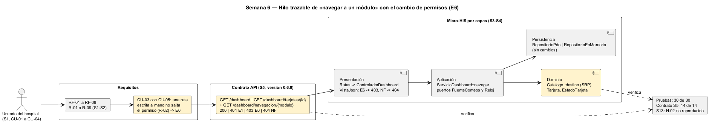

# Semana 6 — Defensa de la arquitectura del Dashboard base

| | |
|---|---|
| **Tarea Odoo** | 2433 — Semana 6: Primera evaluación parcial |
| **Flujo** | «Navegación del dashboard con estados de carga, vacío, error y resumen inicial» |
| **Presentación** | [semana-06-diapositivas.md](semana-06-diapositivas.md) (8 diapositivas) |
| **Estudiante** | Josué David Morales Ramírez |

## 1. Hilo trazable

Un solo hilo conecta las semanas 1 a 5. El usuario del hospital entra (CU-01), ve el resumen (CU-02), navega (CU-03) y reintenta una tarjeta (CU-04), siempre con CU-05 incluido. RF-01 a RF-06 y R-01 a R-09 fijan las reglas, el contrato expone las operaciones, y cada capa del Micro-HIS cumple una parte. En amarillo está lo que añade el cambio práctico (§3).

## 2. Matriz decisión → evidencia

| # | Decisión | Por qué | RF/RNF | Evidencia verificable |
|---|---|---|---|---|
| D-01 | Un actor (usuario del hospital); RBAC y sesión son servicios internos | El dashboard es la puerta de entrada de cualquier rol | RF-01 | [Casos de uso S1](../semana-01/semana-01-uml-navegacion-dashboard.md) |
| D-02 | **SRP**: estado, texto y catálogo de tarjetas en piezas separadas (`EstadoTarjeta`, `Tarjeta`, `Catalogo`) | Cambiar un texto o una regla toca una sola pieza | RNF-03, RNF-04 | [Antes/después S2](../semana-02/semana-02-srp-requerimientos-diseno.md) |
| D-03 | Cuatro capas; el dominio no tiene dependencias | Estados y textos se prueban sin base ni HTTP | RNF-04 | [S3](../semana-03/semana-03-arquitectura-micro-his.md); prueba «dependencias: …» |
| D-04 | MVC: `VistaJson` es dueña de los HTTP; una tarjeta en error es 503 E5 con texto amable | El cliente decide por código, nunca por texto técnico | RF-03, RNF-01 | [S4](../semana-04/semana-04-mvc-repository.md); prueba «503 E5 con texto amable» |
| D-05 | Puerto `FuenteConteos` con PDO e InMemory y el mismo guion | Probar sin base; solo conteos (R-06) | RNF-05 | 9 pruebas por adaptador en [salida-pruebas.txt](evidencia/salida-pruebas.txt) |
| D-06 | Cada tarjeta carga y falla por su cuenta; reintentar es volver a pedirla | El error de una no bloquea a las demás (R-03, R-08) | RF-06 | Pruebas «las demás tarjetas siguen» y «al reintentar … vuelve a 200» |
| D-07 | Contrato OpenAPI con prueba de contrato | El documento y el código no se separan | RF-01 a RF-05 | [api/openapi.yaml](../semana-05/api/openapi.yaml): lint sin avisos, contrato 14 de 14 |
| D-08 | Cambio práctico: `Catalogo::destino` valida la ruta escrita a mano → 403 E6 o 404 NF | Cierra CU-03 y el hallazgo H-02 de la S13 | RF-05 | §3; 3 pruebas «cambio S6» |

## 3. Registro del cambio práctico defendido

**Solicitud:** «Un usuario de recepción escribe a mano `/dashboard/navegacion/camas`. Como su rol no ve camas, el sistema debe negarlo con un mensaje claro, distinto de "esa sección no existe".» Es CU-03 con E6 de la S1, que no estaba implementado (hallazgo H-02 de la S13): no existía ninguna operación para navegar.

| Capa | Qué cambió | Qué no cambió |
|---|---|---|
| Dominio | `Catalogo::destino`: usa el mismo `MENU` que arma el menú; módulo inexistente → NF, sin permiso → E6. | `Tarjeta` y `EstadoTarjeta`. |
| Aplicación | `ServicioDashboard::navegar`, con `exigirSesion` (CU-05). | Los puertos `FuenteConteos` y `Reloj`. |
| Presentación | Ruta `GET /dashboard/navegacion/{modulo}`, acción `navegar` y `VistaJson`: E6 → 403, NF → 404. | `inicio` y `tarjeta`. |
| Persistencia | Nada. | Los dos adaptadores. |
| Contrato (S5) | `openapi.yaml` 0.6.0: la operación `navegar`, E6 y NF, y 3 escenarios más en la prueba de contrato. | Las operaciones de la S5. |

| `GET /dashboard/navegacion/…` con un rol que solo ve citas | [Antes](evidencia/salida-navegacion-antes.txt) | [Después](evidencia/salida-navegacion-despues.txt) |
|---|---|---|
| `citas` (permitido) | 404 | **200 «Citas»** |
| `camas` (no permitido) | 404 | **403 E6** |
| `usuarios` (no existe) | 404 | 404 NF |
| `citas` sin hospital | 404 | 401 E1 |

**La prueba de contrato lo detectó:** con el código nuevo y el contrato sin cambiar, la S5 dio «FALLA operaciones documentadas = acciones del controlador: … sin documentar: navegar» ([salida](evidencia/salida-contrato-antes.txt)). Con el contrato 0.6.0 da 14 de 14 y el lint pasa sin avisos ([salida](evidencia/salida-contrato-despues.txt)).

**Resultados:** las pruebas pasan de 27 a 30. La S13 da **H-02 «no reproducido»**, y la métrica M-03 de la S14 sube de 3 a 5 de 5 casos de uso con prueba, con lo que pasa a cumplir. Las salidas guardadas en `semana-05/evidencia/` siguen siendo las de la versión 0.5.0.

**Riesgo defendido:** los permisos todavía llegan en la petición (H-01); hasta la semana 15, E6 protege la navegación pero no la autenticidad del rol.

## 4. Bibliografía

Martin, R. C. (2017). *Clean Architecture*. Prentice Hall · Nielsen, J. (1994). *10 Usability Heuristics* (mensajes de error claros). Nielsen Norman Group.
