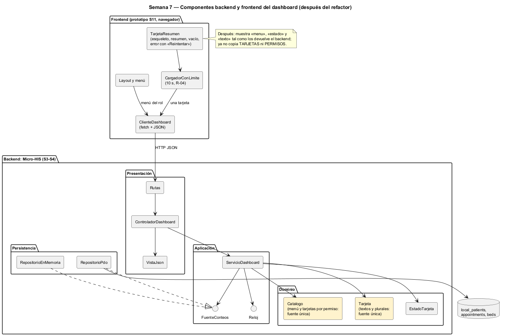

# Semana 7 — Componentes y refactorización del Dashboard base

| | |
|---|---|
| **Tarea Odoo** | 2434 — Semana 7: Diseño de componentes y refactorización |
| **Flujo** | «Navegación del dashboard con estados de carga, vacío, error y resumen inicial» |
| **Base** | Micro-HIS de las semanas 3 y 4, contrato de la [semana 5](../semana-05/semana-05-cliente-servidor.md) y prototipo de la [semana 11](../semana-11/semana-11-prototipo.md) |
| **Estudiante** | Josué David Morales Ramírez |

## 1. Componentes backend y frontend

| Componente | Lado | Responsabilidad única | Depende de |
|---|---|---|---|
| Layout y menú | Frontend | Encabezado, salto al contenido y menú del rol (R-02) | `ClienteDashboard` |
| `TarjetaResumen` | Frontend | Dibujar los cuatro estados: esqueleto, resumen, vacío con acción y error con «Reintentar» (R-04, R-05, R-08) | `CargadorConLimite` |
| `CargadorConLimite` | Frontend | Cortar a los 10 s y tratarlo como error (R-04); cada tarjeta por su cuenta (R-03) | `ClienteDashboard` |
| `ClienteDashboard` | Frontend | Hablar HTTP y JSON con el contrato de la S5; un 401 limpia la sesión (R-07) | Contrato API |
| `Rutas`, `ControladorDashboard`, `VistaJson` | Backend: Presentación | Ruta → acción → caso de uso → respuesta (una tarjeta en error = 503 E5) | `ServicioDashboard` |
| `ServicioDashboard` | Backend: Aplicación | CU-01, CU-02 y CU-04 con CU-05 incluido | `FuenteConteos`, `Reloj`, dominio |
| `Catalogo`, `Tarjeta`, `EstadoTarjeta`, `ReglaDeDominio` | Backend: Dominio | Qué ve cada permiso, textos y plurales, estados y códigos | Nada fuera del dominio |
| `RepositorioPdo`, `RepositorioEnMemoria` | Backend: Persistencia | Solo conteos, nunca datos de pacientes (R-06) | `FuenteConteos` |

## 2. Contratos de entrada y salida

| Contrato | Entrada | Salida | Errores |
|---|---|---|---|
| HTTP `GET /dashboard` | `X-Tenant-ID`, permisos | 200 `{menu, tarjetas}` (todas «cargando») | 401 E1 |
| HTTP `GET /dashboard/tarjetas/{id}` | `X-Tenant-ID`, permisos | 200 `{id, estado, texto}` con `resumen` o `vacio` | 401 E1, 403 E4, 503 E5 con `estado: error` |
| `ControladorDashboard::atender` | acción, datos | `['status', …]` | Nunca lanza: traduce a la vista |
| `ServicioDashboard::inicio` · `tarjeta` | hospital, permisos · id, hospital, permisos | `{menu, tarjetas}` · `{id, estado, texto}` | E1, E4 |
| `FuenteConteos::conteo` | tarjeta, día | `int` | `ErrorPersistencia` → la tarjeta pasa a «error» |
| `Catalogo::menu` · `tarjetas` | permisos | rutas y títulos · tarjetas visibles | — |
| `Tarjeta::texto` | estado, total | texto sin detalles técnicos (R-09) | — |

## 3. El punto con mayor acoplamiento

[medir-acoplamiento.php](evidencia/medir-acoplamiento.php) da el máximo en **`ServicioDashboard`: Ce 7 y Ca 1 (I = 0,88)** ([salida](evidencia/salida-acoplamiento.txt)). Es el orquestador: une puertos, catálogo, tarjeta, estado y errores. El dominio queda estable (`EstadoTarjeta` y `ReglaDeDominio` con I = 0).

El acoplamiento caro está entre la UI y el dominio, en **tarjetas y permisos**:

| Lugar | Qué guarda | Problema |
|---|---|---|
| `Catalogo` y `Tarjeta` (backend, dominio) | Menú por permiso; títulos, unidades singular/plural y mensajes de vacío | Es la fuente legítima |
| `TARJETAS` en [`app.js`](../semana-11/prototipo/app.js) | Los mismos títulos, plurales y mensajes; el comentario dice «textos de Dominio/Dashboard.php» | Copia literal: un texto corregido en el dominio queda viejo en la UI |
| `PERMISOS` en `app.js` | Qué módulos ve cada rol, incluido «Usuarios» | Otra regla R-02, distinta: el backend no tiene «Usuarios» en su menú |

Cambiar un texto o el plural de una tarjeta obliga hoy a tocar 2 archivos de 2 capas. Además, el menú del prototipo ofrece un módulo que el backend no conoce.

## 4. Refactor concreto: antes y después

| | Antes | Después |
|---|---|---|
| Frontend | `TARJETAS[id].unidad[total === 1 ? 0 : 1]` y `PERMISOS[rol]` arman textos y menú | `const { menu, tarjetas } = await cliente.inicio()` y `const { estado, texto } = await cliente.tarjeta(id)`: dibuja lo recibido |
| Frontend (se queda) | — | `CargadorConLimite` y los cuatro estados visuales: son de UI (R-03, R-04, R-08) |
| Dominio | `Catalogo` y `Tarjeta` | Sin cambios: siguen siendo la única fuente |
| Archivos a tocar si cambia un texto o el menú | 2 (`Dashboard.php` y `app.js`) | 1 (`Dashboard.php`) |
| Módulos del menú | Prototipo con «Usuarios»; backend sin él | Solo los del `Catalogo` del backend |

**Justificación:**
- Cada capa conserva lo suyo: la UI, cómo se ve cada estado y el límite de 10 s; el dominio, qué se muestra y con qué palabras.
- No amplía el módulo: `GET /dashboard` y `GET /dashboard/tarjetas/{id}` ya devuelven `menu`, `estado` y `texto`.
- La red ya existe: las pruebas «el menú y las tarjetas muestran solo lo que el rol permite», «1 cita hoy» en singular y «0 camas = vacío», más la prueba de contrato de la S5.
- Es un refactor conceptual, como pide el enunciado: no cambia el código de esta entrega.

## 5. Evidencia y bibliografía

[salida-acoplamiento.txt](evidencia/salida-acoplamiento.txt) se midió sobre `develop` en `402fd68`. El diagrama se generó con PlantUML local (`-charset UTF-8`).

**Bibliografía:** Martin, R. C. (2017). *Clean Architecture*, caps. 13 y 14. Prentice Hall · Hunt, A. y Thomas, D. (2019). *The Pragmatic Programmer* (2.ª ed.), principio DRY. Addison-Wesley.
