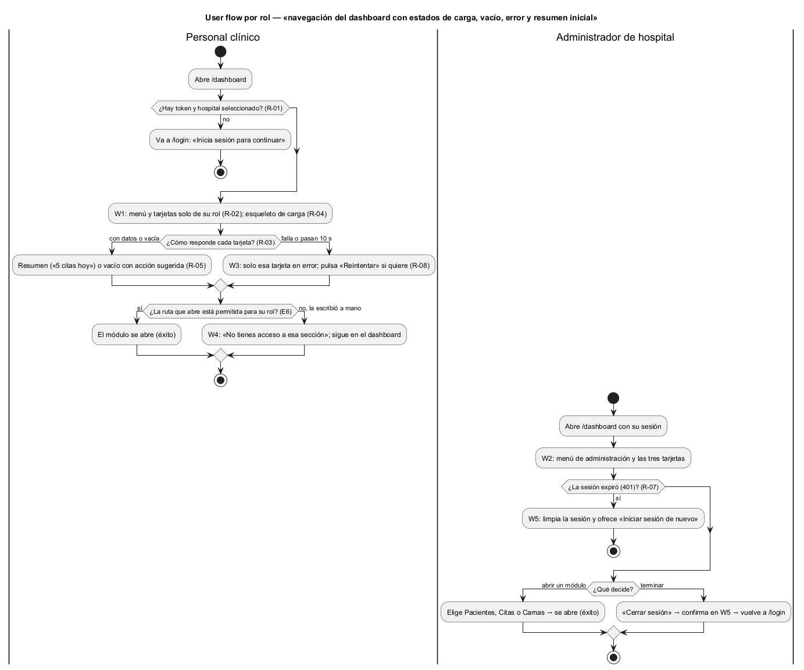

# Semana 8 — Flujo UX de «navegación del dashboard con estados de carga, vacío, error y resumen inicial»

| | |
|---|---|
| **Tarea Odoo** | 2435 — Semana 8: Diseño de experiencia de usuario |
| **Módulo** | Dashboard base UI/UX e implementación transversal |
| **Base** | Actores, CU-01 a CU-05, reglas R-01 a R-09 y excepciones E1–E6 de la [Semana 1](../semana-01/semana-01-uml-navegacion-dashboard.md); RF y RNF de la [Semana 2](../semana-02/semana-02-srp-requerimientos-diseno.md) |
| **Estudiante** | Josué David Morales Ramírez |

## 1. Roles autorizados y lo que ve cada uno

| Rol | Ve | No ve |
|---|---|---|
| Personal clínico (médico, enfermería, laboratorio) | El menú y las tarjetas de sus permisos; por ejemplo, un médico con `pacientes.ver` y `citas.ver` ve Pacientes y Citas | Las opciones y tarjetas sin permiso: no se muestran deshabilitadas, no aparecen (R-02) |
| Administrador de hospital | El menú completo y las tres tarjetas: pacientes activos, citas de hoy y camas disponibles | Datos de otro hospital: todo se filtra por el hospital de la sesión (`X-Tenant-ID`) |

## 2. User flow por rol

Inicio: `/dashboard` con sesión y hospital válidos (R-01); sin ellos se va a `/login`. Decisión: abrir un módulo, reintentar una tarjeta o terminar la sesión. Confirmación: el módulo abierto queda marcado en el menú, y «Cerrar sesión» pide confirmarlo en W5. Salida: éxito (resumen o módulo abierto) o uno de los errores recuperables de W3 a W5.

## 3. Wireframes anotados

| W | Pantalla | Estados | Mensajes | Validaciones | Reglas de interacción |
|---|---|---|---|---|---|
| [W1](diagramas/semana-08-wf1-resumen-clinico.png) | Resumen del personal clínico | Carga: esqueleto por tarjeta. Resumen: «42 pacientes activos». Vacío: «No hay citas hoy: agenda una.» | Hospital y rol visibles arriba | Token y hospital antes de pintar (R-01); permisos por tarjeta (R-02) | Cada tarjeta carga por su cuenta (R-03); la acción del vacío lleva al módulo |
| [W2](diagramas/semana-08-wf2-resumen-admin.png) | Resumen del administrador | Las tres tarjetas; una en vacío («No hay camas disponibles ahora.») | Igual que W1 | Igual que W1 | «Vacío» no se pinta como error (R-05); solo conteos (R-06) |
| [W3](diagramas/semana-08-wf3-tarjeta-error.png) | Tarjeta en error | Error de una tarjeta y resumen en las demás | «No pudimos cargar las citas de hoy.» para E2 y E5, sin códigos técnicos (R-09) | Más de 10 s sin respuesta cuenta como error (R-04) | «Reintentar» recarga solo esa tarjeta y se deshabilita mientras carga; nunca hay reintento automático (R-08) |
| [W4](diagramas/semana-08-wf4-acceso-denegado.png) | Ruta no permitida | Aviso dentro del layout | «No tienes acceso a esa sección» y a quién pedir el permiso (E6) | Permiso de la ruta antes de abrirla (CU-05) | «Volver al inicio» y «Ver qué puedo usar» (lista los módulos de su rol); el menú sigue disponible |
| [W5](diagramas/semana-08-wf5-sesion.png) | Sesión expirada y cerrar sesión | 401 (E3) y diálogo de confirmación | «Tu sesión expiró… No se perdió ningún dato.»; «¿Cerrar sesión?» | Un 401 limpia la sesión (R-07) | «Cancelar» es la opción por defecto; al confirmar se borran el token y el hospital del equipo |

**Errores recuperables:** E2 y E5 (W3), E6 (W4) y E3 (W5). Ninguno saca al usuario del dashboard sin avisar ni hace perder datos, y cada uno ofrece una acción para seguir.

## 4. Ayuda contextual

«Ayuda» en el menú explica qué cuenta cada tarjeta, por qué una opción no aparece (depende del rol) y qué hacer ante «No pudimos cargar». Cada tarjeta tiene un texto corto al pasar el cursor («Pacientes con ingreso activo en este hospital»), y W4 dice a quién pedir el permiso.

## 5. Protección de datos

- Las tarjetas muestran solo conteos: ningún nombre, documento ni diagnóstico (R-06, RNF-05).
- Todo se filtra por el hospital de la sesión; el hospital y el rol se ven arriba para que el usuario sepa qué datos está mirando.
- Un 403 oculta la tarjeta en vez de mostrar su contenido (R-07), y una ruta ajena no revela su contenido (E6).
- Los mensajes no muestran detalles técnicos ni trazas (R-09, RNF-01).
- En equipos compartidos del hospital, «Cerrar sesión» borra el token y el hospital guardados (W5).

## 6. Trazabilidad y evidencia

| Regla | Dónde se aplica |
|---|---|
| R-01, R-07 | Inicio del flujo y W5: sin sesión a `/login`; 401 limpia la sesión |
| R-02, R-06 | W1 y W2: menú y tarjetas por permiso, solo conteos |
| R-03, R-04, R-05, R-08, R-09 | W1 a W3: carga independiente, 10 s, vacío ≠ error, reintento manual y mensajes sin códigos |
| E6 | W4: ruta no permitida sin salir del dashboard |

Fuentes editables en [`diagramas/`](diagramas/) (`.puml` con PlantUML Salt para los wireframes); los PNG se generaron con PlantUML local. Las rutas y errores siguen el front controller propuesto en la semana 4 (PR #200, aún no integrado); si ese PR cambia, se ajustan los textos. La confirmación de «Cerrar sesión», la ayuda al pasar el cursor y «Ver qué puedo usar» son diseños propuestos: el Micro-HIS aún no los implementa.

**Bibliografía:** Nielsen, J. (1994). *10 Usability Heuristics for User Interface Design*. Nielsen Norman Group · W3C (2023). *Web Content Accessibility Guidelines (WCAG) 2.2*.
