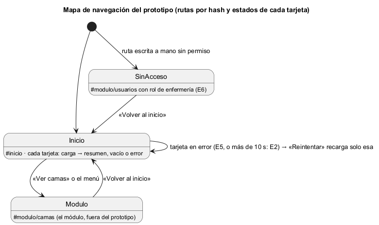

# Semana 11 — Prototipo navegable del Dashboard base

| | |
|---|---|
| **Tarea Odoo** | 2438 — Semana 11: Mejores prácticas para diseño móvil/web |
| **Módulo** | Dashboard base UI/UX e implementación transversal |
| **Base** | Flujo de la semana 8 (PR #205), backlog de la semana 9 (PR #222), diseño móvil de la semana 10 (PR #279) y textos de las tarjetas de `Dominio/Dashboard.php` |
| **Estudiante** | Josué David Morales Ramírez |

## 1. Prototipo y mapa de navegación

**Archivo:** [prototipo/index.html](prototipo/index.html). Se abre sin servidor; es HTML, CSS y JavaScript sin dependencias, con datos ficticios y una API simulada. Flujo principal: «navegación del dashboard con estados de carga, vacío, error y resumen inicial». El layout tiene el menú por permisos y una tarjeta por módulo. Cada tarjeta carga por su cuenta, y hay una columna hasta 375 px, dos desde 376 px y tres desde 431 px (semana 10). El **panel del prototipo**, al pie, cambia el rol y la respuesta de «Citas de hoy» (normal, vacía, falla o lenta).

## 2. Camino feliz y error crítico

| Paso | Escritorio (1280 px) | Móvil (360 px) | Qué se ve |
|---|---|---|---|
| 1. Carga | [captura](capturas/escritorio/01-inicio-cargando.png) | [captura](capturas/movil/01-inicio-cargando.png) | Camas y pacientes ya cargaron; citas sigue en esqueleto (`aria-busy`), sin frenar a las demás (R-03) |
| 2. **Camino feliz** | [captura](capturas/escritorio/02-inicio-resumen.png) | [captura](capturas/movil/02-inicio-resumen.png) | Resumen de las tres tarjetas, ordenadas para enfermería (camas primero) |
| 3. Abrir un módulo | [captura](capturas/escritorio/03-abrir-modulo.png) | [captura](capturas/movil/03-abrir-modulo.png) | «Ver camas» abre el módulo y el menú lo marca como actual, subrayado y con `aria-current` |
| 4. **Error crítico** | [captura](capturas/escritorio/04-error-tarjeta.png) | [captura](capturas/movil/04-error-tarjeta.png) | «No pudimos cargar las citas de hoy. Intenta de nuevo.» (E5), y las otras dos tarjetas siguen con su resumen |
| 5. Recuperación | [captura](capturas/escritorio/05-reintento-recupera.png) | [captura](capturas/movil/05-reintento-recupera.png) | «Reintentar» recarga solo esa tarjeta (R-08) y el foco va a su título |
| 6. Sin permiso | [captura](capturas/escritorio/06-sin-permiso.png) | [captura](capturas/movil/06-sin-permiso.png) | `#modulo/usuarios` con el rol de enfermería: «No tienes acceso a esa sección» (E6), dentro del layout |

Es el error crítico porque toca las tarjetas y los estados de carga, vacío y error: si una falla tumbara la pantalla, o se mostrara como «0», el usuario no podría distinguir «sin datos» de «error» (R-05). El panel también tiene «Vacía», que muestra «No hay citas hoy: agenda una.», y «Lenta», que pasa a error a los 10 s (R-04).

## 3. Consistencia de roles, estados y accesibilidad

- **Roles:** enfermería ve camas, pacientes y citas; el administrador, además, «Usuarios» (R-02). Con el rol de administrador, `#modulo/usuarios` se abre.
- **Estados:** carga, resumen, vacío y error, con los textos de `Dashboard.php`; la unidad tiene singular y plural, como en el Micro-HIS.
- **Accesibilidad:** `lang="es"` y un título por pantalla; foco en el `<h1>` al navegar, y en el título de la tarjeta tras reintentar; «Saltar al contenido»; anillo de foco de 2 px en `#2563eb`; objetivos de 44 px; el enlace activo se distingue sin depender del color (semana 9, B-07); «Reintentar» queda con `aria-disabled` mientras carga.

## 4. Evidencia y validación

[capturar.mjs](evidencia/capturar.mjs), el mismo script de la semana 11 de Catálogo, fija el ancho exacto con el protocolo DevTools de Edge, recorre el flujo pulsando como un usuario, toma las capturas y mide el scroll horizontal. Su [salida](evidencia/salida-medicion.txt) da 18 de 18 mediciones sin scroll a 320, 360 y 430 px (WCAG 1.4.10), y el foco nunca queda en `BODY`. Controles: un bloque inyectado de 600 px marca «SÍ», y con el rol de administrador «Usuarios» se abre. La API simulada responde en 100 ms para que la falla y el reintento quepan en la espera del script.

**Bibliografía:** W3C (2023). *WCAG 2.2* · Chrome DevTools Protocol: `Emulation.setDeviceMetricsOverride`.
