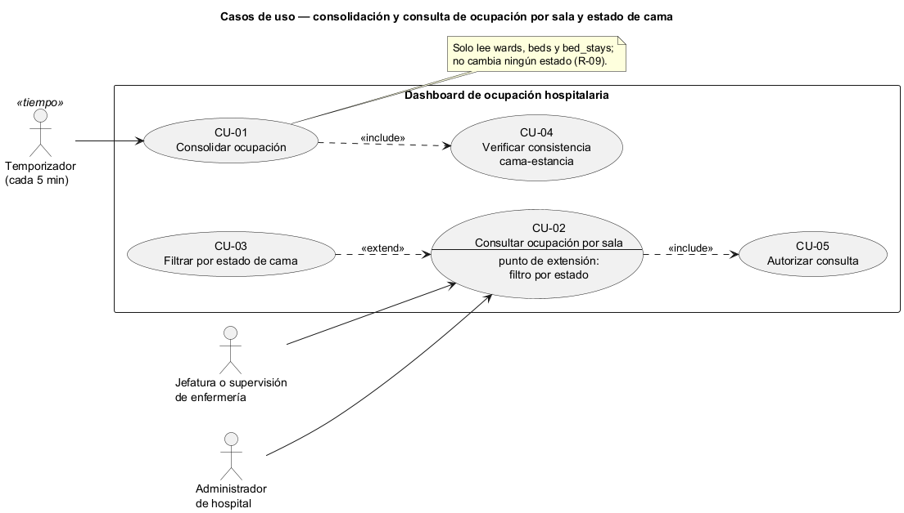
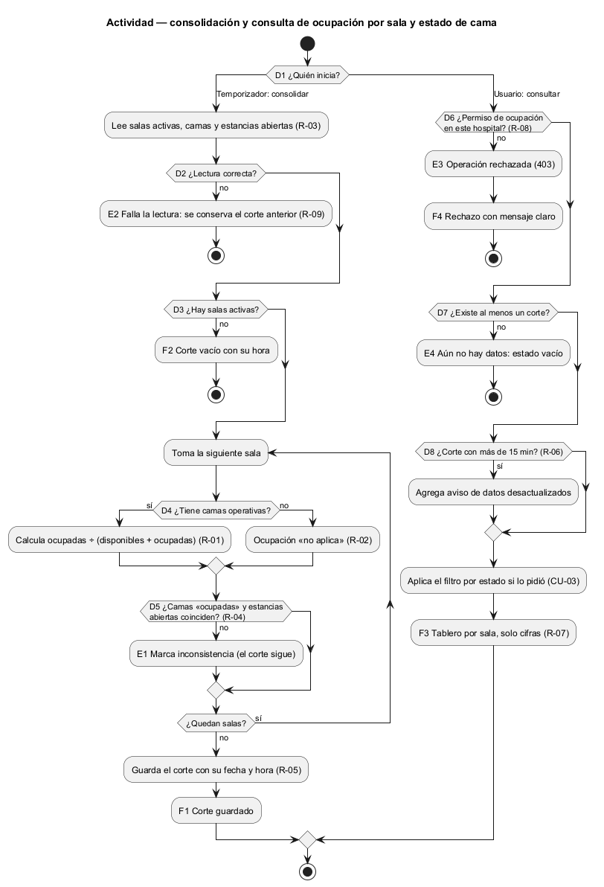
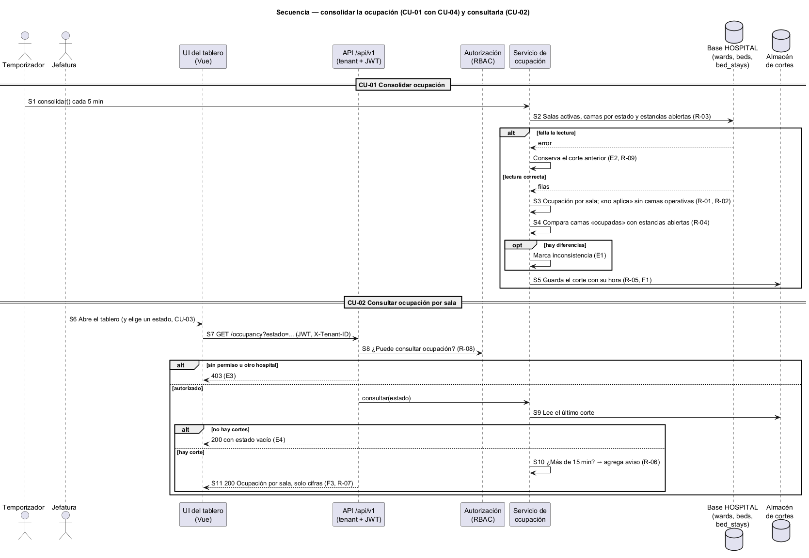

# Semana 1 — Modelado UML del proceso del Dashboard de ocupación hospitalaria

| | |
|---|---|
| **Curso** | Análisis de Sistemas II — Proyecto Final 2026 |
| **Proyecto** | Sistema Hospitalario Integrado (HIS) |
| **Módulo** | Dashboard de ocupación hospitalaria |
| **Tarea Odoo** | 2488 — Semana 1: Conceptos generales, orientación a objetos y UML |
| **Proceso modelado** | «Consolidación y consulta de ocupación por sala y estado de cama» |
| **Estudiante** | Josué David Morales Ramírez (carné 1890-23-10545) |
| **Fecha** | Octubre 2026 |

## 1. Introducción

Para decidir dónde ingresar a un paciente, la jefatura necesita saber **cuántas camas quedan libres en cada sala y qué tan actual es ese dato**. Contar camas a mano o con datos viejos lleva a prometer camas que ya están ocupadas. Este documento modela con UML cómo se consolida la ocupación y cómo se consulta. Las tres vistas comparten identificadores (CU, R, D, E, F, S) para trazarlas entre sí (§9).

## 2. Narrativa de alcance

| | |
|---|---|
| **Objetivo** | Consolidar periódicamente la ocupación por sala y estado de cama, detectar inconsistencias, y mostrarla con su hora de corte a quien tiene permiso. |
| **Dentro del alcance** | Consolidar la ocupación; verificar la consistencia entre cama y estancia; consultar la ocupación por sala; filtrar por estado de cama. |
| **Fuera del alcance** | Cambiar estados de cama (catálogo); asignar, trasladar o liberar camas (admisión); históricos y tendencias (reportes); datos de pacientes. |
| **Supuestos** | La fuente son las tablas `wards`, `beds` y `bed_stays` del esquema HOSPITAL (`database/migrations/hospital/..._000300_create_scheduling_and_bed_tables.php`). La consolidación corre cada 5 minutos y guarda un «corte»; el almacenamiento de cortes se define en la Semana 4. El umbral de 15 minutos para avisar de datos viejos es una propuesta. El esquema no asigna salas a supervisores, así que todo usuario con permiso ve todas las salas de su hospital. Los endpoints se formalizan en la Semana 5. |

## 3. Actores

| Actor | Tipo | Objetivo en el proceso |
|---|---|---|
| Jefatura o supervisión de enfermería | Primario | Ver qué salas tienen camas libres para decidir ingresos y traslados. |
| Administrador de hospital | Primario | Seguir la ocupación global del hospital. |
| Temporizador (tarea programada) | Primario (tiempo) | Disparar la consolidación cada 5 minutos. |

El temporizador es un actor de tiempo: inicia un caso de uso sin que nadie lo pida. El catálogo y admisión no son actores aquí, porque el tablero solo lee sus tablas, no se comunica con ellos.

## 4. Reglas de negocio

| ID | Regla | Origen |
|---|---|---|
| R-01 | Ocupación de una sala = ocupadas ÷ (disponibles + ocupadas). Mantenimiento e inactivas se muestran aparte y no cuentan. | Decisión de diseño sobre `beds.status` |
| R-02 | Una sala sin camas operativas muestra «no aplica», nunca una división entre cero. | Decisión de diseño |
| R-03 | Solo se consolidan salas activas. | `wards.status IN ('active','inactive')` |
| R-04 | Una cama «ocupada» debe tener una estancia abierta, y una estancia abierta debe estar en una cama «ocupada». Si no coinciden, se marca inconsistencia; el tablero no la corrige. | `bed_stays.ended_at IS NULL` y `bed_stays_bed_active_period_exclusion` |
| R-05 | Cada corte guarda su fecha y hora, y la consulta la muestra. | Decisión de diseño |
| R-06 | Si el último corte tiene más de 15 minutos, se avisa que los datos pueden estar desactualizados. | Decisión de diseño |
| R-07 | Solo cifras agregadas: ningún nombre ni dato de paciente. | Minimización de datos clínicos |
| R-08 | Solo consulta quien tenga el permiso de ocupación en el mismo hospital. | Módulo RBAC, cabecera `X-Tenant-ID` |
| R-09 | La consolidación es de solo lectura: no cambia ningún estado. Si falla, se conserva el corte anterior. | Decisión de diseño |

## 5. Diagrama de casos de uso

Fuente editable: [diagramas/semana-01-casos-de-uso.puml](diagramas/semana-01-casos-de-uso.puml)

## 6. Especificación de casos de uso

| CU | Nombre | Actor | Flujo principal | Alternativas y excepciones | Reglas |
|---|---|---|---|---|---|
| CU-01 | Consolidar ocupación | Temporizador | Lee salas activas, camas y estancias abiertas; calcula la ocupación por sala y guarda el corte con su hora. | Sin salas activas (F2); falla la lectura (E2). | R-01–R-05, R-09 |
| CU-02 | Consultar ocupación por sala | Jefatura, Administrador | Ve el último corte: por sala, disponibles, ocupadas, mantenimiento, inactivas y porcentaje. | Sin permiso (E3); aún no hay corte (E4); corte viejo (aviso). | R-01, R-02, R-05–R-08 |
| CU-03 | Filtrar por estado de cama (extiende CU-02) | Jefatura, Administrador | Elige un estado (por ejemplo «disponible») y ve solo las salas que tienen camas en ese estado. | — | R-07 |
| CU-04 | Verificar consistencia cama-estancia (incluido) | — | Compara `beds.status` con las estancias abiertas y marca las diferencias. | Inconsistencia (E1). | R-04 |
| CU-05 | Autorizar consulta (incluido) | — | Verifica sesión, hospital y permiso. | E3. | R-08 |

**Relaciones:** CU-01 *incluye* CU-04, porque no se publica un corte sin revisar su consistencia. CU-02 *incluye* CU-05. CU-03 *extiende* CU-02 en el punto de extensión «filtro por estado».

## 7. Diagrama de actividad

Fuente editable: [diagramas/semana-01-actividad.puml](diagramas/semana-01-actividad.puml)

| Decisión | Pregunta | Si falla |
|---|---|---|
| D1 | ¿Quién inicia: el temporizador o un usuario? | — |
| D2 | ¿Se pudieron leer salas, camas y estancias? | E2 Falla la lectura: se conserva el corte anterior |
| D3 | ¿Hay salas activas? | No → F2 corte vacío |
| D4 | ¿La sala tiene camas operativas? | No → ocupación «no aplica» (R-02) |
| D5 | ¿Estado de cada cama y estancias abiertas coinciden? | E1 Inconsistencia marcada (el corte sigue) |
| D6 | ¿El usuario tiene permiso en este hospital? | E3 Operación rechazada (403) |
| D7 | ¿Existe al menos un corte? | E4 Aún no hay datos (estado vacío) |
| D8 | ¿El corte tiene más de 15 minutos? | Sí → se muestra con aviso de datos viejos |

**Resultados:** F1 corte guardado con su hora · F2 corte vacío (sin salas activas) · F3 tablero de ocupación mostrado (con aviso si es viejo) · F4 operación rechazada con mensaje claro.

## 8. Diagrama de secuencia

Fuente editable: [diagramas/semana-01-secuencia.puml](diagramas/semana-01-secuencia.puml)

Participantes: Temporizador, Jefatura, UI del tablero (Vue), API `/api/v1`, Autorización (RBAC), Servicio de ocupación, base HOSPITAL (`wards`, `beds`, `bed_stays`) y Almacén de cortes.

| Paso | Mensaje | Validación o respuesta |
|---|---|---|
| S1 | Temporizador → servicio: consolidar (cada 5 min) | — |
| S2 | Lee salas activas, camas por estado y estancias abiertas | Falla → se conserva el corte anterior |
| S3 | Calcula por sala la ocupación (R-01, R-02) | — |
| S4 | Compara camas «ocupadas» con estancias abiertas | Diferencia → marca inconsistencia |
| S5 | Guarda el corte con su hora (F1) | — |
| S6–S7 | Jefatura abre el tablero → `GET /occupancy?estado=...` | — |
| S8 | API → RBAC: ¿puede consultar ocupación? | No → 403 |
| S9 | Servicio lee el último corte | No hay → 200 con estado vacío |
| S10 | Revisa la antigüedad del corte | > 15 min → agrega aviso |
| S11 | 200 con la ocupación por sala (F3) | — |

## 9. Matriz de trazabilidad

| CU | Reglas | Actividad | Secuencia |
|---|---|---|---|
| CU-01 | R-01–R-05, R-09 | D1–D5, E1, E2, F1, F2 | S1–S5 |
| CU-02 | R-01, R-02, R-05–R-08 | D6–D8, E3, E4, F3 | S6–S11 |
| CU-03 | R-07 | (parámetro `estado` del flujo de consulta) | S7 |
| CU-04 | R-04 | D5, E1 | S4 |
| CU-05 | R-08 | D6, E3, F4 | S8 |

## 10. Conclusión

El tablero no decide nada sobre las camas: las cuenta, revisa que los datos cuadren y dice qué tan actuales son. Separar la consolidación (temporizador) de la consulta (usuario) hace que la consulta sea rápida y que un fallo de lectura no deje el tablero en blanco. La inconsistencia cama-estancia (R-04) es el dato más útil para los módulos de catálogo y admisión.

## 11. Bibliografía

- Object Management Group. (2017). *Unified Modeling Language (UML) Version 2.5.1*. https://www.omg.org/spec/UML/2.5.1
- Sommerville, I. (2016). *Software Engineering* (10.ª ed.). Pearson.
- Esquema HOSPITAL del repositorio: `database/migrations/hospital/2026_08_11_000300_create_scheduling_and_bed_tables.php`.
