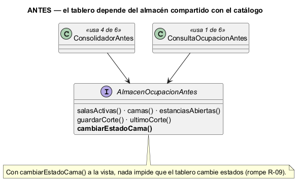
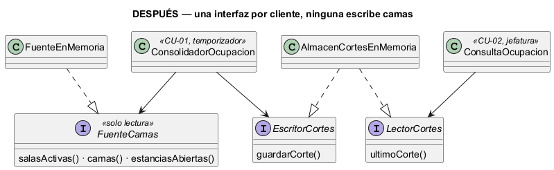

# Semana 2 — RF/RNF, criterios de aceptación e ISP en el Dashboard de ocupación

| | |
|---|---|
| **Módulo** | Dashboard de ocupación hospitalaria |
| **Tarea Odoo** | 2489 — Semana 2: Proceso y modelo de diseño; principios SOLID |
| **Flujo** | «Consolidación y consulta de ocupación por sala y estado de cama» (modelado en la [Semana 1](../semana-01/semana-01-uml-ocupacion.md)) |
| **Principio aplicado** | ISP — principio de segregación de interfaces |
| **Estudiante** | Josué David Morales Ramírez |

## 1. Requerimientos funcionales

| ID | Requerimiento | Trazado a |
|---|---|---|
| RF-01 | Calcular por sala la ocupación = ocupadas ÷ (disponibles + ocupadas); mantenimiento e inactivas aparte. | CU-01, R-01 |
| RF-02 | Mostrar «no aplica» en una sala sin camas operativas, y excluir las salas inactivas. | CU-01, R-02, R-03 |
| RF-03 | Marcar las camas cuyo estado no coincide con sus estancias abiertas, sin corregirlas. | CU-04, R-04 |
| RF-04 | Guardar cada corte con su hora y, al consultarlo, avisar si tiene más de 15 minutos. | CU-02, R-05, R-06 |
| RF-05 | Filtrar el tablero por estado de cama. | CU-03 |
| RF-06 | Si falla la lectura, conservar el corte anterior. | CU-01, R-09 |

## 2. Requerimientos no funcionales

| ID | Requerimiento | Cómo se verifica |
|---|---|---|
| RNF-01 | Seguridad: solo consulta quien tiene permiso de ocupación en el mismo hospital. | Prueba de API en la Semana 15 |
| RNF-02 | Integridad: el tablero no puede cambiar estados de cama. | `verificar.php`: ninguna interfaz expone `cambiar…`, `asignar…` ni `liberar…` |
| RNF-03 | Mantenibilidad: cada cliente depende solo de los métodos que usa. | `verificar.php`: reflexión (3 + 1 y 1 métodos, frente a 6) |
| RNF-04 | Disponibilidad: un fallo de lectura no deja el tablero en blanco. | `verificar.php`: CA-07 |
| RNF-05 | Privacidad: los cortes solo tienen cifras. | `verificar.php`: CA-08 |

## 3. Criterios de aceptación

| CA | Dado / Cuando / Entonces | RF | Evidencia |
|---|---|---|---|
| CA-01 | Dada la sala A con 2 disponibles, 2 ocupadas y 1 en mantenimiento, cuando consolido, entonces A = 50.0 %. | RF-01 | `verificar.php` |
| CA-02 | Dada la sala B solo con mantenimiento e inactiva, entonces «no aplica»; la sala inactiva C no aparece. | RF-02 | `verificar.php` |
| CA-03 | Dadas A4 ocupada sin estancia y A5 disponible con estancia, entonces ambas quedan marcadas como inconsistentes. | RF-03 | `verificar.php` |
| CA-04 | Dado que aún no hay corte, cuando consulto, entonces veo el estado vacío. | RF-04 | `verificar.php` |
| CA-05 | Dado un corte de hace 5 minutos, no hay aviso; si es de hace 20, sí. | RF-04 | `verificar.php` |
| CA-06 | Cuando filtro por «disponible», entonces solo veo las salas con camas disponibles. | RF-05 | `verificar.php` |
| CA-07 | Dado que falla la lectura, cuando consolido, entonces se conserva el corte anterior. | RF-06 | `verificar.php` |
| CA-08 | El corte no contiene datos de pacientes. | RNF-05 | `verificar.php` |

## 4. ISP: diseño antes y después

**El problema (antes).** En [`ejemplo-isp/antes.php`](ejemplo-isp/antes.php), el consolidador y la consulta dependen de `AlmacenOcupacionAntes`, el almacén que también usa el catálogo. Tiene 6 métodos: el consolidador usa 4 y la consulta 1. Y uno de ellos, `cambiarEstadoCama()`, es de escritura: el tablero, que según R-09 solo debe leer, tiene a la vista un método para cambiar camas.



**La solución (después).** En [`ejemplo-isp/despues.php`](ejemplo-isp/despues.php), la interfaz se separa por cliente, y ninguna parte escribe camas:

| Interfaz | Cliente y su responsabilidad | Métodos | Implementada por |
|---|---|---:|---|
| `FuenteCamas` | `ConsolidadorOcupacion`: leer salas, camas y estancias | 3 | `FuenteEnMemoria` (en producción, una consulta de solo lectura a `wards`, `beds` y `bed_stays`) |
| `EscritorCortes` | `ConsolidadorOcupacion`: guardar el corte | 1 | `AlmacenCortesEnMemoria` |
| `LectorCortes` | `ConsultaOcupacion`: leer el último corte | 1 | `AlmacenCortesEnMemoria` |



**Por qué estas responsabilidades y dependencias.** El consolidador recibe dos interfaces porque hace dos cosas distintas (leer camas y escribir cortes); la consulta recibe solo una. `cambiarEstadoCama()` queda en el módulo de catálogo, que es su dueño. ISP refuerza aquí una regla de negocio: si el tablero no ve el método, no puede llamarlo por error.

## 5. Evidencia verificable

```powershell
php docs/modulos/dashboard-ocupacion/semana-02/ejemplo-isp/verificar.php
```

Salida real: [`evidencia/salida-verificar.txt`](evidencia/salida-verificar.txt). Pasan 17 de 17 controles: los criterios CA-01 a CA-08 con datos ficticios, la reflexión que muestra 3 + 1 y 1 métodos frente a 6, que ninguna interfaz del tablero permite cambiar camas y que la versión anterior sí lo permitía. En una prueba de mutación se contaron las camas en mantenimiento en la fórmula, en una copia de `despues.php`, y el script falló en CA-01 y CA-02 (exit 1).

## 6. Conclusión

En este módulo, ISP no solo ordena el código: hace cumplir R-09. El tablero queda con interfaces de lectura, la consulta depende de un solo método y la fórmula de ocupación queda probada con casos que incluyen mantenimiento, salas sin camas operativas e inconsistencias en los dos sentidos.

## 7. Bibliografía

- MVP Cluster. (s. f.). *Diseño de software 2: principios SOLID*. https://mvpcluster.com/diseno-de-software-2/
- Martin, R. C. (2018). *Clean Architecture*. Prentice Hall.
