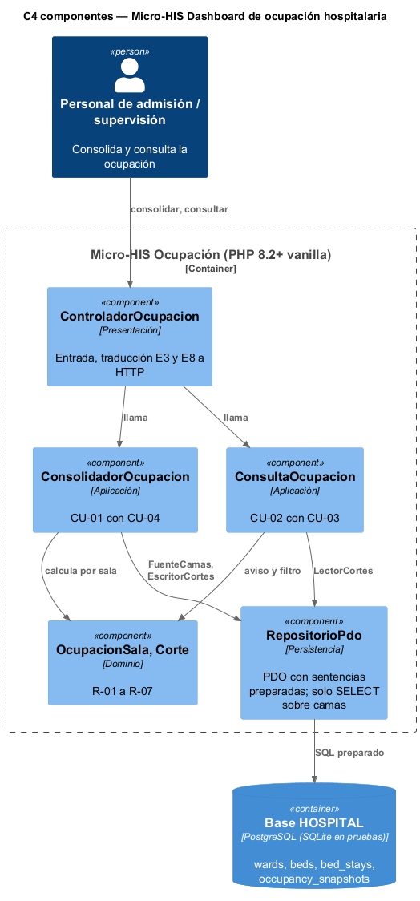
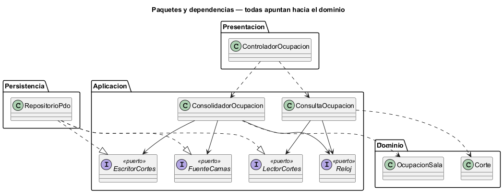

# Semana 3 — Vista arquitectónica del Micro-HIS Dashboard de ocupación hospitalaria

| | |
|---|---|
| **Tarea Odoo** | 2490 — Semana 3: Diseño arquitectónico, vistas y patrones |
| **Flujo** | «Consolidación y consulta de ocupación por sala y estado de cama» (semanas [1](../semana-01/semana-01-uml-ocupacion.md) y [2](../semana-02/semana-02-isp-requerimientos-diseno.md)) |
| **Código** | [`micro-his-dashboard-ocupacion/`](../micro-his-dashboard-ocupacion/): PHP 8.2+ vanilla, sin framework |
| **Estudiante** | Josué David Morales Ramírez |

## 1. Decisiones arquitectónicas

| Decisión | Por qué |
|---|---|
| Cuatro capas: Presentación, Aplicación, Dominio y Persistencia | Lo pide el enunciado; cada capa tiene una sola razón para cambiar. |
| Dominio sin dependencias: `OcupacionSala` (R-01, R-02, R-04, R-07) y `Corte` (R-05, R-06, CU-03) | El cálculo, las inconsistencias, el aviso y el filtro se prueban sin base ni HTTP. |
| Puertos por cliente (ISP de la semana 2): `FuenteCamas`, `EscritorCortes`, `LectorCortes` y `Reloj` | El consolidador lee camas y escribe cortes; la consulta solo lee cortes. Ningún puerto cambia una cama (R-09). |
| Una sola consulta con `LEFT JOIN` y `EXISTS` sobre `bed_stays` | Trae también las salas sin camas y marca cada cama con o sin estancia abierta, sin datos del paciente. |
| La lectura falla antes de guardar el corte | Si la base cae, el último corte sigue siendo el que se consulta (R-09, CA-07). |

## 2. Vista C4 de componentes y regla de dependencias

 

| Componente | Capa | Responsabilidad | Depende de |
|---|---|---|---|
| `ControladorOcupacion` | Presentación | Recibir la petición y traducir E3 y E8 a HTTP | Los dos servicios |
| `ConsolidadorOcupacion`, `ConsultaOcupacion` | Aplicación | CU-01 con CU-04, y CU-02 con CU-03 | Dominio y sus puertos |
| `OcupacionSala`, `Corte` | Dominio | Cálculo por sala, inconsistencias, aviso y filtro | Nada |
| `RepositorioPdo` | Persistencia | Lectura de camas y guardado de cortes con PDO | Los tres puertos de datos |

## 3. Pruebas y evidencia

`php docs/modulos/dashboard-ocupacion/micro-his-dashboard-ocupacion/pruebas/pruebas.php` → [`evidencia/salida-pruebas.txt`](evidencia/salida-pruebas.txt) (15/15, exit 0).

| Tipo pedido | Cómo se prueba | Resultado |
|---|---|---|
| Camino feliz | Base SQLite de prueba: vacío sin corte → consolidar → sala A al 50.0 % → filtro por «available» | 4/4 |
| Regla de dominio | «No aplica» y salas inactivas (R-02, R-03), inconsistencias (R-04), solo lectura (R-09), aviso a los 20 min (R-06), estado desconocido (E3), solo cifras (R-07) | 6/6 |
| Error de persistencia | Doble con la base caída y `PDOException` real (tabla borrada): 503 sin detalles técnicos y se conserva el corte anterior | 3/3 |
| Dependencias y SQL | Ninguna capa apunta hacia afuera; ninguna consulta concatena variables | 2/2 |

En una prueba de mutación se contó el mantenimiento como cama operativa en una copia del dominio, y las pruebas fallaron en R-01 y R-02 (exit 1). Las pruebas también encontraron un error real: `json_encode(50.0)` guardaba `50` y el corte volvía como entero; se corrigió con `JSON_PRESERVE_ZERO_FRACTION`.

**Limitaciones:** el permiso de ocupación (R-08) llega con RBAC en una semana posterior; la consolidación se pide a mano, sin tarea programada; SQLite reemplaza a PostgreSQL en las pruebas. **Siguiente:** MVC con Repository (semana 4).

**Bibliografía:** Brown, S. (2018). *The C4 model*. https://c4model.com · Martin, R. C. (2018). *Clean Architecture*. Prentice Hall.
