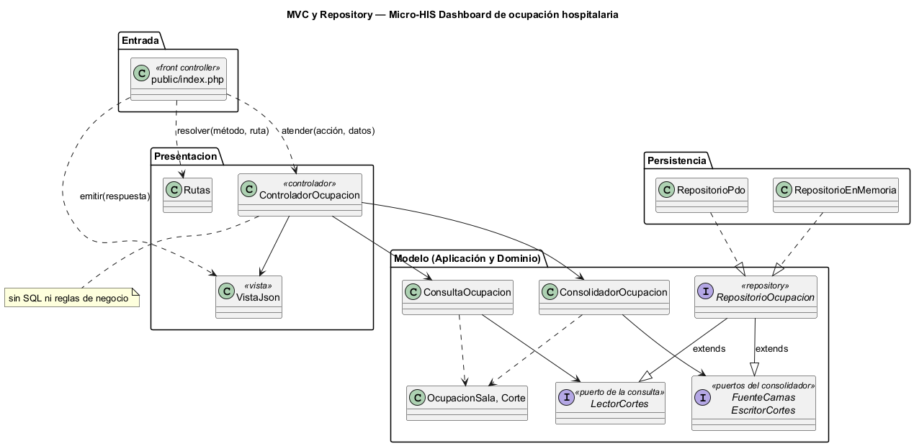
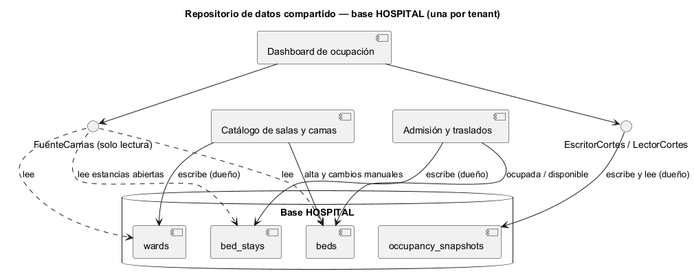

# Semana 4 — MVC, Repository y repositorio de datos compartido en el Micro-HIS Dashboard de ocupación hospitalaria

| | |
|---|---|
| **Tarea Odoo** | 2491 — Semana 4: Arquitectura en capas y patrón repositorio |
| **Flujo** | «Consolidación y consulta de ocupación por sala y estado de cama» (mismo Micro-HIS de la [Semana 3](../semana-03/semana-03-arquitectura-micro-his.md)) |
| **Código** | [`micro-his-dashboard-ocupacion/`](../micro-his-dashboard-ocupacion/): PHP 8.2+ vanilla, sin framework |
| **Estudiante** | Josué David Morales Ramírez |

## 1. Entrada organizada con MVC

| Pieza | Archivo | Responsabilidad |
|---|---|---|
| Front controller | `public/index.php` | Único punto de entrada HTTP: resuelve la ruta, toma el filtro `?estado=` de la consulta, inyecta el reloj y emite la respuesta. |
| Rutas | `Presentacion/Rutas.php` | `POST /ocupacion/cortes` (consolidar) y `GET /ocupacion` (último corte). |
| Controlador | `Presentacion/ControladorOcupacion.php` | Elige el caso de uso y entrega el resultado a la vista. **Sin SQL ni reglas de negocio** (lo comprueba una prueba). |
| Vista | `Presentacion/VistaJson.php` | Única dueña de los códigos HTTP (201, 200, 422 E3 y 503 E8) y de los textos; emite `50.0` como número decimal. |
| Modelo | Los dos servicios de `Aplicacion/` + `Dominio/Ocupacion.php` | Casos de uso y reglas R-01 a R-09; sin cambios respecto a la Semana 3. |

## 2. Interfaz Repository en el límite y sus adaptadores

La interfaz Repository del módulo es `RepositorioOcupacion`, en **Aplicación**: la unión de los tres puertos por cliente de la semana 2 (`FuenteCamas`, `EscritorCortes` y `LectorCortes`). Ninguno permite cambiar una cama (R-09). El consolidador recibe solo la fuente y el escritor, la consulta solo el lector (ISP), y el modelo no depende de PDO (DIP).

| Adaptador | Para qué | Cómo cumple el contrato |
|---|---|---|
| `RepositorioPdo` | Producción (PostgreSQL) y pruebas (SQLite) | Una consulta preparada con `LEFT JOIN` y `EXISTS` sobre `bed_stays`; cortes en JSON con `JSON_PRESERVE_ZERO_FRACTION`. |
| `RepositorioEnMemoria` | Pruebas y demos sin base | Las mismas filas: solo salas activas, ordenadas, y una fila con cama `null` para una sala sin camas, como el `LEFT JOIN`. |

## 3. Capas, responsabilidades y objetos reutilizables

| Capa | Objetos | Responsabilidad | Reutilizable en |
|---|---|---|---|
| Dominio | `OcupacionSala`, `Corte`, `ReglaDeDominio` | Ocupación por sala, inconsistencias, aviso de corte viejo y filtro | Reportes de ocupación y el dashboard base (tarjeta de camas) |
| Aplicación | `ConsolidadorOcupacion`, `ConsultaOcupacion`, cuatro puertos y `RepositorioOcupacion` | CU-01 a CU-04 | Una tarea programada que consolide sin HTTP |
| Persistencia | `RepositorioPdo`, `RepositorioEnMemoria` | Lectura de camas y guardado de cortes | `RepositorioEnMemoria` como doble para el frontend del tablero |

## 4. Cómo lo integraría un repositorio de datos compartido

En el estilo de **repositorio de datos compartido**, los módulos se coordinan a través de un almacén común, la base HOSPITAL del tenant. Ocupación **lee** lo que escriben Catálogo y Admisión, y **escribe** solo sus propios cortes.

| Decisión | Regla propuesta |
|---|---|
| Dueño de cada dato | Catálogo escribe `wards` y los cambios manuales de `beds`; Admisión escribe `bed_stays` y pasa las camas a ocupadas o disponibles; Ocupación es dueña solo de `occupancy_snapshots`. |
| Acceso | `FuenteCamas` es de solo lectura: el tablero nunca corrige una inconsistencia, solo la marca (R-04, R-09). |
| Consistencia | Cada corte es una foto con hora (R-05); si la lectura falla, se conserva el anterior (R-09) y el aviso de 15 min muestra que los datos pueden ser viejos (R-06). |
| Esquema | Si Catálogo o Admisión cambian sus estados, cambia solo `RepositorioPdo`; los cortes ya guardados no se tocan. |
| Aislamiento | Una base por hospital: nunca se mezclan camas de tenants distintos. |

**Ventajas:** el tablero no llama a Catálogo ni a Admisión y siempre consolida desde el dato real. **Riesgos:** depende del esquema de dos dueños y la consolidación lee muchas filas; se mitiga con una sola consulta indexada y cortes guardados que la consulta lee sin tocar las camas.

## 5. Evidencia

`php docs/modulos/dashboard-ocupacion/micro-his-dashboard-ocupacion/pruebas/pruebas.php` → [`evidencia/salida-pruebas.txt`](evidencia/salida-pruebas.txt) (29/29, exit 0; el mismo guion de 10 pruebas con cada adaptador). Prueba HTTP real con `php -S` y `curl` → [`evidencia/salida-http.txt`](evidencia/salida-http.txt). En una prueba de mutación se incluyeron las salas inactivas en una copia de `RepositorioEnMemoria`, y fallaron 3 pruebas (exit 1). **Limitaciones:** el permiso de ocupación (R-08) llega con RBAC; la consolidación se pide a mano, sin tarea programada. **Bibliografía:** Pressman, R. S. y Maxim, B. R. (2020). *Ingeniería del software* (9.ª ed.), cap. de diseño arquitectónico. McGraw-Hill · Fowler, M. (2002). *Patterns of Enterprise Application Architecture* (Repository, Front Controller). Addison-Wesley.
