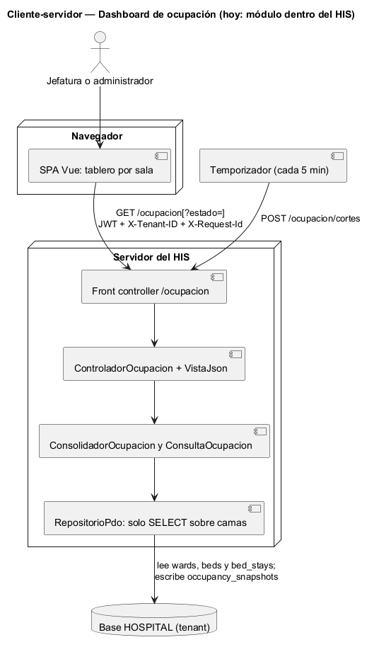
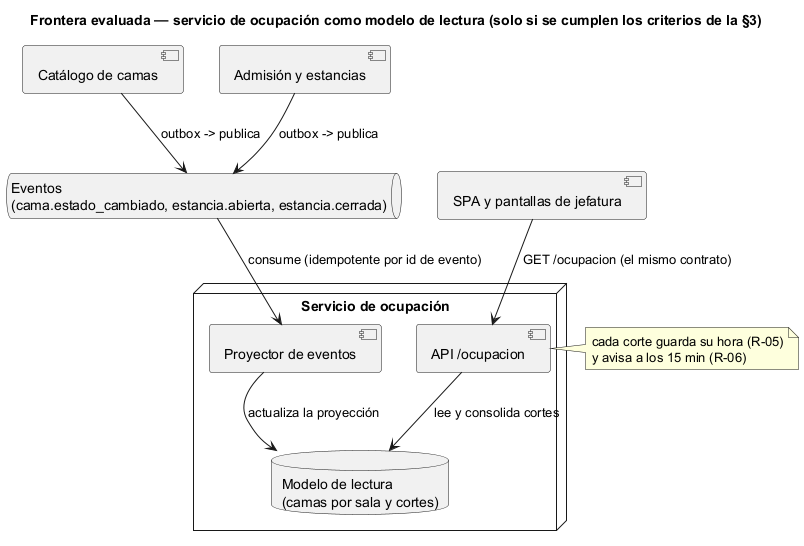

# Semana 5 — Cliente-servidor, contrato API y frontera de microservicio del Dashboard de ocupación hospitalaria

| | |
|---|---|
| **Tarea Odoo** | 2492 — Semana 5: Cliente-servidor, API REST, microservicios e integración |
| **Flujo** | «Consolidación y consulta de ocupación por sala y estado de cama» (mismo Micro-HIS de las [semanas 3](../semana-03/semana-03-arquitectura-micro-his.md) y [4](../semana-04/semana-04-mvc-repository.md)) |
| **Contrato** | [api/openapi.yaml](api/openapi.yaml) (OpenAPI 3.1, validado con Redocly) |
| **Estudiante** | Josué David Morales Ramírez |

## 1. Diseño cliente-servidor

Hay dos clientes. La SPA del HIS **consulta** el último corte (`GET /ocupacion`), y un temporizador **consolida** cortes (`POST /ocupacion/cortes`). El temporizador cada 5 minutos es una propuesta: hoy la consolidación se pide a mano. El servidor separa escribir de leer: la consulta nunca recalcula y solo lee el último corte guardado, con su hora. Así, una lectura lenta o caída de las camas no deja el tablero sin datos (RNF-04).

## 2. Contrato API

| Método | Ruta | Caso de uso | Éxito | Errores documentados |
|---|---|---|---|---|
| POST | `/ocupacion/cortes` | CU-01 consolidar (con CU-04) | 201 `{hora, salas}` | 403 sin permiso (semana 15), 503 E8 lectura fallida |
| GET | `/ocupacion[?estado=]` | CU-02 consultar y CU-03 filtrar | 200 con el corte, o `{"vacio": true}` | 422 E3 estado desconocido, 503 E8 |

Cada sala trae solo cifras: los cuatro estados, la ocupación (o «no aplica», R-02) y las camas inconsistentes (R-04), nunca datos de pacientes (R-07). El lint pidió una respuesta 4xx para consolidar. El contrato la documenta como el 403 que llegará con el permiso de ocupación, y no inventa un código que el Micro-HIS no produce. Los códigos E3 y E8 se documentan tal como responden hoy, distintos de la semana 1, que es el hallazgo H-02 de la semana 13. **Prueba de contrato:** [verificar-contrato.php](evidencia/verificar-contrato.php) hace pasar 7 escenarios por las rutas y el controlador reales y comprueba que cada respuesta esté documentada. Comprueba también que las 2 operaciones coincidan con las acciones del controlador ([salida](evidencia/salida-contrato.txt)).

## 3. Frontera de microservicio: evaluación con criterios medibles

La frontera candidata es un **servicio de ocupación como modelo de lectura**: no lee las tablas de otros, sino que proyecta los eventos de Catálogo y Admisión en su propia base. Es el patrón natural de un tablero, pero solo tiene sentido si un criterio medible lo pide:

| Criterio para extraerlo | Umbral | Valor hoy | ¿Lo pide? |
|---|---|---|---|
| Catálogo o Admisión ya extraídos (no hay tabla compartida que leer) | Al menos 1 | 0: la semana 5 de Catálogo decidió no extraerlo | No |
| Tiempo de consolidación de un corte | Más de 5 s (1/60 del intervalo propuesto de 5 min) | Sin datos de producción; en las pruebas, con 8 camas, es inmediato | No |
| Lectores fuera del HIS (pantallas de jefatura, otras sedes) | Al menos 1 en producción | 0 | No |
| Despliegue independiente: cambios frenados por otros módulos | Más de 1 por mes | 0: ninguno de los 9 PR del módulo integrados en `develop` esperó un cambio de otro módulo | No |

**Decisión:** la ocupación sigue como **módulo del monolito** que lee la base del tenant, sin escribir en las camas (semana 4). Su frontera ya está marcada por los puertos de solo lectura (`FuenteCamas`) y por los cortes guardados, que son su propio modelo de lectura.

## 4. Si se extrae: propiedad, comunicación, seguridad, resiliencia, observabilidad y consistencia

| Aspecto | Decisión |
|---|---|
| Propiedad de datos | Catálogo sigue dueño de las camas y Admisión de las estancias. El servicio es dueño solo de su proyección y de sus cortes, y nunca corrige una inconsistencia: la marca (R-04, R-09). |
| Comunicación | Asíncrona para alimentarse (`cama.estado_cambiado`, `estancia.abierta`, `estancia.cerrada`) y síncrona (HTTP) para consultar. Nadie le pide al servicio que cambie una cama. |
| Seguridad | JWT, `X-Tenant-ID` y permiso de ocupación (R-08). La proyección es por tenant, y los eventos de un hospital nunca entran en la de otro. |
| Resiliencia | Si los eventos se atrasan, la consulta sigue respondiendo con el último corte, su hora y el aviso de 15 minutos (R-06). El proyector es idempotente por id de evento, así que un evento repetido no cuenta dos veces. |
| Observabilidad | `X-Request-Id` en la consulta, retraso del proyector (hora del último evento aplicado), número de inconsistencias por corte y porcentaje de consultas con aviso de corte viejo. |
| Consistencia | Eventual y **visible**: cada corte dice su hora, y el aviso lo hace explícito. Una vez al día, una reconciliación compara la proyección con un `COUNT` sobre las tablas de origen. |

## 5. Migración razonada (si un criterio de la §3 se cumple)

1. **Contrato primero:** congelar `openapi.yaml` y su prueba de contrato en el CI. Ya está hecho en esta entrega.
2. **Cerrar H-02 y H-03 antes de mover nada:** los códigos de la semana 1 y la marca de dos estancias en una cama. Una proyección hereda los errores de la consulta que reemplaza.
3. **Eventos en paralelo:** Catálogo y Admisión publican con outbox, y el servicio proyecta en sombra mientras el módulo sigue leyendo las tablas. Se comparan los dos cortes durante una semana.
4. **Cambio de lectura:** cuando los cortes coinciden 7 días seguidos, la consulta pasa a la proyección y el monolito redirige `/ocupacion`. La salida se mide con la prueba de contrato en verde.
5. **Reversa:** si la reconciliación diaria encuentra una diferencia, la consulta vuelve a leer las tablas mientras se corrige el proyector.

## 6. Plan de issue, rama, worktree y PR

| Paso | Valor |
|---|---|
| Issue | «Semana 5: Ocupación — contrato API y frontera de microservicio»; criterios de aceptación: lint sin errores, prueba de contrato en verde, decisión con criterios medibles. |
| Rama | `semana-5-dashboard-ocupacion`, desde `origin/develop` actualizado. |
| Worktree | `git worktree add ../wt-ocupacion-s5 -b semana-5-dashboard-ocupacion origin/develop`. Aísla la tarea sin cambiar de rama en la copia principal. Para esta entrega se usó una rama normal, porque había una sola tarea activa. |
| PR | Hacia `develop`, 1 commit, máximo 400 líneas, con la plantilla del repositorio, la salida del lint y de la prueba de contrato, y la revisión pedida al revisor asignado. |

**Evidencia:** [salida del lint](evidencia/salida-lint-openapi.txt) (`npx @redocly/cli@1.34.3 lint`, sin errores ni avisos) y [salida de la prueba de contrato](evidencia/salida-contrato.txt) (9 de 9). **Bibliografía:** Newman, S. (2021). *Building Microservices* (2.ª ed.). O'Reilly · Fowler, M. (2011). *CQRS*. martinfowler.com · OpenAPI Initiative (2021). *OpenAPI Specification 3.1.0*.
