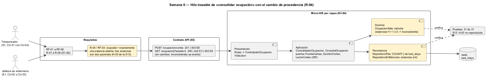

# Semana 6 — Defensa de la arquitectura del Dashboard de ocupación hospitalaria

| | |
|---|---|
| **Tarea Odoo** | 2493 — Semana 6: Primera evaluación parcial |
| **Flujo** | «Consolidación y consulta de ocupación por sala y estado de cama» |
| **Presentación** | [semana-06-diapositivas.md](semana-06-diapositivas.md) (8 diapositivas) |
| **Estudiante** | Josué David Morales Ramírez |

## 1. Hilo trazable

Un solo hilo conecta las semanas 1 a 5. El temporizador consolida (CU-01, con CU-04 incluido) y la jefatura consulta y filtra (CU-02 y CU-03). RF-01 a RF-06 y R-01 a R-09 fijan las reglas, el contrato expone `POST /ocupacion/cortes` y `GET /ocupacion`, y cada capa del Micro-HIS cumple una parte. En amarillo está lo que añade el cambio práctico (§3).

## 2. Matriz decisión → evidencia

| # | Decisión | Por qué | RF/RNF | Evidencia verificable |
|---|---|---|---|---|
| D-01 | Tres actores: jefatura, administrador y temporizador, que consolida cada 5 minutos | La consulta no recalcula: lee el último corte | RF-04 | [Casos de uso S1](../semana-01/semana-01-uml-ocupacion.md) |
| D-02 | **ISP**: tres puertos (`FuenteCamas`, `EscritorCortes`, `LectorCortes`); ninguno cambia estados de cama | Cada servicio ve solo lo que usa; el tablero no puede escribir camas | RNF-02, RNF-03 | [Antes/después S2](../semana-02/semana-02-isp-requerimientos-diseno.md); prueba «consolidar no cambia ningún estado» |
| D-03 | Cuatro capas; la fórmula (`OcupacionSala`) y el corte (`Corte`) en el dominio | Ocupación = ocupadas ÷ operativas, probada sin base | RF-01, RF-02 | [S3](../semana-03/semana-03-arquitectura-micro-his.md); prueba «sala A = 50.0 %» |
| D-04 | MVC: el controlador solo elige el caso de uso; `VistaJson` es dueña de los HTTP | Errores con un código fijo | RF-05 | [S4](../semana-04/semana-04-mvc-repository.md); prueba «estado que no existe = 422 E3» |
| D-05 | Repository (unión de los tres puertos) con PDO e InMemory y el mismo guion | Probar sin base y cambiar de motor | RNF-03 | 10 pruebas por adaptador en [salida-pruebas.txt](evidencia/salida-pruebas.txt) |
| D-06 | Cada corte guarda su hora y avisa a los 15 minutos; si falla la lectura, queda el anterior | Actualización visible y tablero nunca en blanco | RF-04, RF-06, RNF-04 | Pruebas «aviso a los 20 minutos» y «se conserva el corte anterior» |
| D-07 | Contrato OpenAPI con prueba de contrato | El documento y el código no se separan | RF-01 a RF-06 | [api/openapi.yaml](../semana-05/api/openapi.yaml): lint sin avisos, contrato 9 de 9 |
| D-08 | Cambio práctico: contar las estancias abiertas, no solo saber si existe alguna | Procedencia del dato «ocupada»: cierra H-03 de la S13 | RF-03, RNF-05 | §3; prueba «cambio S6» por adaptador |

## 3. Registro del cambio práctico defendido

**Solicitud:** «Admisión registró por error dos estancias abiertas en la cama A1: el sistema dice que hay dos pacientes en una sola cama. El tablero debe marcarlo, porque la cifra de ocupación ya no es confiable.» R-04 de la S1 pide que una cama «ocupada» tenga una estancia abierta. El hallazgo H-03 de la S13 mostró que el `EXISTS` solo preguntaba si había alguna: con dos, la cama parecía correcta.

| Capa | Qué cambió | Qué no cambió |
|---|---|---|
| Persistencia | PDO: `EXISTS` → `COUNT(*)` de estancias abiertas, en la columna `estancias`. InMemory: `estancias` entero; `true` y `false` siguen valiendo como 1 y 0, así que los guiones de la S5 y la S13 no cambian. | Solo `SELECT` sobre las camas (R-09). |
| Dominio | `OcupacionSala::calcular`: inconsistente si `estancias` no es exactamente 1 (ocupada) o 0 (otro estado). | La fórmula de ocupación, «no aplica» y el aviso de 15 minutos. |
| Aplicación y Presentación | Solo el comentario del puerto `FuenteCamas`. | Puertos, servicios, controlador, rutas y contrato: `inconsistentes` ya existía. |

| Escenario: A1 ocupada con 2 estancias, A2 ocupada con 1, A3 libre (PDO, tablas reales) | [Antes](evidencia/salida-consistencia-antes.txt) | [Después](evidencia/salida-consistencia-despues.txt) |
|---|---|---|
| Ocupación de A | 66.7 % | 66.7 % (la cifra no cambia) |
| Camas inconsistentes de A | **[]** (dos pacientes en una cama, sin marca) | **[A1]** |

Las pruebas pasan de 29 a 31, y el script de la S13 da **H-03 «no reproducido»**. La prueba de contrato de la S5 sigue en verde.

**Riesgo defendido:** el tablero marca, pero no corrige (R-09). Cerrar las estancias duplicadas es trabajo de admisión. En el PostgreSQL real, `bed_stays_bed_active_period_exclusion` ya impide dos estancias activas solapadas en una cama, así que esta marca detecta datos que entraron por otra vía, como una migración o una carga manual.

## 4. Evidencia y bibliografía

[probar-consistencia.php](evidencia/probar-consistencia.php) se corrió antes y después del cambio. [salida-pruebas.txt](evidencia/salida-pruebas.txt) muestra las 31 pruebas en verde. El diagrama se generó con PlantUML local (`-charset UTF-8`).

**Bibliografía:** Martin, R. C. (2017). *Clean Architecture* (ISP). Prentice Hall · Redman, T. C. (2001). *Data Quality: The Field Guide*. Digital Press.
