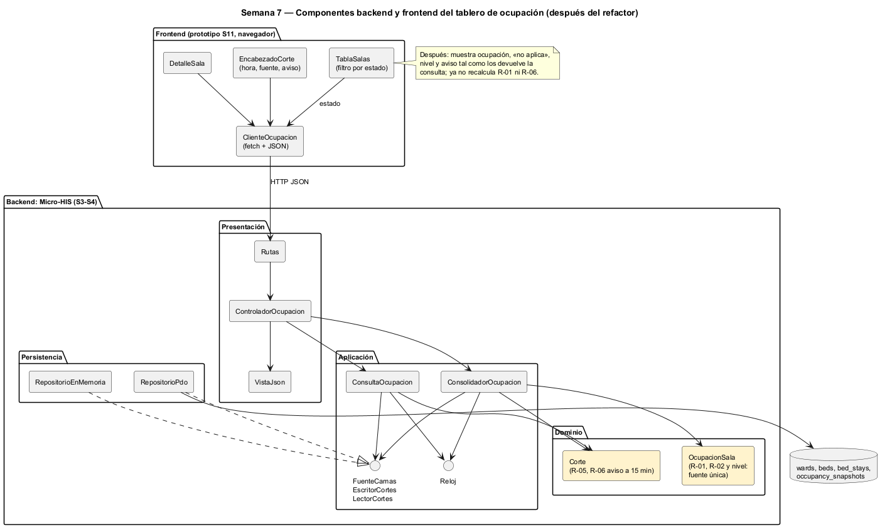

# Semana 7 — Componentes y refactorización del Dashboard de ocupación hospitalaria

| | |
|---|---|
| **Tarea Odoo** | 2494 — Semana 7: Diseño de componentes y refactorización |
| **Flujo** | «Consolidación y consulta de ocupación por sala y estado de cama» |
| **Base** | Micro-HIS de las semanas 3 y 4, contrato de la [semana 5](../semana-05/semana-05-cliente-servidor.md), backlog de la [semana 9](../semana-09/semana-09-evaluacion-usabilidad.md) y prototipo de la [semana 11](../semana-11/semana-11-prototipo.md) |
| **Estudiante** | Josué David Morales Ramírez |

## 1. Componentes backend y frontend

| Componente | Lado | Responsabilidad única | Depende de |
|---|---|---|---|
| `EncabezadoCorte` | Frontend | Hora del corte, fuente de los datos y aviso de desactualizado (R-05, R-06) | `ClienteOcupacion` |
| `TablaSalas` | Frontend | Ocupación por sala con nivel en texto y color (B-04 de la S9); filtro por estado (CU-03) | `ClienteOcupacion` |
| `DetalleSala` | Frontend | Disponibles, ocupadas, mantenimiento, inactivas y camas inconsistentes de una sala | `ClienteOcupacion` |
| `ClienteOcupacion` | Frontend | Hablar HTTP y JSON con el contrato de la S5 | Contrato API |
| `Rutas`, `ControladorOcupacion`, `VistaJson` | Backend: Presentación | Ruta → acción → caso de uso → respuesta HTTP | Consolidador y consulta |
| `ConsolidadorOcupacion`, `ConsultaOcupacion` | Backend: Aplicación | CU-01 con CU-04; CU-02 con CU-03 | Puertos por cliente (ISP) y `Reloj` |
| `OcupacionSala`, `Corte`, `ReglaDeDominio` | Backend: Dominio | Fórmula, «no aplica» e inconsistencias (R-01, R-02, R-04); hora y aviso (R-05, R-06) | Nada fuera del dominio |
| `RepositorioPdo`, `RepositorioEnMemoria` | Backend: Persistencia | Solo `SELECT` sobre camas (R-09); guardar y leer cortes | Los tres puertos |

## 2. Contratos de entrada y salida

| Contrato | Entrada | Salida | Errores |
|---|---|---|---|
| HTTP `POST /ocupacion/cortes` | — (lo dispara el temporizador) | 201 `{hora, salas}` | 503 E8 |
| HTTP `GET /ocupacion[?estado=]` | estado opcional | 200 `{vacio, hora, aviso_viejo, salas}` | 422 E3, 503 E8 |
| `ControladorOcupacion::atender` | acción, datos | `['status', …]` | Nunca lanza: traduce a la vista |
| `ConsolidadorOcupacion::consolidar` | — | `Corte` | `ErrorPersistencia`: se conserva el corte anterior (R-09) |
| `ConsultaOcupacion::consultar` | estado o `null` | `{vacio}` o `{hora, aviso_viejo, salas}` | E3 |
| `FuenteCamas` · `EscritorCortes` · `LectorCortes` | — · `Corte` · — | filas de camas · `void` · `?Corte` | `ErrorPersistencia` |
| `OcupacionSala::calcular` · `Corte::esViejo` | camas de una sala · ahora | cifras, `ocupacion` e `inconsistentes` · `bool` | — |

## 3. El punto con mayor acoplamiento

[medir-acoplamiento.php](evidencia/medir-acoplamiento.php) da el máximo en **`Corte`: Ca 6 y Ce 2 (I = 0,25)** ([salida](evidencia/salida-acoplamiento.txt)). Lo usan los servicios, los puertos, los adaptadores y la vista. Es un objeto del dominio, estable y muy usado: es justo donde conviene que esté el acoplamiento. El siguiente es `ConsolidadorOcupacion` (Ce 5), el orquestador de CU-01.

El acoplamiento caro está entre la UI y el dominio, en **los indicadores**:

| Lugar | Qué calcula | Problema |
|---|---|---|
| `OcupacionSala::calcular` y `Corte::esViejo` (backend) | Ocupación = ocupadas ÷ operativas, «no aplica» sin camas operativas, aviso a los 15 minutos | Es la fuente legítima |
| `ocupacion()` y `cabecera()` en [`app.js`](../semana-11/prototipo/app.js) | La misma fórmula, el mismo «no aplica» y `edad > 15` | Repite R-01, R-02 y R-06 |
| `app.js`, B-04 de la S9 | Nivel «baja» (menos de 70 %), «media» (70–89 %) y «alta» | Una regla de indicador que **solo existe en la UI**: otro cliente, como el móvil de la S10, tendría que copiarla |

Si se cambia la fórmula (por ejemplo, contar el mantenimiento como no disponible) o el umbral de 15 minutos, hay que tocar 2 archivos de 2 capas. El nivel por umbrales no lo conoce el backend.

## 4. Refactor concreto: antes y después

| | Antes | Después |
|---|---|---|
| Frontend | `ocupacion(id)` divide las cuentas y decide el nivel; `cabecera()` compara `edad > 15` | Muestra `salas[x].ocupacion`, `nivel` y `aviso_viejo` tal como llegan; solo elige color y texto para cada nivel |
| Dominio | `OcupacionSala::calcular` sin nivel | `OcupacionSala::calcular` devuelve también `nivel` (`baja`, `media`, `alta` o `no aplica`), con los umbrales de B-04 en una constante |
| Aplicación y contrato | `aviso_viejo` ya se devolvía | Sin cambios de operación; el corte suma el campo `nivel` |
| Archivos a tocar si cambia la fórmula o el umbral | 2 (`Ocupacion.php` y `app.js`) | 1 (`Ocupacion.php`) |
| Nivel por umbrales | Solo en la UI | En el dominio, igual para cualquier cliente |

**Justificación:**
- El tablero muestra indicadores, y los indicadores son reglas del negocio: deben calcularse una vez, donde se calcula la ocupación.
- La UI conserva lo que es suyo: colores, textos y cómo se ve el aviso.
- No amplía el módulo: no hay caso de uso nuevo, solo un campo calculado dentro del corte que CU-02 ya devuelve.
- La red ya existe: las pruebas «sala A = 50.0 %», «B sin camas operativas = no aplica» y «aviso a los 20 minutos» corren con los dos adaptadores.
- Es un refactor conceptual, como pide el enunciado: no cambia el código de esta entrega.

## 5. Evidencia y bibliografía

[salida-acoplamiento.txt](evidencia/salida-acoplamiento.txt) se midió sobre `develop` en `402fd68`. El diagrama se generó con PlantUML local (`-charset UTF-8`).

**Bibliografía:** Martin, R. C. (2017). *Clean Architecture*, caps. 13 y 14. Prentice Hall · Few, S. (2013). *Information Dashboard Design* (2.ª ed.). Analytics Press.
