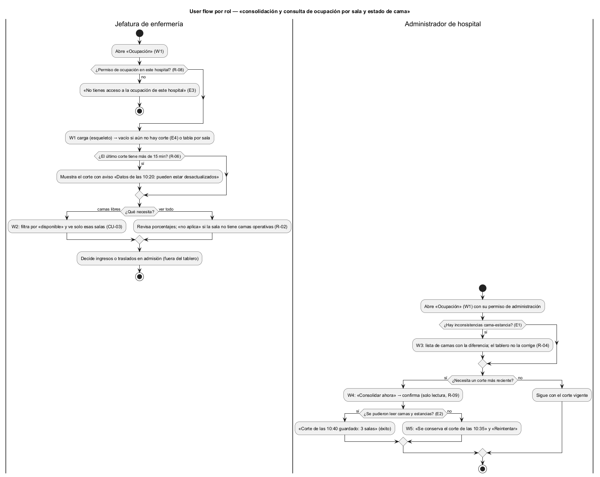

# Semana 8 — Flujo UX de «consolidación y consulta de ocupación por sala y estado de cama»

| | |
|---|---|
| **Tarea Odoo** | 2495 — Semana 8: Diseño de experiencia de usuario |
| **Módulo** | Dashboard de ocupación hospitalaria |
| **Base** | Actores, CU-01 a CU-05, reglas R-01 a R-09 y excepciones E1–E4 de la [Semana 1](../semana-01/semana-01-uml-ocupacion.md); cálculo y corte del Micro-HIS ([Semana 3](../semana-03/semana-03-arquitectura-micro-his.md)) |
| **Estudiante** | Josué David Morales Ramírez |

## 1. Roles autorizados y lo que ve cada uno

| Rol | Puede | No ve |
|---|---|---|
| Jefatura de enfermería | Consultar la ocupación por sala del último corte y filtrar por estado de cama | Pacientes ni estancias individuales (R-07); la lista de inconsistencias |
| Administrador de hospital | Lo mismo, más revisar inconsistencias cama-estancia y pedir una consolidación inmediata | Datos de otro hospital (R-08) |

El temporizador consolida cada 5 minutos sin pantalla, por eso no tiene carril en el user flow.

## 2. User flow por rol

Inicio: «Ocupación» en el menú, con permiso en el hospital de la sesión (R-08). Decisión: ver todas las salas o filtrar por estado; el administrador decide además si revisa inconsistencias o pide un corte nuevo. Confirmación: «Consolidar» en W4, que explica que solo lee. Salida: éxito (tablero con la hora del corte o «Corte de las 10:40 guardado: 3 salas») o uno de los errores recuperables de W5.

## 3. Wireframes anotados

| W | Pantalla | Estados | Mensajes | Validaciones | Reglas de interacción |
|---|---|---|---|---|---|
| [W1](diagramas/semana-08-wf1-tablero-salas.png) | Ocupación por sala | Carga: filas de esqueleto. Vacío: «Aún no hay datos de ocupación» (E4). Resumen: tabla del último corte | Hora del corte y antigüedad («hace 4 min»); fuente de los datos al pie | Permiso de ocupación en el hospital (R-08); solo salas activas (R-03) | Mantenimiento e inactivas aparte y fuera del porcentaje (R-01); sala sin camas operativas: «no aplica» (R-02) |
| [W2](diagramas/semana-08-wf2-filtro-estado.png) | Filtrar por estado | Con resultados o sin resultados («Ninguna sala tiene camas disponibles en este corte») | «1 de 3 salas con camas disponibles» | Solo los cuatro estados de cama | «Quitar filtro» vuelve a W1; el filtro no recalcula, usa el mismo corte (CU-03) |
| [W3](diagramas/semana-08-wf3-inconsistencias.png) | Inconsistencias (administrador) | Con diferencias o sin ellas («Todas las camas coinciden») | «2 camas no coinciden con sus estancias» (E1) y dónde se corrige | Cama ocupada sin estancia abierta, o al revés (R-04) | Solo informa: no cambia estados (R-09); muestra códigos de cama, no pacientes |
| [W4](diagramas/semana-08-wf4-consolidar.png) | Consolidar ahora | Confirmación → «Consolidando…» → éxito | «No cambia ningún estado de cama»; «Corte de las 10:40 guardado: 3 salas» | Permiso de administración | «Cancelar» es la opción por defecto; el botón se deshabilita mientras consolida para no lanzar dos cortes |
| [W5](diagramas/semana-08-wf5-error-recuperable.png) | Errores recuperables | Lectura fallida (E2), corte viejo (R-06) o estado inexistente | «Se conserva el corte de las 10:35»; «pueden estar desactualizados» | Más de 15 minutos desde el último corte | Nunca se muestran cifras vacías: queda el corte anterior con su hora; «Reintentar», «Actualizar» y «Quitar filtro» corrigen sin salir |

## 4. Ayuda contextual

«Ayuda» explica cómo se calcula el porcentaje, por qué mantenimiento e inactivas no cuentan, qué es un corte y cada cuánto se genera, y qué significa «no aplica». En W3 se explica qué es una inconsistencia y qué módulo la corrige; en W5, qué hacer si los datos son viejos.

## 5. Protección de datos

- Solo cifras agregadas por sala: ningún nombre, documento ni estancia individual (R-07); W3 identifica camas, no pacientes.
- Solo el hospital de la sesión y solo con permiso de ocupación (R-08).
- Procedencia visible: cada pantalla muestra la hora del corte y la fuente (catálogo de camas y estancias de admisión), para que nadie tome una cifra vieja por actual (R-05, R-06).
- La consolidación es de solo lectura (R-09): ni el temporizador ni «Consolidar ahora» cambian estados de cama.

## 6. Trazabilidad y evidencia

| Regla | Dónde se aplica |
|---|---|
| R-01, R-02, R-03 | W1 y W2: porcentaje, «no aplica» y solo salas activas |
| R-04, R-09 | W3 y W4: inconsistencias marcadas sin corregir, consolidación de solo lectura |
| R-05, R-06 | W1 y W5: hora del corte y aviso de datos viejos |
| R-07, R-08 | §5: solo cifras y solo el hospital con permiso |

Fuentes editables en [`diagramas/`](diagramas/) (`.puml` con PlantUML Salt para los wireframes); los PNG se generaron con PlantUML local. Las cifras de W1 siguen la fórmula de `OcupacionSala::calcular` del Micro-HIS (6 ÷ 11 = 54.5 %). Las rutas y errores siguen el front controller propuesto en la semana 4 (PR #201, aún no integrado); si ese PR cambia, se ajustan los textos. «Consolidar ahora» usa la acción `consolidar` que el Micro-HIS ya tiene, pero la semana 1 solo la asigna al temporizador: exponerla al administrador es una propuesta de esta semana.

**Bibliografía:** Nielsen, J. (1994). *10 Usability Heuristics for User Interface Design*. Nielsen Norman Group · W3C (2023). *Web Content Accessibility Guidelines (WCAG) 2.2*.
