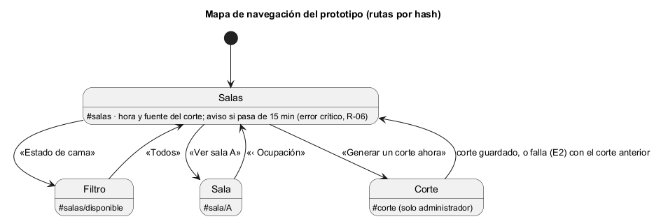

# Semana 11 — Prototipo navegable del Dashboard de ocupación hospitalaria

| | |
|---|---|
| **Tarea Odoo** | 2498 — Semana 11: Mejores prácticas para diseño móvil/web |
| **Módulo** | Dashboard de ocupación hospitalaria |
| **Base** | Flujo de la semana 8 (PR #206), backlog de la semana 9 (PR #223), diseño móvil de la semana 10 (PR #280) y la fórmula de `OcupacionSala::calcular` |
| **Estudiante** | Josué David Morales Ramírez |

## 1. Prototipo y mapa de navegación

**Archivo:** [prototipo/index.html](prototipo/index.html). Se abre sin servidor; es HTML, CSS y JavaScript sin dependencias, con datos ficticios en memoria y un reloj fijo (10:39), sin conexión a la API. Flujo principal: «consolidación y consulta de ocupación por sala y estado de cama». Las salas se ordenan por camas libres, se filtran por estado de cama y se abre su detalle; el administrador además genera un corte. El **panel del prototipo**, al pie, cambia el rol, la antigüedad del último corte y si generar un corte falla.

## 2. Camino feliz y error crítico

| Paso | Escritorio (1280 px) | Móvil (360 px) | Qué se ve |
|---|---|---|---|
| 1. **Camino feliz** | [captura](capturas/escritorio/01-salas.png) | [captura](capturas/movil/01-salas.png) | Corte de las 10:35 (hace 4 min) con su fuente; A primero, con 5 disponibles de 11 y ocupación de 54.5 %, «baja» |
| 2. Filtro | [captura](capturas/escritorio/02-filtro-disponible.png) | [captura](capturas/movil/02-filtro-disponible.png) | Estado «disponible»: «1 de 3 salas…», anunciado en la región de estado |
| 3. Detalle de sala | [captura](capturas/escritorio/03-detalle-sala-a.png) | [captura](capturas/movil/03-detalle-sala-a.png) | Una línea por estado de cama y la fórmula (R-01) |
| 4. **Error crítico** | [captura](capturas/escritorio/04-error-datos-viejos.png) | [captura](capturas/movil/04-error-datos-viejos.png) | Corte de las 10:20 (hace 19 min): franja «pueden estar desactualizados» (R-06), con las cifras visibles y su hora |
| 5. Corte generado | [captura](capturas/escritorio/05-corte-generado.png) | [captura](capturas/movil/05-corte-generado.png) | El administrador genera uno: «Corte de las 10:40 guardado: 3 salas», «recién generado» |
| 6. Falla al generar | [captura](capturas/escritorio/06-corte-falla.png) | [captura](capturas/movil/06-corte-falla.png) | E2: se conserva el corte de las 10:35, y el aviso usa la barra de alerta, no la de éxito |

Es el error crítico porque toca la actualización y la procedencia de datos: con cifras viejas que parecen actuales, la jefatura asignaría una cama que ya no está libre. Las cifras no se esconden: se marcan con su hora, y el teléfono no recalcula nada por su cuenta.

## 3. Consistencia de roles, estados y accesibilidad

- **Roles:** la jefatura de enfermería consulta; solo el administrador ve y usa «Generar un corte ahora». La jefatura que abre `#corte` vuelve al tablero.
- **Estados:** los cuatro estados de cama y los indicadores de ocupación por nivel («baja» por debajo de 70 %, «media» entre 70 y 89 %, «alta» desde 90 %), siempre en texto. «Sin camas operativas · no aplica» (R-02).
- **Accesibilidad:** `lang="es"` y un título por pantalla; foco en el `<h1>` y «Saltar al contenido»; anillo de foco de 2 px y objetivos de 44 px. El aviso de datos viejos llega a una región viva vacía que se llena después, para que se anuncie. «Consolidando…» va con `aria-disabled`.

## 4. Evidencia y validación

[capturar.mjs](evidencia/capturar.mjs), el mismo script de la semana 11 de Catálogo, fija el ancho exacto con el protocolo DevTools de Edge, recorre el flujo pulsando como un usuario, toma las capturas y mide el scroll horizontal. Su [salida](evidencia/salida-medicion.txt) da 18 de 18 mediciones sin scroll a 320, 360 y 430 px (WCAG 1.4.10), y el foco nunca queda en `BODY`. Controles: un bloque inyectado de 600 px marca «SÍ», y la jefatura en `#corte` vuelve al tablero. Con el reloj fijo, la antigüedad se calcula, pero no avanza sola; en producción se recalcula cada minuto (semana 9, B-03).

**Bibliografía:** W3C (2023). *WCAG 2.2* · Chrome DevTools Protocol: `Emulation.setDeviceMetricsOverride`.
