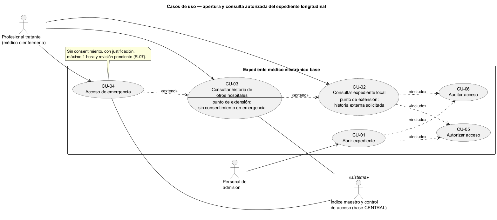
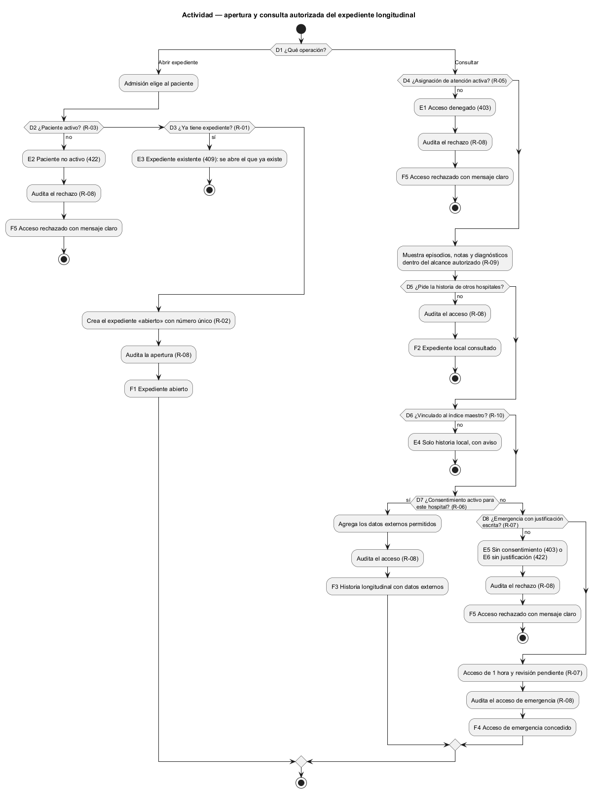
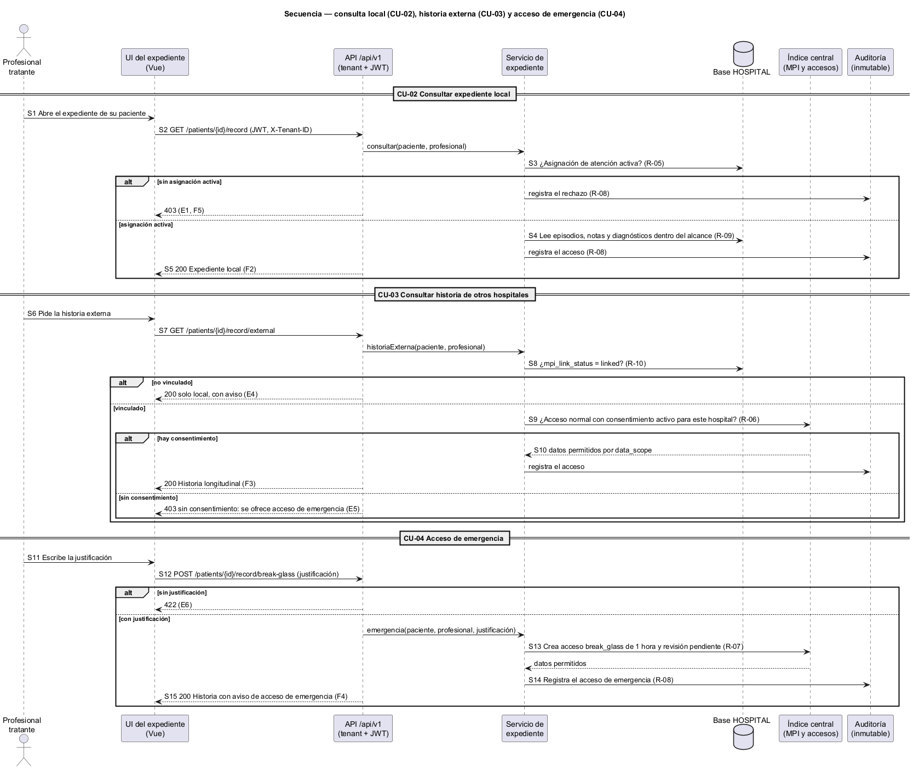

# Semana 1 — Modelado UML del proceso del Expediente médico electrónico base

| | |
|---|---|
| **Curso** | Análisis de Sistemas II — Proyecto Final 2026 |
| **Proyecto** | Sistema Hospitalario Integrado (HIS) |
| **Módulo** | Expediente médico electrónico base |
| **Tarea Odoo** | 2503 — Semana 1: Conceptos generales, orientación a objetos y UML |
| **Proceso modelado** | «Apertura y consulta autorizada del expediente longitudinal» |
| **Estudiante** | Josué David Morales Ramírez (carné 1890-23-10545) |
| **Fecha** | Octubre 2026 |

## 1. Introducción

El expediente **longitudinal** reúne toda la historia clínica del paciente: sus episodios, notas y diagnósticos en este hospital y, si hay permiso, en otros de la red. Es el dato más sensible del HIS: un acceso sin motivo es una violación de privacidad, y negarlo en una emergencia puede costar una vida. Este documento modela cómo se abre el expediente y cómo se consulta con autorización. Las tres vistas comparten identificadores (CU, R, D, E, F, S) para trazarlas entre sí (§9).

## 2. Narrativa de alcance

| | |
|---|---|
| **Objetivo** | Abrir un único expediente por paciente y permitir su consulta solo a quien tiene una relación de atención vigente, con acceso entre hospitales por consentimiento o por emergencia justificada, y con todo acceso auditado. |
| **Dentro del alcance** | Abrir expediente; consultar el expediente local; consultar la historia de otros hospitales; acceso de emergencia; autorizar y auditar cada acceso. |
| **Fuera del alcance** | Escribir notas y diagnósticos (módulo de notas SOAP); registrar al paciente (módulo de pacientes); gestionar consentimientos; revisar los accesos de emergencia (gobernanza y auditoría); cerrar el expediente. |
| **Supuestos** | Se usa el esquema real: `medical_records`, `care_assignments` y `local_patients` en la base HOSPITAL; `patient_consents`, `cross_hospital_access_grants`, `cross_hospital_access_audits` y `break_glass_reviews` en la base CENTRAL. La apertura la hace el personal de admisión en el primer episodio del paciente. Los endpoints se formalizan en la Semana 5. |

## 3. Actores

| Actor | Tipo | Objetivo en el proceso |
|---|---|---|
| Personal de admisión | Primario | Abrir el expediente del paciente en su primera atención. |
| Profesional tratante (médico o enfermería) | Primario | Consultar la historia del paciente que está atendiendo. |
| Índice maestro de pacientes y control de acceso (base CENTRAL) | Secundario (sistema) | Identificar al paciente en la red y conceder o negar el acceso a otros hospitales. |

A diferencia de RBAC y la auditoría local, que son servicios internos, la base CENTRAL es un sistema federado distinto del hospital: por eso aquí sí es actor secundario.

## 4. Reglas de negocio

| ID | Regla | Origen |
|---|---|---|
| R-01 | Un solo expediente por paciente en el hospital. | `medical_records_local_patient_id_unique` |
| R-02 | El número de expediente es único. | `medical_records_record_number_unique` |
| R-03 | Solo se abre para pacientes activos. | Decisión de diseño sobre `local_patients.status` |
| R-04 | El expediente nunca se borra; si se cierra, queda su fecha. | Trigger `medical_records_retention` y `medical_records_closure_check` |
| R-05 | Consultar exige una asignación de atención activa del profesional para un episodio del paciente. | `care_assignments.status = 'active'` |
| R-06 | La historia de otro hospital exige un acceso «normal» con consentimiento activo y vigente que incluya al hospital solicitante. | `grant_type = 'normal'`, `patient_consents` (`allowed_hospitals`, `valid_to`) |
| R-07 | El acceso de emergencia no requiere consentimiento, pero sí justificación, dura como máximo 1 hora y deja una revisión pendiente. | `grant_type = 'break_glass'`, `valid_to <= valid_from + interval '1 hour'`, `break_glass_reviews` |
| R-08 | Todo acceso queda auditado, y la auditoría no se puede modificar. | `cross_hospital_access_audits_immutable` |
| R-09 | Solo se muestra el alcance autorizado de los datos. | `care_assignments.scope`, `patient_consents.data_scope` |
| R-10 | Un paciente sin vínculo con el índice maestro solo tiene historia local. | `local_patients.mpi_link_status` (`pending`, `linked`, `unlinked`) |

## 5. Diagrama de casos de uso

Fuente editable: [diagramas/semana-01-casos-de-uso.puml](diagramas/semana-01-casos-de-uso.puml)

## 6. Especificación de casos de uso

| CU | Nombre | Actor | Flujo principal | Alternativas y excepciones | Reglas |
|---|---|---|---|---|---|
| CU-01 | Abrir expediente | Personal de admisión | Elige al paciente; el sistema crea el expediente «abierto» con un número único. | Paciente no activo (E2); ya tiene expediente (E3). | R-01–R-03, R-08 |
| CU-02 | Consultar expediente local | Profesional tratante | Abre el expediente de su paciente y ve sus episodios, notas y diagnósticos dentro de su alcance. | Sin asignación de atención activa (E1). | R-04, R-05, R-08, R-09 |
| CU-03 | Consultar historia de otros hospitales (extiende CU-02) | Profesional tratante, índice central | Pide la historia externa; el índice central verifica el consentimiento y devuelve lo permitido. | Sin vínculo con el índice (E4); sin consentimiento (E5). | R-06, R-08–R-10 |
| CU-04 | Acceso de emergencia (extiende CU-03) | Profesional tratante, índice central | Sin consentimiento, escribe la justificación; recibe un acceso de 1 hora y queda una revisión pendiente. | Sin justificación (E6). | R-07, R-08 |
| CU-05 | Autorizar acceso (incluido) | — | Verifica sesión, hospital, rol y relación de atención. | E1. | R-05 |
| CU-06 | Auditar acceso (incluido) | — | Registra quién, qué paciente, desde qué hospital y con qué permiso. | — | R-08 |

**Relaciones:** CU-01 y CU-02 *incluyen* CU-05 y CU-06, porque nada se abre ni se ve sin autorización y auditoría. CU-03 *extiende* CU-02 («historia externa solicitada») y CU-04 *extiende* CU-03 («sin consentimiento en una emergencia»), así que ocurren dentro de esa misma autorización y auditoría.

## 7. Diagrama de actividad

Fuente editable: [diagramas/semana-01-actividad.puml](diagramas/semana-01-actividad.puml)

| Decisión | Pregunta | Si falla |
|---|---|---|
| D1 | ¿Qué operación: abrir o consultar? | — |
| D2 | ¿El paciente está activo? | E2 Paciente no activo (422) |
| D3 | ¿Ya tiene expediente en este hospital? | E3 Expediente existente (409): se abre el que ya existe |
| D4 | ¿El profesional tiene una asignación de atención activa? | E1 Acceso denegado (403) |
| D5 | ¿Pide la historia de otros hospitales? | No → F2 expediente local |
| D6 | ¿El paciente está vinculado al índice maestro? | E4 Solo historia local, con aviso |
| D7 | ¿Hay consentimiento activo para este hospital? | Sí → F3 historia externa |
| D8 | ¿Es una emergencia con justificación escrita? | E5 Sin consentimiento (403); E6 sin justificación (422) |

**Resultados:** F1 expediente abierto · F2 expediente local consultado · F3 historia longitudinal con datos externos · F4 acceso de emergencia de 1 hora con revisión pendiente · F5 acceso rechazado con mensaje claro. Todo resultado, incluido el rechazo, queda auditado (R-08).

## 8. Diagrama de secuencia

Fuente editable: [diagramas/semana-01-secuencia.puml](diagramas/semana-01-secuencia.puml)

Participantes: Profesional tratante, UI del expediente (Vue), API `/api/v1`, Servicio de expediente, base HOSPITAL, índice central (MPI y accesos, base CENTRAL) y Auditoría.

| Paso | Mensaje | Validación o respuesta |
|---|---|---|
| S1–S2 | Profesional abre el expediente → `GET /patients/{id}/record` | — |
| S3 | Servicio busca la asignación de atención activa | No hay → 403 y se audita el rechazo |
| S4–S5 | Lee el expediente local dentro del alcance → 200 (F2) | — |
| S6–S7 | Pide la historia externa → `GET /patients/{id}/record/external` | — |
| S8 | ¿Vinculado al índice maestro? | No → 200 solo local, con aviso |
| S9 | Índice central: ¿consentimiento activo para este hospital? | Sí → S10 datos permitidos, 200 (F3) |
| S11–S12 | Sin consentimiento: emergencia con justificación → `POST .../break-glass` | Sin justificación → 422 |
| S13 | Índice central crea el acceso de 1 hora y la revisión pendiente | — |
| S14–S15 | Registra el acceso en la auditoría inmutable → 200 (F4) | — |

## 9. Matriz de trazabilidad

| CU | Reglas | Actividad | Secuencia |
|---|---|---|---|
| CU-01 | R-01–R-03, R-08 | D1–D3, E2, E3, F1 | (mismo patrón que S1–S5) |
| CU-02 | R-04, R-05, R-08, R-09 | D4, D5, E1, F2 | S1–S5 |
| CU-03 | R-06, R-08–R-10 | D5–D7, E4, F3 | S6–S10 |
| CU-04 | R-07, R-08 | D8, E5, E6, F4 | S11–S15 |
| CU-05 | R-05 | D4, E1, F5 | S3 |
| CU-06 | R-08 | todos los resultados | S3, S14 |

## 10. Conclusión

El expediente equilibra dos riesgos opuestos: ver sin motivo y no poder ver en una emergencia. El esquema ya resuelve buena parte (un expediente por paciente, nada se borra, auditoría inmutable, emergencia limitada a 1 hora); el módulo debe aplicar la relación de atención (R-05) y el alcance de los datos (R-09) en cada consulta.

## 11. Bibliografía

- Object Management Group. (2017). *Unified Modeling Language (UML) Version 2.5.1*. https://www.omg.org/spec/UML/2.5.1
- HL7 International. (2023). *HL7 FHIR R5: Consent resource*. https://hl7.org/fhir/R5/consent.html
- Esquemas del repositorio: `database/migrations/hospital/2026_08_11_000400_create_medical_record_tables.php` y `database/migrations/central/2026_08_11_000300_create_consent_and_access_control.php`.
