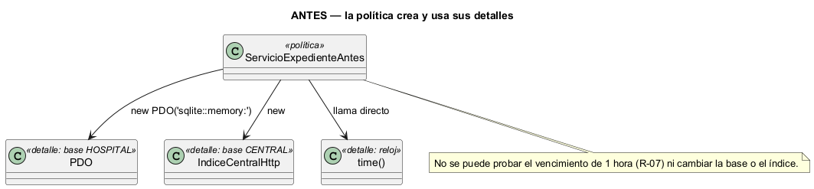
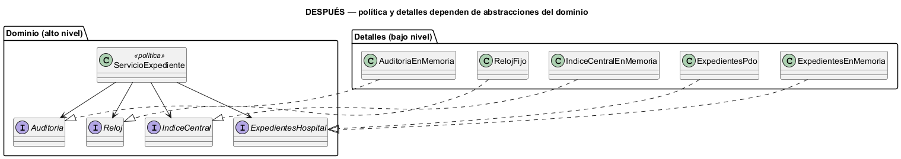

# Semana 2 — RF/RNF, criterios de aceptación y DIP en el Expediente médico electrónico

| | |
|---|---|
| **Módulo** | Expediente médico electrónico base |
| **Tarea Odoo** | 2504 — Semana 2: Proceso y modelo de diseño; principios SOLID |
| **Flujo** | «Apertura y consulta autorizada del expediente longitudinal» (modelado en la [Semana 1](../semana-01/semana-01-uml-expediente.md)) |
| **Principio aplicado** | DIP — principio de inversión de dependencias |
| **Estudiante** | Josué David Morales Ramírez |

## 1. Requerimientos funcionales

| ID | Requerimiento | Trazado a |
|---|---|---|
| RF-01 | Abrir un único expediente por paciente activo. | CU-01, R-01, R-03 |
| RF-02 | Consultar el expediente solo con una asignación de atención activa. | CU-02, R-05 |
| RF-03 | Ver la historia de otros hospitales solo si el paciente está vinculado al MPI y hay consentimiento vigente para este hospital. | CU-03, R-06, R-10 |
| RF-04 | Conceder un acceso de emergencia con justificación, de 1 hora como máximo y con revisión pendiente. | CU-04, R-07 |
| RF-05 | Auditar cada operación, incluidos los rechazos. | CU-06, R-08 |

## 2. Requerimientos no funcionales

| ID | Requerimiento | Cómo se verifica |
|---|---|---|
| RNF-01 | Portabilidad: cambiar la base HOSPITAL no modifica la política. | `verificar.php`: mismos casos con memoria y con PDO/SQLite |
| RNF-02 | Facilidad de prueba: los vencimientos (consentimiento y emergencia) se prueban con un reloj fijo. | `verificar.php`: `RelojFijo`, CA-05 y CA-06 |
| RNF-03 | Seguridad: las consultas usan sentencias preparadas. | `ExpedientesPdo`: solo `prepare()` con parámetros |
| RNF-04 | Trazabilidad: la auditoría no se omite en ningún camino. | `verificar.php`: CA-07 (11 eventos) |

## 3. Criterios de aceptación

| CA | Dado / Cuando / Entonces | RF | Evidencia |
|---|---|---|---|
| CA-01 | Cuando abro el expediente de p1 (activo), entonces 201; otra vez, 409; el de p3 (inactivo), 422. | RF-01 | `verificar.php` |
| CA-02 | Cuando m1 (asignado) consulta p1, entonces 200; cuando m2 (sin asignación), 403. | RF-02 | `verificar.php` |
| CA-03 | Cuando pido la historia externa de p2 (sin vínculo), solo veo la local; la de p1 (con consentimiento), 200. | RF-03 | `verificar.php` |
| CA-04 | Cuando pido la historia externa de p4 (sin consentimiento), entonces 403. | RF-03 | `verificar.php` |
| CA-05 | Cuando pido emergencia sin justificación, 422; con justificación, 200, vence a la hora y queda una revisión pendiente. | RF-04 | `verificar.php` |
| CA-06 | Dado el consentimiento de p1 vencido, cuando pido su historia externa, entonces 403. | RF-03 | `verificar.php` |
| CA-07 | Toda operación, aceptada o rechazada, deja un evento de auditoría. | RF-05 | `verificar.php` |

## 4. DIP: diseño antes y después

**El problema (antes).** En [`ejemplo-dip/antes.php`](ejemplo-dip/antes.php), `ServicioExpedienteAntes` es la política (quién puede ver qué), pero crea su base con `new PDO`, su cliente del índice central con `new IndiceCentralHttp()` y calcula el vencimiento con `time()`. No se puede probar que la emergencia dure 1 hora, ni cambiar la base o el índice sin tocar las reglas de acceso.



**La solución (después).** En [`ejemplo-dip/despues.php`](ejemplo-dip/despues.php), la política declara lo que necesita y lo recibe por constructor:

| Pieza | Nivel | Responsabilidad | Depende de |
|---|---|---|---|
| `ServicioExpediente` | Alto | Reglas de apertura, consulta, consentimiento y emergencia | Solo de las cuatro interfaces |
| `ExpedientesHospital`, `IndiceCentral`, `Auditoria`, `Reloj` | Alto (abstracciones del dominio) | Decir qué necesita la política de cada base y servicio | Nada |
| `ExpedientesPdo`, `ExpedientesEnMemoria` | Bajo | Leer pacientes y asignaciones, y abrir expedientes en la base HOSPITAL | `ExpedientesHospital` (y `PDO`) |
| `IndiceCentralEnMemoria`, `AuditoriaEnMemoria`, `RelojFijo` | Bajo | Detalles para pruebas | Su interfaz |



**Por qué estas dependencias.** Las dos bases del sistema federado (HOSPITAL y CENTRAL) quedan detrás de interfaces que pertenecen al dominio, así que la política no sabe si el índice central se consulta por HTTP o por otra vía. Todas las salidas pasan por un único `fin()`, que audita antes de responder: así ningún camino se salta R-08.

## 5. Evidencia verificable

```powershell
php docs/modulos/expediente-medico/semana-02/ejemplo-dip/verificar.php
```

Salida real: [`evidencia/salida-verificar.txt`](evidencia/salida-verificar.txt). La misma política pasa los 13 controles con memoria y los 13 con PDO/SQLite; además, 3 de 3 controles por reflexión confirman que solo depende de interfaces y que la versión anterior creaba sus detalles. En una prueba de mutación se cambió en una copia la duración del acceso de emergencia de 1 hora a 24, y el script falló en CA-05 con los dos adaptadores (exit 1).

## 6. Conclusión

DIP separa las reglas de acceso, que son lo más sensible del módulo, de las dos bases federadas y del reloj. Gracias a eso, los vencimientos del consentimiento y de la emergencia ya se prueban con una hora fija.

## 7. Bibliografía

- MVP Cluster. (s. f.). *Diseño de software 2: principios SOLID*. https://mvpcluster.com/diseno-de-software-2/
- Martin, R. C. (2018). *Clean Architecture*. Prentice Hall.
