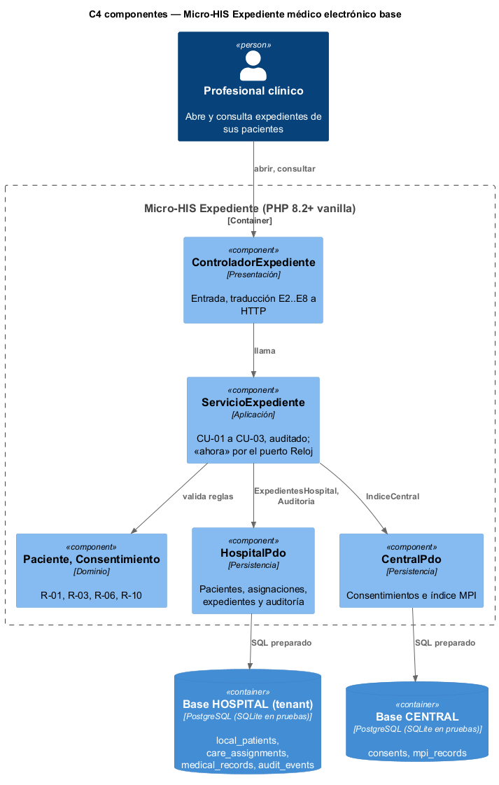
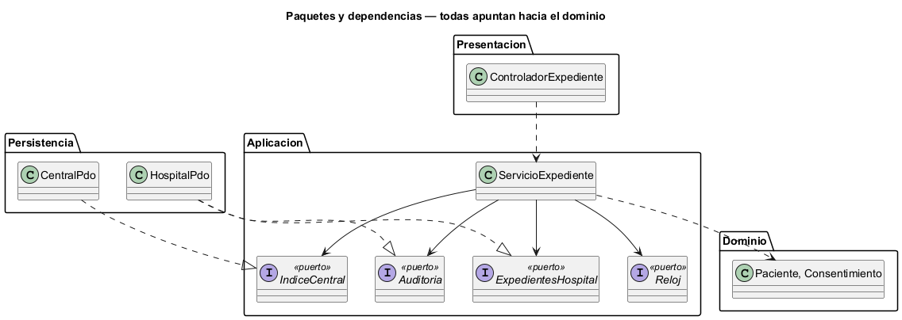

# Semana 3 — Vista arquitectónica del Micro-HIS Expediente médico electrónico base

| | |
|---|---|
| **Tarea Odoo** | 2505 — Semana 3: Diseño arquitectónico, vistas y patrones |
| **Flujo** | «Apertura y consulta autorizada del expediente longitudinal» (semanas [1](../semana-01/semana-01-uml-expediente.md) y [2](../semana-02/semana-02-dip-requerimientos-diseno.md)) |
| **Código** | [`micro-his-expediente/`](../micro-his-expediente/): PHP 8.2+ vanilla, sin framework |
| **Estudiante** | Josué David Morales Ramírez |

## 1. Decisiones arquitectónicas

| Decisión | Por qué |
|---|---|
| Cuatro capas, con un Dominio sin dependencias: `Paciente` (R-01, R-03) y `Consentimiento` (R-06, R-10) | Quién puede tener expediente y cuándo vale un consentimiento se prueban sin base. |
| Puertos `ExpedientesHospital`, `IndiceCentral`, `Auditoria` y `Reloj` en Aplicación | Continúa el DIP de la semana 2: la política no conoce las bases ni la hora real. |
| Dos adaptadores PDO, uno por base: `HospitalPdo` (tenant) y `CentralPdo` (MPI y consentimientos) | Respeta la separación HOSPITAL/CENTRAL del esquema; si CENTRAL cae, la consulta local sigue. |
| Toda operación pasa por `auditado()`, que registra el resultado o el código del rechazo | R-08: ningún camino, ni siquiera un rechazo, se salta la auditoría. |

## 2. Vista C4 de componentes y regla de dependencias

 

Regla de dependencias: Presentación usa `ServicioExpediente`; el servicio usa el Dominio y sus cuatro puertos; `HospitalPdo` y `CentralPdo` implementan los puertos de datos y auditoría; el Dominio no depende de nada.

## 3. Pruebas y evidencia

`php docs/modulos/expediente-medico/micro-his-expediente/pruebas/pruebas.php` → [`evidencia/salida-pruebas.txt`](evidencia/salida-pruebas.txt) (14/14, exit 0).

| Tipo pedido | Cómo se prueba | Resultado |
|---|---|---|
| Camino feliz | Bases SQLite de prueba: abrir → consultar → historia longitudinal con el expediente de otro hospital | 3/3 |
| Regla de dominio | Apertura repetida (E3) o de inactivo (E2), sin asignación (E4), sin vínculo MPI (solo local), sin consentimiento o vencido (E5), auditoría de las 11 operaciones | 6/6 |
| Error de persistencia | Doble con CENTRAL caída (503 sin detalles técnicos; la consulta local sigue) y `PDOException` real en HOSPITAL | 3/3 |
| Dependencias y SQL | Ninguna capa apunta hacia afuera; ninguna consulta concatena variables | 2/2 |

En una prueba de mutación se ignoró el fin de la vigencia del consentimiento en una copia del dominio, y las pruebas fallaron en R-10 (exit 1).

**Limitaciones:** el acceso de emergencia (CU-04 de la semana 2) y las notas clínicas del expediente quedan para semanas posteriores; el profesional llega en la petición en vez de leerse de la sesión; SQLite reemplaza a PostgreSQL en las pruebas. **Siguiente:** MVC con Repository (semana 4). **Bibliografía:** Brown, S. (2018). *The C4 model*. https://c4model.com · Martin, R. C. (2018). *Clean Architecture*. Prentice Hall.
