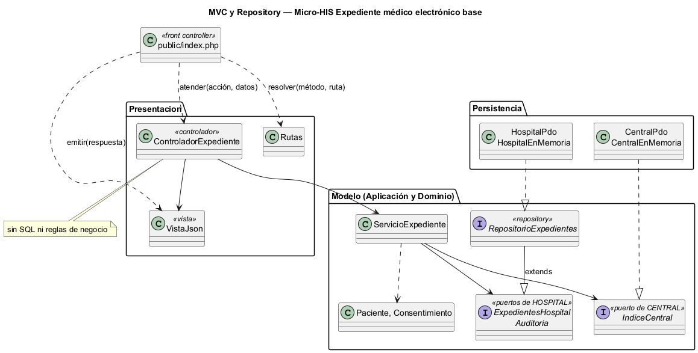
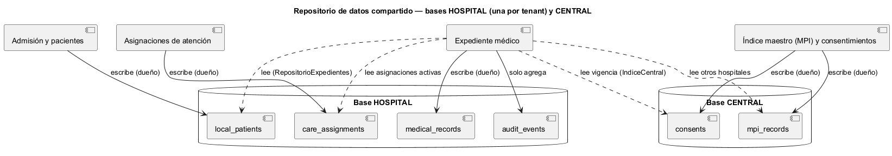

# Semana 4 — MVC, Repository y repositorio de datos compartido en el Micro-HIS Expediente médico electrónico base

| | |
|---|---|
| **Tarea Odoo** | 2506 — Semana 4: Arquitectura en capas y patrón repositorio |
| **Flujo** | «Apertura y consulta autorizada del expediente longitudinal» (mismo Micro-HIS de la [Semana 3](../semana-03/semana-03-arquitectura-micro-his.md)) |
| **Código** | [`micro-his-expediente/`](../micro-his-expediente/): PHP 8.2+ vanilla, sin framework |
| **Estudiante** | Josué David Morales Ramírez |

## 1. Entrada organizada con MVC

| Pieza | Archivo | Responsabilidad |
|---|---|---|
| Front controller | `public/index.php` | Único punto de entrada HTTP: resuelve la ruta, abre las bases HOSPITAL y CENTRAL, toma el profesional y el hospital de las cabeceras y emite la respuesta. |
| Rutas | `Presentacion/Rutas.php` | `POST /patients/{id}/record` (abrir), `GET /patients/{id}/record` (consulta local) y `GET /patients/{id}/record/external` (longitudinal). |
| Controlador | `Presentacion/ControladorExpediente.php` | Elige el caso de uso y entrega el resultado a la vista. **Sin SQL ni reglas de negocio** (lo comprueba una prueba). |
| Vista | `Presentacion/VistaJson.php` | Única dueña de los códigos HTTP (201, 200, 403, 409, 422, 404 y 503) y de los textos; antes el mapa de códigos vivía en el controlador. |
| Modelo | `Aplicacion/ServicioExpediente.php` + `Dominio/Expediente.php` | Casos de uso CU-01 a CU-03 y reglas R-01 a R-10; sin cambios de comportamiento respecto a la Semana 3. |

## 2. Interfaz Repository en el límite y sus adaptadores

La interfaz Repository es `RepositorioExpedientes`, en **Aplicación**, y está en el límite de la base HOSPITAL del tenant: une los puertos `ExpedientesHospital` y `Auditoria` de la semana 2. El índice CENTRAL **no** entra en ella: tiene otro dueño y otra base, así que sigue como un puerto aparte (`IndiceCentral`). Así, cambiar CENTRAL no toca el repositorio del hospital, y el servicio no depende de PDO (DIP).

| Adaptador | Para qué | Cómo cumple el contrato |
|---|---|---|
| `HospitalPdo` y `CentralPdo` | Producción (PostgreSQL) y pruebas (SQLite) | Sentencias preparadas; `PDOException` se traduce a `ErrorPersistencia`. |
| `HospitalEnMemoria` y `CentralEnMemoria` | Pruebas y demos sin base | Las mismas respuestas: solo consentimientos activos, otros hospitales en el mismo orden que el `ORDER BY` y un evento por operación. |

## 3. Capas, responsabilidades y objetos reutilizables

| Capa | Objetos | Responsabilidad | Reutilizable en |
|---|---|---|---|
| Dominio | `Paciente`, `Consentimiento`, `ReglaDeDominio` | Un expediente por paciente activo; vigencia del consentimiento | Admisión (validar antes de abrir) y el portal del paciente |
| Aplicación | `ServicioExpediente`, `RepositorioExpedientes`, `IndiceCentral`, `Reloj` | CU-01 a CU-03, con auditoría de cada intento | Un proceso por lotes que abra expedientes sin HTTP |
| Persistencia | Los cuatro adaptadores | HOSPITAL y CENTRAL | `CentralEnMemoria` como doble para el frontend de historia externa |

## 4. Cómo lo integraría un repositorio de datos compartido

En el estilo de **repositorio de datos compartido**, los módulos se coordinan a través de almacenes comunes. Aquí hay dos: la base HOSPITAL de cada tenant y la base CENTRAL. El expediente **lee** lo que escriben Admisión, Asignaciones y el MPI, y **escribe** solo sus expedientes y sus eventos de auditoría.

| Decisión | Regla propuesta |
|---|---|
| Dueño de cada dato | Admisión escribe `local_patients`, Asignaciones escribe `care_assignments`, y el MPI escribe `consents` y `mpi_records`. El expediente es dueño de `medical_records` y `audit_events`. |
| Acceso | `IndiceCentral` es de solo lectura, y la auditoría solo agrega eventos. Hoy la base no impide modificarlos (hallazgo H-04 de la semana 13); el trigger que lo bloquee es el control propuesto en la semana 14. |
| Consistencia | Si CENTRAL falla, la consulta local sigue (503 solo en la longitudinal). La vigencia del consentimiento se evalúa en cada consulta, no se guarda. |
| Esquema | Si Admisión o el MPI cambian sus tablas, cambian solo `HospitalPdo` o `CentralPdo`; el servicio no se toca (RNF-01). |
| Aislamiento | Una base HOSPITAL por tenant. CENTRAL se filtra siempre por el hospital que pide: `expedientesExternos` excluye el propio. |

**Ventajas:** el expediente no llama a Admisión ni al MPI en cada petición, y CENTRAL puede caer sin dejar al hospital sin su historia local. **Riesgos:** depende del esquema de cuatro dueños, y la auditoría es tan confiable como los permisos sobre su tabla. Se mitiga con adaptadores por base y con la auditoría inmutable propuesta.

## 5. Evidencia

`php docs/modulos/expediente-medico/micro-his-expediente/pruebas/pruebas.php` → [`evidencia/salida-pruebas.txt`](evidencia/salida-pruebas.txt) (25/25, exit 0; el mismo guion de 9 pruebas con cada par de adaptadores). Prueba HTTP real con `php -S` y `curl` → [`evidencia/salida-http.txt`](evidencia/salida-http.txt). En una prueba de mutación, una copia de `CentralEnMemoria` devolvía también el expediente del propio hospital, y falló 1 prueba (exit 1). El script de autorrevisión de la semana 13 usa la fábrica anterior: su ajuste va en un PR aparte del módulo, junto con las filas pendientes del README. **Limitaciones:** el profesional y el hospital llegan en cabeceras hasta tener sesión (RNF de seguridad, semana 15); el acceso de emergencia (CU-04) sigue pendiente. **Bibliografía:** Pressman, R. S. y Maxim, B. R. (2020). *Ingeniería del software* (9.ª ed.), cap. de diseño arquitectónico. McGraw-Hill · Fowler, M. (2002). *Patterns of Enterprise Application Architecture* (Repository, Front Controller). Addison-Wesley.
