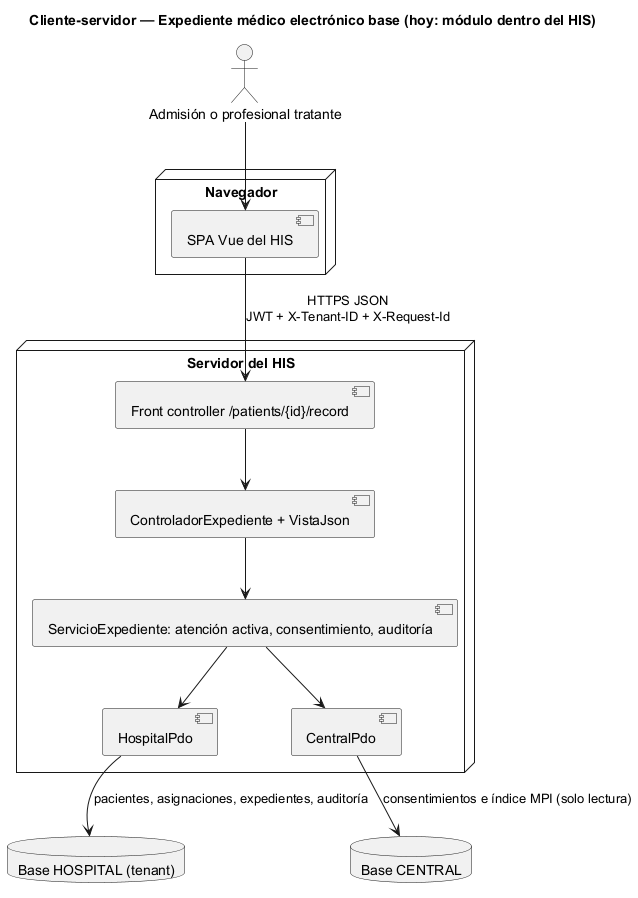
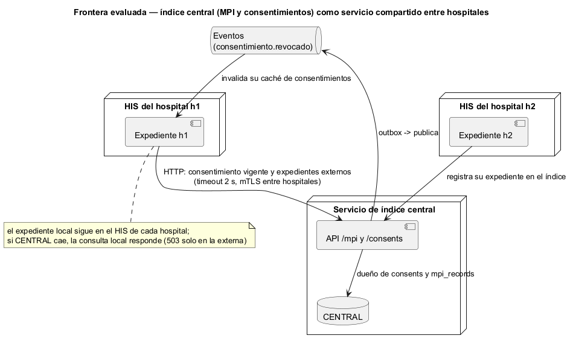

# Semana 5 — Cliente-servidor, contrato API y frontera de microservicio del Expediente médico electrónico base

| | |
|---|---|
| **Tarea Odoo** | 2507 — Semana 5: Cliente-servidor, API REST, microservicios e integración |
| **Flujo** | «Apertura y consulta autorizada del expediente longitudinal» (mismo Micro-HIS de la [semana 3](../semana-03/semana-03-arquitectura-micro-his.md) y de la semana 4, PR #349) |
| **Contrato** | [api/openapi.yaml](api/openapi.yaml) (OpenAPI 3.1, validado con Redocly) |
| **Estudiante** | Josué David Morales Ramírez |

## 1. Diseño cliente-servidor

El cliente es la SPA del HIS y el servidor es el Micro-HIS detrás de su front controller. Hablan solo por HTTPS con JSON. El servidor tiene **dos almacenes**: la base HOSPITAL del tenant (pacientes, asignaciones, expedientes y auditoría) y la base CENTRAL (consentimientos e índice MPI), que solo se lee. El cliente nunca decide si alguien puede ver un expediente: lo decide el servidor con la asignación activa y el consentimiento, y cada intento queda auditado (R-08).

## 2. Contrato API

| Método | Ruta | Caso de uso | Éxito | Errores documentados |
|---|---|---|---|---|
| POST | `/patients/{id}/record` | CU-01 abrir | 201 `{expediente}` | 409 E3 ya existe, 422 E2 no activo, 503 E8 |
| GET | `/patients/{id}/record` | CU-02 consulta local | 200 `{expediente}` | 403 E4 sin asignación, 404 NF sin expediente, 503 E8 |
| GET | `/patients/{id}/record/external` | CU-03 longitudinal | 200 con `externos` o `solo_local` | 403 E4 o E5 sin consentimiento, 404 NF, 503 E8 solo si CENTRAL falla |

Los errores no traen detalles técnicos ni datos clínicos: un 403 no dice si el paciente tiene episodios. Las rutas son las de la semana 4 (PR #349, aún sin integrar). Sin asignación activa responde 403 E4, no E1 como en la semana 1; el contrato lo documenta tal cual, porque es el hallazgo H-01 de la semana 13. **Prueba de contrato:** [verificar-contrato.php](evidencia/verificar-contrato.php) hace pasar 9 escenarios por las rutas y el controlador reales y comprueba que cada respuesta esté documentada. Comprueba también que las 3 operaciones coincidan con las acciones del controlador. Como la entrada MVC aún no está en `develop`, en esta rama el script avisa y sale con 1; la [salida](evidencia/salida-contrato.txt) se obtuvo sobre una copia del commit `0fd94ce` del PR #349.

## 3. Frontera de microservicio: evaluación con criterios medibles

El expediente **no** es buen candidato a separarse: sus datos son del hospital y viven en la base del tenant. La frontera natural es otra: el **índice central** (MPI y consentimientos), que por definición comparten varios hospitales y que ya tiene su propia base y su propio puerto (`IndiceCentral`, semana 4). Separarlo como servicio solo tiene sentido si un criterio medible lo pide:

| Criterio para extraer el índice central | Umbral | Valor hoy | ¿Lo pide? |
|---|---|---|---|
| Instalaciones del HIS que usan CENTRAL (redes de hospitales distintas) | Al menos 2 | 1: todos los tenants corren en la misma instalación | No |
| Consultas longitudinales sobre el total | Más del 20 % | Sin datos de producción | No |
| Requisito legal o de un tercero: custodia de consentimientos fuera del hospital | Al menos 1 | 0 | No |
| Despliegue independiente: cambios frenados por otros módulos | Más de 1 por mes | 0: ninguno de los 8 PR del módulo integrados en `develop` esperó un cambio de otro módulo | No |

**Decisión:** el expediente sigue como **módulo del monolito**, y CENTRAL sigue como base aparte accedida por su puerto. Si se suma una segunda instalación del HIS, el índice central es lo primero que se extrae.

## 4. Si se extrae: propiedad, comunicación, seguridad, resiliencia, observabilidad y consistencia

| Aspecto | Decisión |
|---|---|
| Propiedad de datos | El índice central es dueño de `consents` y `mpi_records`. Cada hospital sigue dueño de sus expedientes y de su auditoría; el índice solo guarda **dónde** hay un expediente, nunca su contenido. |
| Comunicación | Síncrona (HTTP) para preguntar por el consentimiento y los expedientes externos. Asíncrona para avisar de una revocación (`consentimiento.revocado`). |
| Seguridad | mTLS entre instalaciones, más JWT del profesional y `X-Tenant-ID`. El índice comprueba que el hospital que pide esté en el consentimiento (R-06), y la auditoría de cada lado registra la consulta (R-08). |
| Resiliencia | Timeout de 2 s. Si el índice cae, la consulta local sigue y solo la externa responde 503 E8, como hoy. No se reintenta en bucle (R-08 audita cada intento). |
| Observabilidad | `X-Request-Id` compartido entre el HIS y el índice para seguir una consulta de punta a punta; métricas de 403 E5 (consentimientos faltantes) y de la latencia del índice. |
| Consistencia | Una revocación debe valer de inmediato. Por eso la caché de consentimientos de cada HIS dura como máximo 60 s y se invalida con el evento. Mientras tanto, la vigencia se vuelve a comprobar en cada consulta (R-10). |

## 5. Migración razonada (si un criterio de la §3 se cumple)

1. **Contrato primero:** congelar `openapi.yaml` y su prueba de contrato en el CI. Ya está hecho en esta entrega, y queda pendiente que se integre la semana 4.
2. **Cerrar la auditoría:** auditar también los fallos técnicos y bloquear su modificación (H-04 y H-05 de la semana 13). Un acceso entre instalaciones que no deja rastro es inaceptable.
3. **Contrato del índice:** escribir el OpenAPI de `/mpi` y `/consents` y un adaptador HTTP de `IndiceCentral`, que convive con `CentralPdo`. El servicio de expediente no cambia.
4. **Extracción:** CENTRAL pasa a su servicio con mTLS, y el adaptador HTTP reemplaza al PDO. La salida se mide con la prueba de contrato en verde y la consulta local intacta cuando el índice cae.
5. **Reversa:** si un consentimiento revocado se acepta después de los 60 s, se vuelve al adaptador PDO mientras se corrige la invalidación.

## 6. Plan de issue, rama, worktree y PR

| Paso | Valor |
|---|---|
| Issue | «Semana 5: Expediente — contrato API y frontera de microservicio»; criterios de aceptación: lint sin errores, prueba de contrato en verde sobre la semana 4, decisión con criterios medibles. |
| Rama | `semana-5-expediente-medico`, desde `origin/develop` actualizado. |
| Worktree | `git worktree add ../wt-expediente-s5 -b semana-5-expediente-medico origin/develop`. Aísla la tarea sin cambiar de rama en la copia principal. Para esta entrega se usó una rama normal, porque había una sola tarea activa. |
| PR | Hacia `develop`, 1 commit, máximo 400 líneas, con la plantilla del repositorio, la salida del lint y de la prueba de contrato, y la revisión pedida al revisor asignado. Depende del PR #349 para que la prueba de contrato corra en `develop`. |

**Evidencia:** [salida del lint](evidencia/salida-lint-openapi.txt) (`npx @redocly/cli@1.34.3 lint`, sin errores ni avisos) y [salida de la prueba de contrato](evidencia/salida-contrato.txt) (11 de 11, sobre `0fd94ce`). **Bibliografía:** Newman, S. (2021). *Building Microservices* (2.ª ed.). O'Reilly · HL7 International (2019). *FHIR R4: recurso Consent*. hl7.org/fhir/R4/consent.html · OpenAPI Initiative (2021). *OpenAPI Specification 3.1.0*.
