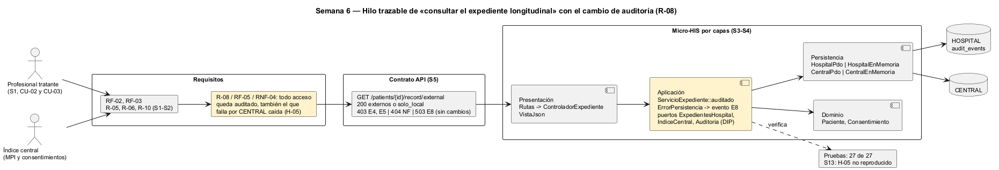

# Semana 6 — Defensa de la arquitectura del Expediente médico electrónico base

| | |
|---|---|
| **Tarea Odoo** | 2508 — Semana 6: Primera evaluación parcial |
| **Flujo** | «Apertura y consulta autorizada del expediente longitudinal» |
| **Presentación** | [semana-06-diapositivas.md](semana-06-diapositivas.md) (8 diapositivas) |
| **Estudiante** | Josué David Morales Ramírez |

## 1. Hilo trazable

Un solo hilo conecta las semanas 1 a 5. Admisión abre el expediente (CU-01), y el profesional tratante consulta la historia local (CU-02) y la de otros hospitales (CU-03) a través del índice central. CU-05 (autorizar) y CU-06 (auditar) se incluyen siempre. RF-01 a RF-05 y R-01 a R-10 fijan las reglas, el contrato expone las tres operaciones, y cada capa del Micro-HIS cumple una parte. En amarillo está lo que añade el cambio práctico (§3).

## 2. Matriz decisión → evidencia

| # | Decisión | Por qué | RF/RNF | Evidencia verificable |
|---|---|---|---|---|
| D-01 | Actores: admisión, profesional tratante y el índice central como sistema secundario | La historia de la red tiene otro dueño (CENTRAL) | RF-01, RF-03 | [Casos de uso S1](../semana-01/semana-01-uml-expediente.md) |
| D-02 | **DIP**: la política depende de cuatro puertos (`ExpedientesHospital`, `IndiceCentral`, `Auditoria`, `Reloj`) | Cambiar de base o de reloj no toca la política | RNF-01, RNF-02 | [Antes/después S2](../semana-02/semana-02-dip-requerimientos-diseno.md) |
| D-03 | Cuatro capas; `Paciente` y `Consentimiento` en el dominio | Vigencias y R-01/R-03 se prueban sin base | RF-01, RNF-02 | [S3](../semana-03/semana-03-arquitectura-micro-his.md); prueba «dependencias: …» |
| D-04 | MVC: el controlador solo elige el caso de uso; `VistaJson` es dueña de los HTTP | Errores sin detalles técnicos | RF-02 | [S4](../semana-04/semana-04-mvc-repository.md); prueba «503 E8 sin detalles técnicos» |
| D-05 | Repository de HOSPITAL (expedientes y auditoría) separado de CENTRAL, cada uno con PDO e InMemory | Dos bases con dueños distintos | RNF-01, RNF-03 | 9 pruebas por adaptador en [salida-pruebas.txt](evidencia/salida-pruebas.txt) |
| D-06 | La historia externa exige vínculo MPI y consentimiento vigente; sin vínculo, solo local | Acceso autorizado a datos sensibles (R-06, R-10) | RF-03 | Pruebas «p4 sin consentimiento = 403 E5» y «p2 … solo local» |
| D-07 | Contrato OpenAPI con prueba de contrato | El documento y el código no se separan | RF-01 a RF-03 | [api/openapi.yaml](../semana-05/api/openapi.yaml): lint sin avisos, contrato 11 de 11 |
| D-08 | Cambio práctico: el fallo técnico también se audita (evento E8) | «La auditoría no se omite en ningún camino»: cierra H-05 de la S13 | RF-05, RNF-04 | §3; pruebas «cambio S6» con PDO e InMemory |

## 3. Registro del cambio práctico defendido

**Solicitud:** «Si la base CENTRAL se cae justo cuando un médico pide la historia de otro hospital, ese intento debe quedar en la auditoría. Acceder a datos sensibles sin rastro, aunque falle, es justo lo que una auditoría necesita ver.» R-08 y RNF-04 lo exigen. El hallazgo H-05 de la S13 mostró que `auditado()` solo registraba las `ReglaDeDominio`: el 503 E8 no dejaba ningún evento.

| Capa | Qué cambió | Qué no cambió |
|---|---|---|
| Aplicación | `ServicioExpediente::auditado` también captura `ErrorPersistencia`: registra el evento con resultado E8 y vuelve a lanzar el error. Si la caída es la propia auditoría (HOSPITAL), no oculta el error original. | Los puertos, `abrir` y `consultar`. |
| Dominio, Persistencia y Presentación | Nada. | Las reglas de acceso, los adaptadores, las rutas y el 503 E8 sin detalles técnicos. |

| Escenario: m1 consulta a p1 con CENTRAL caída (PDO) | [Antes](evidencia/salida-auditoria-antes.txt) | [Después](evidencia/salida-auditoria-despues.txt) |
|---|---|---|
| Consulta local | 200, 1 evento «ok» | 200, 1 evento «ok» |
| Consulta longitudinal | 503 E8, **0 eventos** | 503 E8, **1 evento** «m1 consultar_longitudinal p1 E8» |

Las pruebas pasan de 25 a 27, y el script de la S13 da **H-05 «no reproducido»**. La prueba de contrato de la S5 sigue en verde.

**Riesgo defendido:** la auditoría sigue siendo una tabla común que admite `UPDATE` (hallazgo H-04). Este cambio asegura que el evento se escribe, no que no se altere después; en producción lo protege el trigger `cross_hospital_access_audits_immutable` (R-08). Además, H-02 (abrir sin rol) y H-03 (alcance del consentimiento) siguen abiertos.

## 4. Evidencia y bibliografía

[probar-auditoria.php](evidencia/probar-auditoria.php) se corrió antes y después del cambio. [salida-pruebas.txt](evidencia/salida-pruebas.txt) muestra las 27 pruebas en verde. El diagrama se generó con PlantUML local (`-charset UTF-8`).

**Bibliografía:** Martin, R. C. (2017). *Clean Architecture* (DIP). Prentice Hall · HL7 International (2023). *FHIR R5: AuditEvent*. hl7.org/fhir/auditevent.html.
