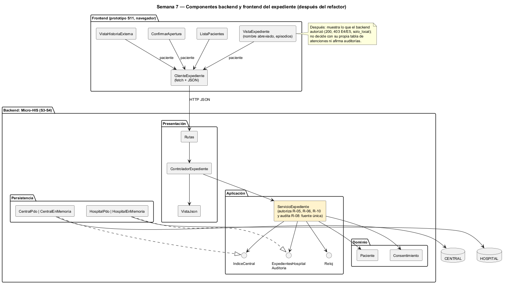

# Semana 7 — Componentes y refactorización del Expediente médico electrónico base

| | |
|---|---|
| **Tarea Odoo** | 2509 — Semana 7: Diseño de componentes y refactorización |
| **Flujo** | «Apertura y consulta autorizada del expediente longitudinal» |
| **Base** | Micro-HIS de las semanas 3 y 4, contrato de la [semana 5](../semana-05/semana-05-cliente-servidor.md) y prototipo de la [semana 11](../semana-11/semana-11-prototipo.md) |
| **Estudiante** | Josué David Morales Ramírez |

## 1. Componentes backend y frontend

| Componente | Lado | Responsabilidad única | Depende de |
|---|---|---|---|
| `ListaPacientes`, `ConfirmarApertura` | Frontend | Pacientes activos y confirmación antes de abrir (R-01, R-04) | `ClienteExpediente` |
| `VistaExpediente` | Frontend | Episodios locales con el nombre abreviado hasta pedir verlo (datos sensibles) | `ClienteExpediente` |
| `VistaHistoriaExterna` | Frontend | Episodios de otros hospitales con su alcance | `ClienteExpediente` |
| `ClienteExpediente` | Frontend | Hablar HTTP y JSON con el contrato de la S5 | Contrato API |
| `Rutas`, `ControladorExpediente`, `VistaJson` | Backend: Presentación | Ruta → acción → caso de uso → respuesta, sin detalles técnicos | `ServicioExpediente` |
| `ServicioExpediente` | Backend: Aplicación | CU-01 a CU-03 con CU-05 (autorizar) y CU-06 (auditar) incluidos | 4 puertos y dominio |
| `Paciente`, `Consentimiento`, `ReglaDeDominio` | Backend: Dominio | Expediente único y paciente activo (R-01, R-03); vigencia del consentimiento (R-06) | Nada fuera del dominio |
| `HospitalPdo`, `HospitalEnMemoria`, `CentralPdo`, `CentralEnMemoria` | Backend: Persistencia | HOSPITAL (expedientes, auditoría) y CENTRAL (MPI, consentimientos), cada una con su dueño | Puertos |

## 2. Contratos de entrada y salida

| Contrato | Entrada | Salida | Errores |
|---|---|---|---|
| HTTP `POST /patients/{id}/record` | profesional | 201 `{expediente}` | 409 E3, 422 E2, 503 E8 |
| HTTP `GET /patients/{id}/record` | profesional | 200 `{expediente}` | 403 E4, 404 NF, 503 E8 |
| HTTP `GET /patients/{id}/record/external` | profesional | 200 con `externos` o `solo_local` | 403 E4 o E5, 404 NF, 503 E8 |
| `ServicioExpediente::abrir` · `consultar` | paciente, profesional · más `longitudinal` | número · expediente y externos | `ReglaDeDominio`; todo queda auditado (R-08) |
| `ExpedientesHospital` · `Auditoria` | código, profesional · evento | `?Paciente`, `bool` · `void` | `ErrorPersistencia` |
| `IndiceCentral` | id global, hospital | consentimiento · expedientes externos | `ErrorPersistencia` (CENTRAL caída) |
| `Consentimiento::vigente` | consentimiento, ahora | `bool` | — |

## 3. El punto con mayor acoplamiento

[medir-acoplamiento.php](evidencia/medir-acoplamiento.php) da el máximo en **`ServicioExpediente`: Ce 7 y Ca 1 (I = 0,88)** ([salida](evidencia/salida-acoplamiento.txt)). Es el orquestador que une HOSPITAL, CENTRAL, auditoría y reloj, y concentra la autorización, que es justo lo que se quiere: una sola puerta para los datos sensibles.

El acoplamiento caro está entre la UI y la aplicación, en el **acceso autorizado**:

| Lugar | Qué decide | Problema |
|---|---|---|
| `ServicioExpediente` (backend) | Asignación activa (R-05), vínculo MPI y consentimiento vigente (R-06, R-10), y la auditoría de cada intento (R-08) | Es la fuente legítima |
| `vistas.expediente` y `vistas.externa` en [`app.js`](../semana-11/prototipo/app.js) | `rol !== 'tratante'`, su propia tabla `ATENCIONES` (R-05) y la vigencia del consentimiento (R-06) | Decide en el cliente quién ve datos clínicos |
| Textos de `app.js` | «Este intento quedó en la auditoría» | Afirma algo que solo el backend puede garantizar (el hallazgo H-05 de la S13 mostró que no siempre ocurría) |

Si cambia R-05 (por ejemplo, permitir la consulta a la jefatura del servicio), hay que tocar 2 lugares de 2 capas, y la regla del cliente se puede saltar con una petición directa.

## 4. Refactor concreto: antes y después

| | Antes | Después |
|---|---|---|
| Frontend | `if (rol !== 'tratante' \|\| !ATENCIONES[hc])` decide qué mostrar; la vigencia sale de `EXTERNOS[hc].vigencia` | Pide el expediente y muestra la respuesta: 200, 403 E4 o E5, o `solo_local`, con el mensaje del backend |
| Aplicación | `ServicioExpediente` autoriza y audita | Sin cambios: sigue siendo la única puerta (CU-05 y CU-06) |
| Texto de auditoría | La UI lo afirma siempre | Lo muestra solo si el backend responde que el evento se registró |
| Lugares que deciden el acceso | 2 (servicio y `app.js`) | 1 (`ServicioExpediente`) |
| Datos sensibles en el cliente | Llegan y la UI decide si mostrarlos | Solo llega lo autorizado; la UI conserva el nombre abreviado como protección visual |

**Justificación:**
- En datos clínicos, la autorización en el cliente no protege: el documento ya viajó. La regla tiene que vivir donde se decide qué sale de la base.
- La UI conserva lo suyo: abreviar el nombre en pantalla y explicar el rechazo.
- No amplía el módulo: las tres operaciones de la S5 ya responden 403 E4, 403 E5 y `solo_local`.
- La red ya existe: las pruebas «m2 sin asignación = 403 E4», «p4 sin consentimiento = 403 E5», «p2 sin vínculo MPI = solo local» y «las operaciones quedan auditadas, también los rechazos», con los dos adaptadores.
- Es un refactor conceptual, como pide el enunciado: no cambia el código de esta entrega.

## 5. Evidencia y bibliografía

[salida-acoplamiento.txt](evidencia/salida-acoplamiento.txt) se midió sobre `develop` en `2f3a807`. El diagrama se generó con PlantUML local (`-charset UTF-8`) y se revisó visualmente.

**Bibliografía:** Martin, R. C. (2017). *Clean Architecture*, caps. 13 y 14. Prentice Hall · OWASP (2021). *Top 10 A01: Broken Access Control*. owasp.org.
