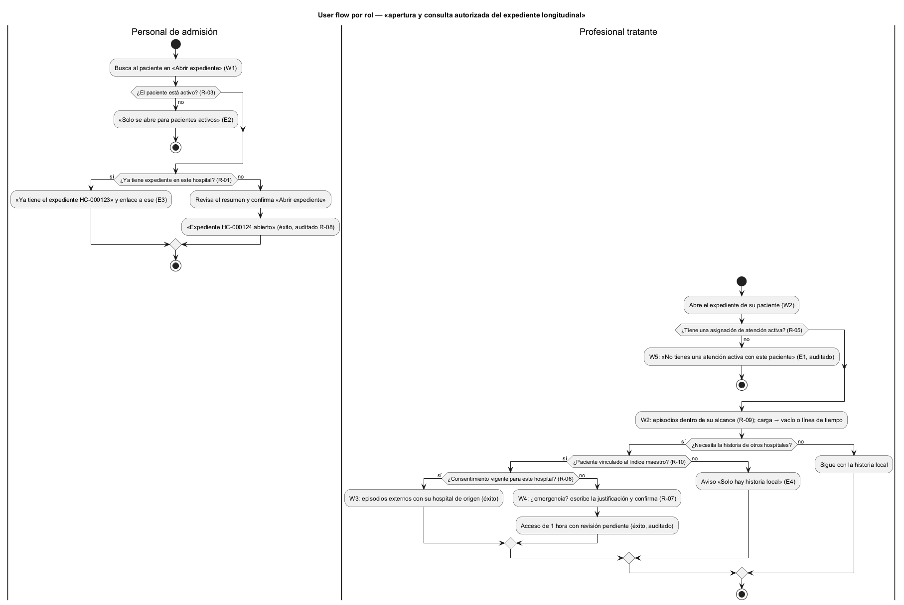

# Semana 8 — Flujo UX de «apertura y consulta autorizada del expediente longitudinal»

| | |
|---|---|
| **Tarea Odoo** | 2510 — Semana 8: Diseño de experiencia de usuario |
| **Módulo** | Expediente médico electrónico base |
| **Base** | Actores, CU-01 a CU-06, reglas R-01 a R-10 y excepciones E1–E6 de la [Semana 1](../semana-01/semana-01-uml-expediente.md); RF-01 a RF-05 de la [Semana 2](../semana-02/semana-02-dip-requerimientos-diseno.md) |
| **Estudiante** | Josué David Morales Ramírez |

## 1. Roles autorizados y lo que ve cada uno

| Rol | Puede | No ve |
|---|---|---|
| Personal de admisión | Buscar pacientes activos y abrir su expediente en la primera atención | Episodios, notas ni diagnósticos: abre el expediente, no lo consulta |
| Profesional tratante (médico o enfermería) | Consultar el expediente de los pacientes con los que tiene una asignación de atención activa y, con consentimiento o emergencia justificada, la historia de otros hospitales | Pacientes sin asignación activa (R-05) y lo que queda fuera de su alcance o del consentimiento (R-09) |

## 2. User flow por rol

Inicio: W1 para admisión y W2 para el profesional tratante. Decisión: abrir el expediente o usar el que ya existe; consultar solo la historia local o también la externa y, sin consentimiento, si es una emergencia. Confirmación: «Abrir» en el diálogo de W1 y «Confirmar acceso de emergencia» en W4. Salida: éxito (expediente abierto, historia local o externa, acceso de emergencia de 1 hora) o uno de los errores recuperables de W5.

## 3. Wireframes anotados

| W | Pantalla | Estados | Mensajes | Validaciones | Reglas de interacción |
|---|---|---|---|---|---|
| [W1](diagramas/semana-08-wf1-abrir-expediente.png) | Abrir expediente | Carga: filas de esqueleto. Vacío: «No hay pacientes activos con ese nombre». Éxito: «Expediente HC-000124 abierto» | Diálogo «Se crea con un número único y no se puede borrar» | Paciente activo (R-03, E2); un expediente por paciente (R-01, E3); número único (R-02) | Quien ya tiene expediente muestra su número y «Abrir» en lugar del botón de crear; documento enmascarado |
| [W2](diagramas/semana-08-wf2-expediente-local.png) | Expediente local | Carga → línea de tiempo de episodios o vacío («Sin episodios anteriores en este hospital») | Episodio de la atención activa visible arriba; aviso de que el acceso se audita | Asignación de atención activa (R-05, E1) | Solo el alcance de la asignación (R-09); más reciente primero; «Ver otros hospitales» abre W3 |
| [W3](diagramas/semana-08-wf3-historia-externa.png) | Historia de otros hospitales | Con consentimiento: episodios externos; sin vínculo con el índice (E4): «Solo hay historia local» | Fecha de vigencia del consentimiento y hospital de origen de cada episodio | Vínculo con el índice maestro (R-10); consentimiento activo y vigente para este hospital (R-06) | Lo externo se distingue de lo local por su hospital de origen; solo el alcance consentido |
| [W4](diagramas/semana-08-wf4-acceso-emergencia.png) | Acceso de emergencia | Sin consentimiento (E5) → justificación → acceso de 1 hora | «Quedará registrado y será revisado»; «Acceso de emergencia hasta las 11:40 · revisión pendiente» | Justificación obligatoria (E6); 1 hora como máximo (R-07) | «Cancelar» es la opción por defecto; al vencer la hora, el acceso se cierra solo |
| [W5](diagramas/semana-08-wf5-error-recuperable.png) | Errores recuperables | Sin atención activa (E1), expediente existente (E3) o falla al consultar otros hospitales | A quién pedir la asignación; enlace al expediente existente; «La historia local sigue disponible» | — | Cada error ofrece una acción para seguir; una falla externa nunca oculta la historia local |

## 4. Ayuda contextual

«Ayuda» explica qué es el expediente longitudinal, por qué hace falta una atención activa, qué es el consentimiento y cuándo vence, y cuándo se justifica un acceso de emergencia y quién lo revisa. Junto a la justificación de W4 hay ejemplos de motivos válidos.

## 5. Protección de datos

- Mínimo necesario: W1 enmascara el documento y no muestra datos clínicos; W2 y W3 muestran solo el alcance autorizado (R-09).
- Sin atención activa no se ve nada, ni siquiera si el expediente tiene episodios (R-05).
- Todo acceso, incluidos los rechazos y las emergencias, queda en una auditoría que no se puede modificar (R-08), y las pantallas lo avisan.
- La emergencia exige justificación, dura como máximo 1 hora y deja una revisión pendiente (R-07).
- El expediente nunca se borra (R-04): el diálogo de W1 lo avisa antes de crearlo.
- Los nombres de los wireframes son ficticios.

## 6. Trazabilidad y evidencia

| Regla | Dónde se aplica |
|---|---|
| R-01, R-02, R-03, R-04 | W1: paciente activo, un expediente con número único que no se borra |
| R-05, R-09 | W2 y W5: atención activa y alcance autorizado |
| R-06, R-10 | W3: vínculo con el índice maestro y consentimiento vigente |
| R-07, R-08 | W4 y §5: emergencia justificada de 1 hora y auditoría inmutable |

Fuentes editables en [`diagramas/`](diagramas/) (`.puml` con PlantUML Salt para los wireframes); los PNG se generaron con PlantUML local. El flujo se basa solo en las semanas 1 y 2, ya integradas. El Micro-HIS de la semana 3 (PR #191) aún no está integrado; si cambia sus mensajes, se ajustan los textos. El aviso «No pudimos consultar otros hospitales», la búsqueda con documento enmascarado y los ejemplos de justificación son diseños propuestos.

**Bibliografía:** Nielsen, J. (1994). *10 Usability Heuristics for User Interface Design*. Nielsen Norman Group · W3C (2023). *Web Content Accessibility Guidelines (WCAG) 2.2*.
