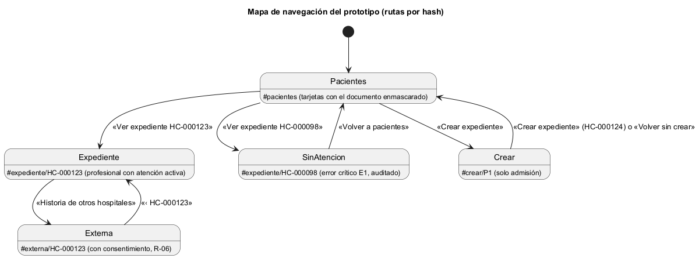

# Semana 11 — Prototipo navegable del Expediente médico electrónico base

| | |
|---|---|
| **Tarea Odoo** | 2513 — Semana 11: Mejores prácticas para diseño móvil/web |
| **Módulo** | Expediente médico electrónico base |
| **Base** | Flujo de la semana 8 (PR #207), backlog de la semana 9 (PR #224), diseño móvil de la semana 10 (PR #281) y reglas R-01 a R-10 de la semana 1 |
| **Estudiante** | Josué David Morales Ramírez |

## 1. Prototipo y mapa de navegación

**Archivo:** [prototipo/index.html](prototipo/index.html). Se abre sin servidor; es HTML, CSS y JavaScript sin dependencias, con datos ficticios en memoria y sin conexión a la API. Flujo principal: «apertura y consulta autorizada del expediente longitudinal». El profesional tratante consulta los episodios clínicos de su paciente y la historia de otros hospitales; admisión abre el expediente de un paciente nuevo. El **panel del prototipo**, al pie, cambia el rol.

## 2. Camino feliz y error crítico

| Paso | Escritorio (1280 px) | Móvil (360 px) | Qué se ve |
|---|---|---|---|
| 1. Pacientes | [captura](capturas/escritorio/01-pacientes.png) | [captura](capturas/movil/01-pacientes.png) | Una tarjeta por paciente, con año de nacimiento y «Documento terminado en 4521»; la acción va dentro de la tarjeta (semana 9, B-01) |
| 2. **Camino feliz** | [captura](capturas/escritorio/02-expediente.png) | [captura](capturas/movil/02-expediente.png) | HC-000123: nombre abreviado («M. López R.») hasta pulsar «Mostrar nombre», la atención E-77 activa y los episodios, el más reciente primero |
| 3. Otros hospitales | [captura](capturas/escritorio/03-historia-externa.png) | [captura](capturas/movil/03-historia-externa.png) | Consentimiento vigente hasta el 31/12/2026 (R-06); el episodio externo muestra su hospital de origen y su alcance |
| 4. **Error crítico** | [captura](capturas/escritorio/04-error-sin-atencion.png) | [captura](capturas/movil/04-error-sin-atencion.png) | HC-000098 sin atención activa: «No tienes una atención activa con este paciente» (E1), sin mostrar ningún dato, y el intento queda en la auditoría |
| 5. Admisión confirma | [captura](capturas/escritorio/05-admision-confirmar.png) | [captura](capturas/movil/05-admision-confirmar.png) | «¿Crear el expediente de M. López?» con su nacimiento y documento, para no confundirlo con M. López Ruiz |
| 6. Expediente creado | [captura](capturas/escritorio/06-expediente-creado.png) | [captura](capturas/movil/06-expediente-creado.png) | «Expediente HC-000124 abierto»; cada paciente queda con un solo expediente (R-01) |

Es el error crítico porque toca el acceso autorizado y los datos sensibles: sin una atención activa no se ve nada, ni siquiera si el expediente tiene episodios (R-05). Admisión no consulta episodios: si abre `#expediente/HC-000123`, vuelve a la lista. La integridad se protege en los pasos 5 y 6, porque un expediente no se puede borrar (R-04).

## 3. Consistencia de roles, estados y accesibilidad

- **Roles:** el profesional tratante consulta; el personal de admisión crea. Son los mismos actores de la semana 1.
- **Estados:** atención activa, consentimiento vigente y expediente abierto, como en las semanas 8 a 10. Los nombres y documentos son ficticios.
- **Accesibilidad:** `lang="es"` y un título por pantalla; foco en el `<h1>` y «Saltar al contenido»; anillo de foco de 2 px y objetivos de 44 px. «Mostrar nombre» es un botón con `aria-pressed`. El documento se escribe como «terminado en 4521» y nunca completo (semana 9, B-06).

## 4. Evidencia y validación

[capturar.mjs](evidencia/capturar.mjs), el mismo script de la semana 11 de Catálogo, fija el ancho exacto con el protocolo DevTools de Edge, recorre el flujo pulsando como un usuario, toma las capturas y mide el scroll horizontal. Su [salida](evidencia/salida-medicion.txt) da 18 de 18 mediciones sin scroll a 320, 360 y 430 px (WCAG 1.4.10), y el foco nunca queda en `BODY`. Controles: un bloque inyectado de 600 px marca «SÍ»; «Mostrar nombre» deja «M. López Ruiz» y `aria-pressed="true"`; admisión en `#expediente/HC-000123` vuelve a la lista.

**Bibliografía:** W3C (2023). *WCAG 2.2* · W3C (2024). *ARIA Authoring Practices Guide: Button (toggle)* · Chrome DevTools Protocol: `Emulation.setDeviceMetricsOverride`.
