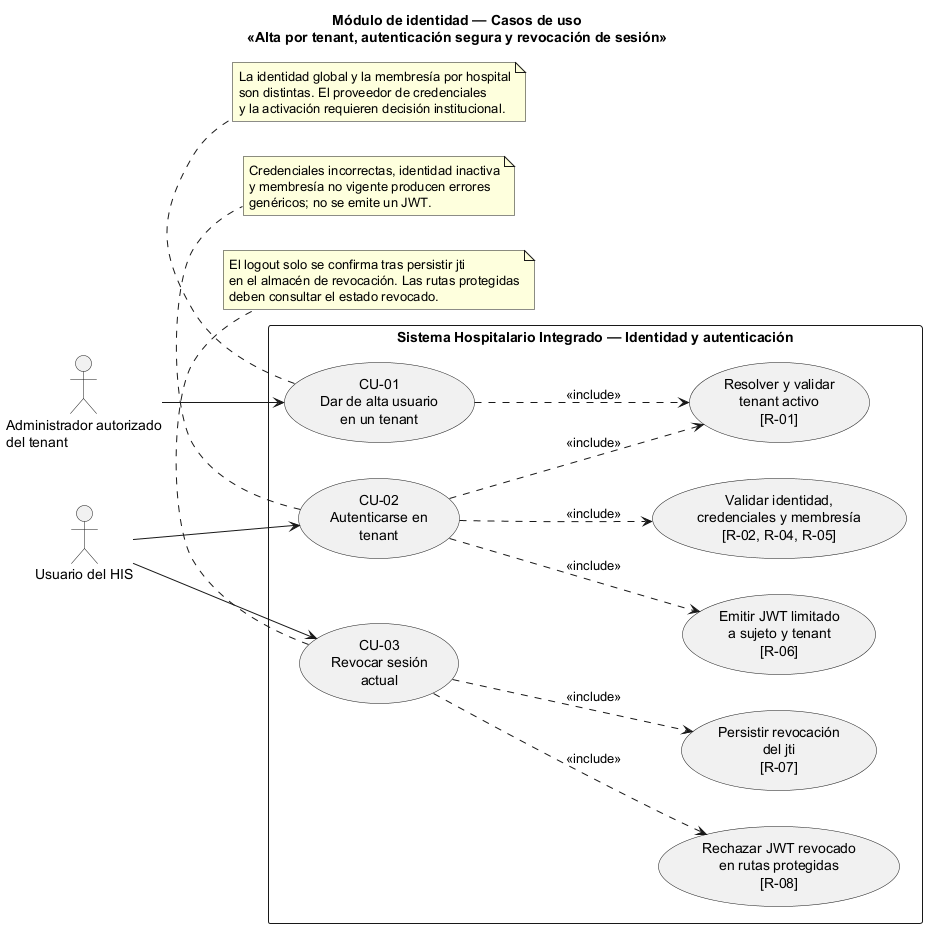
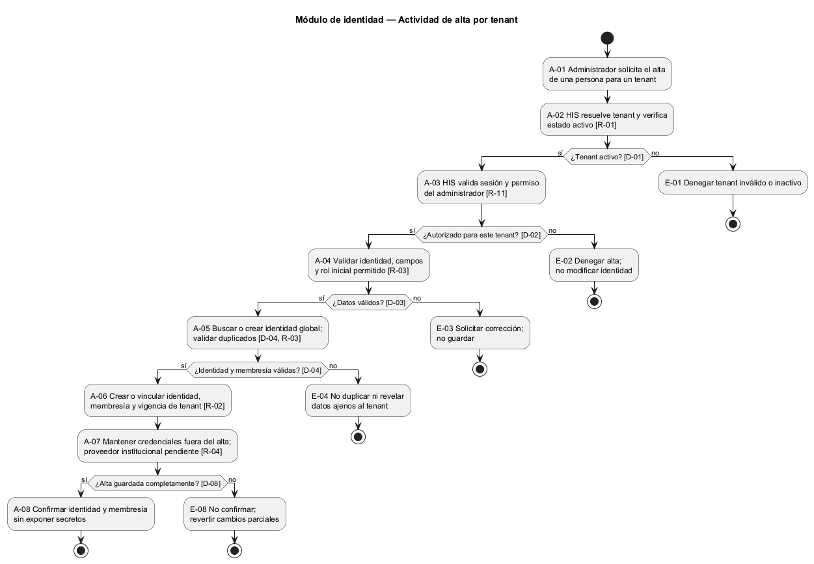
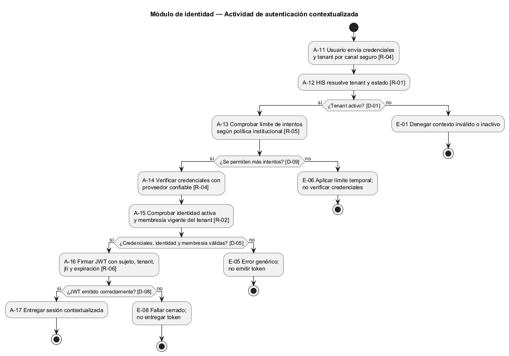
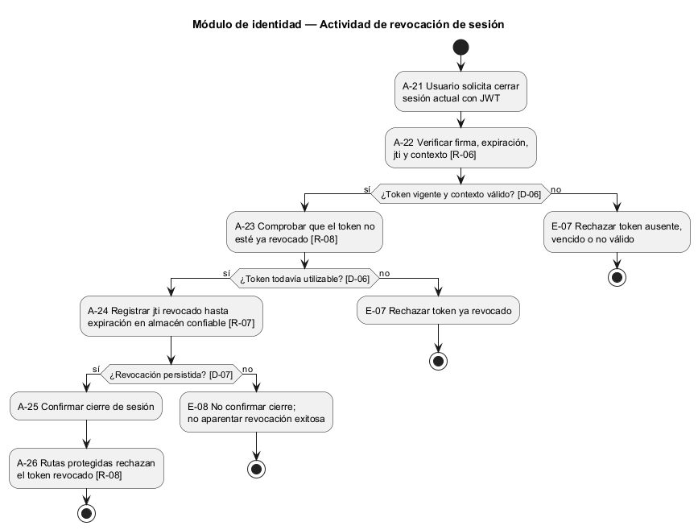
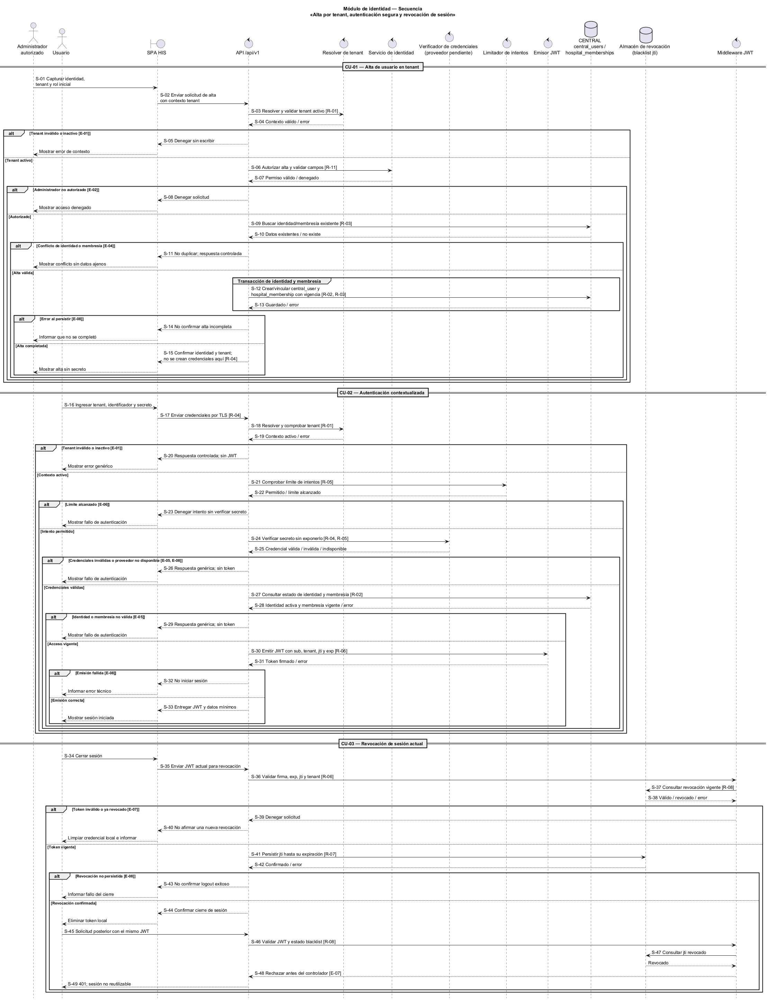

# Semana 1 — Modelado UML de alta de usuarios, autenticación y revocación de sesión

| | |
|---|---|
| **Curso** | Análisis de Sistemas II — Proyecto Final 2026 |
| **Proyecto** | Sistema Hospitalario Integrado (HIS) |
| **Módulo** | Gestión de usuarios, tenants y endurecimiento de autenticación |
| **Tema de la semana** | Conceptos generales, orientación a objetos y UML |
| **Proceso modelado** | «Alta de usuario por tenant, autenticación segura y revocación de sesión» |
| **Estudiante según la captura** | Mercedes Azucena Lopez Perez |
| **Fecha** | Octubre 2026 |

## 1. Introducción

Un HIS multi-tenant debe identificar a la persona y limitar su sesión al hospital o contexto al que tiene acceso. Dar de alta una identidad no equivale, por sí solo, a concederle acceso a todos los hospitales. El proceso vincula una identidad con una membresía del tenant; el inicio de sesión valida las credenciales y la vigencia de esa membresía antes de emitir un JWT contextualizado. Al cerrar la sesión, el token actual se revoca y las solicitudes posteriores deben rechazarlo.

El documento presenta tres vistas relacionadas:

- **Casos de uso:** identifica quién da de alta una cuenta y quién autentica o cierra su sesión.
- **Actividad:** muestra las decisiones, validaciones, excepciones y resultados de cada flujo.
- **Secuencia:** identifica participantes, mensajes, comprobaciones y respuestas.

Los identificadores CU, A, D, E, S y R permiten seguir cada regla entre vistas mediante una matriz de trazabilidad. Es un modelo de negocio académico: describe el comportamiento esperado y no afirma que los endpoints actuales funcionen.

## 2. Narrativa de alcance

**Objetivo.** Permitir que una persona administradora autorizada registre o vincule una identidad y una membresía con el tenant correcto; que el usuario se autentique únicamente después de verificar el contexto, el estado de la identidad, las credenciales y la vigencia de acceso; y que el usuario pueda revocar la sesión actual de modo que su JWT deje de ser aceptado.

**Escenario de referencia.** El administrador del tenant selecciona el contexto activo, registra una identidad verificada y solicita la membresía con el rol inicial permitido. El sistema comprueba el permiso del administrador y que el tenant esté activo; evita duplicar una identidad o una membresía vigente; y conserva la identidad global junto con una membresía propia del hospital. La identidad incluye un sujeto emitido por la autoridad de identidad que se apruebe. El administrador no ve ni registra contraseñas. La creación de credenciales permanece en el proceso institucional que se defina, separado de esta alta porque el repositorio aún no decide su proveedor.

Más tarde, el usuario elige ese mismo tenant e ingresa sus credenciales por un canal seguro. El sistema resuelve el tenant, verifica que esté activo, valida la identidad y sus credenciales, y comprueba que exista una membresía vigente para ese hospital. Solo entonces emite un JWT limitado al contexto autorizado. Cuando el usuario cierra sesión, el sistema invalida el token actual en el mecanismo de revocación; la interfaz confirma el cierre únicamente si la revocación quedó registrada. Un uso posterior del token es rechazado.

**Dentro del alcance:**

- dar de alta una identidad y vincularla al tenant/hospital activo con una membresía autorizada;
- autenticar al usuario en un tenant elegido y verificar su estado y su membresía vigente;
- responder con errores de autenticación genéricos que no revelen si una cuenta existe;
- emitir un JWT con sujeto, tenant/contexto, identificador de token y expiración;
- revocar la sesión actual y rechazar el token revocado en solicitudes posteriores;
- diferenciar errores de datos, autorización, credenciales, estado, tenant y persistencia;
- conservar el principio de mínimo privilegio y separar identidad global de acceso por tenant.

**Fuera del alcance:**

- gestión completa del catálogo RBAC, permisos y políticas de cada módulo;
- recuperación o restablecimiento de contraseña, MFA, acceso federado/SSO y enrolamiento de factores;
- cierre remoto de todas las sesiones, desactivación de cuentas, gestión de dispositivos y rotación de claves;
- definir endpoints definitivos, pantallas, proveedor de credenciales o infraestructura de producción;
- acceso sin conexión (offline): sigue expresamente sin resolverse en el diseño federado;
- procesos clínicos y autorización funcional de cada operación después de autenticar.

**Supuestos y decisiones por confirmar:**

1. La captura usa «tenant»; el esquema vigente modela redes y hospitales y la membresía `hospital_memberships` se vincula a `hospitals`. Para esta entrega se representa el tenant operativo como el contexto/hospital seleccionado, pero la equivalencia formal y la resolución de `X-Tenant-ID` deben confirmarse antes de implementar.
2. El esquema CENTRAL guarda en `central_users` un sujeto, correo opcional, nombre visible y estado. No guarda contraseñas ni define un proveedor de credenciales. La verificación se representa como una colaboración abstracta; no se afirma dónde viven secretos, hashes o factores.
3. La política de invitación/activación, de establecimiento de credenciales, de reutilización de una identidad global para otro hospital y de unicidad del identificador de inicio de sesión requiere acuerdo. La restricción vigente hace único el correo normalizado global cuando se proporciona, pero el correo es nullable.
4. `hospital_memberships` registra usuario, hospital, `role_code`, estado y vigencia; no decide por sí sola cómo se asignan todos los roles ni quién puede conceder cada uno. El alta exige el permiso de administración de usuarios y membresías que defina el módulo RBAC.
5. El proyecto configura JWT con claims obligatorios `sub`, `jti`, `iat`, `nbf` y `exp`, y habilita blacklist. La durabilidad del almacén de revocación, su disponibilidad y la comprobación de blacklist en todas las rutas protegidas son requisitos del diseño, no evidencia de que la autenticación actual opere.
6. El esquema federado deja offline authentication fuera de alcance. `local_user_ref` no contiene ni representa credenciales.
7. Ninguna excepción técnica se presenta como alta, autenticación o cierre de sesión exitosos.

## 3. Actores

| Actor | Tipo | Objetivo |
|---|---|---|
| Administrador autorizado del tenant | Primario | Registrar una identidad y solicitar su membresía y rol inicial dentro del tenant que administra. |
| Usuario del HIS | Primario | Iniciar una sesión contextualizada al tenant donde tiene acceso y revocar su sesión actual al salir. |

La SPA, la API, el resolver de tenant, el servicio de identidad, el verificador de credenciales, el emisor JWT, el repositorio de membresías y el almacén de revocación son componentes internos, no actores externos.

## 4. Diagrama de casos de uso

Fuente editable: [semana-01-casos-de-uso.puml](diagramas/semana-01-casos-de-uso.puml).

## 5. Especificación de casos de uso

### CU-01 — Dar de alta usuario en un tenant

| Campo | Descripción |
|---|---|
| Actor principal | Administrador autorizado del tenant. |
| Objetivo | Crear o localizar la identidad adecuada y asociarla con una membresía válida del tenant/hospital correcto. |
| Precondición | Administrador autenticado; tenant operativo resuelto y activo; identidad verificada bajo la política institucional; permiso de alta y de asignación de membresía concedido por RBAC. |
| Disparador | El administrador solicita incorporar a una persona al HIS para su tenant. |
| Flujo principal | 1. El administrador selecciona el tenant/contexto e ingresa la identidad verificada y el rol inicial autorizado. 2. El sistema valida el contexto, el permiso y los campos (D-01–D-03). 3. El sistema comprueba si el sujeto ya tiene identidad y evita duplicar la membresía para usuario, hospital y rol (D-04). 4. En una única transacción de CENTRAL, el servicio crea o vincula `central_users` y crea `hospital_memberships` con estado y vigencia (A-05, R-02, R-03). 5. El sistema confirma el alta sin entregar credenciales; su configuración corresponde al mecanismo institucional, aún por definir (R-04). |
| Alternativas y excepciones | Tenant inexistente/inactivo o contexto inválido: no crear membresía (E-01). Administrador sin permiso: denegar (E-02). Datos incompletos o rol no autorizado/inexistente: solicitar corrección sin guardar (E-03). Identidad/membresía duplicada: no duplicar; informar conflicto sin revelar datos de otra organización (E-04). Falla al guardar identidad o membresía: revertir la operación atómica y no confirmar el alta (E-08). |
| Postcondición | Se conserva una identidad y una membresía vinculadas al contexto correcto; nunca se crea acceso a otro tenant por inferencia del cliente. El alta no afirma que se hayan creado credenciales ni que el usuario ya pueda iniciar sesión. |

### CU-02 — Autenticarse en un tenant

| Campo | Descripción |
|---|---|
| Actor principal | Usuario del HIS. |
| Objetivo | Obtener una sesión JWT solo cuando las credenciales, la identidad y el acceso al tenant sean válidos. |
| Precondición | El usuario presenta sus credenciales y solicita acceso a un tenant; la existencia de identidad activa y membresía vigente se verifica durante el flujo, no se presupone. |
| Disparador | El usuario solicita iniciar sesión e ingresa sus credenciales. |
| Flujo principal | 1. El usuario selecciona tenant e ingresa el identificador y el secreto por canal seguro. 2. La API resuelve el tenant y comprueba su estado (D-01). 3. Antes de verificar el secreto, se comprueba el límite de intentos definido por política (D-09, R-05). 4. El verificador valida las credenciales sin registrarlas ni devolverlas (R-04, R-05). 5. El sistema comprueba identidad activa y membresía vigente para ese hospital/tenant (D-05, R-02). 6. El emisor crea un JWT para ese sujeto y contexto con `jti` y expiración (R-06). 7. La API entrega el token y los datos de sesión mínimos, sin secretos. |
| Alternativas y excepciones | Tenant desconocido/inactivo: detener el flujo (E-01). Credenciales inválidas, identidad inexistente/inactiva o membresía ausente/expirada: misma respuesta genérica de autenticación (E-05, R-05). Límite de intentos alcanzado: no verificar el secreto hasta que la política permita un nuevo intento (E-06). Falla al verificar o emitir token: no entregar una sesión de éxito (E-08). |
| Postcondición | El usuario autenticado recibe un token limitado al tenant autorizado; no se emite JWT para credenciales o membresías inválidas. |

### CU-03 — Revocar sesión actual

| Campo | Descripción |
|---|---|
| Actor principal | Usuario autenticado del HIS. |
| Objetivo | Invalidar el JWT de la sesión actual para impedir que vuelva a autorizar solicitudes. |
| Precondición | JWT vigente, no revocado y asociado con el contexto de tenant de la solicitud. |
| Disparador | El usuario selecciona «cerrar sesión». |
| Flujo principal | 1. La interfaz envía el JWT actual a la API. 2. La API verifica firma, expiración, `jti`, tenant y estado actual de revocación (D-06). 3. El servicio de sesión agrega el identificador del token a la lista de revocación hasta su expiración (R-07). 4. El sistema confirma el cierre solo después de persistir la revocación. 5. La siguiente solicitud con ese token se rechaza antes de llegar a una operación protegida (R-08). |
| Alternativas y excepciones | Token ausente, inválido, vencido o previamente revocado: denegar uso; no emitir nueva sesión (E-07). El contexto de la solicitud no coincide con el del token: rechazar sin tocar otra sesión (E-01). Falla del almacén de revocación: no confirmar que la sesión quedó revocada ni presentar éxito (E-08). |
| Postcondición | El token queda revocado y deja de ser aceptado; la expiración por sí sola no se confunde con el cierre explícito. |

## 6. Diagrama de actividad

**Alta por tenant**

Fuente editable: [semana-01-actividad.puml](diagramas/semana-01-actividad.puml).

**Autenticación contextualizada**

Fuente editable: [semana-01-actividad-autenticacion.puml](diagramas/semana-01-actividad-autenticacion.puml).

**Revocación de sesión**

Fuente editable: [semana-01-actividad-revocacion.puml](diagramas/semana-01-actividad-revocacion.puml).

Los tres flujos separan sus decisiones y excepciones para mantener visibles las validaciones y el cierre seguro de cada operación.

## 7. Diagrama de secuencia

Fuente editable: [semana-01-secuencia.puml](diagramas/semana-01-secuencia.puml).

La secuencia detalla las interacciones con el contexto de tenant, el verificador abstracto de credenciales, la identidad y membresía, el emisor JWT y el almacén de revocación. El componente de credenciales es un límite explícito pendiente de decisión, no una afirmación sobre persistencia actual.

## 8. Reglas, decisiones y excepciones

| ID | Regla |
|---|---|
| R-01 | Resolver y validar el tenant activo antes de alta o autenticación. Un identificador enviado por el cliente no es prueba de pertenencia; la revocación se valida contra el contexto del JWT. |
| R-02 | Una persona solo recibe acceso al tenant mediante una membresía explícita, vigente y relacionada con el hospital correspondiente. |
| R-03 | La identidad global y la membresía por hospital son registros distintos. El alta no crea membresías duplicadas ni concede acceso implícito a otros hospitales. |
| R-04 | Los secretos no se muestran al administrador ni se almacenan o registran en texto claro; el componente institucional de credenciales es responsable de su manejo seguro. |
| R-05 | Los errores de inicio de sesión son genéricos para no revelar existencia, estado o tenant de una cuenta; los controles contra abuso siguen la política institucional. |
| R-06 | Emitir JWT solo tras autenticar identidad y membresía; delimitarlo con sujeto, contexto, `jti` y expiración. La clave y el algoritmo deben proceder de configuración segura. |
| R-07 | Revocar requiere registrar `jti` hasta expiración en un almacén confiable y disponible; no se confirma el cierre antes de persistirlo. |
| R-08 | Cada ruta protegida comprueba firma, expiración, contexto y blacklist/revocación antes de autorizar. No se da por válido un token revocado. |
| R-09 | Un tenant, identidad, permiso o mecanismo de persistencia no disponible provoca respuesta cerrada, sin alta ni autenticación por defecto. |
| R-10 | Autenticación sin conexión no está definida; las réplicas de identidad sin credenciales no habilitan login offline. |
| R-11 | Solo un administrador autenticado y autorizado por RBAC puede dar de alta identidades o membresías en el tenant que administra. |

| ID | Decisión |
|---|---|
| D-01 | ¿Existe y está activo el tenant/contexto solicitado? |
| D-02 | ¿El administrador está autenticado y autorizado para dar altas en este tenant? |
| D-03 | ¿La identidad y los datos requeridos son válidos y se permite el rol/membresía inicial? |
| D-04 | ¿La identidad puede crearse o vincularse sin duplicar el acceso en este tenant? |
| D-05 | ¿Credenciales válidas, identidad activa y membresía vigente coinciden con el tenant seleccionado? |
| D-06 | ¿El JWT es vigente, corresponde al contexto y aún no está revocado? |
| D-07 | ¿La revocación del identificador `jti` quedó persistida correctamente? |
| D-08 | ¿Se guardaron completamente identidad y membresía, o se emitió el JWT, sin error? |
| D-09 | ¿Se permiten más intentos de autenticación para este origen/cuenta según la política institucional? |

| ID | Excepción |
|---|---|
| E-01 | Tenant inexistente, inactivo o diferente del contexto asociado al token: impedir operación y no cambiar datos de otro tenant. |
| E-02 | Administrador no autenticado o sin permiso: responder sin crear identidad ni membresía. |
| E-03 | Datos de identidad incompletos, rol no permitido o solicitud inválida: señalar los campos corregibles sin aplicar cambios. |
| E-04 | Identidad/membresía duplicada o conflicto de unicidad: no duplicar ni divulgar datos sensibles entre tenants. |
| E-05 | Credenciales inválidas, usuario inexistente/inactivo o membresía no vigente: respuesta genérica de autenticación; no emitir token. |
| E-06 | Umbral de intentos alcanzado: limitar temporalmente intentos de acuerdo con la política de seguridad, sin revelar la cuenta objetivo. |
| E-07 | Token expirado, mal firmado, ausente o ya revocado: rechazarlo y no permitir acceso. |
| E-08 | Falla del proveedor de credenciales, de base de datos, del emisor JWT o del almacén de revocación: no anunciar alta/login/logout exitoso ni omitir controles. |

## 9. Trazabilidad entre vistas

| Regla | Caso(s) de uso | Actividad | Secuencia |
|---|---|---|---|
| R-01 — Tenant activo y contexto seguro | CU-01, CU-02 | A-02, A-12; D-01; E-01 | S-03–S-05, S-18–S-20 |
| R-02 — Membresía explícita y vigente | CU-01, CU-02 | A-06, A-15; D-05; E-05 | S-12–S-13, S-27–S-29 |
| R-03 — Identidad global separada de membresía | CU-01 | A-05–A-06; D-03, D-04; E-04 | S-09–S-14 |
| R-04 — Credenciales protegidas | CU-01, CU-02 | A-07, A-14; D-05; E-08 | S-15, S-17, S-24–S-26 |
| R-05 — Error genérico y control de intentos | CU-02 | A-13–A-15; D-05, D-09; E-05, E-06 | S-21–S-29 |
| R-06 — JWT ligado a sujeto y contexto | CU-02, CU-03 | A-16, A-22; D-06, D-08; E-07, E-08 | S-30–S-31, S-36 |
| R-07 — Persistir revocación antes de confirmar | CU-03 | A-24–A-25; D-07; E-08 | S-41–S-44 |
| R-08 — Rechazar tokens revocados en toda ruta | CU-03 | A-23, A-26; D-06; E-07 | S-37–S-40, S-45–S-49 |
| R-09 — Fallar cerrado | CU-01, CU-02, CU-03 | A-02–A-08, A-12–A-17, A-21–A-26; D-01–D-09; E-01–E-08 | S-03–S-15, S-18–S-33, S-36–S-49 |
| R-10 — Sin autenticación offline implícita | CU-02 | Límite del proceso; E-08 | S-24–S-26 (verificación requiere proveedor disponible) |
| R-11 — Alta administrativa autorizada | CU-01 | A-03; D-02; E-02 | S-06–S-08 |

## 10. Conclusión

Los tres flujos relacionados establecen que la identidad no basta para acceder al HIS: la membresía debe vincular la persona al tenant correcto. El inicio de sesión verifica credenciales y vigencia antes de emitir una sesión contextualizada; el cierre invalida el token y exige comprobar su revocación en cada ruta protegida. La separación entre identidad y acceso por hospital está respaldada por el esquema federado. La ubicación de las credenciales, la equivalencia formal de tenant con hospital, la política de activación y el almacén de blacklist continúan siendo decisiones pendientes, no capacidades que esta entrega declare implementadas.

## 11. Referencias

- Captura de la consigna de Semana 1 compartida por la estudiante: «Gestión de usuarios, tenants y endurecimiento de autenticación».
- `README.md`: stack, estado real de las rutas de autenticación y decisión pendiente sobre credenciales.
- `routes/api.php` y `app/Http/Controllers/Api/V1/AuthController.php`: rutas y comportamiento de referencia del flujo JWT existente, actualmente documentado como no funcional.
- `config/jwt.php`: claims requeridos, tiempos configurados y opción de blacklist habilitada.
- `database/migrations/central/2026_08_11_000000_create_network_registry.php`: entidades `networks` y `hospitals`.
- `database/migrations/central/2026_08_11_000100_create_identity_and_memberships.php`: `central_users` y `hospital_memberships`; identidad sin contraseña y membresía por hospital.
- `openspec/changes/postgresql-federated-schema-rebuild/design.md`: arquitectura federada y pregunta de autenticación offline aún no resuelta.
- `openspec/changes/postgresql-federated-schema-rebuild/specs/central-control-schema/spec.md`: inventario CENTRAL e invariantes de identidad y membresías.
- Object Management Group. (2017). *Unified Modeling Language (UML), Version 2.5.1*. https://www.omg.org/spec/UML/2.5.1
- OWASP Foundation. *Authentication Cheat Sheet*. https://cheatsheetseries.owasp.org/cheatsheets/Authentication_Cheat_Sheet.html
- OWASP Foundation. *Session Management Cheat Sheet*. https://cheatsheetseries.owasp.org/cheatsheets/Session_Management_Cheat_Sheet.html
