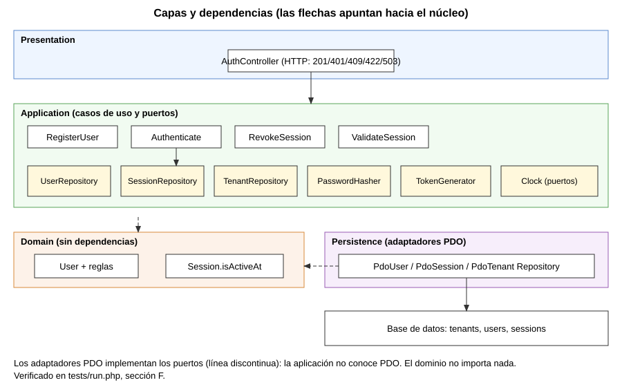
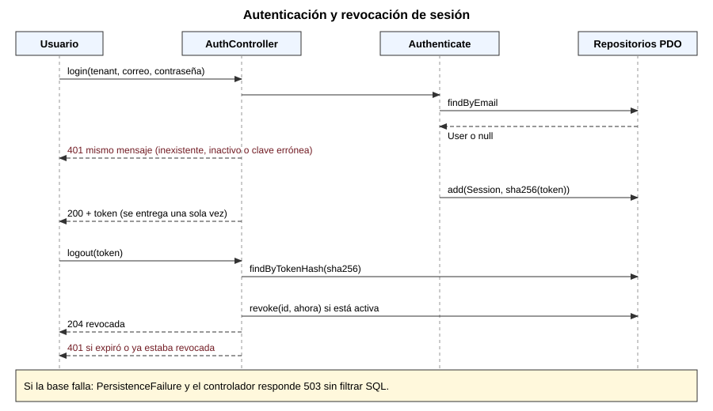

# Semana 3 - Diseño arquitectónico, vistas y patrones: Gestión de usuarios, tenants y endurecimiento de autenticación

Estudiante: LOPEZ PEREZ, MERCEDES AZUCENA. Tarea: Micro-HIS en PHP 8.2+ vanilla para «alta de usuario por tenant, autenticación segura y revocación de sesión», con Presentation, Application, Domain y Persistence separados, PDO con sentencias preparadas y pruebas de camino feliz, regla de dominio y error de persistencia.

## 1. Qué se entrega

| Pedido | Dónde |
|---|---|
| Vista arquitectónica C4/UML y dependencias | [componentes](diagramas/semana-03-componentes.svg) y [secuencia](diagramas/semana-03-secuencia.svg) (fuentes `.puml`) |
| Micro-HIS en PHP vanilla con 4 capas | [ejemplo/](ejemplo/) |
| PDO con sentencias preparadas, sin framework | `ejemplo/src/Persistence/Pdo.php` |
| Pruebas: camino feliz, regla de dominio, error de persistencia | `ejemplo/tests/run.php`: 26 de 26 pasan ([salida](evidencia/pruebas-semana-03.txt)) |

Ejecución: `php ejemplo/tests/run.php` (PHP 8.2 con `pdo_sqlite`; usa SQLite en memoria como base de prueba).

## 2. Vista de componentes y dependencias

| Capa | Contenido | Puede depender de |
|---|---|---|
| Presentation | `AuthController`: traduce excepciones a 201/204/401/404/409/422/503 | Application, Domain (excepciones) |
| Application | `RegisterUser`, `Authenticate`, `RevokeSession`, `ValidateSession` y los puertos (interfaces) | Domain |
| Domain | `User` (normaliza correo, regla de contraseña), `Session.isActiveAt`, excepciones | nada |
| Persistence | Adaptadores `Pdo*Repository` de los puertos | Application (interfaces), PDO |

La dependencia apunta al núcleo: la aplicación define los puertos y la persistencia los implementa (inversión de dependencias). Esto se **verifica** en la sección F de las pruebas: dominio, aplicación y presentación no contienen PDO ni SQL.

## 3. Secuencia

## 4. Patrones y decisiones

| Patrón | Dónde | Por qué |
|---|---|---|
| Repository | `UserRepository`, `SessionRepository`, `TenantRepository` | Aísla el SQL; permite dobles en pruebas |
| Puertos y adaptadores | `Clock`, `PasswordHasher`, `TokenGenerator` | Reloj y azar controlables en pruebas |
| Caso de uso | una clase invocable por intención | Una razón de cambio (SRP, Semana 2) |
| Traducción de errores | `PdoBase::run` convierte `PDOException` en `PersistenceFailure` | La aplicación no filtra detalles del motor |

Aislamiento por tenant: `UNIQUE (tenant_id, email)` y todas las consultas filtran por `tenant_id`. El mismo correo puede existir en dos hospitales, pero no repetirse en uno.

## 5. Endurecimiento de autenticación (lo implementado)

- Contraseña de 12 o más caracteres con letra y dígito (regla de dominio).
- Hash `bcrypt` (`password_hash`); nunca se guarda en claro.
- Token aleatorio de 32 bytes; en la base solo se guarda su **SHA-256**, de modo que una filtración de la tabla no entrega sesiones usables.
- Mismo mensaje y código 401 para usuario inexistente, inactivo o contraseña errónea.
- Sesión con vencimiento de 8 horas y revocación efectiva (`revoked_at`).
- Sentencias preparadas en todas las consultas.

## 6. Pruebas (evidencia/pruebas-semana-03.txt)

| Grupo | Qué demuestra |
|---|---|
| A. Camino feliz | alta 201, login 200 con token, correo normalizado, revocación 204 |
| B. Reglas de dominio | contraseña débil y correo inválido 422, duplicado 409, mismo correo en otro tenant permitido, tenant inactivo o inexistente 404, error genérico 401 |
| C. Expiración | con un reloj controlado, a las 8 h la sesión da 401 |
| D. Seguridad almacenada | bcrypt, token solo como hash, inyección tratada como dato literal |
| E. Error de persistencia | sin esquema: 503 sin filtrar SQL; doble que falla: 503; violación UNIQUE: `PersistenceFailure` |
| F. Arquitectura | el núcleo no usa PDO ni SQL |

## 7. Limitaciones honestas

- **No hay interfaz HTTP real**: el controlador devuelve arreglos `status`/`body`, listos para conectarse a un front controller. No se probó con un servidor.
- La base de pruebas es SQLite en memoria. El esquema usa SQL estándar, pero **no se probó contra MySQL/PostgreSQL**.
- No hay limitación de intentos de inicio de sesión (fuerza bruta), ni autenticación de dos factores, ni cookies seguras: quedan como siguientes pasos.
- La carrera entre `emailExists` y `add` se cubre con `UNIQUE`, pero hoy responde 503 en lugar de 409; mejorarlo es trabajo pendiente.
- `ValidateSession` existe pero no tiene pruebas propias (la expiración se prueba vía `RevokeSession`).
- El ID de módulo y el número de issue no están confirmados. La asignación global del repositorio atribuye este módulo a otra persona; esta entrega sigue la captura recibida.

## 8. Rama y PR

Rama `semana-3-gestion-usuarios-tenants-arquitectura-mercedes-lopez`, worktree `shi-semana-3-gestion-usuarios-tenants-arquitectura-mercedes-lopez`, desde `origin/develop`. PR aún no abierto, por instrucción de la autora.
