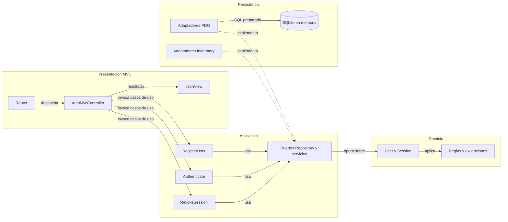
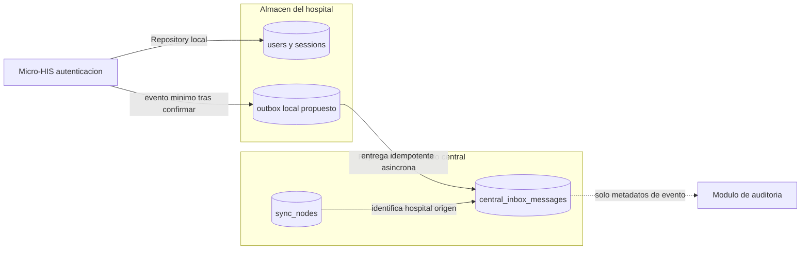

# Semana 4 — MVC, Repository y repositorio de datos compartido

| | |
|---|---|
| **Curso** | Análisis de Sistemas II — Proyecto Final 2026 |
| **Proyecto** | Sistema Hospitalario Integrado (HIS) |
| **Módulo** | Gestión de usuarios, tenants y endurecimiento de autenticación |
| **Tema** | Arquitectura en capas y patrón repositorio |
| **Flujo** | «Alta de usuario por tenant, autenticación segura y revocación de sesión» |
| **Estudiante** | Lopez Perez, Mercedes Azucena |
| **Fecha** | Octubre 2026 |

## 1. Objetivo y alcance

Continuar el mismo Micro-HIS de la Semana 3 (contenido en el PR abierto [#168](https://github.com/compilations-teams/sistema-hospitalario-integrado-SistenasII-2026-G1/pull/168)) organizando la entrada con MVC, manteniendo las interfaces Repository en el límite de aplicación y demostrando que los adaptadores PDO e InMemory cumplen el mismo contrato. El controlador no contiene SQL ni reglas de negocio. Además se analiza cómo un repositorio de datos compartido integraría este módulo.

Como la Semana 3 aún no está fusionada en `develop`, esta rama incluye una copia autocontenida del ejemplo en [`ejemplo/`](ejemplo/) para que la entrega sea ejecutable de forma independiente. El contenido canónico de Semana 3 permanece en su propia rama y PR.

**Incluye:** alta de usuario por tenant con contraseña fuerte, autenticación con token opaco (se persiste solo el hash), revocación de sesión, entrada MVC con router/controlador/vista, adaptadores PDO e InMemory verificados con la misma suite, y análisis del repositorio compartido.

**No incluye:** servidor HTTP real, JWT firmado, MFA, limitación de intentos, cookies seguras, integración productiva con la base central, ni cambios a las migraciones del HIS.

## 2. Capas, responsabilidades y objetos reutilizables

| Capa | Objeto | Responsabilidad | Reutilizable en |
|---|---|---|---|
| Presentación | `Router` | Método + ruta → acción; 404 y 405 | Cualquier módulo con entrada HTTP |
| Presentación | `Request` / `Response` | Transporte de entrada/salida sin lógica | Toda la entrada MVC |
| Presentación | `AuthMvcController` | Traduce la petición a llamadas de aplicación; **sin SQL ni reglas** | — |
| Presentación | `JsonView` | Serializa la respuesta a JSON | Toda respuesta del módulo |
| Aplicación | `RegisterUser`, `Authenticate`, `RevokeSession`, `ValidateSession` | Orquestan el flujo; dependen solo de puertos | — |
| Aplicación | `TenantRepository`, `UserRepository`, `SessionRepository` | **Interfaces Repository en el límite de aplicación** | Cualquier caso de uso de identidad |
| Aplicación | `Clock`, `PasswordHasher`, `TokenGenerator` | Puertos de infraestructura sustituibles | Pruebas y producción |
| Dominio | `User`, `Session` | Reglas: correo normalizado, contraseña fuerte, sesión activa | — |
| Dominio | `WeakPassword`, `InvalidEmail`, `DuplicateEmail`, `TenantUnavailable`, `InvalidCredentials`, `SessionNotActive` | Errores de negocio tipados | — |
| Persistencia | `PdoTenantRepository`, `PdoUserRepository`, `PdoSessionRepository` | SQL preparado, traducción de errores a `PersistenceFailure` | Producción (SQLite/PostgreSQL) |
| Persistencia | `InMemoryTenantRepository`, `InMemoryUserRepository`, `InMemorySessionRepository` | Mismo contrato sin base; `failNext()` simula fallas | Pruebas y demostración |

**Dónde va el límite Repository:** las interfaces viven en Aplicación porque expresan lo que los casos de uso necesitan. Persistencia las implementa y la dependencia apunta hacia adentro. El controlador conoce solo casos de uso; nunca PDO ni SQL.

## 3. Diagrama de capas

<!-- mermaid-checked: no \n, no em-dash/en-dash, no {} in labels, subgraphs are id["label"], arrows are -->|"label"|, all subgraphs closed by end, ids unique -->


## 4. Repositorio de datos compartido

### 4.1 Qué existe en el HIS

Las migraciones del repositorio definen dos conexiones: **central** (registro de redes, hospitales, `sync_nodes`, `central_inbox_messages`) y **hospital** (identidad local, pacientes, episodios). No hay una tabla central de usuarios de autenticación; la identidad se gestiona por hospital.

### 4.2 Propuesta de integración

| Principio | Decisión |
|---|---|
| Propiedad del dato | Usuarios y sesiones pertenecen al almacén del hospital/tenant; este módulo escribe solo ahí. |
| Qué va al centro | Como mucho, eventos mínimos de auditoría (alta, inicio, revocación) con identificadores opacos; **nunca** contraseñas, hashes ni tokens. |
| Mecanismo | Bandeja de salida local → entrega asíncrona a `central_inbox_messages`, aprovechando la unicidad `(source_node_id, event_id)` para idempotencia. |
| Aislamiento | El tenant se resuelve en el servidor; el cliente no elige tenant arbitrariamente. |
| Lectura por otros módulos | Por vistas o contratos autorizados, nunca escritura directa en tablas de identidad. |

<!-- mermaid-checked: no \n, no em-dash/en-dash, no {} in labels, subgraphs are id["label"], arrows are -->|"label"|, all subgraphs closed by end, ids unique -->


**Límite explícito:** esta integración es un análisis; no se creó outbox ni se conectó el módulo a las conexiones del HIS.

## 5. Pruebas

Desde la raíz del repositorio:

```powershell
php docs/modulos/gestion-usuarios-tenants-autenticacion/semana-04/ejemplo/tests/run.php
```

La suite ejecuta el **mismo contrato contra ambos adaptadores** (PDO SQLite en memoria e InMemory): alta 201, login 200 con token de 64 caracteres, unicidad de correo por tenant, mismo correo permitido en otro tenant, tenant inactivo/inexistente 404, contraseña débil 422, credenciales inválidas 401, revocación 204 y doble revocación 401. Además cubre el router MVC (201/200/204/404/405), la vista JSON, una comprobación estática de que el controlador MVC no contiene SQL ni PDO, y la simulación de fallas con `failNext()` que produce 503 sin éxito falso.

Resultado verificado: **26 comprobaciones, 0 fallidas** — [evidencia](evidencia/validacion-semana-04.txt).

## 6. Límites

- Demostración con SQLite en memoria y arrays; no es la base productiva.
- No hay servidor HTTP real, JWT firmado, MFA ni limitación de intentos.
- La integración con el repositorio compartido es propuesta analizada, no implementada.
- El contenido de Semana 3 sigue en el PR [#168](https://github.com/compilations-teams/sistema-hospitalario-integrado-SistenasII-2026-G1/pull/168); esta copia existe para que la entrega sea ejecutable de forma independiente.

## 7. Referencias

- [Semana 1 — UML del flujo](../semana-01/semana-01-uml-usuarios-tenants-autenticacion.md)
- [Semana 2 — SRP y requisitos](../semana-02/semana-02-srp-usuarios-tenants.md)
- Semana 3 — arquitectura en capas: PR [#168](https://github.com/compilations-teams/sistema-hospitalario-integrado-SistenasII-2026-G1/pull/168)
- Semana 5 — contrato API: PR [#169](https://github.com/compilations-teams/sistema-hospitalario-integrado-SistenasII-2026-G1/pull/169)
