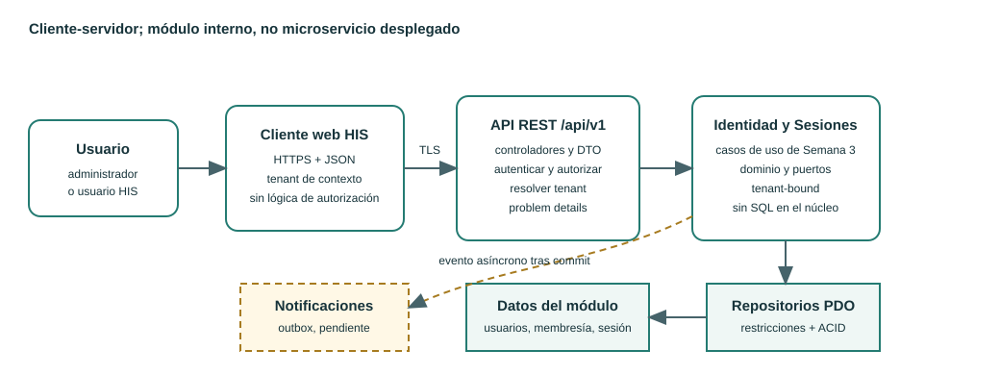
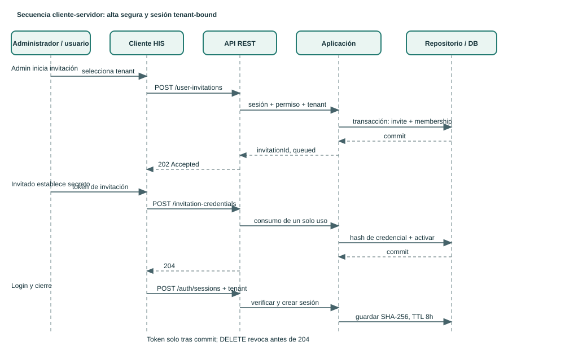

# Semana 5 - API cliente-servidor y frontera de servicio

| | |
|---|---|
| **Proyecto** | Sistema Hospitalario Integrado 2026 |
| **Módulo** | Gestión de usuarios, tenants y endurecimiento de autenticación |
| **Estudiante según la tarea** | LOPEZ PEREZ, MERCEDES AZUCENA |
| **Tema** | Cliente-servidor, API REST, microservicios e integración |
| **Fecha de elaboración** | 27 de octubre de 2026 |
| **Base funcional** | Micro-HIS PHP 8.2+ de Semana 3, ramas del mismo módulo |

## 1. Objetivo y alcance

Se evoluciona el flujo de Semana 3 a un contrato HTTP explícito: la interfaz cliente consume una API REST versionada para invitar a una persona en un tenant, establecer sus credenciales, iniciar sesión, consultar la sesión actual y revocarla. El artefacto principal es el contrato OpenAPI 3.1 y su plan de issues ejecutable; es un diseño verificable, no una API desplegada.

La secuencia conserva las decisiones previas: el usuario pertenece al contexto del tenant, la contraseña se almacena como hash, el token opaco de sesión se entrega una sola vez y solo su hash se persiste, las sesiones duran ocho horas y el cierre invalida la sesión actual. La invitación separa la autorización del administrador del establecimiento de la contraseña por parte de la persona invitada.

**No** se construye infraestructura de producción ni se afirma que el contrato esté implementado o que los servicios externos estén disponibles. La integración de notificaciones, el proveedor de identidad y la validación del correo requieren decisiones institucionales.

## 2. Arquitectura cliente-servidor

Fuente editable: [semana-05-cliente-servidor.puml](diagramas/semana-05-cliente-servidor.puml).

El cliente no decide el tenant confiable, permisos ni estados de sesión. Cada solicitud usa HTTPS y la API valida autenticación, pertenencia al tenant y permiso de la operación. Las capas internas de Semana 3 se conservan detrás del controlador HTTP; el acceso al almacén se realiza por repositorios y transacciones definidas en la aplicación.

## 3. Frontera de microservicio: decisión

**Decisión para esta entrega: mantener un módulo de identidad/autenticación modular dentro del mismo despliegue (monolito modular), con contrato REST versionado; no extraer ahora un microservicio remoto.**

La API ya crea una frontera de cliente-servidor y estabiliza el contrato. No obliga a ubicar cada operación en un proceso o base de datos distintos. Invitaciones, credenciales, membresías, tenant y revocación requieren consistencia inmediata al aceptar la invitación, autenticar y cerrar sesión. Una separación prematura añadiría red, reintentos, fallos parciales y reconciliación sin evidencia de carga o de un equipo autónomo.

La extracción futura del bounded context **Identidad y Sesiones** es candidata solo si se mide y justifica, por ejemplo:

- el módulo requiere despliegues independientes por una frecuencia o ventana distinta, no solo por preferencia tecnológica;
- pruebas de carga muestran que su demanda o latencia incumple un SLO aunque se haya optimizado y escalado el despliegue actual;
- existe equipo propietario, on-call y presupuesto de disponibilidad propios;
- hay estrategia aprobada de propiedad de datos, migración y compatibilidad del contrato;
- las consecuencias de fallas de autenticación justifican aislamiento, y el sistema acepta explícitamente el comportamiento de dependencia no disponible.

Hasta entonces se aplican límites de módulo, puertos, esquema propiedad del módulo y eventos/API internos tipados. No se permiten escrituras directas desde otros módulos a credenciales o sesiones.

## 4. Propiedad de datos y consistencia

| Datos | Propietario lógico | Regla de integridad |
|---|---|---|
| Identidad y perfil mínimo | Módulo de Identidad | Identificador estable; correo normalizado y único según la política aprobada. |
| Credencial | Módulo de Autenticación | Solo hash de contraseña; nunca se devuelve ni se registra el secreto. |
| Tenant/hospital | Registro de tenants compartido, con propietario definido por plataforma | La API resuelve el tenant activo; una cabecera o ruta del cliente nunca concede acceso por sí misma. |
| Membresía y rol inicial | Módulo de Identidad/RBAC | Clave única por usuario y tenant; el invitador necesita permiso explícito para invitar/asignar rol. |
| Invitación | Módulo de Identidad | Token aleatorio, almacenado como hash, tenant-bound, de un solo uso y con expiración. |
| Sesión | Módulo de Autenticación | Token opaco de 32 bytes; solo SHA-256 persistido; expiración de 8 h; `revoked_at` impide autenticación posterior. |

La creación de invitación y membresía pendiente es atómica. La aceptación consume la invitación y registra el hash de credencial en una transacción; si cualquiera falla, no se marca la invitación como consumida. Login escribe una sesión antes de responder con el token. Logout confirma tras persistir la revocación. Errores de almacenamiento no se convierten en éxito.

Las claves foráneas, restricciones únicas y transacciones son la última defensa ante carreras concurrentes. `Idempotency-Key` evita duplicar una invitación en reintentos del cliente. El efecto externo (enviar correo) no participa en la transacción: se propone outbox con entrega reintentable y estado `queued`, sin afirmar que ya exista un proveedor de correo.

## 5. Contrato API

Especificación completa: [api/openapi.yaml](api/openapi.yaml), OpenAPI 3.1.0.

Base: `/api/v1`. Tipos JSON UTF-8. Requiere HTTPS y respuestas de error `application/problem+json`.

| Operación | Seguridad | Resultado |
|---|---|---|
| `POST /tenants/{tenantId}/user-invitations` | Bearer de sesión + permiso `users:invite` en el mismo tenant; `Idempotency-Key` | `202` con invitación pendiente; nunca acepta contraseñas del administrador. |
| `POST /auth/invitation-credentials` | Esquema `Invitation` con token de un solo uso | Establece contraseña y activa la membresía invitada; `204`. |
| `POST /auth/sessions` | Credenciales + `X-Tenant-ID` activo | `201` con token opaco de sesión, `expiresAt` y resumen mínimo de usuario. |
| `GET /auth/me` | Bearer de sesión | `200` con sujeto y tenant de la sesión; no incluye credencial ni token. |
| `DELETE /auth/sessions/current` | Bearer de sesión actual | `204` después de confirmar revocación persistida; operación idempotente para una sesión conocida. |

El endpoint de login devuelve el mismo `401` y mensaje para correo inexistente, credencial incorrecta, cuenta desactivada o membresía no activa. El identificador de tenant inválido/no disponible devuelve `404`; no se revela si una identidad global existe en otro tenant. Un tenant de sesión no se puede cambiar en `GET /auth/me` ni en ninguna operación protegida.

El registro de Semana 3 modela una sesión opaca de ocho horas y no introduce refresh token. Por ello, esta versión no promete `refresh`; al expirar se vuelve a autenticar. La eventual rotación de refresh tokens es una decisión posterior con modelo de amenaza y requisitos de cliente.

## 6. Seguridad, resiliencia y observabilidad

### Seguridad y privacidad

- TLS obligatorio; validación estricta del `Content-Type`, límites de tamaño y validación de esquema en servidor.
- Autorización por acción, sujeto y tenant; el cliente no puede enviar un `roleCode` distinto al permitido por el permiso del invitador.
- Hash de contraseña con función adaptativa aprobada y parámetros configurables; comparación con API segura. Ninguna contraseña o token en logs, trazas, errores ni analytics.
- Invitaciones de vida corta, token de alta entropía almacenado solo en hash, consumo atómico y invalidación al usarlo o vencer.
- Respuestas genéricas para credenciales; limitación de intentos por cuenta/IP con backoff y `429 Retry-After`. No bloquear de forma permanente por ataques de fuerza bruta.
- Tokens bearer no se guardan en `localStorage` del navegador. La decisión entre cookie `HttpOnly; Secure; SameSite` con protección CSRF o almacenamiento efímero en memoria queda como gate de seguridad antes de integrar una SPA real.
- `X-Request-ID` correlaciona solicitudes, pero no transporta PII ni secretos. CORS permite solo orígenes institucionales configurados.

### Resiliencia y fallos

- El API falla cerrado: dependencia de tenant, credenciales, membresía, sesiones o revocación no disponible significa error temporal, nunca autenticación permisiva.
- `503` para dependencias necesarias no disponibles, con `Retry-After` si se conoce; `429` para throttling; no reintentar automáticamente `POST` sin `Idempotency-Key`.
- Timeouts acotados, límites de concurrencia y circuit breaker únicamente en llamadas a dependencias remotas aprobadas. El acceso PDO local no se etiqueta artificialmente como microservicio.
- El logout no reporta éxito si no se confirmó la revocación. Si ocurre timeout tras un commit desconocido, el cliente puede repetir la misma operación; la idempotencia impide recrear la sesión.
- No almacenar contraseñas, tokens ni autorización tenant en caché distribuida sin TTL y estrategia de invalidación. La revocación se verifica en cada petición protegida.

### Consistencia

- Transacciones ACID para invitación/membresía pendiente, aceptación de invitación/credencial y creación de sesión.
- Restricciones de unicidad y claves foráneas resuelven carreras; las respuestas públicas son estables aunque el detalle interno difiera.
- La sesión revocada no puede volver a estado activo. Las invalidaciones se comprueban sin consistencia eventual.
- Envío de invitación se desacopla con outbox; puede ser eventual, pero la API informa que está encolado, no entregado.

### Observabilidad

- Métricas agregadas por operación/resultado: latencia p50/p95/p99, tasa 4xx/5xx, throttling, fallos de base de datos, invitaciones pendientes/vencidas y retraso del outbox.
- Logs estructurados con `requestId`, nombre de operación, código de resultado y tenant pseudonimizado; nunca correo completo, contraseña, token, cuerpo de autenticación o cabecera `Authorization`.
- Trazas distribuidas futuras propagan `traceparent` y `X-Request-ID`; nunca el bearer token. Alertas para aumento de 5xx/401 anómalos, latencia y atraso de revocación/outbox.
- Checks de readiness y liveness separados: readiness comprueba dependencias necesarias; liveness no reinicia el proceso por una dependencia temporal externa.

## 7. Secuencia de integración

Fuente editable: [semana-05-secuencia-api.puml](diagramas/semana-05-secuencia-api.puml).

## 8. Migración razonada desde Semana 3

1. **Congelar reglas del micro-HIS:** conservar aislamiento por tenant, errores genéricos, hash de credencial, token solo-hash, sesión de 8 horas y revocación persistida.
2. **Añadir contrato y compatibilidad:** aprobar OpenAPI, versionar `/api/v1`, definir problem details y no exponer excepciones PHP.
3. **Separar el límite HTTP:** un front controller enruta JSON a los casos de uso; los controladores convierten HTTP↔DTO y no contienen SQL.
4. **Endurecer el alta:** sustituir la captura directa de contraseña por invitación autorizada y establecimiento de credenciales por el invitado; añadir expiración, consumo único e idempotencia.
5. **Hacer sesión tenant-bound:** persistir sesión antes de devolver token; middleware común valida token, tenant, membresía activa y estado de revocación en cada endpoint protegido.
6. **Integrar el cliente:** cliente HTTPS que solo representa estados del servidor, mantiene bearer fuera de almacenamiento persistente y muestra errores recuperables sin revelar credenciales.
7. **Verificar y desplegar gradualmente:** pruebas de contrato, seguridad, concurrencia, aislamiento, revocación, caída de dependencias y telemetría; despliegue canario con rollback.
8. **Evaluar extracción después de medir:** mantener el despliegue modular hasta cumplir criterios explícitos de equipo/SLO/escala y plan de propiedad de datos.

El documento de tareas con dependencias y criterios observables está en [plan-issues.md](plan-issues.md). Cada issue es una propuesta para crear en el tracker, no un issue ya abierto.

## 9. Criterios de aceptación para revisar el diseño

| ID | Criterio |
|---|---|
| CA-01 | El contrato enumera operaciones, método, ruta, seguridad, request, response y errores para invitación, alta de credenciales, login, sesión actual y logout. |
| CA-02 | Ninguna operación de invitación permite al cliente asignarse permisos ni crear un usuario en otro tenant. |
| CA-03 | Credenciales y bearer no aparecen en modelos de respuesta ni en telemetría; la revocación tiene efecto inmediato en rutas protegidas. |
| CA-04 | Login no distingue por mensaje entre usuario inexistente, inactivo, membresía ausente o contraseña incorrecta. |
| CA-05 | La propuesta separa datos e invariantes de tenant, identidad, credencial, invitación y sesión. |
| CA-06 | La decisión sobre microservicio se justifica en términos de consistencia, costo operativo y señales medibles para reevaluar. |
| CA-07 | Se documentan dependencias, fallos, idempotencia, observabilidad, migración y plan de issues. |

## 10. Evidencia y límites

La evidencia de esta semana es documental y de contrato: OpenAPI, diagramas fuente y plan de issues. No se afirma una API en ejecución, generación de cliente, pruebas de integración HTTP, proveedor de identidad, servicio de correo, deployment, SLO medido o extracción a microservicio. Esos pasos se planifican como issues y se validarán en su ejecución.

Rama: `semana-5-gestion-usuarios-tenants-api-cliente-servidor-mercedes-lopez`
Worktree: `shi-semana-5-gestion-usuarios-tenants-api-cliente-servidor-mercedes-lopez`
Base: `origin/semana-3-gestion-usuarios-tenants-arquitectura-mercedes-lopez`
PR: no se abre conforme a la instrucción vigente de subir la rama sin PR.
