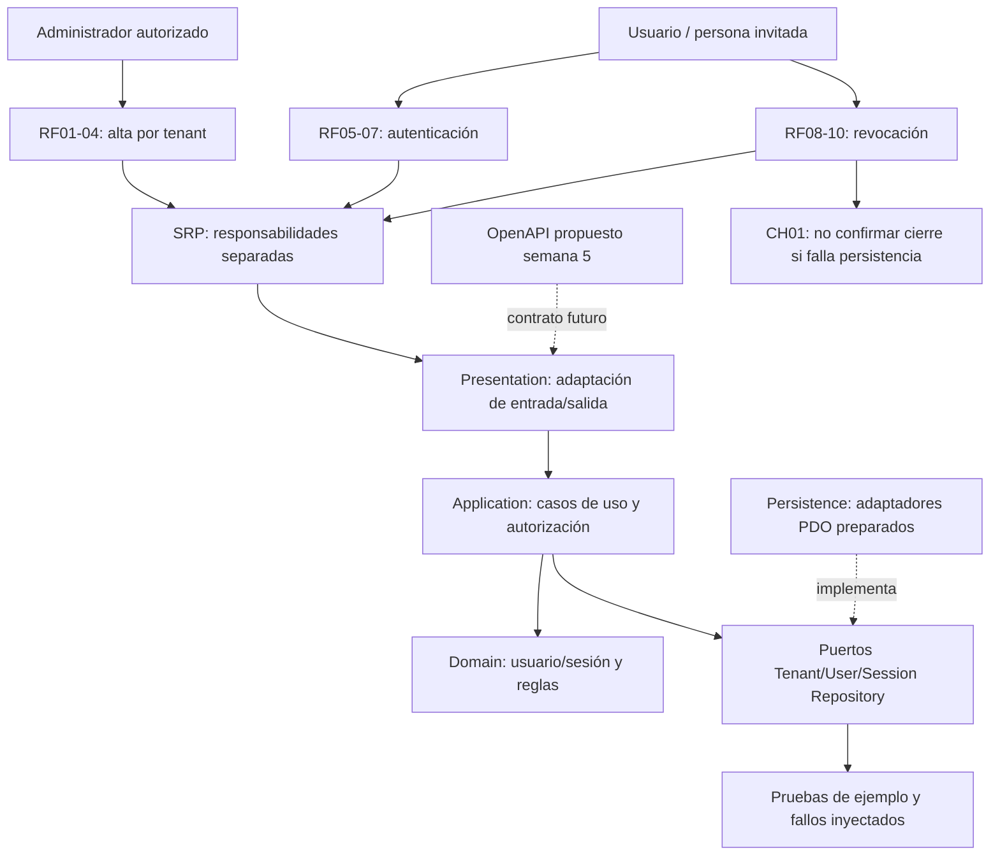

# Semana 6 — Primera evaluación parcial

**Estudiante:** Lopez Perez, Mercedes Azucena.

Entrega: [presentación de ocho diapositivas](presentacion.md), diagrama trazable, matriz de decisiones y [cambio práctico de ejemplo](cambio-practico.md). Base f31d343 de semana 5; integrar esa rama antes de la entrega. No modifica semanas previas ni módulos ajenos.

## Diagrama trazable


[Fuente PlantUML](diagramas/trazabilidad.puml). La relación de OpenAPI con Presentation es diseño futuro: la propuesta de invitación no está implementada por el ejemplo anterior de registro directo.

## Matriz decisión → evidencia

| Decisión defendida | RF/RNF | Evidencia existente / límite |
|---|---|---|
| Identidad y membresía separadas por tenant | RF-01/02 | Semana 1 UML y semana 2 IdentityWorkflow.php |
| Administrador autorizado y rol asignable | RF-03 | UserManagementAuthorization y verificación de semana 2 |
| Alta atómica, sin duplicados | RF-04, RNF-04 | Transacción de semana 2; ejemplo PDO y pruebas de semana 3 |
| Login valida contexto/credencial/membresía | RF-05/06, RNF-03/05 | AuthenticateTenantUser de semana 2; no equivale a JWT verificado |
| SRP por casos de uso | RNF-01 | Semana 2 RegisterTenantUser, AuthenticateTenantUser, RevokeCurrentSession y CheckSessionAccess |
| Capas y Repository, no SQL en controlador | RNF-01/07 | Semana 3 Application/Ports.php y Persistence/Pdo.php |
| Contrato HTTP explícito y errores | RF-01..10 | OpenAPI de semana 5; no endpoints desplegados |
| Invitación tenant-bound y credencial propia | RF-01/03/05, RNF-02 | Diseño semana 5; diferencia con alta directa previa documentada |
| Sesión con tenant/expiración y revocación | RF-07/08/09 | Objetos/almacén del ejemplo; firma JWT real pendiente |
| Fallo no se convierte en éxito | RF-10, RNF-06 | CH-01 y salidas PHP; HTTP real requiere implementación |
| Dependencias solo del módulo | RNF-01/07 | Puertos de identidad/sesión; sin cambios clínicos ni microservicio separado sin evidencia |

## Fuentes

- [Semana 1: UML](../semana-01/semana-01-uml-usuarios-tenants-autenticacion.md).
- [Semana 2: RF/RNF y SRP](../semana-02/semana-02-srp-usuarios-tenants.md).
- [Semana 3: arquitectura](../semana-03/semana-03-arquitectura-usuarios-tenants.md).
- [Puertos Repository](../semana-03/ejemplo/src/Application/Ports.php).
- [Semana 5: API](../semana-05/semana-05-api-cliente-servidor-usuarios-tenants.md) y [OpenAPI](../semana-05/api/openapi.yaml).

## Comandos de evidencia
```powershell
php docs/modulos/gestion-usuarios-tenants-autenticacion/semana-02/ejemplo-srp/verificar.php
php docs/modulos/gestion-usuarios-tenants-autenticacion/semana-03/ejemplo/tests/run.php
```
Salidas en evidencia/. Solo se reportan resultados observados; el diseño OpenAPI no se presenta como prueba HTTP. Relojes/tenants/usuarios son de demostración. La presentación Markdown está delimitada en ocho diapositivas; puede exponerse directamente sin instalar una herramienta de slides.