# Semana 7 — Componentes y refactorización de autenticación por tenant

| | |
|---|---|
| **Curso** | Análisis de Sistemas II — Proyecto Final 2026 |
| **Módulo** | Gestión de usuarios, tenants y endurecimiento de autenticación |
| **Estudiante según la consigna** | LOPEZ PEREZ, MERCEDES AZUCENA |
| **Fecha** | 27 de octubre de 2026 |
| **Alcance** | Componentes backend/frontend y separación del inicio de sesión por tenant |
| **Base inspeccionada** | `origin/develop`, commit `0762576c870a24f3285a667ae743fce446c91db5` |

## 1. Resumen y límites

Se describe el flujo de autenticación multitenant que ya existe en Laravel 12 y Vue 3, se asignan responsabilidades a componentes del backend y frontend, y se propone un refactor pequeño del camino de inicio de sesión. El foco es separar coordinación HTTP de la búsqueda de identidad, validación de credenciales y emisión del token; no se agregan capacidades nuevas al módulo.

El diagrama distingue componentes **existentes** y **propuestos**. El refactor ejecutable de esta entrega es un prototipo PHP aislado con dobles, no está conectado al `AuthController`, a Eloquent ni a JWT. No se afirma que la aplicación productiva haya sido refactorizada o que el flujo integrado haya sido probado. El worktree de `develop` no contiene `vendor/` ni modelos Eloquent; por eso la verificación se limita al prototipo y a la consistencia documental.

### Requisitos de la entrega

| ID | Tipo | Requisito |
|---|---|---|
| RF-07-01 | Funcional | El inicio de sesión autentica las credenciales dentro del tenant resuelto por el middleware, sin tomar el tenant desde el cuerpo. |
| RF-07-02 | Funcional | Solo una identidad autenticada y asociada al tenant solicitado puede recibir una sesión. |
| RF-07-03 | Funcional | El refactor conserva el comportamiento y contrato públicos acordados; los cambios OpenAPI/runtime quedan pendientes de decisión, no se cambian aquí. |
| RNF-07-01 | No funcional | La coordinación de autenticación no depende directamente de Eloquent, `Hash` ni JWT; los sustituye mediante puertos. |
| RNF-07-02 | No funcional | Credenciales inválidas y errores técnicos no se convierten en respuesta exitosa ni revelan el secreto. |
| RNF-07-03 | No funcional | UI, aplicación, dominio/política y adaptadores tienen contratos explícitos; el frontend no concede autorización. |

## 2. Componentes backend y frontend

```mermaid
flowchart LR
    subgraph Browser["Cliente Vue 3"]
        LoginPage["LoginPage actual"]
        AuthStore["Pinia auth store actual"]
        ApiClient["Axios con tenant actual"]
        RouterGuard["Guard de ruta actual"]
        BrowserStorage["LocalStorage actual"]
    end
    subgraph BackendHttp["Backend HTTP Laravel"]
        Routes["Rutas API actuales"]
        TenantMw["TenantMiddleware actual"]
        JwtMw["JwtAuth actual"]
        AuthController["AuthController actual"]
        ResponseMapper["Mapeador HTTP propuesto"]
    end
    subgraph BackendApplication["Backend aplicación propuesto"]
        LoginUseCase["AuthenticateTenantUser"]
        CredentialPort["TenantCredentialAuthenticator"]
        TokenPort["AccessTokenIssuer"]
    end
    subgraph BackendAdapters["Adaptadores propuestos"]
        UserAdapter["Adaptador de identidad por tenant"]
        PasswordAdapter["Verificador de contraseña"]
        JwtAdapter["Emisor JWT"]
    end

    LoginPage -->|"envía tenant y credenciales"| AuthStore
    AuthStore -->|"solicita inicio de sesión"| ApiClient
    AuthStore -->|"persiste token y usuario"| BrowserStorage
    ApiClient -->|"lee token y tenant"| BrowserStorage
    RouterGuard -->|"lee token local"| BrowserStorage
    ApiClient -->|"POST login y X-Tenant-ID"| Routes
    Routes -->|"resuelve tenant"| TenantMw
    TenantMw -->|"adjunta contexto confiable"| AuthController
    AuthController -->|"delega autenticación"| LoginUseCase
    LoginUseCase -->|"verifica credenciales"| CredentialPort
    CredentialPort -.->|"implementa"| UserAdapter
    UserAdapter -->|"verifica secreto"| PasswordAdapter
    LoginUseCase -->|"solicita sesión"| TokenPort
    TokenPort -.->|"implementa"| JwtAdapter
    LoginUseCase -->|"resultado de aplicación"| AuthController
    AuthController -->|"mapea resultado"| ResponseMapper
    ResponseMapper -->|"respuesta JSON"| AuthController
    AuthController -->|"token y usuario"| AuthStore
    AuthStore -->|"guarda sesión"| LoginPage
    ApiClient -->|"Bearer y X-Tenant-ID"| JwtMw
```

<!-- mermaid-checked: no \n, no em-dash/en-dash, no {} in labels, subgraphs are id["label"], arrows are -->|"label"|, all subgraphs closed by end, ids unique -->


### Inventario de componentes

| Componente | Estado | Capa | Responsabilidad / contrato |
|---|---|---|---|
| `LoginPage.vue` | Existente | Frontend / UI | Captura tenant, correo y contraseña; muestra error y estado de carga; delega el envío al store. |
| `useAuthStore` | Existente | Frontend / aplicación | Orquesta login/logout y persiste el token, usuario y tenant localmente. |
| `api` Axios | Existente | Frontend / infraestructura | Define `baseURL`; adjunta `X-Tenant-ID` y el token en llamadas autenticadas. |
| `authGuard` | Existente | Frontend / navegación | Restringe navegación por presencia local de token. No autoriza operaciones de negocio. |
| Rutas API | Existente | Backend / presentación | Asocia endpoints con middleware y `AuthController`. |
| `TenantMiddleware` | Existente | Backend / contexto | Exige `X-Tenant-ID`, resuelve el tenant y lo adjunta a la solicitud. |
| `JwtAuth` | Existente | Backend / autenticación | Valida JWT y comprueba la coincidencia del tenant cuando se envía la cabecera. |
| `AuthController` | Existente | Backend / HTTP | Valida solicitudes, consulta identidad, verifica contraseña, crea JWT y compone respuestas. |
| `AuthenticateTenantUser` | Propuesto | Backend / aplicación | Coordina autenticar una identidad dentro del contexto de tenant y solicitar el token. |
| `TenantCredentialAuthenticator` | Propuesto | Backend / puerto | Verifica credenciales dentro del tenant y devuelve una identidad autenticada. |
| `AccessTokenIssuer` | Propuesto | Backend / puerto | Emite un token para una identidad ya autenticada. |
| Adaptadores de identidad y JWT | Propuestos | Backend / infraestructura | Implementan acceso al repositorio, verificación de secreto y emisión JWT; no se implementan en esta entrega. |
| `ResponseMapper` | Propuesto | Backend / presentación | Traduce el resultado del caso de uso al contrato HTTP acordado, sin decidir credenciales. |

El guard del frontend solo mejora navegación; el backend sigue siendo la autoridad para autenticar y aislar tenants. La UI no debe decidir acceso por rol ni aceptar el tenant de un estado manipulable como prueba de autorización.

## 3. Contratos de entrada y salida

### 3.1 Contrato interno del caso de uso refactorizado

| Límite | Entrada | Salida en éxito | Fallos |
|---|---|---|---|
| `AuthController` → `AuthenticateTenantUser` | Contexto de tenant resuelto por middleware; `email` y `password` validados. La contraseña se usa solo durante la autenticación. | `TenantAuthenticationResult`: identidad sin secreto y credencial de acceso con tiempo de vida. | `InvalidCredentials`; errores técnicos de dependencias se propagan para que el límite HTTP los traduzca explícitamente. |
| `TenantCredentialAuthenticator` | `tenantId`, correo y contraseña recibidos por el caso de uso. | Identidad con `id`, `tenantId`, correo y nombre visible. | `InvalidCredentials` si la combinación no autentica; error técnico si la dependencia no está disponible. |
| `AccessTokenIssuer` | Identidad autenticada que el caso de uso confirmó para el mismo tenant. | Token y `expiresInSeconds`. | Error explícito de emisión; no debe devolverse una respuesta de éxito. |
| `LoginPage.vue` → `useAuthStore.login` | `{ email, password }` y tenant seleccionado. | Sesión almacenada y navegación a inicio si el servidor responde correctamente. | Error normalizado para presentación; limpia loading en `finally`. |

Invariantes:

1. El `tenantId` del comando proviene del contexto resuelto en middleware, no del cuerpo JSON.
2. No se emite token si fallan las credenciales o si la identidad devuelta pertenece a otro tenant.
3. La contraseña nunca forma parte del resultado, persistencia de sesión, token, registro o mensaje de error.
4. El caso de uso no atrapa errores técnicos ni crea éxitos alternativos.

### 3.2 Contrato HTTP observado en `origin/develop`

La implementación inspeccionada registra `POST /api/v1/auth/login` en `routes/api.php`; el grupo ejecuta `TenantMiddleware`. El cuerpo contiene `email` y `password`; el cliente agrega `X-Tenant-ID`. La respuesta observada por el controlador tiene `access_token`, `token_type`, `expires_in` y `user`. El error de credenciales pasa por `ValidationException`. Estos son hechos del código de la base inspeccionada, no una prueba de integración ejecutada. La respuesta HTTP concreta de ese error no se verificó contra un servidor.

| Método y ruta observados | Permiso/contexto | Entrada | Salida / errores observados en código |
|---|---|---|---|
| `POST /api/v1/auth/login` | Endpoint público; `TenantMiddleware` requiere `X-Tenant-ID` y resuelve el contexto. La cabecera selecciona tenant, no autoriza por sí sola. | JSON `email` válido y `password` string; tenant por cabecera. | Éxito con `access_token`, `token_type`, `expires_in`, `user`; cabecera faltante produce 400 y tenant no encontrado 404 en el middleware; validación y credenciales inválidas siguen el mecanismo `ValidationException` de Laravel. El status HTTP final de credenciales no se probó. |

### 3.3 Diferencia pendiente con la definición OpenAPI de Semana 5

La especificación OpenAPI de la rama de Semana 5 (`f31d34394313225df7fdfb91bc183e2ce7445da3`, PR [#169](https://github.com/compilations-teams/sistema-hospitalario-integrado-SistenasII-2026-G1/pull/169)) define `POST /auth/sessions`, respuesta `accessToken`/`expiresAt`, y cierre mediante `DELETE /auth/sessions/current`. El runtime de `develop` inspeccionado usa `/auth/login`, `access_token`/`expires_in` y `POST /auth/logout`.

No se declara equivalencia entre ambos contratos. Antes de conectar el caso de uso propuesto se debe decidir cuál contrato es la fuente de verdad y alinear rutas, serialización, códigos HTTP y pruebas de consumidor. Este refactor separa componentes internos y no cambia ni aprueba la API pública.

## 4. Selección del punto de mayor acoplamiento

Se eligió `AuthController::login()` porque en una sola operación coordina transporte, tenant, persistencia, credenciales, token y respuesta. La medición es un conteo estructural reproducible sobre `origin/develop` commit `0762576c870a24f3285a667ae743fce446c91db5`, no un índice universal de calidad:

| Métrica dentro de `login()` | Antes |
|---|---:|
| Líneas del método, inclusivas (47–75) | 29 |
| Tipos de frontera que coordina directamente | 5: HTTP/validación, tenant, Eloquent, verificador de contraseña, JWT |
| Dependencias first-party directas | 1 modelo concreto (`App\Models\User`) |

La consulta Eloquent cuenta como una frontera, aunque internamente tenga varias llamadas encadenadas. Las cinco categorías describen responsabilidades observables, no cinco clases first-party.

Fuentes: [`AuthController.php`, líneas 47–75](../../../../app/Http/Controllers/Api/V1/AuthController.php), [`routes/api.php`](../../../../routes/api.php), [`TenantMiddleware.php`](../../../../app/Http/Middleware/TenantMiddleware.php).

## 5. Refactor concreto: antes

La versión actual valida el request, extrae el tenant, busca con Eloquent, verifica la contraseña, emite JWT y arma la respuesta en el mismo método:

```php
$validated = $request->validate([
    'email' => ['required', 'email'],
    'password' => ['required', 'string'],
]);

$tenant = $request->attributes->get('tenant');
$user = User::query()
    ->where('tenant_id', $tenant->id)
    ->where('email', $validated['email'])
    ->first();

if ($user === null || ! Hash::check($validated['password'], $user->password)) {
    throw ValidationException::withMessages([
        'email' => ['Las credenciales proporcionadas son incorrectas.'],
    ]);
}

$token = JWTAuth::fromUser($user);
return response()->json([
    'access_token' => $token,
    'token_type' => 'bearer',
    'expires_in' => JWTAuth::factory()->getTTL() * 60,
    'user' => $user->load('roles', 'tenant'),
]);
```

Los detalles Eloquent, `Hash` y JWT provienen del código inspeccionado. El bloque está abreviado solo en el límite del método; no representa una segunda implementación.

## 6. Refactor concreto: después propuesto

El controlador conserva validación y traducción HTTP, pero delega la autenticación a un caso de uso y deja la consulta/hash y JWT detrás de puertos:

```php
public function login(Request $request, AuthenticateTenantUser $authenticate): JsonResponse
{
    $input = $request->validate([
        'email' => ['required', 'email'],
        'password' => ['required', 'string'],
    ]);
    $tenant = $request->attributes->get('tenant');

    $result = $authenticate->execute(new AuthenticateTenantUserCommand(
        (string) $tenant->id,
        $input['email'],
        $input['password'],
    ));

    return response()->json($this->toLoginResponse($result));
}
```

`AuthenticateTenantUser` orquesta los puertos `TenantCredentialAuthenticator` y `AccessTokenIssuer`, y comprueba que la identidad autenticada sea del tenant solicitado antes de emitir token. El prototipo ejecutable está en [`AuthenticateTenantUser.php`](refactor/prototype/AuthenticateTenantUser.php) y [`verify.php`](refactor/prototype/verify.php); usa adaptadores falsos y no está cableado a Laravel.

## 7. Comparación medida

| Medida | Antes | Después propuesto |
|---|---:|---:|
| Líneas locales de `login()` | 29 | 17 en el boceto de controlador |
| Fronteras de infraestructura invocadas por el controlador | 3: Eloquent, `Hash`, JWT | 0; invoca un único caso de uso de aplicación |
| Responsabilidades que coordina el controlador | 5 | 2: entrada HTTP y traducción de respuesta |
| Puertos para sustituir/probar dependencias externas | 0 | 2: credenciales y emisión de token |
| Comportamientos del módulo añadidos | 0 | 0 |

El conteo posterior corresponde al boceto de la sección 6 (17 líneas físicas, incluidos espacios en blanco); no es medición de código Laravel desplegado. El cambio reduce acoplamiento local, no garantiza menos líneas totales: la lógica se mueve a unidades con responsabilidades y límites explícitos.

Verificación del comportamiento del prototipo: [`evidencia/salida-verificacion.txt`](evidencia/salida-verificacion.txt). Se cubre éxito, propagación de credenciales inválidas, coincidencia tenant y ausencia de emisión de token tras un fallo. No se comparan respuestas HTTP reales, base de datos ni JWT reales.

## 8. Justificación y prueba de alcance

- **Cohesión:** el adaptador HTTP valida y transforma; el caso de uso coordina; adaptadores concretos resuelven Eloquent/hash y token.
- **Aislamiento multitenant:** el tenant es contexto confiable del middleware y el caso de uso verifica la identidad devuelta antes de solicitar token.
- **Prueba:** puertos sustituibles permiten verificar el flujo sin Laravel, conexión a base ni secreto real.
- **Fidelidad de alcance:** no se agregan recuperación de contraseña, MFA, registro, invitaciones, nuevos roles ni endpoints. Se refactoriza solo la coordinación de login.
- **Compatibilidad pendiente:** se conserva conceptualmente la respuesta del runtime de `develop`; no se resuelve en esta entrega el cambio de contrato registrado en Semana 5.

Riesgos que permanecen fuera del refactor:

| Riesgo observado | Evidencia | Decisión / siguiente validación |
|---|---|---|
| El token y el usuario se conservan en `localStorage`. | `resources/js/stores/auth.js`. | Definir la estrategia de sesión y mitigaciones XSS antes de un despliegue clínico; esta entrega no cambia almacenamiento. |
| El logout limpia el estado local aunque la petición remota falle. | `auth.js` captura y descarta el error de red antes de limpiar la sesión local. | Definir UX y política de revocación/reintento; el refactor no modifica logout. |
| La API documentada y las rutas runtime no coinciden. | Sección 3.3. | Acordar contrato, luego agregar pruebas HTTP de productor/consumidor. |

## 9. Validación y límites

Comando, desde la raíz del repositorio:

```powershell
php docs/modulos/gestion-usuarios-tenants-autenticacion/semana-07/refactor/prototype/verify.php
```

También se ejecuta `php -l` sobre cada archivo PHP de este prototipo y `git diff --check`. No se ejecutó `composer test`: `vendor/` no existe y esta base no contiene pruebas de autenticación dedicadas. Tampoco se validaron el framework, un frontend montado, el proveedor JWT, la base de datos ni llamadas HTTP reales.

## 10. Criterios de aceptación

| ID | Criterio | Evidencia |
|---|---|---|
| CA-01 | El diagrama distingue componentes backend/frontend y existentes/propuestos. | Sección 2. |
| CA-02 | Cada límite principal documenta entradas, salidas y fallos. | Sección 3 y contratos internos. |
| CA-03 | Un caso de uso ejecutable separa coordinación de credenciales y token. | `refactor/prototype/AuthenticateTenantUser.php`. |
| CA-04 | El token no se emite ante credenciales inválidas o tenant discrepante. | `refactor/prototype/verify.php`. |
| CA-05 | La comparación antes/después muestra método, fronteras y responsabilidades, sin confundir propuesta con integración. | Secciones 4–7. |
| CA-06 | La entrega no agrega comportamiento funcional de autenticación. | Sección 8. |

## 11. Referencias examinadas

- Código de `develop`: [`AuthController.php`, línea 47](../../../../app/Http/Controllers/Api/V1/AuthController.php#L47), [`TenantMiddleware.php`](../../../../app/Http/Middleware/TenantMiddleware.php), [`JwtAuth.php`](../../../../app/Http/Middleware/JwtAuth.php), [`routes/api.php`](../../../../routes/api.php).
- Frontend existente: [`LoginPage.vue`](../../../../resources/js/modules/auth/pages/LoginPage.vue), [`auth.js`](../../../../resources/js/stores/auth.js), [`axios.js`](../../../../resources/js/plugins/axios.js), [`guards.js`](../../../../resources/js/router/guards.js).
- Arquitectura previa Semana 3 en PR [#168](https://github.com/compilations-teams/sistema-hospitalario-integrado-SistenasII-2026-G1/pull/168), commit `d9d18da1e9bdcdb661f62a2d9deac9ccc8dd070b`.
- Contrato de API previo Semana 5 en PR [#169](https://github.com/compilations-teams/sistema-hospitalario-integrado-SistenasII-2026-G1/pull/169), commit `f31d34394313225df7fdfb91bc183e2ce7445da3`.
