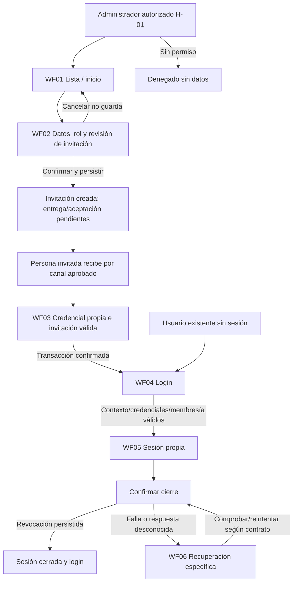
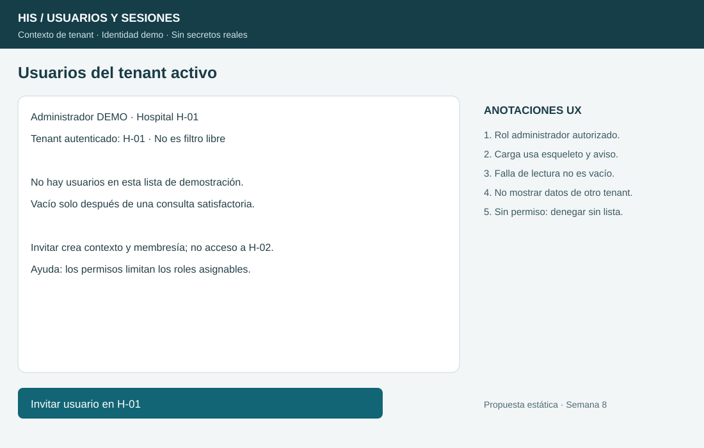
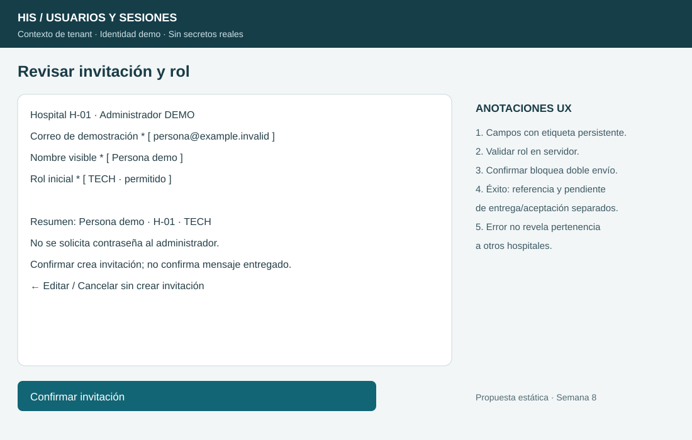
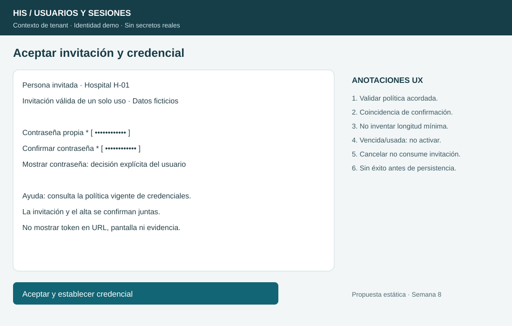
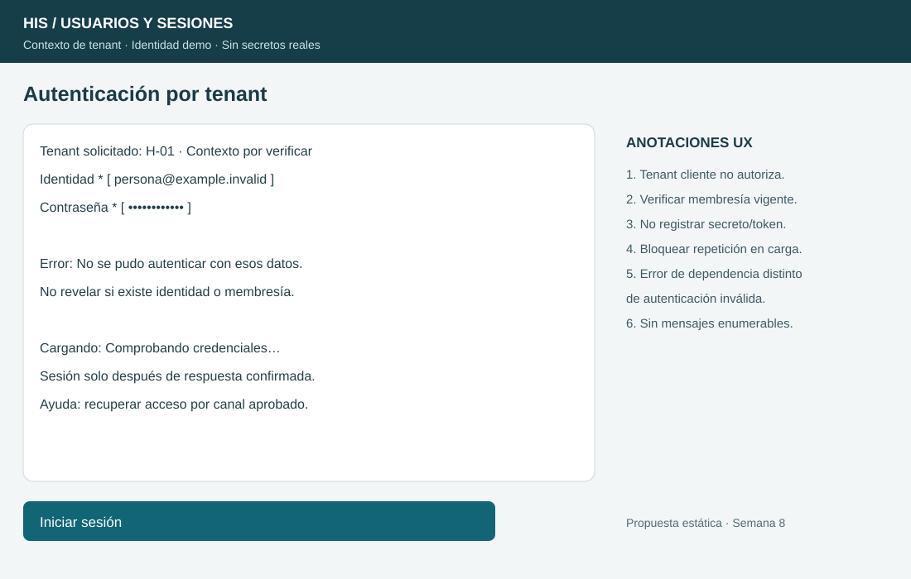
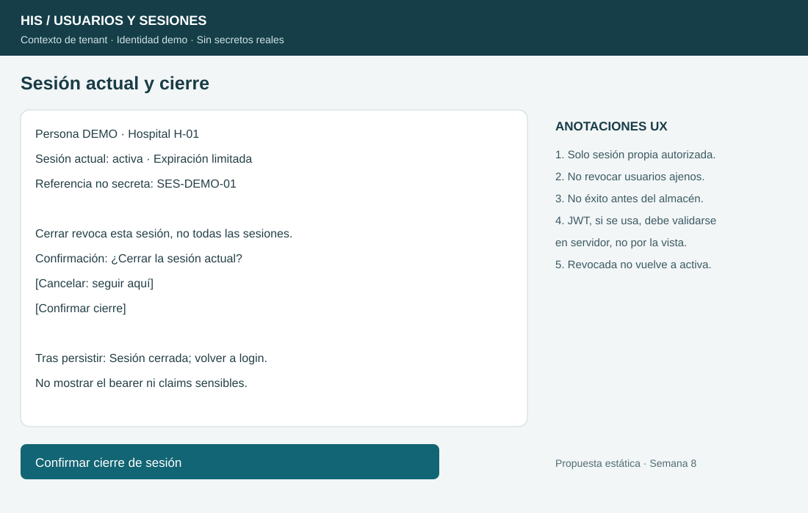
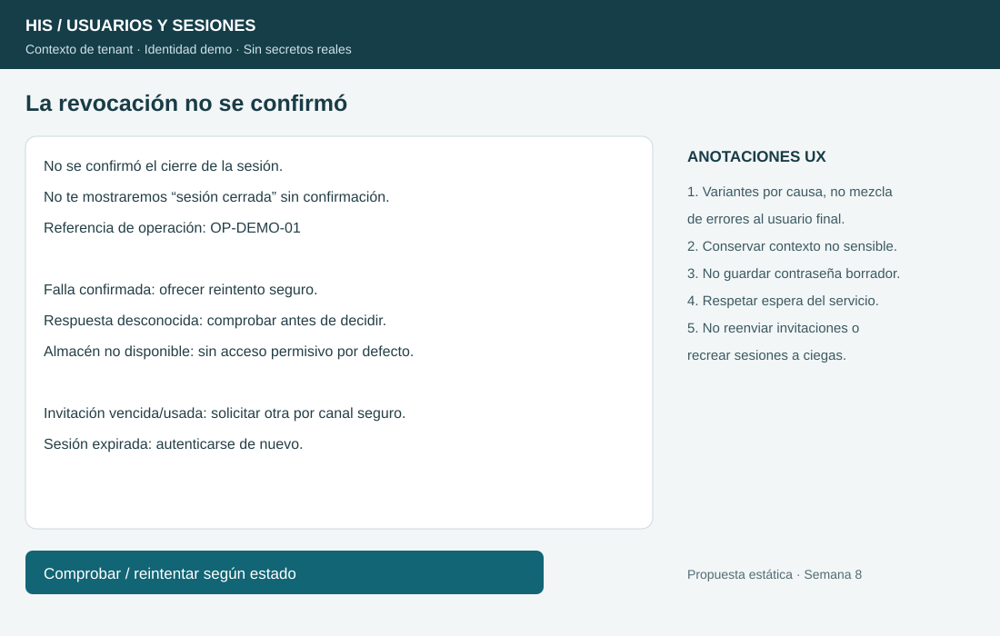

# Semana 8 — UX de usuarios, tenants y autenticación

**Estudiante:** Lopez Perez, Mercedes Azucena.

Flujo de alta por tenant, autenticación segura y revocación de sesión. Se entregan seis wireframes anotados, no una interfaz conectada. Base f31d343 de [API propuesta de semana 5](../semana-05/semana-05-api-cliente-servidor-usuarios-tenants.md) y [OpenAPI](../semana-05/api/openapi.yaml). Integrar esa base antes de esta entrega. Datos ficticios; ninguna pantalla prueba JWT real ni autorización de servidor.

## Roles y decisiones

| Rol | Acciones propuestas | Límite |
|---|---|---|
| Administrador autorizado del tenant | Listar e invitar con rol inicial permitido | No administrar H-02 por pertenecer a H-01; no conocer/establecer contraseña de otra persona. |
| Persona invitada | Revisar contexto y establecer su propia credencial | Invitación válida, de un uso y tenant-bound; token no visible ni persistido en URL/log. |
| Usuario autenticado | Consultar contexto y cerrar su propia sesión | No revocar sesiones ajenas ni cambiar tenant sin autorización. |
| Sin sesión/permiso | Login o denegación genérica según operación | Sin datos protegidos, roles o membresías de otros tenants. |

El selector/contexto cliente no es fuente de autorización. Servidor verifica identidad, tenant, permiso de administrar/asignar rol y estado/vigencia de membresía en cada operación. El diseño de invitaciones de semana 5 evoluciona el alta directa de ejemplos previos; no se presume ya implementado.

## User flow por rol

## Seis wireframes anotados

### WF01 — Inicio/listado por tenant

Hospital/contexto y rol visibles. Vacío solo tras consulta exitosa; carga con esqueleto y aviso; error ofrece reintento sin lista falsa vacía. No mezclar hospitales como filtro libre. Invitaciones y membresías activas deben distinguirse por texto, no solo color.

### WF02 — Invitación, decisión y confirmación

Formularios con etiquetas persistentes, rol limitado por permiso y resumen antes de crear. Esta pantalla tiene fase edición y fase revisión; en implementación el resumen reemplaza campos editables hasta volver. Cancelar no crea; confirmar bloquea doble envío. Un 202 confirma invitación aceptada/encolada por API, no mensaje entregado ni usuario autenticado. Mostrar referencia no secreta y estado de entrega/aceptación por separado.

### WF03 — Credencial propia

Solo persona invitada con contexto válido. No pedir contraseña al administrador. Instrucciones reflejan política acordada, sin inventar longitudes; permitir gestor/pegado y control explícito de mostrar contraseña sin cambiarla. Contraseña/confirmación requieren coincidencia; limpiar secretos al finalizar/cancelar. Invitación usada/vencida no se reactiva ni consume de nuevo. Éxito solo tras transacción de invitación/credencial/membresía.

### WF04 — Autenticación

Contexto solicitado no garantiza acceso. Vacíos generan error junto al campo; credencial incorrecta/identidad/membresía inválidas comparten mensaje genérico. Indisponibilidad del servicio se informa como temporal, sin sesión. Al enviar, bloquear repetición y anunciar carga sin revelar qué identidad existe. Ayuda de recuperación usa canal aprobado sin exponer datos de otro tenant.

### WF05 — Sesión y confirmación de cierre

Contexto propio y expiración limitada; referencia no secreta, nunca bearer completo ni contraseña. Cancelar conserva navegación sin revocar. Confirmar espera persistencia; éxito muestra sesión cerrada y vuelve a login. Si el sistema usa JWT, firma/claims/expiración/revocación se verifican en servidor: el boceto no prueba esos controles.

### WF06 — Recuperación específica

Representa variantes de una plantilla de recuperación, no todos los errores simultáneos. Falla confirmada del almacén no anuncia logout; respuesta desconocida exige comprobar antes de decidir. Contrato de cierre de sesión conocida es idempotente según semana 5. No recrear sesión ni reenviar invitación ciegamente. Reintentar solo operación pertinente y respetar indicación de espera si existe.

## Estados, mensajes y reglas

| Condición | Mensaje y acción | Regla de protección |
|---|---|---|
| Carga | Cargando usuarios / Comprobando / Cerrando | Bloquear repetición; no mostrar éxito o vacío anticipados. |
| Vacío confirmado | No hay usuarios/invitaciones en este contexto | Solo tras lectura autorizada satisfactoria. |
| Campos inválidos | Revisa correo/nombre/rol o coincidencia de contraseña | Error específico de campo sin divulgar identidad ajena. |
| Alta creada | Invitación creada; entrega/aceptación pendientes | 202 no confirma entrega ni credencial establecida. |
| Rol/tenant no permitido | No tienes permiso en este contexto | No revelar lista o membresía de otro hospital. |
| Login rechazado | No se pudo autenticar con esos datos | No distinguir identidad existente, inactiva o credencial errónea. |
| Dependencia no disponible | Servicio temporalmente no disponible | No otorgar sesión/acceso como fallback. |
| Invitación vencida/usada | No se puede usar esta invitación | No mostrar token ni activar membresía parcialmente. |
| Sesión expirada/revocada | Autentícate de nuevo | No reutilizar sesión o borrador secreto. |
| Revocación confirmada | Sesión cerrada | Solo después de respuesta persistida; limpiar estado local según contrato. |
| Revocación no confirmada | No se confirmó el cierre | Mantener explicación honesta; no afirmar que el acceso ya es imposible. |

## Accesibilidad, ayuda y privacidad

Contexto → campos → ayuda → revisar → confirmar como orden de foco. Etiquetas persistentes, controles ≥44 px, foco visible y contraste legible. Mensajes textuales y error asociado a campo; al fallar, foco al resumen/campo; carga/éxito sin cambio de vista se anuncian mediante región de estado. Cancelar/volver accesibles por teclado, sin efectos por recibir foco. Probar en implementación real teclado/lector/zoom; los SVG no prueban operabilidad.

En móvil se propone columna única, acciones apiladas y sin tabla horizontal; detalle conserva tenant/rol/estado. No persistir contraseña o token en borradores. No copiar secretos a logs/notificaciones/evidencia. Minimizar nombre/correo en listados según permiso; no mostrar información clínica. Recuperación de sesión no cambia hospital automáticamente. Ayuda contextual explica permisos/invitación/contraseña sin enumerar usuarios ni reemplazar política institucional.

## Trazabilidad y límites

| RF/RNF de semana 2 | Evidencia UX |
|---|---|
| RF-01..04 alta autorizada, tenant y atomicidad | WF01/02/03, resumen y estados pendientes |
| RF-05/06 autenticación y error genérico | WF04 y tabla de errores |
| RF-07 sesión limitada/contextual | WF05 sin token completo; integración JWT pendiente |
| RF-08..10 revocación y fallo explícito | WF05/06 sin cierre falso |
| RNF-01 responsabilidades | Rutas por rol separadas y API de referencia |
| RNF-02/03 secretos/confidencialidad | Credencial propia, mensaje genérico y borrador sin secretos |
| RNF-04/05/06 integridad/aislamiento/cierre | Confirmaciones, autorización y recuperación según contrato |
| RNF-07/08 testabilidad/alcance honesto | Diseño verificable, sin afirmar API/JWT operativos |

Se entregan seis SVG editables y anotaciones. Verificación en evidencia/verificacion.txt: XML y encaje de textos con Arial. No se modifica el backend, no se prueba autenticación real ni se certifica accesibilidad. Las políticas de contraseña y los controles de token deben implementarse y probarse en el límite real, no en la presentación.